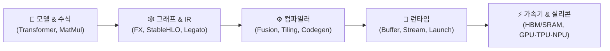

<div align="center">


# 🚀 Tensor2Silicon LAB (T2S Lab)
### **AI 모델에서 가속기 커널까지 — From Tensor to Silicon**

[](https://modulabs.co.kr/labs/811)
[](https://github.com/legato-user-group)
[-004EA2?style=for-the-badge)](https://www.iitp.kr)
[](./LICENSE)
[-success?style=for-the-badge)](https://modulabs.co.kr/labs/811)

<p align="center">
  <b>#Tensor</b> · <b>#Kernel</b> · <b>#AI_Accelerator</b> · <b>#Legato_IR</b> · <b>#Compiler</b> · <b>#Roofline</b> · <b>#Triton</b> · <b>#xPU</b>
</p>

</div>

---

## 📖 소개 (Overview)

**T2S Lab (Tensor-to-Silicon Lab)**은 [모두의연구소(ModuLabs)](https://modulabs.co.kr/labs/811)에서 진행하는 오픈 리서치 랩으로, **AI 모델의 텐서 연산 하나가 실제 하드웨어 가속기(GPU·TPU·NPU/LPU)에서 실행되기까지의 전 과정**을 함께 탐구하고 기록하는 연구·학습 모임입니다.

본 랩은 **과학기술정보통신부**와 **정보통신기획평가원(IITP)**의 지원을 받아 수행되는 **「AI반도체를 활용한 K-클라우드 기술개발 사업」**(*과제명: 지속적 AI반도체 성능 최적화를 위한 AI 생태계 적응형 시스템SW 기술 개발*)의 오픈소스 커뮤니티 활성화 및 개발자 생태계 확산 프로그램의 일환으로 운영됩니다.

PyTorch와 Transformer 등 상위 AI 모델에는 익숙하지만 컴파일러와 하드웨어 시스템은 처음인 개발자·연구자들이 모여, **모델·연산 그래프(IR)부터 컴파일러, 런타임, 커널, 그리고 칩 내부의 메모리 계층과 연산 장치까지** 기초부터 차근차근 연결합니다.

- 🧮 **정량적 계산 및 모델링**: 메모리 이동량, 산술 강도(Arithmetic Intensity), Tiling, Roofline Model을 손으로 직접 계산하고 검증합니다.
- 💻 **코드 실습 및 스택 비교**: PyTorch (`torch.compile`), JAX·OpenXLA, Modular MAX·Mojo, Triton 등 Python 기반 커널 DSL과 xPU별 프로그래밍 모델을 직접 실습하고 비교합니다.
- 📚 **공개 온라인 교재 집필**: 재현 가능한 실습 코드, 아키텍처 다이어그램, 연습문제와 해설을 담은 **오픈소스 온라인 교재(GitBook)**를 공동 집필합니다.
- 🌐 **Legato 오픈소스 생태계 기반 구축**: 국산 AI반도체 및 이기종 가속기를 위한 공개형 저수준 IR인 **Legato**의 설계 철학과 기술적 특징을 분석하고, 개발자들이 함께 배우고 기여할 수 있는 **Legato User Group**의 기반을 마련합니다.

---


## 🔄 T2S Lab 학습 아키텍처 흐름 (From Model to Silicon)

본 랩에서 8주간 단계별로 파헤치는 AI 실행 스택의 5대 계층 구조입니다.



| 계층 (Layer) | 핵심 질문 | 주요 입력 | 주요 출력 |
| :--- | :--- | :--- | :--- |
| **1. 모델·텐서 연산** | 무엇을 계산할까? | 모델 정의, 입력, 가중치 | 텐서 연산의 수학적 의미와 관계 |
| **2. 그래프·IR** | 기계가 분석하기 좋은 형태로 어떻게 표현할까? | 프로그램, `shape`, `dtype` | 연산 그래프 및 중간 표현 (IR) |
| **3. 컴파일러** | 이 계산을 대상 하드웨어에서 어떻게 실행할까? | IR, 타겟 하드웨어 명세 | 최적화된 실행 계획 및 커널 코드 |
| **4. 런타임** | 지금 어떤 데이터로 언제 실행할까? | 실행 가능한 바이너리, 버퍼 | 커널 디스패치, 비동기 스케줄링, 동기화 |
| **5. 칩 내부 (Silicon)** | 데이터를 어디서 가져와 어떤 유닛에서 계산할까? | 명령어, 메모리 주소, 데이터 | HBM↔SRAM 데이터 이동 및 연산 결과 |

---

## 🗓️ 커리큘럼 및 진행 현황 (Curriculum & Roadmap)

> **모임 기간**: 2026.09.15 ~ 2026.11.17 (매주 화요일 19:30 ~ 21:30 @ 모두의연구소 강남캠퍼스)

| 주차 | 주제 (Topic) | 핵심 질문 & 주요 내용 | 자료 링크 | 상태 |
| :---: | :--- | :--- | :---: | :---: |
| **Week 01** | **OT 및 목표 공유** | 랩 운영 방식, 공동 집필·검증 원칙 및 학습 로드맵 정렬 | - | ✅ 완료 |
| **Week 02** | **모델에서 실리콘까지** | 모델의 연산 하나가 가속기에서 실행되기까지 어떤 단계를 거치며, 각 단계는 무엇을 담당할까?<br/>*(PyTorch, JAX·OpenXLA, Modular MAX·Mojo, Triton 비교)* | [📁 `week02`](./week02) | ✅ 완료 |
| **Week 03** | **커널의 시간은 어디에서 소비되는가** | 같은 연산인데 왜 어떤 커널은 빠르고 어떤 커널은 느릴까? 계산 시간과 데이터 이동 시간을 어떻게 구분할까?<br/>*(FLOPs, 대역폭, HBM 메모리 계층, Vector Add, Kernel Fusion)* | [📁 `week03`](./week03) | ✅ 완료 |
| **Week 04** | **Roofline과 Tiling** | 같은 계산을 하면서 데이터를 덜 읽어오면 커널은 얼마나 빨라질 수 있을까?<br/>*(산술 강도 $I = F/Q$, Roofline 상한, Tiling과 온칩 메모리 재사용)* | [📁 `week04`](./week04) | ✅ 완료 |
| **Week 05** | **xPU를 어떻게 비교할 것인가** | GPU, TPU, NPU/LPU 등 서로 다른 가속기 아키텍처와 프로그래밍 모델을 어떤 기준으로 비교할까? | *예정* | 🔜 진행 예정 |
| **Week 06** | **Python에서 Triton 커널로** | Python 기반 커널 DSL(Triton)로 블록 단위 프로그래밍과 메모리 접근을 어떻게 제어할까? | *예정* | 🔜 진행 예정 |
| **Week 07** | **Tiled MatMul과 컴파일 과정** | Tiled Matrix Multiplication 커널 구현과 단계별 컴파일·최적화 파이프라인 해부 | *예정* | 🔜 진행 예정 |
| **Week 08** | **Legato는 무엇을 해결해야 하는가** | 기존 AI 실행 스택의 구조적 한계 정리 및 개방형 저수준 IR(**Legato**)이 해결해야 할 핵심 과제 분석 | *예정* | 🔜 진행 예정 |
| **Week 09** | **GitBook 정리 및 발간** | 8주간의 온라인 교재 원고, 실습 코드, 다이어그램 통합 및 공개 버전 배포 | *예정* | 🔜 진행 예정 |

---

## 📂 레포지토리 구조 및 주차별 아카이브 (Repository Structure)

```text
tensor2slicon-lab/
├── week02/                              # [2주차] 모델에서 실리콘까지 (AI 실행 스택 해부)
│   ├── yblee.md                         # PyTorch, JAX·OpenXLA, Modular MAX·Mojo 실행 스택 종합 교재
│   ├── injokim.html                     # 인터랙티브 학습 노트 & 시각화 자료
│   ├── torch-compile-anatomy-deck.html  # torch.compile 내부 구조 슬라이드 덱
│   ├── jaehyeong.md                     # 주차별 심화 리서치 및 정리
│   ├── junpark.md                       # 주차별 심화 리서치 및 정리
│   ├── mbsong-1.md / mbsong-2.md        # 주차별 심화 리서치 및 정리
│   └── singon.md                        # 주차별 심화 리서치 및 정리
├── week03/                              # [3주차] 커널의 시간은 어디에서 소비되는가 (연산 vs 메모리 병목)
│   ├── yblee.md                         # Vector Add로 이해하는 커널 실행시간과 메모리 계층
│   ├── injokim.md                       # 주차별 계산 실습 및 리서치 노트
│   ├── jaehyeong.md                     # 주차별 계산 실습 및 리서치 노트
│   ├── junpark.md                       # 주차별 계산 실습 및 리서치 노트
│   ├── mbsong.md                        # 주차별 계산 실습 및 리서치 노트
│   └── singon.md                        # 주차별 계산 실습 및 리서치 노트
├── week04/                              # [4주차] Roofline과 Tiling (데이터 재사용과 산술 강도)
│   ├── yblee.md                         # Roofline 모델 수식 유도 및 Tiled MatMul 데이터 이동 계산
│   ├── injokim.md                       # 주차별 계산 실습 및 리서치 노트
│   ├── jaehyeong.md                     # 주차별 계산 실습 및 리서치 노트
│   ├── junpark.md                       # 주차별 계산 실습 및 리서치 노트
│   ├── mbsong.md                        # 주차별 계산 실습 및 리서치 노트
│   └── singon.md                        # 주차별 계산 실습 및 리서치 노트
├── LICENSE                              # Apache License 2.0
└── README.md
```

---

## 🛠️ 운영 원칙 및 기여 방법 (Principles & Contribution)

T2S Lab은 단순 출석이 아닌 **모든 구성원의 직접 기여와 교차 검증**을 원칙으로 운영됩니다.

1. **핵심 질문 중심 학습 (Question-Driven Learning)**
   - 매주 하나의 핵심 질문을 정의하고, 개념 학습 → 손 계산 예제 → 코드 실습 → 공동 집필 및 리뷰 순서로 진행합니다.
2. **근거 기반 서술 (Fact-Checked Documentation)**
   - 모든 기술적 주장은 공식 문서, 아키텍처 백서, 학술 논문을 통해 교차 확인하며, **확인된 사실(Fact)**과 **해석·추론(Interpretation)**을 명확히 구분하여 기록합니다.
3. **재현성 검증 (Reproducibility First)**
   - 실습 코드와 수치 계산 예제는 작성자가 아닌 다른 연구원이 직접 다시 실행하여 동일한 결과가 재현되는지 검증합니다.
4. **초보자 눈높이 리뷰 (Beginner-Friendly Peer Review)**
   - 주제 조사, 실습 구현, 다이어그램 제작, 기술 검증, 초보자 관점의 가독성 리뷰 역할을 매주 순환하며 수행합니다.

---

## 👥 함께하는 사람들 (Members & Contributors)

### 🧭 랩장 (Lab Leader)
- **이영빈 (Youngbin Lee)** — [@yblee110](https://github.com/yblee110)
  - 🖥️ 모두의연구소 커뮤니티팀 팀장 (위탁연구개발기관 책임자) | 🏛️ JAX-KR 오거나이저 / Google AI GDE | 😎 GDG Incheon 오거나이저

### 🧑‍🔬 연구원 (Researchers)
| [@yblee110](https://github.com/yblee110) | [@Jake-Song](https://github.com/Jake-Song) | [@SinGonKim](https://github.com/SinGonKim) | [@currybab](https://github.com/currybab) | [@Kiminjo](https://github.com/Kiminjo) | [@eloqlo](https://github.com/eloqlo) |
| :---: | :---: | :---: | :---: | :---: | :---: |
|  |  |  |  |  |  |
| `yblee` | `mbsong` | `singon` | `junpark` | `injokim` | `jaehyeong` |

---

## 🏦 사사 (Acknowledgments)

본 프로젝트 및 결과물은 **과학기술정보통신부** 및 **정보통신기획평가원(IITP)**의 재원으로 **정보통신·방송 기술개발사업(AI반도체를 활용한 K-클라우드 기술개발 — AI반도체 데이터센터 컴퓨팅 SW)**의 지원을 받아 수행된 연구 결과입니다.

- **과제번호 (Project No.)**: `RS-2026-25521385`
- **연구개발과제명 (국문)**: 지속적 AI반도체 성능 최적화를 위한 AI 생태계 적응형 시스템SW 기술 개발
- **Project Title (EN)**: *Development of Adaptive System Software Technology for AI Ecosystems Enabling Continuous Performance Optimization of AI Semiconductors*
- **연구개발기간 (Period)**: 2026.04.01 ~ 2030.12.31
- **참여기관 (Consortium)**: ㈜하이퍼엑셀(주관), ㈜스퀴즈비츠(공동), 서울대학교 산학협력단(공동), 한국과학기술원(공동), 모두의연구소(위탁)

> *This work was supported by the Institute of Information & Communications Technology Planning & Evaluation (IITP) grant funded by the Korea government (MSIT) (No. RS-2026-25521385, Development of Adaptive System Software Technology for AI Ecosystems Enabling Continuous Performance Optimization of AI Semiconductors).*

---

## 📄 라이선스 (License)

이 레포지토리의 코드와 문서는 [Apache License 2.0](./LICENSE) 라이선스 하에 공개되어 있습니다.
