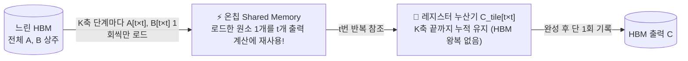

<WeekNavBar :chapter="3" topic="Roofline과 Tiling" :researchers="[{'id': 'mbsong', 'name': 'mbsong', 'label': 'mbsong (송무복)', 'badge': 'Roofline & 타일 크기별 분석'}, {'id': 'singon', 'name': 'singon', 'label': 'singon (김신곤)', 'badge': '4×4 & 4096×4096 완전 해설'}, {'id': 'junpark', 'name': 'junpark', 'label': 'junpark (박준)', 'badge': '2D Block Tiling 직관'}, {'id': 'injokim', 'name': 'injokim', 'label': 'injokim (김인조)', 'badge': '이론 유도 & 연습문제 풀이'}, {'id': 'jaehyeong', 'name': 'jaehyeong', 'label': 'jaehyeong (이재형)', 'badge': 'Roofline & Tiling 핵심 노트'}]" />

# [핵심 압축 교안] Roofline과 Tiling — 산술 강도와 온칩 데이터 재사용

  

    
    

      

        ⚡ <strong>15분 핵심 압축 교안 &amp; 손계산 연습 집필: 이영빈 (Youngbin Lee · <code>yblee</code>)</strong>
        Core Digest · Lead Author
      

      
전체 커리큘럼 설계 및 심화 본문·핵심 압축 교안·연습문제 집필

    

  

  <a class="t2s-author-gh-btn" href="https://github.com/yblee110" target="_blank" rel="noopener">GitHub @yblee110 ↗</a>

  

    ⚡ CORE DIGEST · 15분 핵심 압축 교안
    압축률: 심화 본문 1,434줄 → 핵심 315줄 요약
  

  

    이 문서는 <strong>Chapter 03 전체의 핵심 수식(산술 강도와 Roofline 상한)·2D 타일 재사용 원리·4096 행렬곱 손계산·온칩 메모리 한계와 BK 분할·연습문제</strong>를 15분 분량으로 정밀 압축한 핵심 교안입니다. 상세 도식이나 유도 과정이 필요할 때는 각 절의 <strong>심화 본문 바로가기</strong>를 눌러 이동하세요.
  

  

    💡 <strong>챕터 핵심 질문:</strong> 같은 계산을 하면서 데이터를 덜 읽어오면, 커널은 얼마나 빨라질 수 있을까?
    <a class="t2s-author-gh-btn" href="./">📘 1~17절 전체 심화 본문 열기 →</a>
  

---

## 1. 큰 그림과 필수 수식: 산술 강도($I$)와 Roofline 모델

> 📖 심화 학습 연결: [📘 심화 본문 3~4절(산술 강도와 Roofline 식) →](/ch03/#3-arithmetic-intensity-이동한-데이터로-얼마나-계산할까) · [📘 심화 본문 5절(Roofline 그래프 읽기) →](/ch03/#5-roofline-그래프-읽기)

2장에서 배운 두 시간 모델 $T_{\text{ideal} } = \max(F/P,\; Q/\text{BW})$의 역수를 취해 **초당 달성 가능한 연산 처리율 상한 $R = F / T_{\text{ideal} }$** 로 정리하면, 하드웨어 스펙(`P`, `BW`)과 작업 특성(`I`)을 단 하나의 그래프로 통합하는 **Roofline 모델**이 탄생합니다.

1. **산술 강도 (Arithmetic Intensity, `I`)** — *HBM에서 옮긴 1 Byte당 수행하는 연산 횟수*:
   $$I = \frac{F}{Q} \quad [\text{FLOP/Byte}]$$
2. **Roofline 성능 상한 (`R_max`)**:
   $$R_{\text{max} }(I) = \frac{F}{\max(F/P,\; Q/\text{BW})} = \min\!\left(P,\; \text{BW} \times I\right)$$
3. **하드웨어 분기점 (Ridge Point, `I*`)** — *경사면과 수평 지붕이 만나는 경계*:
   $$I^* = \frac{P}{\text{BW} } \quad \begin{cases} I < I^* & \Rightarrow \text{대역폭 병목 (경사면: } R = \text{BW} \times I\text{)} \\ I \ge I^* & \Rightarrow \text{연산 병목 (수평 지붕: } R = P\text{)} \end{cases}$$

- **핵심 직관**: 하드웨어를 바꾸지 않더라도, 커널 구현에서 **온칩 데이터 재사용(Tiling)** 으로 분모 `Q`(HBM 이동량)를 줄이면 **산술 강도 `I`가 오른쪽으로 이동**하여 대역폭 경사면을 타고 올라가 피크 연산 지붕(`P`)에 도달할 수 있습니다!

---

## 2. Tiling의 원리: 무엇을 나누고 무엇을 유지하는가?

> 📖 심화 학습 연결: [📘 심화 본문 6절(Tiling 원리) →](/ch03/#6-tiling은-무엇을-나누고-무엇을-유지할까) · [📘 심화 본문 7절(4×4 행렬곱 추적) →](/ch03/#7-계산-예제-1-44-행렬곱에서-읽기와-쓰기-세기)

행렬곱 $C = A \times B$ (`[N, N] @ [N, N]`)의 총 연산량 $F = 2N^3$은 어떤 알고리즘 순서로 묶어도 단 1 FLOP도 변하지 않습니다. **Tiling**은 출력 행렬 `C`를 `t × t` 작은 타일로 쪼갠 뒤, **한 출력 타일을 완성할 때까지 필요한 `A`와 `B`의 작은 타일 조각들을 빠른 온칩 메모리(Shared Memory)에 올려두고 `t`번씩 재사용**하는 기법입니다.

- **재사용 없을 때(Naive)**: `C`의 원소 $N^2$개마다 길이 $N$인 행·열을 HBM에서 매번 다시 읽음 $\rightarrow Q_{\text{read} } = 2N^3 \times 4 = 8N^3\text{ Byte}$ ($I \approx 0.25\text{ FLOP/B}$, 극심한 대역폭 병목)
- **`t × t` 정사각 타일링 적용 시** *(타일 간 캐시 공유 미포함 보수적 모델)*:
  - 출력 타일 총개수 $= (N/t)^2$개
  - 출력 타일 1개가 K축 전체를 돌며 읽는 양 $= (t \times N + N \times t) \times 4 = 8tN\text{ Byte}$
  - **전체 HBM 입력 읽기량**: $\displaystyle Q_{\text{read} }(t) = \left(\frac{N}{t}\right)^2 \times 8tN = \mathbf{\frac{8N^3}{t}\text{ Byte} }$ 👉 **타일 한 변 `t`에 정확히 반비례(`1/t` 감소)!**

---

## 3. 대표 손계산 워크스루: `4096 × 4096` FP32 행렬곱

> 📖 심화 학습 연결: [📘 심화 본문 8절(4096 행렬곱 성능 상한) →](/ch03/#8-계산-예제-2-40964096-행렬곱의-성능-상한) · [📘 심화 본문 9절(재사용 가정 비교) →](/ch03/#9-재사용-가정이-달라지면-산술-강도도-달라진다)

- **공통 조건**: $N = 4096$, `FP32`(`4 Byte`), 가상 GPU **`P = 20 TFLOPs/s`**, **`BW = 1 TB/s`** $\implies$ **분기점 $I^* = 20\text{ FLOP/Byte}$**
- **고정 연산량 & 연산 시간**: $F = 2 \times 4096^3 \approx 1.3744 \times 10^{11}\text{ FLOPs}$, $\;T_{\text{compute} } = F / P = \mathbf{6.872\text{ ms} }$
- **고정 출력 쓰기량**: $Q_{\text{write} } = 4096^2 \times 4\text{ Byte} = 67,108,864\text{ Byte} \approx 0.0671\text{ GB}$ (`64 MiB`)

| 타일 크기 (`t`) | 입력 읽기 $Q_{\text{read} } = 8N^3/t$ | 총 이동량 $Q = Q_{\text{read} } + Q_{\text{write} }$ | 산술 강도 $I = F/Q$ | 상한 처리율 $R_{\text{max} }$ | 이상적 시간 $T_{\text{ideal} }$ | 병목 판정 |
| :---: | :---: | :---: | :---: | :---: | :---: | :---: |
| **재사용 없음** | `549.76 GB` (`512 GiB`) | `549.82 GB` | `0.25` | `0.25 TFLOPs/s` | `549.82 ms` | 🚧 대역폭 병목 |
| **`t = 32`** | `17.18 GB` (`16 GiB`) | `17.25 GB` | `7.97` | `7.97 TFLOPs/s` | `17.25 ms` | 🚧 대역폭 병목 |
| **`t = 64`** | `8.59 GB` (`8 GiB`) | `8.66 GB` | `15.88` | `15.88 TFLOPs/s` | `8.66 ms` | 🚧 대역폭 병목 |
| **`t = 128`** | **`4.29 GB` (`4 GiB`)** | **`4.36 GB`** | **`31.51`** ($\ge 20$) | **`20.0 TFLOPs/s`** | **`6.872 ms`** | ⚡ **연산 병목 도달!** |

- **결정적 해석**: `t = 32 → 64 → 128`로 키울수록 `Q`가 절반씩 줄어 속도가 가파르게 빨라지다가, **`t = 128`에서 $I = 31.51 \ge 20$이 되어 연산 지붕(`6.872 ms`)에 도달**합니다. 따라서 이 하드웨어에서는 `t = 256`으로 더 키워도 이상적 시간은 `6.872 ms` 아래로 내려가지 않습니다!

---

## 4. 왜 타일을 무한정 크게 잡을 수 없는가? (`BM×BN` vs `BK` 분리)

> 📖 심화 학습 연결: [📘 심화 본문 10절(큰 타일의 비용) →](/ch03/#10-큰-타일의-저장-공간과-병렬성-비용) · [📘 심화 본문 11절(출력 타일과 K 폭 분리) →](/ch03/#11-출력-타일과-k-방향-폭을-나누어-보기)

실제 GPU 커널에서는 정사각 `t × t × t` 대신 **출력 타일(`BM × BN`)** 과 **한 단계의 K축 누적 폭(`BK`)** 을 독립된 숫자로 쪼개서 설계합니다.

| 제한 요인 / 설계 축 | 하드웨어에서 일어나는 일 | 실전 커널 설계 원칙 |
| :--- | :--- | :--- |
| **① 온칩 메모리 용량 한계** | 타일이 커지면 Shared Memory 입력 버퍼(`A[BM×BK] + B[BK×BN]`)와 레지스터 누산기(`C[BM×BN]`)가 SM 한도를 초과하거나 느린 HBM으로 **레지스터 스필(Spill)** 발생 | 출력 타일(`BM×BN`)은 크게 유지해 **산술 강도 `I`를 확보**하되, **`BK` 폭을 `16·32·64` 등으로 줄여** 1단계 Shared Memory 요구량을 한도 안에 맞춥니다! |
| **② SM 병렬성(Occupancy) 저하** | 타일이 너무 크면 전체 블록 수 `(M/BM) × (N/BN)`가 줄어 일부 SM이 놀거나, 블록당 자원 점유가 커져 지연을 숨길 동시 실행 워프 수가 감소 | 행렬 크기(`M, N`)가 작을 때는 오히려 작은 타일(`32×32`, `64×64`)이 SM 전체에 일감을 고르게 분배해 더 빠릅니다. |

- **일반 직사각 타일(`BM × BN × BK`, 원소당 $b$ Byte) 핵심 공식 요약**:
  - **1단계 A+B 온칩 입력 버퍼 크기**: $S_{\text{1stage} } = (BM \times BK + BK \times BN) \times b\;\text{ [Byte]}$ *(👉 **`BK`에 비례!**)*
  - **타일 간 캐시 미포함 이상적 HBM 입력 읽기량**: $\displaystyle Q_{\text{read} } = MNK \cdot b \cdot \left(\frac{1}{BM} + \frac{1}{BN}\right)$ *(👉 **`BK`와 무관, 오직 `BM, BN`이 결정!**)*

---

## 5. 자주 빠지는 오개념 Top 5

> 📖 심화 학습 연결: [📘 심화 본문 13절(자주 생기는 오해와 그래프 점검) →](/ch03/#13-자주-생기는-오해와-그래프-점검)

| 흔한 오해 (❌) | 정확한 실체 (✅) |
| :--- | :--- |
| **“산술 강도 `I`는 수식(행렬곱)이 정해지면 고정된 상수다”** | 같은 행렬곱이라도 재사용 없는 커널(`I ≈ 0.25`)과 `128×128` 타일 커널(`I ≈ 31.5`), L2 캐시 적중까지 포함한 실측 `I`는 모두 다릅니다. **분모 `Q`의 관찰 경계**를 항상 명시해야 합니다! |
| **“Roofline 선 위에 점이 찍히면 무조건 그 성능이 그대로 나온다”** | Roofline은 **절대 넘을 수 없는 상한선(Ceiling)** 입니다. 분기 발산, 뱅크 충돌, 동기화 대기 등이 있으면 실제 커널 점은 지붕 훨씬 아래에 찍힙니다. |
| **“대역폭 병목(`I < I*`) 커널도 피크 연산(`P`)이 2배인 GPU로 바꾸면 빨라진다”** | $I < I^*$ 구간에서는 $R = \text{BW} \times I$이므로 `BW`나 `I`가 그대로면 수평 지붕(`P`)만 높아질 뿐 성능 상한은 1%도 오르지 않습니다. |
| **“`BK`를 32에서 64로 2배 키우면 HBM 총 읽기량도 절반으로 줄어든다”** | K 루프 횟수는 절반이 되지만 한 번에 읽는 폭이 2배가 되어 블록당 총 읽는 면적(`BM×K + K×BN`)은 동일합니다. `BK`는 **온칩 버퍼 크기와 파이프라인 입도**를 바꿉니다. |
| **“Shared Memory 한도만 통과하면 무조건 제일 큰 타일이 가장 빠르다”** | 블록당 레지스터 압박이나 낮은 SM 점유율(Occupancy) 때문에 중간 크기 타일(`128×128` 등)이 `256×256`보다 실제 실측에서 더 빠른 경우가 흔합니다. |

---

## 6. 단원 핵심 자가 점검 연습문제 (3문항)

> 📖 원문 문제 & 상세 풀이: [📘 심화 본문 14~15절 →](/ch03/#14-연습문제-3개) *(공통 조건: `P = 20 TFLOPs/s`, `BW = 1 TB/s`, FP32 = `4 Byte`)*

1. **하드웨어 변화와 Roofline 이동**: 연산량 `F = 10¹² FLOPs`, HBM 이동량 `Q = 100 GB`인 커널이 있습니다. ① 현재 산술 강도 `I`, 성능 상한 `R`, 이상적 시간 `T_ideal`을 구하고, ② `P`만 `40 TFLOPs/s`로 2배 늘릴 때와 ③ `BW`만 `2 TB/s`로 2배 늘릴 때 `T_ideal`과 분기점 `I*`가 각각 어떻게 바뀌는지 비교하세요.
2. **온칩 입력 버퍼 한도 판정**: 3절의 `4096×4096` FP32 정사각 타일(`BK = t`) 후보 `t = 32, 64, 128` 가운데, 1단계 `A + B` 입력 타일 버퍼 합계 한도가 **`96 KiB`**(`98,304 Byte`) 이하인 가장 큰 후보를 고르고 그때의 이상적 실행 시간을 구하세요.
3. **`BM×BN` 고정 시 `BK` 변경 효과**: `N = 4096`, FP32에서 출력 타일을 **`64 × 64`로 고정**한 채 `BK = 32`와 `BK = 64` 두 설정을 비교합니다. ① K축 루프 단계 수, ② 1단계 `A + B` 입력 버퍼 크기(`KiB`), ③ 전체 HBM 이동량 `Q`와 산술 강도 `I`가 각각 어떻게 달라지는지 구하세요.

## 해답과 해설

💡 연습문제 해답 및 상세 풀이 펼치기 (스스로 먼저 풀어본 뒤 클릭하세요)

1. **문제 1 해답**
   - **① 기본 조건**: $I = 10^{12} / 10^{11} = \mathbf{10\text{ FLOP/Byte} }$ ($< I^* = 20$, 대역폭 병목). $R = \min(20,\; 1 \times 10) = \mathbf{10\text{ TFLOPs/s} }$, $\;T_{\text{ideal} } = \mathbf{100\text{ ms} }$.
   - **② `P`만 2배(`40 TFLOPs/s`)**: 분기점이 $I^* = 40$으로 오른쪽 이동하지만 여전히 대역폭 경사면에 걸려 $R = 10\text{ TFLOPs/s}$, **$T_{\text{ideal} } = 100\text{ ms}$ (변화 없음)**.
   - **③ `BW`만 2배(`2 TB/s`)**: 분기점이 $I^* = 20 / 2 = 10$으로 왼쪽 이동하여 정확히 분기점에 도달! $R = \min(20,\; 2 \times 10) = \mathbf{20\text{ TFLOPs/s} }$, **$T_{\text{ideal} } = 50\text{ ms}$ (2배 가속!)**.

2. **문제 2 해답**
   - 1단계 `A[t×t] + B[t×t]` 버퍼 크기 $= 2 \times t^2 \times 4\text{ Byte} = 8t^2\text{ Byte}$:
     - `t = 32`: $8 \times 1024 = \mathbf{8\text{ KiB} }$ (통과)
     - `t = 64`: $8 \times 4096 = \mathbf{32\text{ KiB} }$ (통과 ✅)
     - `t = 128`: $8 \times 16384 = \mathbf{128\text{ KiB} } > 96\text{ KiB}$ (한도 초과 ❌)
   - 따라서 통과하는 가장 큰 정사각 후보는 **`t = 64`** 이며, 이상적 실행 시간은 **`8.66 ms`** 입니다. (만약 `128×128` 출력 타일을 유지하면서 `BK = 32`로 분리하면 버퍼가 $2 \times 128 \times 32 \times 4 = 32\text{ KiB} \le 96\text{ KiB}$가 되어 `6.872 ms` 달성이 가능해집니다!)

3. **문제 3 해답**
   - **① K축 단계 수 (`N / BK`)**: `BK = 32`일 때 **`128단계`**, `BK = 64`일 때 **`64단계`**.
   - **② 1단계 A+B 입력 버퍼**: `BK = 32`일 때 $2 \times (64 \times 32) \times 4 = \mathbf{16\text{ KiB} }$, `BK = 64`일 때 $\mathbf{32\text{ KiB} }$ (2배 증가; 레지스터 누산기는 둘 다 $64 \times 64 \times 4 = 16\text{ KiB}$로 동일).
   - **③ HBM 총 이동량과 산술 강도**: 출력 타일(`64×64`)이 같으므로 두 경우 모두 **$Q \approx 8.66\text{ GB}$, $I \approx 15.88\text{ FLOP/Byte}$, $T_{\text{ideal} } \approx 8.66\text{ ms}$로 완전히 동일**합니다!

