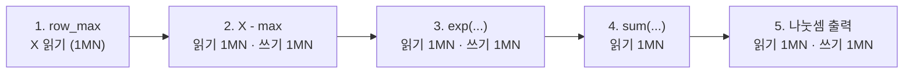

<WeekNavBar :chapter="5" topic="Python에서 Triton 커널로" :researchers="[{'id': 'mbsong', 'name': 'mbsong', 'label': 'mbsong (송무복)', 'badge': 'Vector Add & Fused Softmax'}, {'id': 'singon', 'name': 'singon', 'label': 'singon (김신곤)', 'badge': 'RTX 4070 실측 & 벤치마크'}, {'id': 'junpark', 'name': 'junpark', 'label': 'junpark (박준)', 'badge': 'Online Softmax & IR 분석'}, {'id': 'kiminjo', 'name': 'injokim', 'label': 'injokim (김인조)', 'badge': '블록 포인터 & 마스킹 정밀 해부'}, {'id': 'jaehyeong', 'name': 'jaehyeong', 'label': 'jaehyeong (이재형)', 'badge': 'Triton 프로그래밍 핵심 요약'}]" />

# [핵심 압축 교안] Python에서 Triton 커널로 — 블록 프로그래밍과 Fused Softmax

<div class="t2s-author-byline">
  <div class="t2s-author-byline-main">
    
    <div class="t2s-author-meta">
      <div class="t2s-author-title-row">
        <span>⚡ <strong>15분 핵심 압축 교안 &amp; 손계산 연습 집필: 이영빈 (Youngbin Lee · <code>yblee</code>)</strong></span>
        <span class="t2s-author-role-badge">Core Digest · Lead Author</span>
      </div>
      <div class="t2s-author-affil">전체 커리큘럼 설계 및 심화 본문·핵심 압축 교안·연습문제 집필</div>
    </div>
  </div>
  <a class="t2s-author-gh-btn" href="https://github.com/yblee110" target="_blank" rel="noopener">GitHub @yblee110 ↗</a>
</div>


<div class="t2s-digest-banner">
  <div class="t2s-digest-banner-top">
    <span class="t2s-digest-eyebrow">⚡ CORE DIGEST · 15분 핵심 압축 교안</span>
    <span class="t2s-digest-stats">압축률: 심화 본문 2,142줄 → 핵심 315줄 요약</span>
  </div>
  <p>
    이 문서는 <strong>Chapter 05 전체의 핵심 알맹이(CUDA 스레드 vs Triton 블록 모델, 포인터 벡터와 마스킹, Fused Softmax 4배 가속 손계산, <code>-inf</code> 패딩 원리, 실효 대역폭 측정법)</strong>를 15분 분량으로 정밀 압축한 핵심 교안입니다. 전체 튜토리얼 코드와 단계별 추적표는 각 절의 <strong>심화 본문 바로가기</strong>를 눌러 확인하세요.
  </p>
  <div class="t2s-digest-jump-row">
    <span>💡 <strong>챕터 핵심 질문:</strong> Python 기반 커널 DSL(Triton)은 어떻게 블록 단위로 메모리를 제어하며, 여러 연산을 묶으면 왜 빨라질까?</span>
    <a class="t2s-author-gh-btn" href="./">📘 1~16절 전체 심화 본문 열기 →</a>
  </div>
</div>

---

## 1. 패러다임 전환: 스레드가 아니라 ‘블록(Tile)’으로 생각하기

> 📖 심화 학습 연결: [📘 심화 본문 3절(블록 단위 프로그래밍 모델) →](/ch05/#3-블록-단위-프로그래밍-모델-스레드가-아니라-블록으로-생각하기) · [📘 심화 본문 4절(포인터 연산과 마스킹) →](/ch05/#4-포인터-연산과-마스킹-나누어떨어지지-않는-마지막-블록)

전통적인 CUDA가 개별 스레드 하나(`threadIdx.x`)가 스칼라 원소 하나를 집어 오는 방식이라면, **Triton**은 **프로그램 인스턴스 하나(`tl.program_id`)가 길이 `BLOCK_SIZE`인 벡터/타일 블록 전체를 한꺼번에 다루는 모델(`Blocked Program, Scalar Threads`)** 입니다.

| 비교 항목 | CUDA 프로그래밍 모델 | Triton 프로그래밍 모델 (`@triton.jit`) |
| :--- | :--- | :--- |
| **프로그래머가 짜는 단위** | 개별 스레드 (`tid = blockIdx.x * blockDim.x + threadIdx.x`) | **프로그램 인스턴스 블록** (`pid = tl.program_id(0)`) |
| **인덱스 변수의 형태** | 단일 정수 스칼라 (`int tid`) | **1D/2D 오프셋 벡터** (`offsets = pid * BLOCK + tl.arange(0, BLOCK)`) |
| **경계 밖 보호 방식** | 스레드별 분기문 (`if (tid < N)`) | **벡터 마스크 전달** (`tl.load(ptrs, mask=offsets < N, other=...)`) |
| **스레드·메모리 최적화** | 워프 분할, Shared Memory 배치, Coalescing을 수동 구현 | **Triton 컴파일러 백엔드가 자동 수행** (`BLOCK_SIZE`는 2의 거듭제곱 상수) |

<div class="t2s-formula-card">

- **1차원 블록 인덱싱 3줄 공식** (전체 원소 수 `N`, 블록 크기 `BLOCK_SIZE: tl.constexpr`):
  1. **실행 그리드 개수**: $\text{grid} = \left(\lceil N / \text{BLOCK\_SIZE} \rceil,\right) =$ `(triton.cdiv(N, BLOCK_SIZE),)`
  2. **오프셋 벡터 생성**: `offsets = pid * BLOCK_SIZE + tl.arange(0, BLOCK_SIZE)`
  3. **경계 마스크**: `mask = offsets < N` *(마지막 블록에서 `N`을 넘어가는 슬롯의 불법 메모리 접근 차단)*

</div>

---

## 2. 왜 Vector Add는 비슷하고 Softmax는 4배 빨라지는가?

> 📖 심화 학습 연결: [📘 심화 본문 5절(Vector Add 비교) →](/ch05/#5-vector-add는-왜-pytorch와-속도가-비슷할까) · [📘 심화 본문 6절(Fused Softmax 데이터 이동) →](/ch05/#6-커널-결합과-hbm-왕복-softmax에서-차이가-커지는-이유)

- **단일 Vector Add (`Z = X + Y`)**: PyTorch 기본 `x + y`든 Triton `add_kernel`이든 제거할 중간 텐서가 전혀 없습니다. 둘 다 필수 이동량인 **`X` 읽기(`1N`) + `Y` 읽기(`1N`) + `Z` 쓰기(`1N`) = `3N` 원소**만 HBM과 주고받으므로 속도가 거의 동일합니다.
- **행 단위 Softmax (`[M, N]` 행렬)**: 수치 안정성을 포함한 $\text{Softmax}(x_i) = \frac{e^{x_i - m} }{\sum_j e^{x_j - m} }$ ($m = \max_j x_j$)는 **5단계 연산**으로 이루어져 있어 분리 실행과 결합 실행의 격차가 극적으로 벌어집니다!

**① ❌ PyTorch 기본 분리 실행 (`naive_softmax`) — 주요 큰 텐서 기준 총 `8MN` 원소 HBM 이동!**



**② ✅ Triton 단일 결합 커널 (`softmax_kernel`) — 총 `2MN` 원소 HBM 이동 (`4배` 절감!)**


| 실행 경로 (`[M, N]` FP32 행렬) | HBM 읽기 원소 | HBM 쓰기 원소 | 총 HBM 이동 바이트 `Q` | 이론적 대역폭 속도비 |
| :--- | :---: | :---: | :---: | :---: |
| **`naive_softmax` (5개 커널 분리)** | `5 MN` | `3 MN` *(+ 작은 축약 `2M`)* | **약 `32 MN Byte`** | `1.0x` (기준) |
| **Triton Fused Softmax (단일 커널)** | **`1 MN`** | **`1 MN`** | **`8 MN Byte`** | **약 `4.0x` 가속!** |

---

## 3. 핵심 코드 해부: 행 단위 리덕션과 `-inf` 패딩의 비밀

> 📖 심화 학습 연결: [📘 심화 본문 7절(행 단위 리덕션과 패딩값) →](/ch05/#7-행-단위-리덕션과-패딩값-한-행을-블록-하나에-담기) · [📘 심화 본문 8절(블록 인덱싱 공동 활동) →](/ch05/#8-공동-활동-블록-인덱싱과-fused-softmax의-데이터-이동-비교)

2차원 행렬 `[M, N]`에서 프로그램 인스턴스 하나(`row_idx = tl.program_id(0)`)가 **한 행 전체**를 맡도록 하려면 `BLOCK_SIZE = triton.next_power_of_2(N)`으로 잡습니다(예: `N = 781`이면 `BLOCK_SIZE = 1024`, 남는 `243`칸은 패딩).

```python
@triton.jit
def softmax_kernel(output_ptr, input_ptr, input_row_stride, output_row_stride, n_cols, BLOCK_SIZE: tl.constexpr):
    row_idx = tl.program_id(0)                                          # 1) 이 인스턴스가 담당할 행 번호 (0 ~ M-1)
    row_start_ptr = input_ptr + row_idx * input_row_stride              # 2) 해당 행의 시작 메모리 주소
    col_offsets = tl.arange(0, BLOCK_SIZE)                              # 3) [0, 1, ..., BLOCK_SIZE - 1] 열 벡터
    mask = col_offsets < n_cols                                         # 4) 유효 열(0 ~ n_cols-1) 마스크

    # ★ 핵심 포인트: 빈자리(other)를 0.0이 아니라 반드시 -inf로 채워야 함!
    row = tl.load(row_start_ptr + col_offsets, mask=mask, other=-float('inf'))
    row_minus_max = row - tl.max(row, axis=0)                           # 5) 온칩 최댓값 리덕션 (수치 오버플로우 방지)
    numerator = tl.exp(row_minus_max)                                   # 6) 패딩 구간은 exp(-inf) = 0.0 이 됨!
    denominator = tl.sum(numerator, axis=0)                             # 7) 분모 합산 시 패딩 구간은 0이라 영향 없음!
    softmax_output = numerator / denominator
    tl.store(output_ptr + row_idx * output_row_stride + col_offsets, softmax_output, mask=mask)
```

::: warning 🚨 왜 패딩 기본값(`other`)에 `0.0`을 넣으면 치명적인 버그가 터질까?
만약 유효 원소가 모두 음수인 행(예: `[-5.0, -2.0, -8.0]`)에 `other = 0.0`을 넣으면:
1. `tl.max`가 진짜 최댓값(`-2.0`) 대신 패딩된 **`0.0`을 최댓값으로 잘못 선택**하고,
2. `tl.exp(0.0 - 0.0) = 1.0`이 되어 **빈자리 개수만큼 분모 합(`denominator`)에 `1.0`씩 가짜 값이 더해져** 모든 확률 결과가 완전히 망가집니다!
반면 **`other = -float('inf')`** 는 어떤 실수보다 작아 `max`를 오염시키지 않으며, $\exp(-\infty) = 0$이 되어 `sum`에서도 완벽히 투명하게 사라집니다.
:::

---

## 4. 정확도 검증과 실효 대역폭(`GB/s`) 벤치마크

> 📖 심화 학습 연결: [📘 심화 본문 9절(정확도 검증과 벤치마크) →](/ch05/#9-정확도-검증과-벤치마크-무엇을-확인하고-어느-시간을-잴까)

1. **비정렬 크기(`1823 × 781`) 정확도 검증 먼저!**: `1024 × 1024`처럼 딱 떨어지는 크기만 테스트하면 `mask`나 `stride` 버그가 숨겨집니다. 반드시 2의 거듭제곱이 아닌 행·열 크기로 `torch.allclose(y_triton, y_torch, atol=1e-2, rtol=0)`를 먼저 통과시킵니다.
2. **워밍업과 동기화가 내장된 `triton.testing.do_bench(fn)` 사용**: 첫 호출의 `@triton.jit` 컴파일 시간을 자동 분리(`warmup`)하고 GPU 이벤트 타이머로 순수 커널 반복 실행 중앙값을 측정합니다.
3. **실효 대역폭(`Effective Bandwidth`) 환산 공식**:
   $$\text{Effective BW (GB/s)} = \frac{2 \times M \times N \times \text{element\_bytes} }{t_{\text{ms} } \times 10^{-3} \times 10^9}$$
   *(주의: 분자에는 패딩된 `BLOCK_SIZE`가 아니라 **알고리즘상 꼭 필요한 유효 원소 수 `2MN`** 을 넣어야 분리 실행·PyTorch 내장 커널과 공정한 비교가 됩니다!)*

---

## 5. 자주 빠지는 오개념 Top 5

> 📖 심화 학습 연결: [📘 심화 본문 12절(자주 생기는 오해와 측정 점검) →](/ch05/#12-자주-생기는-오해와-측정-점검)

| 흔한 오해 (❌) | 정확한 실체 (✅) |
| :--- | :--- |
| **“`BLOCK_SIZE = 1024`는 GPU 스레드 1,024개를 뜻한다”** | `BLOCK_SIZE`는 **데이터 원소 개수**입니다! 실제 스레드 수는 `num_warps × 32`(예: `4 warps = 128 스레드`)로 결정되며 스레드 하나가 여러 원소를 분담합니다. |
| **“`BLOCK_SIZE = 1000`처럼 아무 숫자나 넣어도 된다”** | `tl.arange(0, BLOCK_SIZE)`는 `BLOCK_SIZE`가 **2의 거듭제곱(`128, 256, 512, 1024...`)인 컴파일 상수(`tl.constexpr`)** 여야 컴파일됩니다. |
| **“마스크로 가려진 패딩 칸도 HBM 바이트 `Q`에 다 포함해 대역폭을 계산한다”** | 유효 대역폭(`GB/s`)의 분자는 항상 **논리적으로 꼭 필요한 유효 입출력 바이트(`2MN × bytes`)** 기준으로 통일해야 공정합니다. |
| **“행 길이 `N`이 100만 개여도 한 블록에 다 넣으면 된다”** | 한 행 전체를 온칩 SRAM에 올리는 단일 블록 구조는 SM당 Shared Memory/레지스터 한계(보통 수만 원소 이내)를 넘으면 `OutOfResources`가 나며, 긴 행은 타일 순회 **Online Softmax**로 확장해야 합니다. |
| **“커널 안에서 Python `if`문으로 원소별 분기를 짜면 된다”** | 벡터 블록의 원소별 조건 처리는 Python 스칼라 `if`가 아니라 `mask`와 `tl.where(cond, a, b)`로 작성해야 합니다. |

---

## 6. 단원 핵심 자가 점검 연습문제 (3문항)

> 📖 원문 문제 & 상세 풀이: [📘 심화 본문 13~14절 →](/ch05/#13-연습문제-3개)

1. **블록 인덱싱 손계산 (`n_elements = 98,432`)**: 길이 `98,432`인 FP32 벡터를 `BLOCK_SIZE = 1024`로 처리할 때 ① `grid` 크기, ② 마지막 인스턴스(`pid = grid - 1`)에서 유효 원소 개수와 마스킹으로 가려지는 빈자리 개수를 구하세요.
2. **비정렬 행렬(`1823 × 781`) Softmax 이동량**: `M = 1823, N = 781` FP32(`4B`) 행렬에 대해 ① `BLOCK_SIZE = next_power_of_2(781)`과 행당 패딩 슬롯 수, ② `naive_softmax`(`8MN` 기준)와 결합 커널(`2MN`)의 논리적 HBM 이동량(`MB`, $10^6$ 기준)을 구하세요.
3. **실효 대역폭 계산**: `M = 4096, N = 1024` FP32(`4B`) Softmax를 측정했더니 `naive_softmax`는 `0.200 ms`, Triton 결합 커널은 `0.050 ms`가 나왔습니다. 알고리즘 유효 입출력(`2MN × 4 Byte`) 기준으로 두 구현의 실효 처리 대역폭(`GB/s`)을 각각 구하세요.

## 해답과 해설

<details class="t2s-solution-toggle">
<summary>💡 연습문제 해답 및 상세 풀이 펼치기 (스스로 먼저 풀어본 뒤 클릭하세요)</summary>

1. **문제 1 해답**
   - $98,432 = 96 \times 1024 + 128$이므로 ① **`grid = (97,)`** (`pid = 0 ~ 96`).
   - ② 마지막 인스턴스(`pid = 96`)는 오프셋 `98,304 ~ 99,327`을 가리키며, 이 중 **`128개`만 유효(`mask=True`)** 하고 나머지 **`896개`는 마스킹(`mask=False`)** 됩니다.

2. **문제 2 해답**
   - ① $512 < 781 \le 1024$이므로 **`BLOCK_SIZE = 1024`**, 행당 패딩 빈자리는 $1024 - 781 = \mathbf{243\text{개} }$입니다.
   - ② 유효 원소 수 $MN = 1823 \times 781 = 1,423,763\text{개}$:
     - **결합 커널 (`2MN × 4B`)**: $2 \times 1,423,763 \times 4 = 11,390,104\text{ Byte} \approx \mathbf{11.39\text{ MB} }$
     - **`naive_softmax` (`8MN × 4B` 주요 텐서 기준)**: $8 \times 1,423,763 \times 4 = 45,560,416\text{ Byte} \approx \mathbf{45.56\text{ MB} }$ *(최댓값·합계 `2M` 벡터까지 포함 시 약 `45.58 MB`)*

3. **문제 3 해답**
   - 알고리즘 최소 필수 입출력 바이트 $= 2 \times 4096 \times 1024 \times 4\text{ Byte} = 33,554,432\text{ Byte} \approx 0.03355\text{ GB}$:
     - **Triton 결합 커널 (`0.050 ms`)**: $0.033554432\text{ GB} \div (0.050 \times 10^{-3}\text{ s}) \approx \mathbf{671.1\text{ GB/s} }$
     - **`naive_softmax` (`0.200 ms`)**: 같은 최종 문제를 끝내는 유효 처리 대역폭 기준 $0.033554432 \div (0.200 \times 10^{-3}) \approx \mathbf{167.8\text{ GB/s} }$ *(물리적으로는 HBM을 4배 왕복하느라 시간을 소비함!)*

</details>
