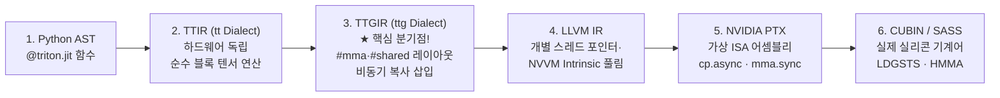

<WeekNavBar :chapter="6" topic="Tiled MatMul과 컴파일 과정" :researchers="[{'id': 'mbsong', 'name': 'mbsong', 'label': 'mbsong (송무복)', 'badge': 'NVIDIA A100 IR·SASS 실측'}, {'id': 'junpark', 'name': 'junpark', 'label': 'junpark (박준)', 'badge': 'RTX 5090 (sm_120) 실측 해부'}, {'id': 'singon', 'name': 'singon', 'label': 'singon (김신곤)', 'badge': 'L2 그룹핑 손계산 & IR 대응표'}, {'id': 'injokim', 'name': 'injokim', 'label': 'injokim (김인조)', 'badge': '알고리즘 & MLIR 하향 변환 종합'}, {'id': 'jaehyeong', 'name': 'jaehyeong', 'label': 'jaehyeong (이재형)', 'badge': '핵심 코드 & 컴파일 단계 요약'}]" />

# [핵심 압축 교안] Tiled MatMul과 컴파일 과정 — 2D 타일에서 GPU 기계어까지

<div class="t2s-author-byline">
  <div class="t2s-author-byline-main">
    
    <div class="t2s-author-meta">
      <div class="t2s-author-title-row">
        <span>⚡ <strong>15분 핵심 압축 교안 &amp; 손계산 연습 집필: 이영빈 (Youngbin Lee · <code>yblee</code>)</strong></span>
        <span class="t2s-author-role-badge">Core Digest · Lead Author</span>
      </div>
      <div class="t2s-author-affil">전체 커리큘럼 설계 및 심화 본문·핵심 압축 교안·연습문제 집필</div>
    </div>
  </div>
  <a class="t2s-author-gh-btn" href="https://github.com/yblee110" target="_blank" rel="noopener">GitHub @yblee110 ↗</a>
</div>


<div class="t2s-digest-banner">
  <div class="t2s-digest-banner-top">
    <span class="t2s-digest-eyebrow">⚡ CORE DIGEST · 15분 핵심 압축 교안</span>
    <span class="t2s-digest-stats">압축률: 심화 본문 2,148줄 → 핵심 325줄 요약</span>
  </div>
  <p>
    이 문서는 <strong>Chapter 06 전체의 핵심 내용(2D 포인터 브로드캐스팅과 K 루프, L2 캐시 Grouped Ordering, <code>@triton.autotune</code>과 파이프라인 SRAM 손계산, <code>TTIR → TTGIR → PTX → SASS</code> 6단계 컴파일 해부)</strong>을 15분 분량으로 정밀 압축한 최종장 교안입니다. 상세 IR 원문과 코드는 각 절의 <strong>심화 본문 바로가기</strong>를 눌러 확인하세요.
  </p>
  <div class="t2s-digest-jump-row">
    <span>💡 <strong>챕터 핵심 질문:</strong> Python으로 작성한 2D Tiled MatMul 커널은 어떻게 데이터를 재사용하며, 어떤 컴파일 단계를 거쳐 GPU 기계어가 될까?</span>
    <a class="t2s-author-gh-btn" href="./">📘 1~15절 전체 심화 본문 열기 →</a>
  </div>
</div>

---

## 1. 3장 타일 수식이 실제 Triton 코드 10줄이 되는 과정

> 📖 심화 학습 연결: [📘 심화 본문 3절(2차원 포인터 블록과 K축 누적) →](/ch06/#3-2차원-포인터-블록과-k축-누적-3장-타일-수식이-코드의-어느-줄이-될까)

3장에서 손으로 유도했던 **출력 타일 고정 + K축 부분곱 누적** 구조는 Triton에서 **2차원 브로드캐스팅(`[:, None]`, `[None, :]`)** 과 **`tl.dot` 누적 루프**로 1:1 대응됩니다.

```python
# 1) 2D 시작 포인터 블록 생성: [BM, 1] 행 벡터 + [1, BK] 열 벡터 -> [BM, BK] 2차원 주소 행렬!
a_ptrs = a_ptr + (offs_am[:, None] * stride_am + offs_k[None, :] * stride_ak)
b_ptrs = b_ptr + (offs_k[:, None] * stride_bk + offs_bn[None, :] * stride_bn)

# 2) 온칩 레지스터 누산기: 입력이 FP16이어도 정밀도 손실 방지를 위해 반드시 FP32로 누적!
accumulator = tl.zeros((BLOCK_SIZE_M, BLOCK_SIZE_N), dtype=tl.float32)

# 3) K축 타일 전진 루프: HBM 왕복 없이 온칩에서 K / BK 회 부분 행렬곱 누적
for k in range(0, tl.cdiv(K, BLOCK_SIZE_K)):
    a = tl.load(a_ptrs, mask=offs_k[None, :] < K - k * BLOCK_SIZE_K, other=0.0)
    b = tl.load(b_ptrs, mask=offs_k[:, None] < K - k * BLOCK_SIZE_K, other=0.0)
    accumulator = tl.dot(a, b, accumulator)          # Tensor Core MMA 매핑 대상!
    a_ptrs += BLOCK_SIZE_K * stride_ak               # 다음 K 타일로 포인터만 전진
    b_ptrs += BLOCK_SIZE_K * stride_bk

# 4) 루프 종료 후: 레지스터 위에서 활성화(Epilogue Fusion 가능) 후 FP16 변환 -> HBM 단 1회 기록!
c = accumulator.to(tl.float16)
tl.store(c_ptrs, c, mask=(offs_cm[:, None] < M) & (offs_cn[None, :] < N))
```

- **경계 처리 포인트**: K축 끝에서 남는 패딩 칸은 **`other = 0.0`** 으로 채웁니다(행렬곱 내적에서는 $0 \times x = 0$이 덧셈 누산의 항등원이므로 Softmax의 `-inf`와 달리 `0.0`이 정답!).

---

## 2. L2 캐시 Grouped Ordering (`GROUP_SIZE_M`)의 원리

> 📖 심화 학습 연결: [📘 심화 본문 4절(프로그램 실행 순서와 L2 캐시) →](/ch06/#4-프로그램-실행-순서와-l2-캐시grouped-ordering-같은-타일-크기인데-왜-실행-순서가-성능을-바꿀까)

타일 크기(`BM, BN, BK`)와 총 연산량(`2MNK`)을 **전혀 바꾸지 않고**, 단지 1차원 `pid`를 2차원 타일 좌표 `(pid_m, pid_n)`에 배정하는 **실행 순서만 바꿨는데도 HBM 트래픽이 크게 줄어듭니다.** 그 비결은 여러 SM이 공유하는 **칩 레벨 L2 캐시**입니다!

| 비교 예시: `9개` 출력 블록을 동시 실행할 때 (`9×9` 타일 그리드) | 동시에 읽어야 하는 고유 입력 타일 수 | L2 캐시 적중률 및 HBM 부하 |
| :--- | :---: | :--- |
| **❌ 단순 Row-major 순서** (`0행`의 열 `0~8`번 9개 블록) | `A` 행 타일 `1`개 + `B` 열 타일 `9`개 = **`10`타일** | 열 종류가 너무 넓어져 `B` 타일들이 L2 캐시에서 쉽게 밀려남(Eviction) |
| **✅ Grouped Ordering (`GROUP_SIZE_M = 3`)** (`3×3` 정사각 구역 9개 블록) | `A` 행 타일 `3`개 + `B` 열 타일 `3`개 = **`6`타일 (`40%` 감소!)** | 인접한 블록들이 같은 `A` 3줄·`B` 3열을 L2에서 집중 공유해 HBM 재로드 급감! |

---

## 3. `@triton.autotune`과 다중 버퍼 파이프라인 손계산

> 📖 심화 학습 연결: [📘 심화 본문 5절(메타파라미터와 자동 튜닝) →](/ch06/#5-메타파라미터와-자동-튜닝tritonautotune-타일-크기와-파이프라인-설정은-어떻게-고를까) · [📘 심화 본문 6절(4096 FP16 타일 후보 손계산) →](/ch06/#6-계산-예제-2-40964096-fp16-tiled-matmul에서-타일-설정과-온칩-메모리roofline-비교)

비동기 복사(`cp.async`)로 **“다음 K 타일을 HBM에서 가져오는 동안 현재 K 타일을 Tensor Core로 계산”** 하려면 온칩 Shared Memory에 여러 단계(`num_stages`)의 원형 버퍼를 잡아야 합니다.

<div class="t2s-formula-card">

- **5대 핵심 메타파라미터**: `BLOCK_SIZE_M`, `BLOCK_SIZE_N`, `BLOCK_SIZE_K` (타일 형상) · `GROUP_SIZE_M` (L2 순서) · `num_stages` (비동기 파이프라인 깊이) · `num_warps` (블록당 워프 수 = `num_warps × 32` 스레드)
- **다중 스테이지 Shared Memory 요구량 공식** (원소당 $b$ Byte, 본문 기준 모형):
  $$S_{\text{1stage} } = (BM \cdot BK + BK \cdot BN) \times b, \qquad S_{\text{pipe} } = \text{num\_stages} \times S_{\text{1stage} }$$
  *(※ 실제 Triton GPU 백엔드 TTGIR에서는 레지스터 선적재 덕분에 `num_stages - 1`칸 순환 버퍼로 최적화 할당되기도 하나, 설계 한도 검산 시 위 식으로 안전 여유를 확인합니다.)*

</div>

### 대표 손계산 비교: `4096 × 4096` FP16(`2B`) 행렬곱 세 후보 판정
*(가상 GPU 조건: `P = 120 TFLOPs/s`, `BW = 1.5 TB/s` $\Rightarrow$ **분기점 $I^* = 80\text{ FLOP/Byte}$**, 블록당 Shared Memory 한도 **`96 KiB`**)*

| 후보 설정 (`BM × BN × BK, stages`) | 1단계 버퍼 $S_{\text{1stage} }$ | 파이프라인 버퍼 $S_{\text{pipe} }$ | `96 KiB` 한도 판정 | 산술 강도 $I$ (L2 미포함) | Roofline 상한 & 판정 |
| :--- | :---: | :---: | :---: | :---: | :--- |
| **후보 1** (`64×32×32, 5 stg`) | `6 KiB` | `30 KiB` | ✅ 통과 | `21.3` ($<80$) | `31.9 TFLOPs/s` (대역폭 병목) |
| **후보 2** (`128×128×32, 4 stg`) | `16 KiB` | **`64 KiB`** | ✅ 통과 | `63.0` ($<80$) | `94.5 TFLOPs/s` (분기점 근접) |
| **후보 3** (`128×256×64, 3 stg`) | `48 KiB` | **`144 KiB`** | ❌ **초과 (`OutOfResources`)** | `83.7` ($\ge 80$) | 연산 병목 진입이나 컴파일 불가! |
| **후보 3 수정** (`128×256×32, 3 stg`) | `24 KiB` | **`72 KiB`** | ✅ **통과!** | **`83.7`** ($\ge 80$) | **`120.0 TFLOPs/s` (피크 도달!)** |

- **`@triton.autotune`의 역할**: 위처럼 칩마다 다른 SM 한도와 캐시 특성에 맞춰 여러 `triton.Config` 후보를 실제 실행해 보고(`key=['M', 'N', 'K']` 바뀌면 재탐색), 한도 초과 후보는 자동 제외하며 가장 빠른 커널을 캐싱합니다.

---

## 4. 다단계 컴파일 파이프라인 해부 (`Python → SASS`)

> 📖 심화 학습 연결: [📘 심화 본문 7절(컴파일 파이프라인과 IR 계층) →](/ch06/#7-triton-컴파일-파이프라인과-ir-계층-python-함수는-어떤-단계를-거쳐-gpu-기계어가-될까) · [📘 심화 본문 8절(컴파일 산출물과 TFLOPs/s 읽기) →](/ch06/#8-컴파일-산출물-확인과-벤치마크-생성된-ir과-tflopss는-어떻게-읽어야-할까)

왜 단일 중간 표현이 아니라 **다단계 IR(Multi-Level IR, MLIR)** 로 조금씩 낮추며(Lowering) 번역할까요? 각 단계가 결정하는 관심사를 분리해야 새로운 GPU 세대(`A100 sm_80` vs `RTX 5090 sm_120`)에도 상위 커널 코드를 고치지 않고 대응할 수 있기 때문입니다!



| 단계 | IR 명칭 | 이 단계에서 새롭게 결정·삽입되는 핵심 요소 | 대응 코드 / 명령어 키워드 (`compiled.asm[...]`) |
| :---: | :--- | :--- | :--- |
| **Stage 2** | **`TTIR`** | 하드웨어 무관 블록 텐서 형태와 제어 흐름만 표현 | `tt.load`, `tt.dot`, `tensor<128x32xf16>` (레이아웃 없음) |
| **Stage 3** | **`TTGIR`** | **워프 분할(`#mma`), Shared Memory 스위즐(`#shared`), 다중 버퍼 비동기 파이프라인 최초 도입!** | `#ttg.nvidia_mma`, `ttg.local_alloc`, `ttg.async_copy_global_to_local` |
| **Stage 4** | **`LLVM IR`** | 블록 추상화가 사라지고 개별 스레드의 레지스터 조각·주소 연산으로 완전 분해 | `@llvm.nvvm.cp.async.*`, 인라인 어셈블리 호출 |
| **Stage 5** | **`PTX`** | NVIDIA 가상 어셈블리 수준에서 비동기 복사·행렬 로드·Tensor Core 명령 개수 확인 가능 | `cp.async.cg.shared.global`, `ldmatrix.sync`, `mma.sync.aligned.m16n8k16` |
| **Stage 6** | **`SASS`** | 물리 레지스터(`R0~R255`) 할당 완료 및 실제 스트리밍 멀티프로세서 기계어 실행 | `LDGSTS` (글로벌→Shared 직행), `LDSM`, `HMMA.16816.F32` |

---

## 5. 자주 빠지는 오개념 Top 5 & 차세대 IR(`Legato`) 전망

> 📖 심화 학습 연결: [📘 심화 본문 11절(자주 생기는 오해) →](/ch06/#11-자주-생기는-오해와-문제-찾기) · [📘 심화 본문 1.5·14.3절(Legato 확장 전망) →](/ch06/#14-핵심-질문으로-스스로-설명하고-점검하기)

| 흔한 오해 (❌) | 정확한 실체 (✅) |
| :--- | :--- |
| **“Grouped Ordering은 연산 횟수(FLOPs)를 줄여준다”** | 연산 횟수는 100% 동일합니다. 동시 실행 블록들의 **L2 캐시 적중률**을 높여 HBM 재읽기를 줄이는 기법입니다. |
| **“`@triton.autotune`을 붙이면 단 1번 실행할 때도 무조건 빠르다”** | 첫 호출 시 모든 후보 Config를 컴파일·벤치마크하느라 수백 `ms`~수 초의 탐색 비용이 들므로, **반복 실행 횟수가 손익분기점을 넘을 때** 이득입니다! |
| **“행렬곱 벤치마크도 Softmax처럼 `GB/s`로만 평가하면 된다”** | 타일 행렬곱은 **연산 병목(Compute-bound)** 이 목표이므로 $\text{TFLOPs/s} = \frac{2MNK \times 10^{-12} }{t_{\text{sec} }}$ 지표로 피크 연산 달성률을 읽어야 합니다. |
| **“`TTIR`만 봐도 Tensor Core(`HMMA`)가 쓰였는지 알 수 있다”** | `TTIR`은 하드웨어 독립 표현입니다. 실제 Tensor Core 매핑 여부는 반드시 **`TTGIR`(`#mma`) → `PTX`(`mma.sync`) → `SASS`(`HMMA`)** 에서 확인해야 합니다. |

- **🌐 책 전체를 마무리하는 확장 시선 (Toward `Legato` IR)**: Triton이 *“개발자에게는 블록 수준 Python DSL을 제공하고, MLIR 다단계 하향 변환으로 GPU 세부 제어를 자동화”* 했듯, GPU를 넘어 국산 AI 반도체(LPU/NPU 등)와 이기종 가속기 생태계에서도 밑바닥 어셈블리 재작성 없이 하드웨어 잠재력을 끌어내려면 **알고리즘과 하드웨어 매핑·스케줄을 깔끔히 연결하는 개방형 저수준 IR(`Legato`)** 이 필수적입니다.

---

## 6. 단원 핵심 자가 점검 연습문제 (3문항)

> 📖 원문 문제 & 상세 풀이: [📘 심화 본문 12~13절 →](/ch06/#12-연습문제-3개)

1. **비정렬 행렬(`500 × 600 × 300`) 경계 계산**: `BM = 128, BN = 128, BK = 64` 설정으로 `A[500, 300] @ B[300, 600]`을 실행할 때 ① `num_pid_m`, `num_pid_n`, 전체 `grid` 크기, K 루프 반복 횟수를 구하고, ② 마지막 K 단계(`k = 4`)에서 유효 K축 폭과 `other = 0.0` 패딩 폭을 구하세요.
2. **8×8 그리드 L2 그룹핑 손계산**: `num_pid_m = 8, num_pid_n = 8` 행렬곱에서 처음 **8개 프로그램 인스턴스(`pid = 0 ~ 7`)** 가 동시 실행될 때, ① Row-major 순서와 ② `GROUP_SIZE_M = 4` 순서에서 각각 필요한 `A` 행 타일 종류 수 + `B` 열 타일 종류 수의 합을 비교하세요.
3. **오토튜닝 손익분기점 계산**: `4096³` FP16 행렬곱(`F = 2 × 4096³ ≈ 137.44 GFLOPs`)에서 고정 설정은 탐색 비용 `0 ms`에 실행당 `1.6000 ms`가 걸리고, 오토튜닝 설정은 최초 탐색에 `900 ms`가 드는 대신 실행당 `0.6872 ms`가 걸립니다. ① 오토튜닝 최적 설정의 달성 `TFLOPs/s`와, ② 총 소요 시간 기준으로 오토튜닝이 고정 설정보다 유리해지는 **최소 반복 실행 횟수 $R$** 을 구하세요.

## 해답과 해설

<details class="t2s-solution-toggle">
<summary>💡 연습문제 해답 및 상세 풀이 펼치기 (스스로 먼저 풀어본 뒤 클릭하세요)</summary>

1. **문제 1 해답**
   - ① $\text{num\_pid\_m} = \lceil 500/128 \rceil = \mathbf{4}$, $\;\text{num\_pid\_n} = \lceil 600/128 \rceil = \mathbf{5} \implies$ 전체 **`grid = 20개`**, K 루프 반복 횟수 $= \lceil 300/64 \rceil = \mathbf{5\text{회} }$ (`k = 0 ~ 4`).
   - ② 마지막 단계 `k = 4`에서 남은 길이는 $300 - 4 \times 64 = \mathbf{44}$이므로, `offs_k`(`0 ~ 63`) 중 **`44개`는 유효 원소**를 읽고 나머지 **`20개`는 `other = 0.0`** 으로 채워져 내적 누산에 영향을 주지 않습니다.

2. **문제 2 해답**
   - **① Row-major (`0행`의 열 `0~7`번 8개 블록)**: `A` 행 타일 `1`종류 + `B` 열 타일 `8`종류 = **총 `9`타일**.
   - **② `GROUP_SIZE_M = 4` (`행 0~3 × 열 0~1`의 `4×2` 구역 8개 블록)**: `A` 행 타일 `4`종류 + `B` 열 타일 `2`종류 = **총 `6`타일 (`9 → 6`, 33.3% 감소!)**.

3. **문제 3 해답**
   - ① 달성 처리율 $= \frac{2 \times 4096^3 \times 10^{-12} }{0.6872 \times 10^{-3} } = \frac{0.137439}{0.0006872} \approx \mathbf{200.0\text{ TFLOPs/s} }$ *(고정 설정 `1.6000 ms`는 약 `85.9 TFLOPs/s` → 반복 실행 속도 `2.33배` 향상)*.
   - ② 손익분기 부등식: $900 + 0.6872 R &lt; 1.6000 R \implies 0.9128 R &gt; 900 \implies R > 985.98$. 따라서 **최소 `986회` 이상 반복 실행**할 때부터 최초 탐색 비용(`900 ms`)을 완전히 회수하고 총 시간에서도 이득이 됩니다!

</details>
