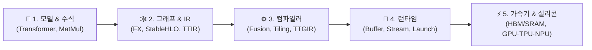

# 🚀 Tensor2Silicon: AI 모델에서 가속기 커널까지
### **From Tensor to Silicon — 실행 스택·Roofline·타일링·다단계 IR 완전 해부**

[-004EA2?style=for-the-badge)](https://www.iitp.kr)

  <b>#Tensor</b> · <b>#Kernel</b> · <b>#AI_Accelerator</b> · <b>#Roofline</b> · <b>#Tiling</b> · <b>#Triton</b> · <b>#MLIR</b> · <b>#xPU</b> · <b>#Legato_IR</b>

---

## 📖 이 책에 대하여 (About This Book)

**『Tensor2Silicon: AI 모델에서 가속기 커널까지』**는 PyTorch·Transformer 수식 한 줄이 **연산 그래프(IR) → 컴파일러 최적화 → 비동기 런타임 → 온칩 메모리 계층과 가속기 실리콘 명령어(`PTX`/`SASS`)**에 도달하기까지의 전 과정을 하나의 일관된 관점으로 연결한 기술 웹북입니다.

상위 딥러닝 프레임워크에는 익숙하지만 컴파일러와 하드웨어 시스템 내부가 블랙박스처럼 느껴졌던 엔지니어와 연구자를 위해, **이영빈(`Youngbin Lee · yblee`)** 대표 저자가 전체 6장 본문과 정량 계산 체계를 집필하고 5인의 공동 연구진이 실제 GPU·TPU 환경에서 교차 검증 및 하드웨어 실측 아티클을 더했습니다.

- 🧮 **정량적 손계산과 시뮬레이션 중심**: 추상적인 비유에 머물지 않고 `FLOPs`, HBM 데이터 이동량(`Q`), 산술 강도($I = F/Q$), 온칩 Shared Memory 파이프라인 용량을 직접 손으로 계산하고 내장 시뮬레이터로 즉시 검증합니다.
- 💻 **실행 스택 비교에서 커널 구현·기계어 해부까지**: PyTorch(`torch.compile`), JAX(`OpenXLA`), Modular `MAX`의 거시적 비교에서 출발해, Triton 1D/2D 커널 구현과 `TTIR → TTGIR → LLVM IR → PTX → SASS` 다단계 하향 변환까지 직접 내려갑니다.
- 🎯 **5단계 능동 학습(Active Learning) 설계**: 모든 장마다 3분 핵심 지도, 오개념 O/X 진단, 결과 예측, 손계산 빈칸, 인터랙티브 실습 미션, 파인만 한 줄 설명 인증서가 내장되어 있어 읽은 내용을 자기 지식으로 완전히 체화할 수 있습니다.
- 🌐 **개방형 AI 반도체 시스템 SW 생태계 토대**: 본 저작물은 **과학기술정보통신부**와 **정보통신기획평가원(IITP)**의 지원을 받아 수행되는 **「AI반도체를 활용한 K-클라우드 기술개발 사업」** 오픈소스 커뮤니티 프로그램([모두의연구소 T2S Lab](https://modulabs.co.kr/labs/811))의 결실로 제작되었으며, 이기종 AI 가속기를 위한 개방형 저수준 IR(**Legato**) 생태계의 기술적 토대를 함께 제시합니다.

---

## 🔄 핵심 관통 프레임워크: AI 실행 스택 5대 계층

이 책 전체(1장 ~ 6장)가 일관되게 파헤치는 **모델에서 실리콘까지의 5대 실행 계층**입니다.

| 계층 (Layer) | 핵심 질문 | 주요 입력 | 주요 출력 | 집중 탐구 장 |
| :--- | :--- | :--- | :--- | :---: |
| **1. 모델·텐서 연산** | 무엇을 계산할까? | 모델 정의, 입력, 가중치 | 텐서 연산의 수학적 의미와 형상(`shape`) | **Chapter 01** |
| **2. 그래프·IR** | 기계가 분석하기 좋은 형태로 어떻게 표현할까? | 프로그램, `shape`, `dtype` | 연산 그래프 및 다단계 중간 표현(IR) | **Chapter 01 · 06** |
| **3. 컴파일러** | 이 계산을 대상 하드웨어에서 어떻게 최적화할까? | IR, 타겟 하드웨어 명세 | 커널 결합(Fusion), 타일링, 비동기 파이프라인 | **Chapter 01 · 05 · 06** |
| **4. 런타임** | 지금 어떤 데이터로 언제 실행하고 어떻게 측정할까? | 실행 바이너리, 디바이스 버퍼 | 비동기 스트림 디스패치, 동기화, 실효 벤치마크 | **Chapter 01 · 04 · 05** |
| **5. 칩 내부 (Silicon)** | 데이터를 어디서 가져와 어떤 유닛에서 계산할까? | 기계어(`SASS`), 메모리 주소 | HBM↔SRAM 재사용, Roofline 상한, SIMT/Systolic | **Chapter 02 · 03 · 04 · 06** |

---

## 📚 전 6장 완결 구성 (Book Contents)

| 장 (Chapter) | 제목 및 핵심 주제 | 다루는 핵심 질문과 역량 | 바로가기 |
| :---: | :--- | :--- | :---: |
| **Chapter 01** | **모델에서 실리콘까지** | 연산 하나가 가속기 실리콘에 도달하기까지 거치는 5대 계층과 PyTorch 2.0 · OpenXLA · Modular MAX 비교 | [1장 읽기](../ch01/) |
| **Chapter 02** | **커널의 시간은 어디에서 소비되는가** | 연산 시간($F/P$) vs 메모리 이동 시간($Q/\text{BW}$) 분해 모델, SRAM·HBM 계층, Vector Add와 Kernel Fusion 손계산 | [2장 읽기](../ch02/) |
| **Chapter 03** | **Roofline과 Tiling** | 산술 강도($I = F/Q$)와 하드웨어 분기점($I^*$), 2D 타일 재사용을 통한 HBM 트래픽 절감 및 온칩 메모리 한계 | [3장 읽기](../ch03/) |
| **Chapter 04** | **xPU를 어떻게 비교할 것인가** | GPU(SIMT) · TPU(Systolic Array) · NPU/LPU 구조 대조, 사양표 함정 해독, LLM Prefill(TTFT) vs Decode(TPOT) 병목 | [4장 읽기](../ch04/) |
| **Chapter 05** | **Python에서 Triton 커널로** | 1D 블록 포인터(`tl.arange`)와 경계 마스킹(`-inf`), 온칩 리덕션을 통한 Fused Softmax 구현 및 대역폭 검증 | [5장 읽기](../ch05/) |
| **Chapter 06** | **Tiled MatMul과 컴파일 과정** | 2D 타일 행렬곱 커널, L2 캐시 Grouped Ordering, Autotune, `TTIR → TTGIR → LLVM IR → PTX → SASS` 실측 해부 | [6장 읽기](../ch06/) |

---

## 🛠️ 집필 및 기술 검증 4대 원칙

1. **핵심 질문 중심 서술 (Question-Driven Architecture)**
   - 모든 장은 명확한 엔지니어링 질문에서 출발하여 **직관 → 수식 모델 → 손계산 → 실제 코드와 하드웨어 검증** 순서로 답을 도출합니다.
2. **근거 기반 서술 (Fact-Checked Documentation)**
   - 공식 컴파일러 문서, 하드웨어 아키텍처 백서, 실제 추출한 IR/어셈블리 산출물을 근거로 삼으며, **확인된 사실(Fact)**과 **성능 모델상의 가정(Assumption)**을 엄격히 구분합니다.
3. **교차 재현성 검증 (Cross-Verified Reproducibility)**
   - 모든 수치 예제와 벤치마크 실험은 대표 저자의 본문 모델과 연구진의 다중 GPU(`RTX 4070`, `RTX 5090`, `NVIDIA A100`) 실측을 통해 교차 검증되었습니다.
4. **능동적 체득 (Active Mastery)**
   - 눈으로만 읽고 넘어가는 수동적 독서를 지양하고, 독자가 직접 예측·계산·조작·설명하며 스스로 이해도를 증명할 수 있도록 설계했습니다.

---

## 🏦 사사 (Acknowledgments)

본 프로젝트 및 결과물은 **과학기술정보통신부** 및 **정보통신기획평가원(IITP)**의 재원으로 **정보통신·방송 기술개발사업(AI반도체를 활용한 K-클라우드 기술개발 — AI반도체 데이터센터 컴퓨팅 SW)**의 지원을 받아 수행된 연구 결과입니다.

- **과제번호 (Project No.)**: `RS-2026-25521385`
- **연구개발과제명 (국문)**: 지속적 AI반도체 성능 최적화를 위한 AI 생태계 적응형 시스템SW 기술 개발
- **Project Title (EN)**: *Development of Adaptive System Software Technology for AI Ecosystems Enabling Continuous Performance Optimization of AI Semiconductors*
- **연구개발기간 (Period)**: 2026.04.01 ~ 2030.12.31
- **참여기관 (Consortium)**: ㈜하이퍼엑셀(주관), 서울대학교 산학협력단(공동), 한국과학기술원(공동), 모두의연구소(위탁)

> *This work was supported by the Institute of Information & Communications Technology Planning & Evaluation (IITP) grant funded by the Korea government (MSIT) (No. RS-2026-25521385, Development of Adaptive System Software Technology for AI Ecosystems Enabling Continuous Performance Optimization of AI Semiconductors).*

---

## 📄 라이선스 (License)

이 웹북의 모든 문서와 예제 코드는 [Apache License 2.0](https://github.com/legato-user-group/tensor2silicon-lab/blob/main/LICENSE) 라이선스 하에 공개되어 있습니다.
