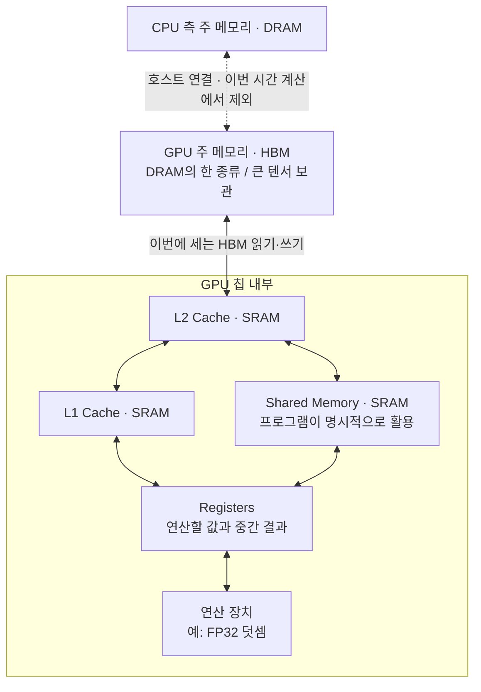

<WeekNavBar :week="3" topic="커널의 시간은 어디에서 소비되는가" :researchers="[{'id': 'mbsong', 'name': 'mbsong', 'label': 'mbsong (송민배)', 'badge': 'GPU·TPU 메모리 계층 비교'}, {'id': 'singon', 'name': 'singon', 'label': 'singon (김신곤)', 'badge': '손계산 & 병목 판별'}, {'id': 'junpark', 'name': 'junpark', 'label': 'junpark (박준)', 'badge': 'SRAM vs DRAM 물리 구조'}, {'id': 'injokim', 'name': 'injokim', 'label': 'injokim (김인조)', 'badge': '수식 모델링 & 정량 분석'}, {'id': 'jaehyeong', 'name': 'jaehyeong', 'label': 'jaehyeong (이재형)', 'badge': '메모리 계층 & 실전 예제'}]" />


**[3주차 안내] 커널의 시간은 어디에서 소비되는가**

안녕하세요! 3주차에는 **커널이 계산하는 시간과 데이터를 옮기는 시간을 나누어 보고, 간단한 연산의 실행시간을 직접 추정**해보려고 합니다.
지난주에 모델에서 실리콘까지의 흐름을 살펴봤다면, 이번에는 그중 커널 하나를 골라 시간이 어디에서 쓰이는지 들여다보겠습니다.
**“같은 연산인데 왜 어떤 커널은 빠르고 어떤 커널은 느린가?”**

이번 주에는 아래 질문과 손계산을 중심으로 기본 감각을 잡아보면 좋겠습니다. Roofline 그래프와 Tiling은 이 계산을 바탕으로 4주차에 이어갑니다.

**1. 공통으로 읽어오면 좋은 자료**

- [Scaling Book 1장: All About Rooflines](https://jax-ml.github.io/scaling-book/roofline/#where-does-the-time-go)
첫 절인 **Where Does the Time Go?**에서 연산 시간·데이터 이동 시간 공식과 **Compute-bound / Communication-bound** 설명까지 읽어주세요. 이번 주에는 한 가속기 안에서의 메모리 이동에 집중합니다. Arithmetic Intensity와 Roofline 그래프는 다음 주에 다룹니다.

- [MLC: GPU Acceleration — GPU Architecture](https://book.mlc.ai/chapter_gpu_acceleration/part1.html#gpu-architecture)
**GPU 구조 그림과 첫 Vector Add 코드**를 살펴봐주세요. `C[i] = A[i] + B[i]`에서 무엇을 읽고, 무엇을 계산하고, 무엇을 쓰는지 찾으면 됩니다. 뒤의 루프 분할과 스케줄 변환까지 이해하거나 코드를 실행할 필요는 없습니다.

- [Scaling Book 12장: How to Think About GPUs — Memory](https://jax-ml.github.io/scaling-book/gpus/#memory)
**HBM, L2 Cache, L1/Shared Memory, Register**의 위치와 역할을 중심으로 읽어주세요. 하드웨어별 용량 수치를 외우기보다 데이터가 연산 장치에 도착하기까지 어떤 저장 공간을 거치는지 따라가보면 좋겠습니다.

**2. 해당 사항들을 다같이 정리해주세요**

**① FLOPs와 FLOPs/s**
해야 할 계산의 양과, 하드웨어가 1초에 처리할 수 있는 계산의 양은 어떻게 다를까?
Vector Add의 덧셈 횟수를 세고, `연산량 ÷ 연산 성능`의 단위가 왜 시간이 되는지 설명해봐주세요.
공통 자료인 Scaling Book 1장 중심

**② 메모리 용량과 메모리 대역폭**
메모리가 16GB라는 것과 대역폭이 1TB/s라는 것은 각각 무엇을 뜻할까?
텐서가 메모리에 들어가는지 판단하는 계산과, 텐서를 옮기는 데 걸리는 시간을 구하는 계산을 구분해봐주세요.
[NVIDIA: GPU Performance Background](https://docs.nvidia.com/deeplearning/performance/dl-performance-gpu-background/index.html)의 **GPU Architecture Fundamentals / Understanding Performance** 중심

**③ HBM·DRAM·SRAM의 역할**
데이터를 모두 연산 장치 가까이에 둘 수는 없을까? 용량이 큰 메모리와 빠르게 접근할 수 있는 작은 메모리가 왜 함께 필요할까?
**[HBM은 DRAM의 한 종류](https://www.micron.com/products/memory/hbm)**라는 점을 짚고, GPU의 HBM과 SRAM 기반 캐시·Shared Memory를 그림으로 연결해봐주세요.
공통 자료인 Scaling Book 12장과 [MLC: Memory Spaces](https://mlc.ai/modern-gpu-programming-for-mlsys/chapter_background/index.html#memory-spaces)의 첫 설명·표 중심. TPU가 궁금하다면 [Scaling Book 2장: What Is a TPU?](https://jax-ml.github.io/scaling-book/tpus/#what-is-a-tpu)의 HBM·VMEM 설명도 함께 봐주세요.

**④ Compute Time과 Memory Time**
계산량이 적어도 느린 커널이 있을까? 입력만 읽으면 끝일까, 결과를 쓰는 시간도 세어야 할까?
이번 주에는 아래 모델을 공통으로 사용합니다.

```text
연산 시간 = 총 FLOPs ÷ 하드웨어 연산 성능(FLOPs/s)
메모리 시간 = 읽고 쓴 총 Byte ÷ 메모리 대역폭(Byte/s)
예상 실행시간 ≈ max(연산 시간, 메모리 시간)
```

이 값은 **연산과 데이터 이동을 충분히 겹치고, 주어진 성능을 활용한다고 가정한 이상적 시간 추정치**입니다. 최대 성능을 대입하면 최소 실행시간의 기준이 되며, 실제 측정값과는 차이가 날 수 있습니다. 이번에는 입력이 이미 가속기 메모리에 있다고 가정합니다.

**⑤ Compute-bound와 Memory-bound**
연산 성능만 두 배가 되면 Vector Add도 두 배 빨라질까? 메모리 대역폭만 두 배가 되면 어떨까?
두 시간 중 더 큰 값을 근거로 병목을 설명해봐주세요. 여기서 Memory-bound는 **메모리 대역폭이 시간을 제한하는 경우**를 뜻합니다.
[NVIDIA: Memory-Limited Layers](https://docs.nvidia.com/deeplearning/performance/dl-performance-memory-limited/index.html)의 **Memory-Limited Layers / Activations**도 참고할 수 있습니다.

**3. 정리할 때 담아오면 좋은 내용**

- 내가 맡은 질문에 대한 설명과 핵심 용어 3개
- 설명에 도움이 되는 그림 또는 계산표 1개
- 계산에 사용한 텐서 크기·자료형·하드웨어 가정과 단위
- 참고한 자료의 링크와 읽은 절
- 이해가 안 됐거나 함께 이야기하고 싶은 질문

가능하면 **`C = A + B`라는 같은 예시**를 각자 선택한 관점에서 설명해보면 좋겠습니다.

**4. 함께 계산해볼 내용: Vector Add**

길이 `N = 100,000,000`인 FP32 벡터 A, B를 더해 새 벡터 C에 저장한다고 가정합니다. FP32 원소 하나는 4Byte입니다.
연습용 가상 하드웨어의 **FP32 덧셈 처리 성능은 20 × 10¹² FLOPs/s**, **HBM 대역폭은 1 × 10¹² Byte/s**로 놓겠습니다. 실제 제품 사양이나 측정값은 아닙니다.

입력은 HBM에서 한 번씩 읽고 결과는 한 번 씁니다. 캐시 재사용과 추가 데이터 이동은 없다고 가정하고, 아래 항목을 각자 계산해와서 비교해주세요.

- A와 B를 읽는 데이터 크기
- C를 쓰는 데이터 크기
- 필요한 덧셈 횟수와 총 FLOPs
- 연산 시간과 메모리 시간
- 더 큰 시간과, 그 값으로 설명할 수 있는 병목

계산이 끝나면 **연산 성능·메모리 대역폭·메모리 용량 중 무엇을 늘렸을 때 이 커널이 빨라질지** 이야기해보겠습니다.
[Triton: Vector Addition](https://triton-lang.org/main/getting-started/tutorials/01-vector-add.html)의 `tl.load`, 덧셈, `tl.store`를 찾아 손계산과 연결해보는 것도 좋습니다.

정리한 뒤에는 **연산 성능과 메모리 대역폭을 구분할 수 있는지**, **간단한 커널의 최소 실행시간을 가정과 함께 추정할 수 있는지**, **어떤 조건에서 Memory-bound인지 설명할 수 있는지** 서로 확인해보겠습니다.

추가로 공부하면서 이것도 같이 보면 좋겠다는 자료가 있으면, 어떤 질문에 도움이 되는지도 함께 공유해주세요!
그럼 다음 모임에서 뵙겠습니다!


---

# 3주차 참고자료 — 커널의 시간은 어디에서 소비되는가

안내문과 함께 사용할 운영·집필 참고자료입니다. 아래 자료를 모두 사전 과제로 읽을 필요는 없습니다. 공통 읽기 이후 맡은 주제에 맞는 자료를 골라보세요.

자료 확인일: 2026-09-23. 수치 예제는 이 문서를 위해 만든 **교육용 가상 조건의 손계산**이며, 특정 제품의 사양이나 실측 결과가 아닙니다.

## 1. 자료별 읽을 범위와 쓰임

| 우선순위 | 자료 | 읽을 범위 · 도움이 되는 질문 |
|---|---|---|
| 공통 | [Scaling Book 1장](https://jax-ml.github.io/scaling-book/roofline/#where-does-the-time-go) | 첫 절의 두 시간 공식과 병목 설명까지. 왜 연산량만으로 시간을 알 수 없을까? |
| 공통 | [MLC: GPU Architecture](https://book.mlc.ai/chapter_gpu_acceleration/part1.html#gpu-architecture) | 구조 그림과 첫 Vector Add 코드까지. 입력 읽기·덧셈·출력 쓰기는 어디에 나타날까? |
| 공통 | [Scaling Book 12장: Memory](https://jax-ml.github.io/scaling-book/gpus/#memory) | 메모리 계층의 위치·역할. GPU 안팎에 왜 여러 저장 공간이 있을까? |
| 개념 보충 | [NVIDIA: GPU Performance Background](https://docs.nvidia.com/deeplearning/performance/dl-performance-gpu-background/index.html) | **GPU Architecture Fundamentals / Understanding Performance / Elementwise Operations**. 연산·대역폭·지연시간은 어떻게 성능을 제한할까? |
| 메모리 용어 | [Micron: HBM](https://www.micron.com/products/memory/hbm) | FAQ의 HBM 정의. HBM은 여러 DRAM 다이를 적층한 메모리라는 관계를 확인합니다. |
| GPU 메모리 | [MLC: Memory Spaces](https://mlc.ai/modern-gpu-programming-for-mlsys/chapter_background/index.html#memory-spaces) | 첫 설명과 비교 표의 Global Memory·Shared Memory·Register 중심. TMEM·DSMEM 등 심화 기능은 이번 주 범위 밖입니다. |
| TPU 비교 | [Scaling Book 2장](https://jax-ml.github.io/scaling-book/tpus/#what-is-a-tpu) · [Google Cloud: TPU7x](https://docs.cloud.google.com/tpu/docs/tpu7x) | 앞 자료의 HBM·VMEM·VPU 설명과 뒤 자료의 **Memory hierarchy**. VMEM은 SRAM 기반 scratchpad이며 GPU 캐시와 관리 방식이 다릅니다. TPU7x의 수치를 다른 세대에 일반화하지 않습니다. |
| 코드 연결 | [Triton: Vector Addition](https://triton-lang.org/main/getting-started/tutorials/01-vector-add.html) | `add_kernel`과 마지막 benchmark의 바이트 집계. FP32 벡터 두 개를 읽고 하나를 쓰는 것을 확인합니다. 실행은 선택입니다. |
| 계산 검증 | [CUDA C++ Best Practices: Effective Bandwidth Calculation](https://docs.nvidia.com/cuda/cuda-c-best-practices-guide/index.html#effective-bandwidth-calculation) | 읽기와 쓰기를 합산하는 공식. 이어지는 **Throughput Reported by Visual Profiler**에서는 요청한 바이트와 실제 전송량의 차이를 읽습니다. |
| 익숙한 연산에 적용 | [NVIDIA: Memory-Limited Layers](https://docs.nvidia.com/deeplearning/performance/dl-performance-memory-limited/index.html) | **Memory-Limited Layers / Activations**. 단순 원소별 연산과 작은 텐서의 성능 특성을 봅니다. |
| 실측 확장 | [JAX: Benchmarking JAX code](https://docs.jax.dev/en/latest/benchmarking.html) | 첫 네 가지 주의점. 컴파일·장치 전송·비동기 실행을 구분해 측정해야 하는 이유를 확인합니다. |
| 실측 확장 | [MLC: Measuring and Analyzing GPU Kernel Performance](https://mlc.ai/modern-gpu-programming-for-mlsys/appendix/benchmarking_gpu_kernels.html) | **Separate Measurement from Diagnosis / Define the Timing Boundary**. 무엇의 시간을 재었는지 먼저 정의합니다. |

MLC 자료는 [공식 강의 목록](https://mlc.ai/courses.html)에서 찾을 수 있습니다. 기존 *Machine Learning Compiler* 교재의 현재 주소는 `book.mlc.ai`이며, 새 *Modern GPU Programming for MLSys* 교재는 별도로 제공됩니다. 이번 주에는 설치나 특정 DSL 문법보다 그림과 연산의 의미에 집중합니다.

다음 주 연결 자료는 [Scaling Book 1장의 Visualizing rooflines](https://jax-ml.github.io/scaling-book/roofline/#visualizing-rooflines)와 [MLC: What Makes a Kernel Fast](https://mlc.ai/modern-gpu-programming-for-mlsys/chapter_performance/index.html)입니다. 산술 강도, Roofline 그래프, Tiling은 4주차에 이어서 다룹니다.

## 2. 1장 전반부 집필에 사용할 뼈대

**Where Does Kernel Time Go?**

1. `C = A + B`에도 데이터 읽기와 결과 쓰기가 필요하다.
2. 계산의 양(FLOPs)과 계산 처리율(FLOPs/s)을 구분한다.
3. 저장할 수 있는 양(Byte)과 옮길 수 있는 속도(Byte/s)를 구분한다.
4. 메모리 계층 그림에서 이번에 세는 이동 구간을 표시한다.
5. 연산 시간과 메모리 시간을 각각 계산하고 병목을 판단한다.
6. 같은 식이라도 구현에 따라 데이터 이동량이 달라질 수 있음을 비교한다.
7. 연습문제 3개를 풀고, 다음 주의 “데이터를 더 잘 재사용할 방법은?”으로 연결한다.

### 용어와 단위

| 구분 | 뜻 | 이번 계산에서의 표기 |
|---|---|---|
| FLOPs | 수행하는 부동소수점 연산의 수 | 덧셈 1회 = 1 FLOP, 곱셈 1회 = 1 FLOP |
| FLOPs/s | 초당 부동소수점 연산 처리율 | `20 × 10¹² FLOPs/s` |
| 메모리 용량 | 동시에 저장할 수 있는 데이터의 양 | Byte, GB |
| 메모리 이동량 | 정한 구간에서 읽고 쓴 데이터의 합 | Byte, GB |
| 메모리 대역폭 | 정한 구간에서 초당 옮길 수 있는 데이터의 양 | Byte/s, GB/s, TB/s |

FLOPs와 FLOPS를 자료마다 다르게 쓰기도 하므로, 이 문서에서는 **연산 횟수는 FLOPs, 초당 성능은 FLOPs/s**로 통일합니다. 곱셈과 덧셈을 합친 FMA는 명령 하나여도 통상 2 FLOPs로 셉니다. [NVIDIA의 연산 성능 설명](https://docs.nvidia.com/deeplearning/performance/dl-performance-gpu-background/index.html)을 참고하세요.

단위는 모두 십진수로 계산합니다: `1 MB = 10⁶ Byte`, `1 GB = 10⁹ Byte`, `1 TB = 10¹² Byte`, `1 ms = 10⁻³초`, `1 μs = 10⁻⁶초`. GiB와 GB, bit와 Byte를 섞지 않습니다.

## 3. 메모리 계층 다이어그램 초안

아래는 **대표적인 NVIDIA GPU의 개념도**입니다. 화살표는 가능한 데이터 이동을 단순화한 것이며, 모든 커널이 모든 메모리 공간을 순서대로 사용하는 것은 아닙니다.



텍스트로 읽으면 **HBM ↔ 온칩 캐시·필요시 Shared Memory ↔ 레지스터 ↔ 연산 장치**입니다. Vector Add가 Shared Memory를 반드시 거칠 필요는 없습니다.

HBM은 DRAM과 별개의 상위·하위 단계가 아닙니다. GPU의 주 메모리로 쓰이는 DRAM의 한 종류입니다. SRAM은 대표적으로 온칩 캐시·Shared Memory를 구성하며, 용량·면적·접근 특성이 달라 HBM과 함께 사용됩니다. 근거: [Micron HBM FAQ](https://www.micron.com/products/memory/hbm), [CUDA Device Memory Spaces](https://docs.nvidia.com/cuda/cuda-c-best-practices-guide/index.html#device-memory-spaces).

TPU를 그릴 때는 별도 그림으로 **HBM ↔ VMEM ↔ 연산 장치(VPU·MXU)**의 관계를 표현하면 됩니다. VMEM은 소프트웨어가 관리하는 온칩 scratchpad이며 GPU의 L2 캐시와 같은 구조로 취급하지 않습니다. 근거: [Scaling Book의 TPU 구조](https://jax-ml.github.io/scaling-book/tpus/#what-is-a-tpu), [Google Cloud TPU7x 메모리 계층](https://docs.cloud.google.com/tpu/docs/tpu7x).

## 4. 계산에 공통으로 적용할 가정

```text
F = 총 부동소수점 연산 횟수             [FLOPs]
Q = HBM에서 읽고 쓴 총 데이터 크기       [Byte]
P = 해당 자료형·연산에 적용 가능한 성능   [FLOPs/s]
B = HBM 대역폭                          [Byte/s]

T_compute = F / P
T_memory  = Q / B
T_ideal   = max(T_compute, T_memory)
```

이 모델은 연산과 데이터 이동이 충분히 겹친다고 가정합니다. 최대 성능·대역폭을 사용한 `T_ideal`은 **주어진 연산량과 이동량에 대한 이상적 하한 추정**입니다. 실제 시간에는 커널 시작 비용, 충분하지 않은 병렬성, 비효율적인 접근 등이 더 영향을 줍니다. 특히 작은 입력에서는 이 두 항보다 시작 비용이나 지연시간이 중요할 수 있습니다. 근거: [NVIDIA Understanding Performance](https://docs.nvidia.com/deeplearning/performance/dl-performance-gpu-background/index.html).

이 문서의 가상 하드웨어는 다음과 같습니다.

- FP32 연산 성능 `P = 20 × 10¹² FLOPs/s`. 아래 덧셈·곱셈에 적용 가능한 성능으로 가정합니다.
- HBM 대역폭 `B = 1 × 10¹² Byte/s`.
- 입력·출력과 필요한 중간 텐서가 모두 들어가는 충분한 메모리 용량.
- 입력은 이미 HBM에 있고 출력도 장치에 남깁니다. CPU↔가속기 복사와 컴파일 시간은 제외합니다.
- 각 예제에 명시한 읽기·쓰기만 HBM에서 발생하고, 캐시 적중이나 추가 전송은 없다고 가정합니다.

Vector Add에는 **BF16 Tensor Core 행렬 연산의 최대 FLOPs/s를 대입하지 않습니다**. 계산하려는 연산·자료형·실행 장치가 일치해야 합니다. [MLC의 CUDA Cores and Tensor Cores 설명](https://mlc.ai/modern-gpu-programming-for-mlsys/chapter_background/index.html#compute-cuda-cores-and-tensor-cores)에서 두 연산 장치의 역할을 확인할 수 있습니다.

## 5. 계산 예제 2개

### 예제 1. Vector Add는 어디에서 시간을 쓰는가?

`C[i] = A[i] + B[i]`, `N = 100,000,000 = 10⁸`, 모든 벡터는 FP32입니다. A·B를 한 번씩 읽고 새 출력 C를 한 번 씁니다.

| 항목 | 계산 | 결과 |
|---|---|---|
| A 읽기 | `4 × N` | 400 MB |
| B 읽기 | `4 × N` | 400 MB |
| C 쓰기 | `4 × N` | 400 MB |
| 총 HBM 이동량 Q | `4N + 4N + 4N` | 1.2 GB |
| 총 연산량 F | 원소마다 덧셈 1회 | `10⁸ FLOPs` |
| 연산 시간 | `10⁸ ÷ (20 × 10¹²)` | `5 × 10⁻⁶초 = 5 μs = 0.005 ms` |
| 메모리 시간 | `(1.2 × 10⁹) ÷ 10¹²` | `1.2 × 10⁻³초 = 1.2 ms` |
| 이상적 실행시간 | `max(0.005, 1.2) ms` | **1.2 ms** |

메모리 시간이 연산 시간의 240배이므로 이 조건에서는 **Memory-bound**로 예상합니다. 출력 쓰기를 빠뜨리면 1.2 GB를 0.8 GB로 잘못 계산하게 됩니다.

세 배열의 저장 공간도 총 1.2 GB이지만, 저장 공간과 이동량은 서로 다른 개념입니다. 같은 배열을 두 번 읽으면 저장 공간은 그대로여도 이동량은 늘어납니다.

바이트 집계 방식은 [Triton Vector Addition](https://triton-lang.org/main/getting-started/tutorials/01-vector-add.html)의 입력 2개·출력 1개 집계와 연결됩니다. 위 수치는 해당 코드의 실측값이 아닙니다.

### 예제 2. 같은 식인데 커널을 합치면 무엇이 달라지는가?

FP32 벡터 X, Y, W에 대해 **`Z[i] = (X[i] + Y[i]) + W[i]`**를 계산합니다. `N = 10⁸`이며 덧셈 순서는 같습니다.

**구현 A: 두 커널로 실행**

```text
첫 커널: T = X + Y     → X·Y 읽기 + T 쓰기 = 12N Byte
둘째 커널: Z = T + W   → T·W 읽기 + Z 쓰기 = 12N Byte
```

**구현 B: 한 커널로 합쳐 실행**

```text
Z = (X + Y) + W        → X·Y·W 읽기 + Z 쓰기 = 16N Byte
중간 덧셈 결과는 레지스터에 유지한다고 가정
```

| 항목 | 구현 A: 두 커널 | 구현 B: 한 커널 |
|---|---:|---:|
| 총 FLOPs | `2N = 2 × 10⁸` | `2N = 2 × 10⁸` |
| HBM 읽기 | `16N = 1.6 GB` | `12N = 1.2 GB` |
| HBM 쓰기 | `8N = 0.8 GB` | `4N = 0.4 GB` |
| 총 HBM 이동량 | `24N = 2.4 GB` | `16N = 1.6 GB` |
| 연산 시간 합계 | 10 μs | 10 μs |
| 메모리 시간 합계 | 2.4 ms | 1.6 ms |
| 이상적 실행시간 | `1.2 + 1.2 = 2.4 ms` | **1.6 ms** |

두 구현의 FLOPs는 같지만, B는 중간 텐서 T의 HBM 쓰기·읽기 `8N Byte`를 줄입니다. 이 모델에서 시간은 약 33% 줄고, 속도는 `2.4 ÷ 1.6 = 1.5배`가 됩니다.

여기서는 A의 중간 텐서가 **실제로 HBM까지 쓰이고 다시 읽힌다**고 가정합니다. 캐시에 남거나 컴파일러가 두 연산을 이미 합치면 차이가 달라집니다. 실제 커널 결합의 효과는 측정해야 합니다. 데이터 이동 집계 원리는 [CUDA 유효 대역폭 계산](https://docs.nvidia.com/cuda/cuda-c-best-practices-guide/index.html#effective-bandwidth-calculation)을 참고했습니다.

## 6. 연습문제 3개

### 문제 1. 곱셈이 하나 늘어나면 병목이 바뀔까?

`Z[i] = a × X[i] + Y[i]`를 계산합니다. X·Y·Z는 FP32, `N = 50,000,000`이며 a는 커널에 전달된 상수입니다. a의 전달 비용은 무시하고, 두 입력을 한 번씩 읽어 새 Z를 한 번 씁니다. 공통 가상 하드웨어를 사용합니다.

읽기·쓰기 바이트 수, FLOPs, 연산 시간, 메모리 시간, 예상 병목을 구하세요. FMA 명령으로 실행되더라도 곱셈과 덧셈을 합쳐 2 FLOPs로 계산하세요.

### 문제 2. 어떤 하드웨어 변화가 Vector Add를 빠르게 할까?

예제 1의 Vector Add를 아래 네 장치에서 실행한다고 가정합니다. 모두 배열을 담을 공간이 충분하고, 표의 성능 외 조건은 같습니다.

| 장치 | FP32 연산 성능 | HBM 대역폭 | HBM 용량 |
|---|---:|---:|---:|
| A | `20 × 10¹² FLOPs/s` | 1 TB/s | 16 GB |
| B | `40 × 10¹² FLOPs/s` | 1 TB/s | 16 GB |
| C | `20 × 10¹² FLOPs/s` | 2 TB/s | 16 GB |
| D | `20 × 10¹² FLOPs/s` | 1 TB/s | 32 GB |

각 장치의 이상적 실행시간을 구하고, 연산 성능·대역폭·용량이 각각 무엇을 바꾸는지 설명하세요.

### 문제 3. Compute-bound인 경우는 어떻게 구분할까?

충분한 병렬성이 있는 어떤 커널의 연산량과 HBM 이동량을 집계했더니 각각 **`10¹² FLOPs`와 `4 × 10⁹ Byte`**였습니다. 공통 가상 하드웨어를 사용하고, 연산 종류에 맞는 처리 성능을 사용했다고 가정합니다.

두 시간과 병목을 구하세요. 연산 성능만 두 배로 바꾸거나, 메모리 대역폭만 두 배로 바꾸면 각각 얼마나 걸릴까요?

## 7. 해답과 해설

<details class="t2s-solution-toggle">
<summary>💡 연습문제 해답 및 상세 풀이 펼치기 (스스로 먼저 풀어본 뒤 클릭하세요)</summary>

### 문제 1 해답

- 읽기: `2 × 4 × 5 × 10⁷ = 4 × 10⁸ Byte = 400 MB`.
- 쓰기: `4 × 5 × 10⁷ = 2 × 10⁸ Byte = 200 MB`.
- 총 이동량: `600 MB = 6 × 10⁸ Byte`.
- 연산량: 원소마다 곱셈·덧셈 1회씩이므로 `2N = 10⁸ FLOPs`.
- 연산 시간: `10⁸ ÷ (20 × 10¹²) = 5 μs`.
- 메모리 시간: `(6 × 10⁸) ÷ 10¹² = 0.6 ms`.
- 이상적 실행시간: **0.6 ms, Memory-bound**.

원소당 계산이 늘어도 두 시간의 대소관계가 바뀌지 않으면 병목은 그대로입니다.

### 문제 2 해답

| 장치 | 연산 시간 | 메모리 시간 | 이상적 실행시간 |
|---|---:|---:|---:|
| A | 5 μs | 1.2 ms | **1.2 ms** |
| B | 2.5 μs | 1.2 ms | **1.2 ms** |
| C | 5 μs | 0.6 ms | **0.6 ms** |
| D | 5 μs | 1.2 ms | **1.2 ms** |

B는 더 빨리 계산할 수 있어도 더 큰 시간인 메모리 시간이 그대로입니다. C는 현재 병목인 대역폭을 늘려 시간이 줄어듭니다. D는 더 많은 데이터를 저장할 수 있지만, 이 문제의 이동량과 대역폭은 바꾸지 않습니다. 원래 배열이 메모리에 들어가지 않았다면 용량 증가는 실행 가능 여부부터 바꿀 수 있습니다.

### 문제 3 해답

```text
연산 시간 = 10¹² ÷ (20 × 10¹²) = 0.05초 = 50 ms
메모리 시간 = (4 × 10⁹) ÷ 10¹² = 0.004초 = 4 ms
이상적 실행시간 = max(50, 4) ms = 50 ms → Compute-bound

연산 성능만 두 배: max(25, 4) ms = 25 ms
메모리 대역폭만 두 배: max(50, 2) ms = 50 ms
```

커널 이름만 보고 병목을 정하기보다 **해당 크기·자료형·구현·하드웨어에서 두 시간을 비교**해야 합니다.

</details>

## 8. 공동 검토 때 확인할 점

- 연산 횟수와 초당 성능을 혼동하지 않았는가?
- 입력 읽기뿐 아니라 출력 쓰기와 중간 텐서의 이동도 셌는가?
- 이동량과 대역폭이 같은 메모리 구간을 가리키는가?
- 이상적인 계산값과 실제 측정값을 구분했는가?
- Memory-bound를 “메모리 용량이 부족하다”는 뜻으로 설명하지 않았는가?

실측을 추가하는 사람은 장치·자료형·크기·측정 범위를 함께 남겨주세요. JAX에서는 첫 실행의 컴파일, CPU↔장치 복사, 비동기 실행을 구분하고 `.block_until_ready()`로 완료를 기다려야 합니다. 근거: [JAX 벤치마킹 안내](https://docs.jax.dev/en/latest/benchmarking.html).

손계산보다 훨씬 짧은 시간이 나온다면 캐시에서 읽었는지, 완료를 기다리지 않고 시간을 쟀는지, 집계한 연산·이동량이 맞는지 살펴봅니다. 반대로 훨씬 길다면 시작 비용·접근 효율·병렬성부터 확인합니다. 계산은 병목을 예상하는 출발점이며, 실제 원인은 프로파일링으로 확인합니다.
