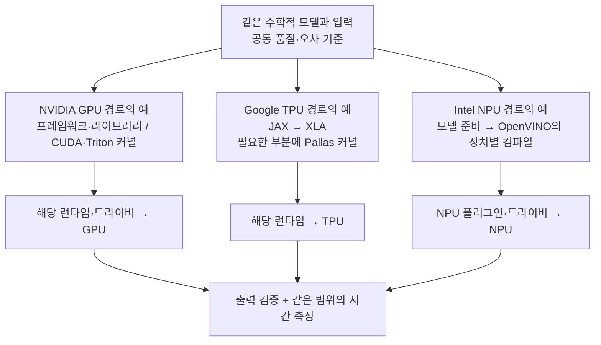

<WeekNavBar :week="5" topic="xPU를 어떻게 비교할 것인가" :researchers="[{'id': 'mbsong', 'name': 'mbsong', 'label': 'mbsong (송무복)', 'badge': 'GPU vs TPU vs NPU 비교표'}, {'id': 'singon', 'name': 'singon', 'label': 'singon (김신곤)', 'badge': 'xPU 비교 기준 & 손계산'}, {'id': 'junpark', 'name': 'junpark', 'label': 'junpark (박준)', 'badge': '아키텍처 심층 리서치'}]" />


<div class="t2s-author-byline">
  <div class="t2s-author-byline-main">
    
    <div class="t2s-author-meta">
      <div class="t2s-author-title-row">
        <span>🧭 <strong>주차 학습 안내 &amp; 손계산 예제 집필: 이영빈 (Youngbin Lee · <code>yblee</code>)</strong></span>
        <span class="t2s-author-role-badge">Lead Author</span>
      </div>
      <div class="t2s-author-affil">T2S Lab 랩장 · 전 주차 커리큘럼 및 정량 계산 연습문제·해설 설계</div>
    </div>
  </div>
  <a class="t2s-author-gh-btn" href="https://github.com/yblee110" target="_blank" rel="noopener">GitHub @yblee110 ↗</a>
</div>

**[5주차 안내] xPU를 어떻게 비교할 것인가**

안녕하세요! 5주차에는 **GPU·TPU·NPU를 어떤 기준과 조건으로 비교해야 하는지** 함께 정리해보려고 합니다.
지난주에 Roofline과 Tiling으로 연산 성능·메모리 대역폭·데이터 재사용의 관계를 살펴봤다면 이번에는 실제 장치의 구조와 소프트웨어, 성능표를 그 관점으로 읽어보겠습니다.
**“같은 AI 작업에 쓸 가속기를 비교하려면 어떤 조건부터 맞춰야 할까?”**

이번에는 NVIDIA GPU, Google TPU, Intel Core Ultra NPU와 같은 NPU를 구체적인 사례로 살펴봅니다. 각 제품의 특징을 GPU·NPU 전체의 특징으로 일반화하지 않도록 제조사·제품·세대와 소프트웨어 버전을 함께 적어주세요.

공통 과제로는 문헌과 계산으로 비교 조건표를 만듭니다. 직접 실행해보고 싶은 분은 아래 5절의 무료 원격 장비를 이용할 수 있습니다. 장비를 배정받지 못하면 CPU 계산이나 시뮬레이션으로 참여해도 됩니다.

**1. 공통으로 읽어오면 좋은 자료**

- [Scaling Book 12장: How to Think About GPUs](https://jax-ml.github.io/scaling-book/gpus/#gpus-vs-tpus-at-the-chip-level)
**GPUs vs. TPUs at the chip level**의 구조 비교를 읽어주세요. 필요하면 앞의 **What Is a GPU? / Memory** 그림도 살펴보면 좋겠습니다. 연산 장치의 구성과 메모리·실행 제어의 차이에 집중하고 문서 속 과거 가격을 현재 가격으로 사용하지 않습니다.

- [OpenVINO 2026: NPU Device](https://docs.openvino.ai/2026/openvino-workflow/running-inference/inference-devices-and-modes/npu-device.html)
도입부의 모델 컴파일 예와 **Supported Inference Data Types / Dynamic Shapes / Limitations**를 읽어주세요. Intel NPU에서 무엇을 실행할 수 있는지가 모델·입력 형태·컴파일러·드라이버와 어떻게 연결되는지 살펴봅시다.

- [MLPerf Inference: Datacenter](https://mlcommons.org/benchmarks/inference-datacenter/)
**Scenarios & Metrics / Divisions / Submission Information**을 중심으로 읽어주세요. 모델, 품질 목표, 요청 방식, 장치 수와 소프트웨어가 성능 결과에 왜 함께 기록되는지 확인하면 됩니다. 결과표 전체를 분석할 필요는 없습니다.

**2. 해당 사항들을 다같이 정리해주세요**

**① 무엇을 비교할 것인가 — 칩, 시스템, 사용 목적**
비교 대상은 칩 하나일까, 여러 가속기를 묶은 서버일까? 학습과 추론, 클라우드 서비스와 개인 기기 실행은 같은 기준으로 비교할 수 있을까?
먼저 제품명·장치 수·실행 환경·비교할 작업을 정해주세요. [TPU v5e 문서](https://docs.cloud.google.com/tpu/docs/v5e)의 칩·호스트·Pod 구분도 참고할 수 있습니다.

**② 하드웨어 구조 — 계산과 데이터 이동은 누가 맡을까?**
행렬곱, 원소별 연산, 실행 제어는 각각 어디에서 이루어질까? 데이터는 어떤 메모리에 놓이고 누가 재사용을 결정할까?
연산 장치와 큰 메모리·온칩 저장 공간·호스트 연결을 그림으로 묶어주세요. GPU의 Tensor Core와 TPU의 TensorCore는 이름이 비슷해도 가리키는 구성 단위가 다릅니다.
Scaling Book 공통 자료와 [2장의 What Is a TPU?](https://jax-ml.github.io/scaling-book/tpus/#what-is-a-tpu) 중심

**③ 성능표의 숫자 — 어떤 조건의 FLOPs/s·TOPS일까?**
INT8 TOPS와 BF16 FLOPs/s를 바로 비교해도 될까? 희소성 사용 여부와 칩당·시스템 전체 수치를 섞으면 어떤 문제가 생길까?
연산 종류, 입력·누산 정밀도, dense/sparse 조건, 집계 단위를 함께 적어주세요. 메모리 용량과 대역폭, 장치 사이 연결 대역폭도 구분해봅시다.
[H100 제품 사양](https://www.nvidia.com/en-us/data-center/h100/)의 **SXM 열과 각주**, [Intel Core Ultra 9 288V 사양](https://www.intel.com/content/www/us/en/products/sku/240961/intel-core-ultra-9-processor-288v-12m-cache-up-to-5-10-ghz/specifications.html)의 **NPU와 전체 성능 항목** 중심

**④ 프로그래밍 방식 — 같은 모델이 어떻게 실행될까?**
프레임워크에서 모델을 넘기는 것과 직접 커널을 작성하는 것은 어떤 차이가 있을까? 지원하지 않는 연산이 있으면 어디에서 확인해야 할까?
NVIDIA GPU에서 CUDA·Triton을 사용하는 경로, Google TPU에서 JAX·XLA·Pallas를 사용하는 경로, Intel NPU에서 OpenVINO를 사용하는 경로를 비교해봐주세요. 모델 입력 자료형과 하드웨어의 실제 계산 정밀도가 같은지도 확인해봅시다.
[CUDA Programming Model](https://docs.nvidia.com/cuda/cuda-programming-guide/01-introduction/programming-model.html)의 도입부, [JAX JIT](https://docs.jax.dev/en/latest/jit-compilation.html#jit-compiling-a-function)의 컴파일 설명과 OpenVINO 공통 자료 중심

**⑤ 실제로 빠르다는 뜻 — 무엇의 시간을 재었을까?**
장치에서 연산하는 시간만 빠르면 사용자도 빨리 결과를 받을까? 한 요청의 지연시간과 여러 요청의 전체 처리량은 어떻게 다를까?
초기 컴파일·입출력 전송·준비 실행을 어디까지 포함했는지, 정확도나 허용오차는 같은지 확인해주세요. 전력도 비교한다면 최대 TDP와 실제 작업당 에너지를 구분해봅시다.
MLPerf 공통 자료 중심. LLM이 궁금하면 [NVIDIA의 추론 지표 설명](https://docs.nvidia.com/nim/benchmarking/llm/latest/metrics.html)에서 **TTFT와 전체 출력 토큰 처리량**을 비교해보면 좋겠습니다.

**3. 정리할 때 담아오면 좋은 내용**

- 내가 고른 제품·세대·장치 수와 소프트웨어 버전
- 연산 장치·메모리·실행 경로를 연결한 작은 그림
- 같은 작업을 기준으로 채운 비교표와 각 항목의 출처
- 성능 수치의 자료형·희소성·배치·측정 범위
- 확인하지 못한 조건과 그 조건 때문에 아직 내릴 수 없는 결론

사양에 없는 값은 추측해서 채우기보다 **미공개·이번 조사에서 미확인·아직 미측정** 중 무엇인지 표시해주시면 좋겠습니다.

**4. 함께 해볼 내용: 같은 작업의 비교 조건표 만들기**

공통 예시는 **`Y = ReLU(XW + b)`**로 놓겠습니다. X는 `[128, 1024]`, W는 `[1024, 1024]`, b는 `[1024]`이며 학습이 아닌 추론을 가정합니다. 이어서 X의 첫 차원을 1로 줄였을 때도 생각해봅시다.

사양 조사에서는 H100 SXM, TPU v5e, Core Ultra 9 288V의 NPU를 예시로 사용할 수 있습니다. **직접 실행할 때는 무료 환경에서 실제 배정받은 제품으로 비교 대상을 바꿔주세요.** 각자 한 제품을 맡아 아래 내용을 정리하면 됩니다.

- 이 연산을 실행할 소프트웨어 경로와 지원 조건
- 입력·가중치·계산·누산 자료형, 기준 출력과 허용오차를 맞출 방법
- 장치 메모리에 둘 데이터와 호스트 전송·다른 장치 실행이 필요한 부분
- 배치 1과 128을 각각 비교할 때 기록할 지연시간·처리량 단위
- 공개 문서로 확인한 사실과 실제 실행이 필요한 확인 항목

문서 조사만으로도 참여할 수 있습니다. 이번에는 **동일한 연산 조건을 맞춘 커널 비교**와 **동일한 품질 목표를 맞춘 모델·시스템 비교**를 구분해 조건표를 완성해봅시다. 상세 참고자료의 가상 장치 계산으로 연산 성능이 더 큰 장치가 항상 빠르지는 않은 이유도 확인하겠습니다.

**5. 장비가 없다면: 무료 실습 환경과 시뮬레이터**

아래 내용은 **2026-10-08 공식 안내 확인 기준**입니다. 무료 서비스에도 사용량·재고·가입 조건이 있으므로 특정 제품이나 수업 당일의 접속을 보장하지는 않습니다.

| 하고 싶은 활동 | 이용할 곳 | 시작 방법과 조건 |
|---|---|---|
| 실제 GPU·TPU 실행 | [Google Colab](https://colab.research.google.com/) | 새 노트북에서 **런타임 → 런타임 유형 변경 → GPU 또는 TPU** 선택. 무료 제공이지만 종류·사용량·가용성은 달라집니다. [공식 FAQ](https://research.google.com/colaboratory/faq.html) |
| 다른 무료 GPU·TPU 환경 | [Kaggle Notebooks](https://www.kaggle.com/code) | 새 노트북의 **Settings → Accelerator**에서 선택. 계정에 표시되는 인증 요구·잔여 할당량·현재 장치 목록을 확인해주세요. [공식 안내](https://www.kaggle.com/docs/notebooks) |
| 실제 Intel NPU 실행 | [Intel AI PC Cloud](https://www.intel.com/content/www/us/en/developer/topic-technology/ai-pc/download-get-started.html) | 무료 원격 Core Ultra PC를 신청하는 경로입니다. **회사·대학 이메일, 승인과 장비 재고** 조건이 있으므로 미리 신청해주세요. 288V 배정은 보장되지 않습니다. [신청 안내](https://www.intel.com/content/www/us/en/developer/articles/guide/ai-pc-cloud-quick-user-guide.html) |
| 다른 제조사의 실제 NPU 실행 | [Qualcomm AI Hub Workbench](https://workbench.aihub.qualcomm.com/) | 계정을 만들고 모델을 올려 실제 Qualcomm 장치에서 실행·프로파일링합니다. 현재 무료로 안내되며 장치 가용성은 확인해야 합니다. **비교 대상도 Qualcomm NPU로 변경**해주세요. [공식 FAQ](https://workbench.aihub.qualcomm.com/docs/hub/faq.html) |
| 장비 없이 구조 변화 실험 | [SCALE-Sim](https://github.com/scalesim-project/SCALE-Sim) | CPU에서 실행하는 오픈소스 시뮬레이터입니다. 작은 행렬곱의 연산 배열·SRAM·대역폭 설정을 바꾸어 사이클과 이동량을 추정합니다. 설치·설정이 필요한 선택 심화 활동입니다. |

처음에는 **CPU에서 공통 식의 결과 확인 → Colab 또는 Kaggle에서 배정된 GPU로 실행 → 가능하면 TPU·NPU 결과 추가** 순서가 좋겠습니다. NPU 장비를 확보한 구성원이 조건과 결과를 공유하고 다른 구성원은 그 조건을 검토하는 방식으로 함께 참여할 수도 있습니다.

시뮬레이터는 **가정한 구조의 성능 추정**을 위한 도구입니다. CPU에서 OpenVINO를 실행한 시간이나 SCALE-Sim 결과를 실제 NPU의 속도로 적지 않습니다. 다음 주 커널 문법을 미리 확인하고 싶다면 [Triton의 CPU 해석기](https://triton-lang.org/main/programming-guide/chapter-3/debugging.html#using-the-interpreter)도 있지만 이 역시 GPU 성능 측정 도구는 아닙니다. 구체적인 시작 순서와 대안은 참고자료 0절에 정리했습니다.

정리한 뒤에는 **비교 대상과 조건을 구체적으로 적을 수 있는지**, **공표 사양·시뮬레이션·실제 장치 측정을 구분하는지**, **작업에 따라 결론이 달라지는 이유를 설명할 수 있는지** 서로 확인해보겠습니다.

추가로 도움이 된 제품 문서나 비교 사례가 있으면 어떤 조건을 확인하는 데 좋았는지도 함께 공유해주세요!
그럼 다음 모임에서 뵙겠습니다!


---

# 5주차 참고자료 — xPU를 어떻게 비교할 것인가

자료 확인일: **2026-10-08**. 이번 주는 **비교할 작업과 단위 정하기 → 구조·소프트웨어 확인 → 같은 조건의 성능 해석** 순서로 살펴봅니다. 3·4주차의 시간 모델과 Roofline을 실제 제품 문서 읽기에 연결합니다.

제품 사양은 아래 출처에서 확인한 값이며, 계산 예제와 연습문제의 장치·시간·전력은 **별도로 만든 교육용 가상 조건**입니다. 실제 장치를 실행하거나 성능 순위를 측정한 자료는 아닙니다.

## 0. 장비 없이 참여하기 — 무료 환경과 시뮬레이션

**GPU·TPU·NPU를 모두 소유할 필요는 없습니다.** 실제 성능 측정에는 로컬 또는 원격의 실제 장치가 필요하지만, 이번 주의 비교 조건표와 Roofline 계산은 CPU만으로 준비할 수 있습니다. 사양 조사용 제품과 실습에 배정된 제품이 다르면 표를 분리합니다.

### 0.1 무료로 실제 장치를 이용하는 경로

| 경로 | 사용할 수 있는 자원 | 무료 이용 조건과 수업에서의 역할 |
|---|---|---|
| [Colab](https://colab.research.google.com/) | 원격 GPU·TPU 런타임 | Google 계정으로 시작. 무료 자원은 종류·사용량·가용성이 변동하므로 특정 GPU나 TPU 세대를 전제로 준비하지 않습니다. [공식 FAQ](https://research.google.com/colaboratory/faq.html) |
| [Kaggle Notebooks](https://www.kaggle.com/code) | 원격 GPU·TPU 노트북 | 계정의 현재 Accelerator 목록과 잔여 할당량을 확인합니다. 혼잡 시 대기할 수 있습니다. [무료 자원 안내](https://www.kaggle.com/docs/notebooks), [할당량 확인 안내](https://www.kaggle.com/docs/efficient-gpu-usage) |
| [Intel AI PC Cloud](https://www.intel.com/content/www/us/en/developer/topic-technology/ai-pc/download-get-started.html) | 실제 Core Ultra AI PC를 원격 사용 | 무료 제공이지만 회사·대학 이메일로 신청하고 승인·재고를 기다리는 방식입니다. 개인 이메일로 당일 접속하는 기본 경로로 잡지 않습니다. [가입·신청 조건](https://www.intel.com/content/www/us/en/developer/articles/guide/ai-pc-cloud-quick-user-guide.html) |
| [Qualcomm AI Hub Workbench](https://workbench.aihub.qualcomm.com/) | 실제 Qualcomm 장치의 모델 실행·프로파일링 | 공식 FAQ는 현재 무료 서비스로 설명합니다. 계정과 장치 가용성을 확인하고 모델 작업을 제출합니다. Intel NPU를 대신 측정하는 것이 아니라 **Qualcomm NPU 사례를 새로 조사하는 경로**입니다. [무료·실장치 안내](https://workbench.aihub.qualcomm.com/docs/hub/faq.html) |

위 무료 제공은 2026-10-08에 공식 문서에서 확인한 내용입니다. 가입 지역·계정 자격·장치 재고·개인별 사용량은 실제 신청 화면에서 확인해야 합니다. 이번 자료를 만들면서 계정을 생성하거나 장비를 배정받아 실행하지는 않았습니다.

Kaggle의 일부 안내에는 오래된 GPU·TPU 세대 예시가 남아 있습니다. [TPU 문서](https://www.kaggle.com/docs/tpu) 자체도 이전 버전용 설명임을 밝힙니다. 예전 문서의 제품명이나 주간 시간을 모두에게 보장된 현재 할당량으로 옮기지 말고, **계정 화면과 실제 장치 조회 결과**를 사용합니다.

### 0.2 실제 장치 경로의 시작 순서

**GPU·TPU — Colab을 우선 사용하고 Kaggle을 대안으로**

1. 새 노트북을 열고, Colab은 **런타임 → 런타임 유형 변경**, Kaggle은 **Settings → Accelerator**에서 사용할 자원을 선택합니다. 계정 인증이 표시되면 해당 절차를 완료합니다.
2. 런타임에 연결한 뒤 실제 장치명과 개수를 확인합니다. GPU·TPU 런타임을 골랐어도 코드가 CPU에서 실행될 수 있으므로, 사용 프레임워크의 장치 목록과 배열 배치를 확인합니다.
3. `Y = ReLU(XW + b)`처럼 작은 작업으로 시작해 출력과 실제 배치를 확인합니다. TPU는 선택한 프레임워크의 TPU 실행 경로가 필요하며 CUDA 코드를 그대로 실행하는 환경이 아닙니다.
4. GPU나 TPU가 배정되지 않으면 CPU로 계산 과제를 진행합니다. 작업을 마치면 결과를 저장하고 런타임을 종료합니다.

GPU 모델이 T4로 나왔다면 결과에는 T4를 적고, H100 사양을 대입하지 않습니다. TPU가 여러 장치를 노출하더라도 노출된 개수와 실제 계산에 사용한 개수는 구분합니다. [Colab FAQ의 자원·실행 설명](https://research.google.com/colaboratory/faq.html).

**Intel NPU — 미리 신청할 수 있는 구성원을 위한 경로**

1. [Intel Cloud Services](https://cloud.intel.com/)에 자격에 맞는 이메일로 가입하고 **Hardware Catalog**의 AI PC 플랫폼을 확인합니다.
2. 사용 목적 등을 작성해 **Request Instance**로 신청하고 승인과 배정 결과를 확인합니다. 정확한 제품·세대는 배정 후 기록합니다. 특정 288V 장비를 보장하는 신청이 아닙니다.
3. 배정된 환경에 접속해 OpenVINO의 사용 가능 장치 목록에서 NPU 노출을 확인하고, 지원 모델을 NPU 대상으로 컴파일·실행합니다. [신청 가이드](https://www.intel.com/content/www/us/en/developer/articles/guide/ai-pc-cloud-quick-user-guide.html), [NPU 실행 문서](https://docs.openvino.ai/2026/openvino-workflow/running-inference/inference-devices-and-modes/npu-device.html).

**Qualcomm NPU — 모델 작업을 원격 장치에 제출하는 경로**

1. [공식 시작 문서](https://workbench.aihub.qualcomm.com/docs/hub/getting_started.html)에 따라 Qualcomm ID와 Python 클라이언트를 준비하고, 사용 가능한 장치 목록을 확인합니다.
2. 작은 지원 모델을 선택한 장치용으로 컴파일한 뒤, 입력 데이터를 넣어 inference 작업을 제출합니다. 현재 API의 프로파일링은 `submit_inference_job(..., profile=True)` 경로를 참고합니다.
3. 출력과 프로파일을 확인하고, 실제 장치·런타임·NPU 실행 여부를 기록합니다. CPU·GPU로 실행된 부분이 있으면 함께 적습니다. [프로파일링과 실행 장치 관련 FAQ](https://workbench.aihub.qualcomm.com/docs/hub/faq.html).

Workbench는 원격 노트북 전체를 대여하는 방식과 다릅니다. 작업 제출부터 완료까지의 대기·업로드 시간을 장치 연산 시간으로 기록하지 말고, **보고서에서 측정한 범위**를 확인합니다. Intel OpenVINO 결과와 비교하려면 제조사·장치·실행 경로가 달라졌다는 사실부터 표에 반영합니다.

### 0.3 시뮬레이터·해석기는 무엇을 대신할 수 있을까?

| 방법 | CPU에서 할 수 있는 일 | 결과의 의미 |
|---|---|---|
| 아래의 Roofline 계산 코드 | 가상 장치의 연산 성능·대역폭과 F·Q를 바꾸어 시간 계산 | **분석 모델의 이상적 하한 추정**. 실제 명령 실행이나 장치 시뮬레이션은 하지 않습니다. |
| [Triton interpreter](https://triton-lang.org/main/programming-guide/chapter-3/debugging.html#using-the-interpreter) | `TRITON_INTERPRET=1`을 사용해 CPU에서 작은 커널을 해석하고 값·인덱스·마스크 확인 | **코드의 동작 확인**. GPU 병렬 실행·메모리 성능·실행시간을 재현하지 않습니다. |
| [Pallas의 interpret 모드](https://docs.jax.dev/en/latest/_autosummary/jax.experimental.pallas.pallas_call.html) | `pallas_call(..., interpret=True)`로 GPU·TPU 없이 CPU에서 커널 확인 | **디버깅용 실행**. CPU에서 걸린 시간을 TPU 성능으로 해석하지 않습니다. |
| [SCALE-Sim](https://github.com/scalesim-project/SCALE-Sim) | 설정한 systolic array·SRAM·데이터 흐름에서 GEMM 등의 사이클·접근량 추정 | **가상 가속기 구조의 시뮬레이션**. 특정 상용 NPU 전체나 임의의 PyTorch 모델을 그대로 재현하는 도구는 아닙니다. |

Triton은 공식 설치 호환성을 확인해야 하며, 기존 GPU 튜토리얼에 환경변수만 붙이는 것으로 충분하지 않습니다. 입력을 CPU에 두고 GPU 조회·GPU 벤치마크 코드를 분리해야 합니다. BF16 등 해석기에서 제한되는 기능도 있습니다. [Triton 설치](https://triton-lang.org/main/getting-started/installation.html)와 위 디버깅 문서를 함께 봅니다. JAX 사용자는 [Pallas의 첫 예제](https://docs.jax.dev/en/latest/pallas/quickstart.html#hello-world-in-pallas)에서 interpret 모드로 시작할 수 있습니다.

SCALE-Sim은 선택 심화 활동으로, 저장소의 설치 안내와 작은 예제를 먼저 실행한 뒤 **작은 GEMM 하나의 설정만 바꾸는 방식**이 적합합니다. 연산 배열 크기를 바꾸는 실험과 대역폭을 바꾸는 실험을 분리합니다. `CALC` 모드는 필요한 대역폭을 계산하고, `USER` 모드는 지정한 대역폭의 제약을 반영하므로 대역폭에 따른 stall을 보려면 모드도 확인해야 합니다. 사용한 버전·설정·입력 연산과 출력 지표를 함께 남깁니다. [공식 README와 사용법](https://github.com/scalesim-project/SCALE-Sim).

시뮬레이터 프로그램 자체가 실행되는 데 걸린 시간은 가속기의 실행시간이 아닙니다. CPU에서 OpenVINO의 `CPU` 대상으로 실행한 결과 역시 **CPU 결과**이며, NPU를 가상으로 실행한 결과가 아닙니다.

### 0.4 설치 없이 해볼 첫 계산

Python만 있으면 아래 코드를 로컬 또는 Colab의 **CPU 런타임**에서 실행할 수 있습니다. GPU·NPU나 별도 패키지가 필요하지 않습니다. 6절의 가상 A·B를 그대로 계산합니다.

```python
# 교육용 시간 모델 계산. 실제 GPU·TPU·NPU를 실행하지 않습니다.
devices = {
    "A": (200e12, 1e12),  # FLOPs/s, Byte/s
    "B": (100e12, 2e12),
}
workloads = {
    "계산이 적은 작업": (1e12, 100e9),  # FLOPs, 누적 이동 Byte
    "계산이 많은 작업": (1e14, 100e9),
}
for work, (flops, moved_bytes) in workloads.items():
    for name, (compute_rate, bandwidth) in devices.items():
        compute_ms = flops / compute_rate * 1000
        memory_ms = moved_bytes / bandwidth * 1000
        estimate_ms = max(compute_ms, memory_ms)
        print(work, name, f"이상적 시간: {estimate_ms:.1f} ms")
```

순서대로 **A 100.0 ms, B 50.0 ms, A 500.0 ms, B 1000.0 ms**가 나옵니다. 이는 출력값 검산까지 수행한 계산 코드입니다. 무료 클라우드·NPU·해석기·SCALE-Sim의 설치와 실제 실행은 수행하지 않았습니다.

### 0.5 이번 모임의 참여 방식

- **장비·계정 없이:** 공식 자료로 제품 조건표를 채우고 위 CPU 계산을 실행합니다.
- **무료 GPU·TPU가 배정되면:** 같은 작은 작업의 출력·실행 장치·측정 범위를 기록합니다. 다른 제품의 사양표와 섞지 않습니다.
- **NPU가 확보되면:** Intel 또는 Qualcomm 중 실제 사용한 경로와 지원 조건을 기록하고 결과를 함께 검토합니다.
- **시뮬레이션을 선택하면:** 가상 구조와 설정을 적고, 계산한 사이클·이동량을 비교합니다.

모든 구성원이 세 종류의 장치를 확보할 필요는 없습니다. 결과에는 **문헌 / 분석 계산 / CPU 동작 확인 / 시뮬레이션 / 실제 장치 측정** 중 어떤 근거인지 표시합니다. 서로 다른 코드·자료형·측정 구간의 숫자를 모았을 때는 먼저 조건 차이를 정리하고, 속도 순위는 보류합니다.

## 1. 자료별 읽을 범위

| 구분 | 자료 | 읽을 범위와 질문 |
|---|---|---|
| 공통 | [Scaling Book 12장](https://jax-ml.github.io/scaling-book/gpus/#gpus-vs-tpus-at-the-chip-level) | GPU·TPU의 칩 구조 비교 절. 연산·메모리·제어의 구성이 어떻게 다를까? |
| 공통 | [OpenVINO 2026: NPU Device](https://docs.openvino.ai/2026/openvino-workflow/running-inference/inference-devices-and-modes/npu-device.html) | 도입부, 자료형·동적 shape·제약 설명. 어떤 조건에서 모델을 실행할 수 있을까? |
| 공통 | [MLPerf Inference: Datacenter](https://mlcommons.org/benchmarks/inference-datacenter/) | 시나리오·평가 부문·제출 정보. 같은 단위의 결과를 비교하려면 무엇을 맞춰야 할까? |
| GPU 사양 | [NVIDIA H100](https://www.nvidia.com/en-us/data-center/h100/) | 제품 사양의 SXM 열과 희소성 각주. 연산·HBM·장치 연결 수치를 구분합니다. |
| TPU 사양 | [Google Cloud TPU v5e](https://docs.cloud.google.com/tpu/docs/v5e) | **System architecture / VM types**. 칩·호스트·Pod의 수치가 어떻게 다른지 봅니다. |
| NPU 사양 | [Intel Core Ultra 9 288V](https://www.intel.com/content/www/us/en/products/sku/240961/intel-core-ultra-9-processor-288v-12m-cache-up-to-5-10-ghz/specifications.html) | NPU·GPU·전체 TOPS, 메모리 항목. 내장 NPU 성능과 제품 전체 성능을 구분합니다. |
| NPU 구조 심화 | [Core Ultra 200V 데이터시트 Rev.004](https://cdrdv2-public.intel.com/829568/829568-004.pdf) | 9.0~9.1.2절, 인쇄 69~71쪽. 연산 타일·SRAM·실행 제어와 시스템 메모리 연결을 봅니다. 200V 제품군에 한정합니다. |
| GPU 실행 방식 | [CUDA Programming Model](https://docs.nvidia.com/cuda/cuda-programming-guide/01-introduction/programming-model.html) | **Heterogeneous Systems / GPU Hardware Model**. CPU host와 GPU kernel의 관계를 읽습니다. |
| 컴파일·커널 경로 | [JAX JIT](https://docs.jax.dev/en/latest/jit-compilation.html#jit-compiling-a-function) · [Pallas](https://docs.jax.dev/en/latest/pallas/index.html) · [Triton](https://triton-lang.org/main/index.html) | JIT 컴파일 절과 두 커널 언어의 소개만. 프레임워크·컴파일러·직접 작성하는 커널의 위치를 구분합니다. |
| 여러 장치에 나눠 실행 | [OpenVINO Heterogeneous Execution](https://docs.openvino.ai/2026/openvino-workflow/running-inference/inference-devices-and-modes/hetero-execution.html) | 도입부와 **Configure fallback devices**. 모델의 일부를 다른 장치에 맡기는 조건을 확인합니다. |
| 벤치마크 규칙 심화 | [MLPerf Inference Rules](https://github.com/mlcommons/inference_policies/blob/master/inference_rules.adoc) | **Scenarios**, 모델 동등성·양자화 관련 절. 측정 목적에 따라 허용되는 변경과 지연시간 조건이 어떻게 다른지 봅니다. |
| LLM 지표 확장 | [NVIDIA NIM: Metrics](https://docs.nvidia.com/nim/benchmarking/llm/latest/metrics.html) | TTFT·전체 요청 지연·토큰 처리량. 사용자 한 명의 응답 속도와 시스템 전체 처리량을 구분합니다. |

자료를 모두 사전 과제로 읽을 필요는 없습니다. 공통 자료를 읽고, 맡은 제품·질문에 맞는 행을 골라주세요. 같은 이름의 제품도 형태·세대·소프트웨어 버전에 따라 달라집니다. 링크의 최신 내용과 실제 사용하는 버전의 문서를 구분합니다.

## 2. 먼저 “무엇의 비교인가”를 정한다

이 문서에서 xPU는 여러 가속기를 함께 가리키는 편의상 표현입니다. GPU·Google TPU·각 제조사의 NPU는 하나의 공통 규격으로 정해진 세 등급이 아닙니다. 구체적인 제품과 실행 환경을 정해야 비교가 시작됩니다.

| 비교 수준 | 먼저 고정할 것 | 얻을 수 있는 결론 |
|---|---|---|
| 공표 사양 | 제품·형태·칩 수·연산 종류·정밀도·희소성 | 해당 조건에서의 이론 성능과 자원 규모 |
| 커널·연산 | 수학적 연산·shape·자료형·누산·오차 허용범위·측정 구간 | 정한 연산 구현의 성능 |
| 모델 | 모델·가중치·입력 데이터·품질 목표·배치 | 모델을 실행하는 하드웨어와 소프트웨어 조합의 성능 |
| 서비스·제품 | 요청 패턴·동시성·지연시간 목표·품질·비용·실행 위치 | 실제 사용 목적에 맞는 구성인지 |

정밀도를 고정한 커널 비교와, 양자화를 허용하되 같은 품질 목표를 만족시키는 모델 비교는 서로 다른 질문입니다. 후자에서는 변환·양자화 방법을 밝히고 품질을 검증합니다. 결과가 좋아도 그 차이를 칩 구조 하나만의 효과라고 해석하지 않습니다. [MLPerf 규칙](https://github.com/mlcommons/inference_policies/blob/master/inference_rules.adoc)도 시스템을 하드웨어와 소프트웨어를 포함한 대상으로 정의합니다.

## 3. 실제 사양표 읽기 — 세 가지 사례

아래는 **조건을 읽는 예시**입니다. 데이터센터용 가속기와 개인 기기의 내장 NPU는 배치 환경이 다르므로, 각 열의 숫자를 곧바로 성능 순위로 바꾸지 않습니다.

| 사례와 출처 | 공표 연산 수치의 예 | 메모리 항목 | 읽을 때 확인할 점 |
|---|---|---|---|
| [NVIDIA H100 SXM](https://www.nvidia.com/en-us/data-center/h100/) | BF16 Tensor Core **1,979 TFLOPs/s**, 희소성 사용 각주 있음 | GPU 메모리 **80 GB**, 대역폭 **3.35 TB/s** | dense 연산의 성능으로 옮겨 적지 않습니다. 같은 표의 NVLink·PCIe는 HBM과 다른 이동 구간입니다. |
| [Google TPU v5e, 칩당](https://docs.cloud.google.com/tpu/docs/v5e) | BF16 **197 TFLOPs/s** | HBM **16 GB**, 대역폭 **800 GiB/s** | 칩당 값과 Pod 전체 값을 구분합니다. 대역폭 단위도 GB/s와 다릅니다. |
| [Core Ultra 9 288V의 NPU](https://www.intel.com/content/www/us/en/products/sku/240961/intel-core-ultra-9-processor-288v-12m-cache-up-to-5-10-ghz/specifications.html) | NPU INT8 **48 TOPS** | 제품의 최대 메모리 **32 GB**는 시스템 메모리 항목 | 전체 **120 TOPS**를 NPU 단독 성능으로 쓰지 않습니다. 이 표에서 NPU 전용 메모리 대역폭은 확인하지 못했습니다. |

Intel 사양의 희소성 지원 여부만으로 48 TOPS의 dense/sparse 산정 조건을 확정하지 않습니다. 지원 기능과 성능 수치의 측정 조건은 별도로 확인합니다.

단위 변환 예:

```text
TPU v5e의 표기: 800 GiB/s
800 × 2³⁰ = 858,993,459,200 Byte/s
           ≈ 858.99 GB/s
           ≈ 0.859 TB/s
```

이 문서의 값은 확인일의 공식 표를 따른 것입니다. 다른 자료에 다른 값이 있으면 단위·제품·문서 시점을 확인하고, 임의로 평균 내거나 섞지 않습니다. H100의 희소 BF16과 288V의 INT8 수치를 나누어 “몇 배 빠르다”고 계산하는 것도 이 단계에서는 의미가 없습니다.

### 구조에서는 무엇을 볼까?

| 사례 | 연산·제어에서 볼 것 | 메모리·재사용에서 볼 것 |
|---|---|---|
| NVIDIA GPU | SM 안의 일반 연산 장치, Tensor Core, warp 실행 | HBM·L2·Shared Memory·레지스터와 그 사이의 이동 |
| Google TPU | MXU의 행렬 연산, VPU의 벡터 연산, 실행 제어 | HBM·VMEM과 컴파일러가 구성하는 데이터 이동 |
| Intel 200V NPU | 연산 타일의 DPU·DSP와 스케줄러 | 근접 SRAM, DMA, 시스템 메모리 연결 |

GPU·TPU 구조는 [Scaling Book 12장](https://jax-ml.github.io/scaling-book/gpus/)과 [2장](https://jax-ml.github.io/scaling-book/tpus/#what-is-a-tpu), NPU 구조는 [Intel 200V 데이터시트 9장](https://cdrdv2-public.intel.com/829568/829568-004.pdf)을 참고했습니다. 서로 역할이 비슷한 요소가 있어도 같은 크기·관리 방식의 부품으로 취급하지 않습니다.

구조 그림에서는 **칩 내부 메모리 이동, CPU↔가속기 이동, 가속기↔가속기 통신**을 다른 화살표로 표시하면 좋습니다. 같은 Byte/s라도 이 세 구간의 수치는 대체할 수 없습니다.

## 4. 소프트웨어를 포함해 실행 경로 그리기



이 그림은 가능한 경로의 개념도입니다. 프레임워크와 백엔드에 따라 실제 단계가 달라집니다. CUDA는 NVIDIA의 경로이고, JAX와 Pallas는 TPU에만 한정되지 않습니다. Triton은 여기서 GPU 커널 언어·컴파일러를 뜻합니다. [CUDA](https://docs.nvidia.com/cuda/cuda-programming-guide/01-introduction/programming-model.html), [JAX JIT](https://docs.jax.dev/en/latest/jit-compilation.html#jit-compiling-a-function), [Pallas](https://docs.jax.dev/en/latest/pallas/index.html), [Triton](https://triton-lang.org/main/index.html).

같은 Python 함수가 실행된다는 사실만으로 커널 수·Fusion·자료형 변환·메모리 이동이 같아지지는 않습니다. 최초 컴파일과 반복 실행도 나누어 기록합니다.

### NPU 지원을 확인할 때의 현재 사례

[OpenVINO 2026 NPU 문서](https://docs.openvino.ai/2026/openvino-workflow/running-inference/inference-devices-and-modes/npu-device.html)를 기준으로 다음을 구분합니다.

- 입력이나 내부 표현에서 F32를 받는 것과 네이티브 FP32로 계산하는 것은 다릅니다. 문서는 하드웨어 계산 정밀도를 FP16으로 설명합니다.
- 동적 shape는 일괄적으로 가능·불가능이라고 쓰지 않습니다. 제한된 범위의 동적 shape 지원이 preview로 제공되며, 장치 세대·컴파일러·드라이버·모델 종류에 조건이 있습니다.
- NPU만 대상으로 컴파일하는 것과 여러 장치로 나누는 실행 모드는 다릅니다. HETERO는 NPU에서 일부 모델에 한정된 지원이며, 모든 미지원 연산의 자동 CPU 실행을 보장하지 않습니다. [HETERO 문서](https://docs.openvino.ai/2026/openvino-workflow/running-inference/inference-devices-and-modes/hetero-execution.html).

이번 비교표에는 “지원됨” 옆에 적용한 문서 버전과 조건을 적습니다. 모델 변환 성공, 장치 컴파일 성공, 전체 연산의 장치 실행, 출력 품질 통과는 각각 확인할 항목입니다.

## 5. 공동 활동에 쓸 비교 조건표

공통 작업은 **`Y = ReLU(XW + b)`의 추론**입니다. X는 `[128, 1024]`, W는 `[1024, 1024]`, b는 `[1024]`이며 출력은 `[128, 1024]`입니다. 입력 128개를 한 묶음으로 처리하는 경우를 본 뒤 X를 `[1, 1024]`로 바꿔봅니다. W와 b는 같은 값을 유지합니다.

이 작업은 문서 조사와 실행 계획을 위한 작은 공통 예시입니다. 각 제품에서 이 조건이 실제로 지원되고 실행되는지는 별도로 확인합니다.

| 비교 항목 | 공통으로 정할 것 | 장치별로 남길 것 |
|---|---|---|
| 작업·입력 | 같은 연산, 입력·가중치 값과 shape | 지원하는 입력 범위, 필요한 변환 |
| 정확도 | 기준 출력과 오차 허용범위 | 검증 결과, 미검증이면 그 상태 |
| 정밀도 | 커널 비교라면 입력·계산·누산·출력 조건 통일 | 실제 실행 정밀도, 양자화·희소성 |
| 배치 | 1과 128은 별도 실험 | ms/batch와 samples/s를 함께 기록 |
| 장치 | 칩 또는 시스템 중 비교 단위 통일 | 제품·세대·장치 수·호스트 구성 |
| 소프트웨어 | 재현 가능한 실행 방법 | 프레임워크·컴파일러·런타임·드라이버 버전 |
| 메모리 | 동시에 필요한 데이터·작업 공간의 범위 | 가용 용량, 전송 구간, 상주·복사 여부 |
| 실행 분할 | 같은 수학적 작업 전체를 포함 | Fusion·커널 수·다른 장치에서 실행한 부분 |
| 시간 | 최초 실행과 준비 실행 후 측정을 분리 | 동기화 방식, 반복 횟수, 분포·요약값 |
| 비용·전력 | 같은 품질·지연 목표와 측정 범위 | 측정 또는 요금의 근거, 적용 시점 |
| 증거 상태 | 같은 표기법 사용 | 문서 확인 / 계산 추정 / 실측 / 미확인 |

모델 수준에서 정밀도 변경을 허용한다면, 그 결과는 **공통 품질 목표를 만족하는 실행 구성의 비교**로 적습니다. 자료형을 고정한 커널 비교 결과와 한 순위표로 섞지 않습니다.

각자 한 제품의 표를 채운 뒤, 서로의 조건에서 맞지 않는 항목을 찾아보세요. 다음 문장을 완성할 수 있으면 좋겠습니다.

> 이 구성은 ___ 작업을 ___ 품질·지연 조건에서 실행하기 위한 후보이다. 확인한 근거는 ___이며, ___는 아직 측정하지 않아 성능 결론을 보류한다.

## 6. 계산 예제 1 — 연산 성능이 더 크면 항상 유리할까?

아래 A·B는 **실제 GPU·TPU·NPU를 대신하는 값이 아닌 가상 장치**입니다. 같은 BF16 dense 연산에 적용 가능한 처리율을 가정합니다. FMA는 2 FLOPs로 세며, 두 장치 모두 해당 작업과 품질 조건을 지원합니다.

| 가상 장치 | 연산 처리율 P | HBM 대역폭 BW | 메모리 용량 |
|---|---:|---:|---:|
| A | 200 TFLOPs/s | 1 TB/s | 16 GB |
| B | 100 TFLOPs/s | 2 TB/s | 32 GB |

두 작업 모두 입력·출력·중간값·작업 공간의 동시 상주량은 **8 GB**이고, 이를 담을 가용 공간과 실행 자원 여유가 있다고 가정합니다. 입력은 장치에 있으며 연산과 이동을 충분히 겹칩니다. 시작·컴파일·호스트 전송 비용은 제외합니다. 단위는 십진 GB·TB입니다.

```text
산술 강도 I = F / Q
연산 시간 = F / P
메모리 시간 = Q / BW
이상적 시간 = max(연산 시간, 메모리 시간)
```

이 시간 모델은 [Scaling Book의 Roofline 설명](https://jax-ml.github.io/scaling-book/roofline/#where-does-the-time-go)과 같습니다. 아래 F·Q는 각 가상 작업에서 이미 집계했다고 가정한 값입니다.

| 작업 | F | 누적 HBM 이동량 Q | 산술 강도 I |
|---|---:|---:|---:|
| 데이터 이동에 비해 계산이 적은 작업 | `10¹² FLOPs` | 100 GB | 10 FLOP/Byte |
| 데이터 이동에 비해 계산이 많은 작업 | `10¹⁴ FLOPs` | 100 GB | 1,000 FLOP/Byte |

| 작업·장치 | 연산 시간 | 메모리 시간 | 이상적 시간 |
|---|---:|---:|---:|
| 계산이 적은 작업 · A | 5 ms | 100 ms | **100 ms** |
| 계산이 적은 작업 · B | 10 ms | 50 ms | **50 ms** |
| 계산이 많은 작업 · A | 500 ms | 100 ms | **500 ms** |
| 계산이 많은 작업 · B | 1,000 ms | 50 ms | **1,000 ms** |

첫 작업은 대역폭이 큰 B가, 둘째 작업은 연산 성능이 큰 A가 유리합니다. **작업에 따라 결론이 바뀝니다.** 실제 제품 비교에서는 구현에 따라 Q 자체도 달라질 수 있으므로, 같은 이동량이라는 가정을 검토해야 합니다.

A의 Roofline 분기점은 `200/1 = 200`, B는 `100/2 = 50 FLOP/Byte`입니다. 분기점은 각 장치 내부에서 두 상한이 만나는 위치입니다. **두 장치의 성능이 같아지는 위치와는 다릅니다.** 이 가상 조건에서는 `I=100`에서 두 성능 상한이 모두 100 TFLOPs/s가 됩니다.

Q가 100 GB인데 16 GB 장치에서 계산한 것은 모순이 아닙니다. **100 GB는 실행 동안 누적된 이동량**, 8 GB는 동시에 놓아야 하는 데이터와 작업 공간의 크기입니다. 같은 데이터를 여러 번 읽을 수 있습니다.

## 7. 계산 예제 2 — 장치 연산이 빠르면 전체 응답도 빠를까?

이번에는 두 **가상 실행 경로**를 비교합니다. 동일한 입력에 대해 동일한 허용오차·품질 기준을 만족한다고 가정합니다. “장치 연산”은 `Matmul + bias + ReLU` 전체 구간이며, 커널 하나의 시간으로 한정하지 않습니다.

아래 단계는 순차 실행되고 겹치지 않습니다. 컴파일은 이미 끝난 정상 상태입니다.

| 측정 구간 | 경로 가 | 경로 나 |
|---|---:|---:|
| 전체 장치 연산 | 4 ms | 7 ms |
| 필요한 호스트↔장치 전송 합 | 9 ms | 2 ms |
| 호스트 전·후처리 합 | 2 ms | 2 ms |
| 전체 한 배치 처리 시간 | **15 ms** | **11 ms** |

장치 연산 구간만 보면 가가 빠르지만, 지정한 전체 구간에서는 나가 빠릅니다. 입력을 장치에 계속 두거나 전송과 연산을 겹치면 다시 측정해야 합니다.

초기 컴파일이 가 30초, 나 5초라는 조건을 추가해봅시다. 컴파일까지 포함한 최초 한 번의 시간은 각각 **30.015초, 5.011초**입니다. 반복 실행시간과 최초 준비시간을 별도로 보고하면, 일회 실행과 반복 서비스에서 필요한 판단을 나눌 수 있습니다. 실제로 컴파일이 어느 요청 경계에 포함되는지는 실행 방식에 따라 확인합니다. [JAX의 컴파일 설명](https://docs.jax.dev/en/latest/jit-compilation.html#jit-compiling-a-function).

## 8. 벤치마크 결과에서 확인할 것

[MLPerf의 제출 정보](https://mlcommons.org/benchmarks/inference-datacenter/)는 소프트웨어와 시스템·가속기 수를 함께 제공합니다. 공개 결과를 읽을 때는 먼저 같은 제출 라운드·모델·품질 목표·시나리오·평가 부문을 골라봅니다.

- **Offline과 Server:** 대량 입력의 처리량을 보는 상황과, 도착하는 요청을 지연시간 조건 안에서 처리하는 상황을 구분합니다. 적용 시나리오와 세부 제약은 해당 버전의 [규칙](https://github.com/mlcommons/inference_policies/blob/master/inference_rules.adoc)을 확인합니다.
- **Closed와 Open:** 허용하는 모델 변경 범위가 다릅니다. Closed라고 모든 장치가 같은 내부 정밀도·커널을 쓴다는 뜻은 아닙니다.
- **단일 장치와 여러 장치:** 총 처리량을 장치 수로 나눈 값은 평균일 뿐입니다. 통신과 분할 효과 때문에 단일 장치 실측값으로 바꿔 적지 않습니다.
- **품질과 실행 가능성:** 품질 검증 실패, 미지원, 미제출, 미측정은 서로 다른 상태입니다. 결과가 없다는 이유로 속도를 0으로 기록하지 않습니다.

우리의 문헌 조사표나 가상 계산은 MLPerf 공식 결과가 아닙니다. 공개 벤치마크는 비교 조건을 기록하는 방법의 참고로 사용합니다.

### LLM으로 확장한다면

다음 세 지표는 서로 다른 질문에 답합니다.

| 지표 | 읽을 질문 |
|---|---|
| TTFT | 요청 후 첫 출력 토큰을 받기까지 얼마나 기다리는가? |
| 첫 토큰 이후 토큰 간 지연 | 생성이 진행되는 동안 얼마나 자주 다음 토큰을 받는가? |
| 시스템 전체 output tokens/s | 모든 동시 요청을 합쳐 출력 토큰을 얼마나 처리하는가? |

입력·출력 길이, 동시 요청 수, 캐시 조건과 지연시간 분포를 같이 기록합니다. 전체 토큰 처리량이 높아도 사용자 한 명의 응답 지연은 더 길 수 있습니다. TTFT에는 측정 경계에 따라 대기·전처리·네트워크가 포함되므로, 이를 행렬곱 커널 시간과 비교하지 않습니다. [NVIDIA 지표 정의](https://docs.nvidia.com/nim/benchmarking/llm/latest/metrics.html).

### 비용과 에너지로 확장한다면

실제 비교에서는 지역·계약·호스트 포함 범위와 조사 날짜를 남깁니다. 시간당 요금이 저렴하다는 것만으로 작업당 비용이 낮다고 결론 내리지 않습니다.

```text
작업당 비용 = 같은 측정 범위의 총비용 / 완료한 유효 작업 수
작업당 에너지 = 같은 측정 구간의 총에너지 / 완료한 유효 작업 수
             = 평균 전력(W) / 유효 처리량(작업/s)
```

위 두 번째 등식은 전력과 처리량을 같은 기간에 측정했을 때 사용합니다. TDP·프로세서 전력 설정은 특정 작업의 실측 평균 전력과 다릅니다. 예를 들어 [MLPerf 전력 측정](https://mlcommons.org/benchmarks/inference-datacenter/)은 해당 벤치마크 실행 중 전체 시스템의 벽면 전력을 측정하는 범위를 명시합니다.

## 9. 연습문제

### 문제 1 — 수치 두 개로 순위를 정할 수 있을까?

가상 광고에 “장치 X: INT8 sparse 400 TOPS”, “장치 Y: BF16 dense 200 TFLOPs/s”라고 쓰여 있습니다. X가 같은 모델 추론에서 두 배 빠르다고 말할 수 있을까요? 비교를 시작하기 위해 추가로 확인할 조건을 적어보세요.

### 문제 2 — 모델이 메모리에 들어가지 않으면?

예제 1의 A·B에서 새 작업을 실행하려고 합니다. 입력·가중치·출력·중간값·작업 공간의 **필수 동시 상주량이 24 GB**입니다. B에는 예약 공간을 제외하고도 24 GB 이상이 남아 있고, A의 가용 용량은 최대 16 GB입니다.

분할·오프로딩 없이 한 장치에 상주시킨다는 조건에서, A의 연산 성능이 더 높으므로 A를 선택해도 될까요? A를 사용하려면 시간 모델에서 무엇을 다시 검토해야 할까요?

### 문제 3 — 전력이 낮으면 작업당 에너지도 낮을까?

두 가상 시스템이 동일한 품질과 지연시간 요구를 만족한다고 합시다. 같은 부하 생성 정책으로 측정했으며, 전력은 같은 범위의 전체 시스템 평균값이고 처리량도 같은 측정 기간의 유효 완료 요청 수로 구했습니다.

| 시스템 | 평균 전력 | 유효 처리량 |
|---|---:|---:|
| 가 | 400 W | 100 requests/s |
| 나 | 250 W | 50 requests/s |

각 시스템의 요청당 에너지를 계산하고, “나가 전력이 낮으므로 요청당 에너지도 낮다”는 주장을 검토해보세요.

## 10. 해답과 해설

<details class="t2s-solution-toggle">
<summary>💡 연습문제 해답 및 상세 풀이 펼치기 (스스로 먼저 풀어본 뒤 클릭하세요)</summary>

### 문제 1 해답

두 배 빠르다고 말할 수 없습니다. INT8 정수 연산과 BF16 부동소수점 연산, sparse와 dense의 조건이 다릅니다. 적어도 다음을 확인해야 합니다.

- 동일 모델·입력과 품질 기준을 만족하는가?
- 광고한 연산·자료형·희소 패턴을 실제 작업에서 사용할 수 있는가?
- 곱셈·덧셈 등 연산 횟수 집계와 칩·시스템 단위가 같은가?
- 메모리 용량·대역폭, 지원 연산과 실행 소프트웨어는 충분한가?
- 배치·동시성·측정 구간을 맞춘 실제 지연시간·처리량은 어떤가?

서로 다른 자료형을 쓰더라도 같은 품질 목표를 만족하는 시스템 비교는 할 수 있습니다. 그때는 원시 TOPS 비율이 아닌 **검증된 실행 결과**를 비교합니다.

### 문제 2 해답

A는 현재의 상주 조건을 충족하지 못합니다. 먼저 분할·오프로딩·다중 장치 실행 등의 방법을 정해야 하며, 필요하다면 정밀도 변경과 품질 영향도 검토합니다.

그 후 메모리 이동량, 호스트·장치 간 전송, 장치 간 통신, 추가 연산과 실행 순서를 다시 계산합니다. 종전의 `max(F/P, Q/BW)`에 같은 F·Q를 그대로 대입해 A가 빠르다고 결론 내릴 수 없습니다. B도 공간이 충분하다는 조건 외에 연산 지원과 실제 실행을 확인해야 합니다.

### 문제 3 해답

```text
가: 400 J/s ÷ 100 requests/s = 4 J/request
나: 250 J/s ÷ 50 requests/s = 5 J/request
```

나의 순간적인 평균 소비 전력은 낮지만, 이 조건에서 요청당 에너지는 가가 더 낮습니다. 여기에 가격이나 운영비를 대입하려면 비용의 범위를 별도로 정해야 합니다. 낮은 부하나 다른 지연시간 목표에서는 결과가 달라질 수 있습니다.

</details>

## 11. 공동 검토와 다음 주 연결

서로의 비교표를 바꿔 읽고 다음을 확인해보세요.

- 제품·장치 수·작업 목적이 구체적인가?
- 공표 사양·계산 추정·실측 결과가 구분돼 있는가?
- 메모리 용량·누적 이동량·구간별 대역폭을 섞지 않았는가?
- 입력 자료형과 실제 계산·누산 정밀도를 구분했는가?
- 지원 연산·shape·컴파일·다른 장치 실행 조건을 확인했는가?
- 지연시간·처리량·품질·측정 범위를 맞추었는가?
- 근거가 없는 값과 아직 측정하지 않은 값을 명시했는가?

이번 주에는 **근거가 붙은 제품별 비교표와, 같은 조건으로 측정하기 위한 계획**을 남기면 좋겠습니다. 다음 Triton 주차에서는 GPU 경로를 직접 다루며, 작성한 커널이 어떤 연산·데이터 이동을 만들고 어느 범위의 시간을 재는지 확인하게 됩니다.

검증 범위: 공식 자료의 해당 항목을 열람했고, 예제·해답의 단위 변환과 수치를 독립적으로 재계산했습니다. 실제 제품에서의 모델 변환·장치 컴파일·추론·전력 측정은 수행하지 않았습니다.
