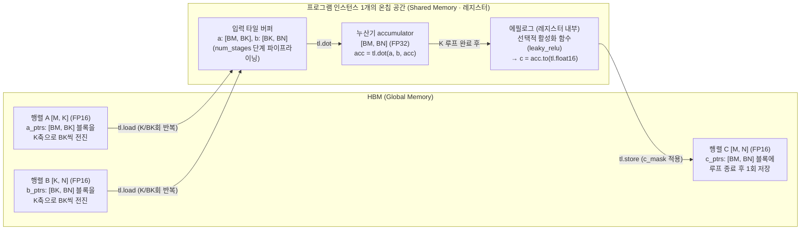
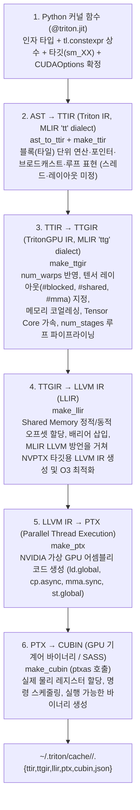

<WeekNavBar :week="7" topic="Tiled MatMul과 컴파일 과정" :researchers="[{'id': 'mbsong', 'name': 'mbsong', 'label': 'mbsong (송무복)', 'badge': 'NVIDIA A100 IR·SASS 실측'}, {'id': 'junpark', 'name': 'junpark', 'label': 'junpark (박준)', 'badge': 'RTX 5090 (sm_120) 실측 해부'}, {'id': 'singon', 'name': 'singon', 'label': 'singon (김신곤)', 'badge': 'L2 그룹핑 손계산 & IR 대응표'}, {'id': 'injokim', 'name': 'injokim', 'label': 'injokim (김인조)', 'badge': '알고리즘 & MLIR 하향 변환 종합'}, {'id': 'jaehyeong', 'name': 'jaehyeong', 'label': 'jaehyeong (이재형)', 'badge': '핵심 코드 & 컴파일 단계 요약'}]" />


**[7주차 안내] Tiled MatMul과 컴파일 과정**

안녕하세요! 7주차에는 **Python으로 작성한 2차원 Tiled MatMul 커널이 어떻게 타일 단위로 데이터를 재사용하고, `@triton.jit` 아래에서 어떤 컴파일 단계를 거쳐 GPU 기계어로 바뀌는지** 함께 살펴보려고 합니다.
4주차에 손계산으로 익힌 행렬곱 Tiling과 Roofline, 6주차에 살펴본 1차원 블록 인덱싱(`pid`, `offsets`, `mask`)과 행 단위 커널 결합(`Fused Softmax`)을 이어받아 이번에는 2차원 블록 행렬곱과 컴파일 파이프라인 내부로 한 걸음 더 들어가보겠습니다.
**“Python으로 작성한 2차원 Tiled MatMul 커널은 어떻게 타일 단위로 데이터를 재사용하며, 어떤 컴파일 단계를 거쳐 GPU 기계어로 바뀔까?”**

이번 주에는 2차원 포인터 블록과 `tl.dot` 누적, L2 캐시 적중률을 높이는 블록 실행 순서(Grouped Ordering), `@triton.autotune`을 통한 타일·파이프라인 탐색, 그리고 `Python AST → TTIR → TTGIR → LLVM IR → PTX → CUBIN`으로 내려가는 컴파일 과정을 함께 다룹니다. 여기서 익힌 블록 수준 DSL과 MLIR 기반 다단계 컴파일 구조는 8주차 **“Legato는 무엇을 해결해야 하는가”**에서 새로운 가속기용 프로그래밍 언어·컴파일러 스택을 분석하는 밑바탕이 됩니다.

공통 과제는 공식 Tutorial 03 코드와 컴파일 단계 개념을 읽고 타일 설정별 HBM 이동량·온칩 버퍼 크기·L2 그룹핑 효과를 손계산으로 따라가는 것입니다. 직접 실행해보고 싶은 분은 무료 GPU 런타임에서 행렬곱 벤치마크와 컴파일 산출물(`.asm`, `PTX`)을 확인할 수 있으며, 장비가 없어도 코드·IR 분석과 계산으로 충분히 참여할 수 있습니다.

**1. 공통으로 읽어오면 좋은 자료**

- [Triton Tutorial 03: Matrix Multiplication](https://triton-lang.org/main/getting-started/tutorials/03-matrix-multiplication.html#motivations)
**Motivations**, **Compute Kernel(Pointer Arithmetic, L2 Cache Optimizations)**, **Final Result**의 `matmul_kernel`·`matmul` 함수를 중심으로 읽어주세요. 4주차에 손으로 계산했던 `[BLOCK_SIZE_M, BLOCK_SIZE_N]` 출력 타일과 `BLOCK_SIZE_K` 누적 루프가 2차원 포인터 연산과 `tl.dot`, `accumulator` 코드로 어떻게 옮겨지는지 확인합니다. **Unit Test**와 **Benchmark** 절에서는 FP16 기준 검증과 `TFLOPs/s` 계산식을 중심으로 보고, FP8 예제는 선택으로 남겨두셔도 됩니다.

- [Triton 논문 (MAPL 2019): Triton: An Intermediate Language and Compiler for Tiled Neural Network Computations](https://www.eecs.harvard.edu/~htk/publication/2019-mapl-tillet-kung-cox.pdf)
**Section 4.2(Support for Tile-Level Data-Flow Analysis)**와 **Section 5(The Triton-JIT Compiler, 5.1~5.3절, 본문 4~7쪽)**의 개념 설명과 그림(Figure 4~7)을 중심으로 읽어주세요. 타일 단위 중간 표현(IR)에서 브로드캐스팅, 루프 프리페칭(Pre-Fetching), 계층적 타일링(Hierarchical Tiling), 메모리 병합(Coalescing), Shared Memory 할당과 동기화가 왜 컴파일러 패스로 자동화되는지 살펴봅니다. 논문 작성 시점(2019년)의 `Triton-C` 문법이나 PSSA 수식 세부는 외우지 않아도 되며, 현재 Triton 2.0+의 MLIR 기반 파이프라인(`TTIR → TTGIR`)과 어떻게 이어지는지는 참고자료에서 함께 비교합니다.

- [Modern GPU Programming: What Makes a Kernel Fast — GEMM & The Optimization Ladder](https://mlc.ai/modern-gpu-programming-for-mlsys/chapter_performance/index.html#gemm)
**GEMM**, **The Optimization Ladder**, **Reducing Idle Time Through Overlap**, **Occupancy and Resource Pressure** 절을 읽어주세요. 타일 크기가 산술 강도를 높이는 원리와 함께, 왜 계산 병목(Compute-bound) 구간에 들어선 뒤에도 데이터 이동과 연산의 중첩(파이프라이닝) 및 온칩 자원(Shared Memory·레지스터) 균형이 중요한지 확인합니다. 문서 속 B200 전용 명령(`tcgen05.mma`, TMEM) 세부는 이번 주 범위에 포함하지 않습니다.

**2. 해당 사항들을 다같이 정리해주세요**

**① 2차원 포인터 블록과 K축 누적 — 4주차 타일 수식이 코드의 어느 줄이 될까?**
`C = A @ B`(`A: [M, K]`, `B: [K, N]`, `C: [M, N]`)에서 프로그램 인스턴스 하나가 출력 타일 `C[m:m+BM, n:n+BN]` 하나를 계산하려면 2차원 주소를 어떻게 만들어야 할까?
`offs_am[:, None] * stride_am + offs_k[None, :] * stride_ak`처럼 브로드캐스팅으로 `[BM, BK]`와 `[BK, BN]` 크기의 2차원 포인터 블록을 만드는 원리와, K 루프를 돌 때마다 포인터를 `BLOCK_SIZE_K * stride`만큼 전진시키는 과정을 작은 그림으로 그려봐주세요. 입력 `A`·`B`는 FP16인데 누산기(`accumulator`)는 왜 `tl.float32`로 두는지, 그리고 루프 직후 `c = accumulator.to(tl.float16)` 전에 활성화 함수(`leaky_relu`)를 끼워 넣으면 왜 추가 HBM 왕복 없이 결합(Epilogue Fusion)되는지도 함께 정리해봅시다.
공통 자료인 Tutorial 03(**Motivations / Pointer Arithmetic / Final Result**)과 [`tl.dot` API 문서](https://triton-lang.org/main/python-api/generated/triton.language.dot.html) 중심

**② 프로그램 실행 순서와 L2 캐시(Grouped Ordering) — 같은 타일 크기인데 왜 실행 순서가 성능을 바꿀까?**
출력 타일들을 단순 행 우선(row-major) 순서로 실행할 때와 몇 개 행(`GROUP_SIZE_M`)씩 묶어 열 방향으로 진행할 때, 여러 프로그램 인스턴스가 동시에 필요로 하는 `A`·`B` 입력 타일 수는 어떻게 달라질까?
4주차 손계산에서는 “서로 다른 출력 타일 사이의 캐시 재사용은 없다”고 가정했지만 실제 GPU에는 모든 SM이 공유하는 **L2 캐시**가 있습니다. Tutorial 03의 9×9 블록 예시(`GROUP_SIZE_M = 3`)에서 처음 9개의 출력 블록을 계산할 때 필요한 입력 타일 수가 왜 **90개(row-major)에서 54개(grouped ordering)**로 줄어드는지 직접 세어 보고 그림으로 설명해봐주세요.
공통 자료인 Tutorial 03(**L2 Cache Optimizations**) 중심

**③ 메타파라미터와 자동 튜닝(`@triton.autotune`) — 타일 크기와 파이프라인 설정은 어떻게 고를까?**
`BLOCK_SIZE_M`, `BLOCK_SIZE_N`, `BLOCK_SIZE_K`, `GROUP_SIZE_M` 같은 타일 크기와 `num_warps`, `num_stages` 같은 컴파일 옵션은 왜 하나로 고정하지 않고 `triton.Config` 후보 목록으로 줄까?
`@triton.autotune(configs=..., key=['M', 'N', 'K'])`에서 `key`에 지정한 인자 값(및 입력 텐서 dtype)이 바뀔 때 언제 후보들을 다시 벤치마크하는지, 그리고 `num_warps`(인스턴스당 워프 수)와 `num_stages`(소프트웨어 파이프라이닝 단계 수)가 온칩 메모리(Shared Memory·레지스터) 사용량과 지연시간 은닉(overlap)에 어떤 영향을 주는지 정리해봐주세요.
공통 자료인 Tutorial 03, Modern GPU Programming(**Reducing Idle Time Through Overlap / Occupancy and Resource Pressure**), [`triton.autotune`](https://triton-lang.org/main/python-api/generated/triton.autotune.html)·[`triton.Config` API 문서](https://triton-lang.org/main/python-api/generated/triton.Config.html) 중심

**④ Triton 컴파일 파이프라인과 IR 계층 — Python 함수는 어떤 단계를 거쳐 GPU 기계어가 될까?**
`@triton.jit`가 붙은 Python 커널을 처음 호출할 때 내부에서는 어떤 중간 표현(IR)들을 거치며, 왜 한 번에 기계어로 바꾸지 않고 여러 단계로 나누어 내릴까(lowering)?
현대 Triton(MLIR 기반 백엔드)의 **`Python AST → TTIR(Triton IR, tt dialect) → TTGIR(TritonGPU IR, ttg dialect) → LLVM IR(LLIR) → PTX → CUBIN`** 단계별 역할을 도식으로 정리해봐주세요. 특히 스레드·메모리 배치를 아직 정하지 않은 블록 수준 표현(**TTIR**)과, `num_warps`·메모리 레이아웃(blocked, shared, dot operand)·`num_stages` 파이프라이닝·Tensor Core 명령 선택이 반영되는 GPU 특화 표현(**TTGIR**)이 어떻게 다른지 구분해봅시다.
공통 자료인 Triton 논문(4~5절)과 [Triton MLIR Dialects(`tt`·`ttg`) 문서](https://triton-lang.org/main/dialects/dialects.html), [MLIR 개요](https://mlir.llvm.org/) 중심

**⑤ 컴파일 산출물 확인과 벤치마크 — 생성된 IR과 `TFLOPs/s`는 어떻게 읽어야 할까?**
작성한 커널이 실제로 어떤 IR과 PTX 명령으로 번역되었는지, Shared Memory와 레지스터를 얼마나 쓰는지 어떻게 확인할 수 있을까?
컴파일된 커널의 `.asm['ttir']`, `.asm['ttgir']`, `.asm['llir']`, `.asm['ptx']`와 `.metadata`(`shared`, `num_warps`, `num_stages`) 또는 환경변수 `TRITON_KERNEL_DUMP=1`, `TRITON_PRINT_AUTOTUNING=1`의 활용법을 정리해봐주세요. 아울러 6주차 Softmax 벤치마크는 왜 `GB/s`를 잰 반면 Tutorial 03 행렬곱 벤치마크는 **`2 * M * N * K * 1e-12 / (ms * 1e-3)`으로 `TFLOPs/s`**를 계산하는지 4주차 Roofline 관점으로 연결해 설명해봅시다.
공통 자료인 Tutorial 03(**Benchmark**), [Triton GitHub: Debugging / Tips for Hacking](https://github.com/triton-lang/triton?tab=readme-ov-file#tips-for-hacking), [NVIDIA Matrix Multiplication Background](https://docs.nvidia.com/deeplearning/performance/dl-performance-matrix-multiplication/index.html#math-mem) 중심

**3. 정리할 때 담아오면 좋은 내용**

- 내가 맡은 질문에 대한 설명과 핵심 용어 3개
- 2차원 포인터 블록·L2 그룹핑(`GROUP_SIZE_M`) 또는 `AST → TTIR → TTGIR → LLVM IR → PTX → CUBIN` 컴파일 단계를 표현한 작은 그림 1개
- 타일 설정(`triton.Config`)별 HBM 이동량·산술 강도·온칩 버퍼 크기 비교표 또는 컴파일 단계별 변환 내용 비교표
- 계산이나 실습에 사용한 행렬 크기(`M, N, K`)·자료형(입력 FP16, 누산 FP32 등)·타일 설정과 실제 실행했다면 사용한 GPU 모델·소프트웨어 버전·측정 범위
- 참고한 자료의 링크·읽은 절과 함께 이야기하고 싶은 질문

가능하면 **Tutorial 03의 같은 `C = A @ B` 커널 코드**가 알고리즘·메모리 재사용 관점(①~③)과 컴파일러 IR 변환 관점(④~⑤)에서 어떻게 이어지는지 연결해 설명해보면 좋겠습니다.

**4. 함께 해볼 내용: Tiled MatMul의 데이터 재사용·L2 그룹핑과 컴파일 단계 연결하기**

먼저 **작은 9×9 출력 블록 그리드에서 L2 캐시 그룹핑(Grouped Ordering)의 효과**를 손으로 확인해봅시다.
`A`와 `B`가 각각 9×9개의 블록으로 나뉘어 있고(`num_pid_m = 9, num_pid_n = 9, K / BK = 9`), 처음 **9개의 출력 블록(`pid = 0 ~ 8`)**을 계산한다고 가정합니다.
- **행 우선 순서(Row-major):** `pid = 0 ~ 8`이 0번째 행의 출력 블록 9개(`C[0, 0] ~ C[0, 8]`)를 차례로 맡을 때 필요한 `A`의 행 블록 수와 `B`의 열 블록 수를 더해 총 몇 개의 입력 타일(90개)을 읽어야 하는지 세어 보세요.
- **그룹 순서(`GROUP_SIZE_M = 3`):** Tutorial 03의 그룹 순서 식에 `pid = 0 ~ 8`을 대입해 각 인스턴스가 맡는 `(pid_m, pid_n)` 좌표를 표로 적고, 3×3 정사각 구역을 계산할 때 필요한 입력 타일 수가 왜 **54개**(`27 + 27`)로 줄어드는지 확인해봅시다.

그다음 **`M = N = K = 4096`인 행렬곱 `C = A @ B`**를 Tutorial 03의 기본 자료형(**입력 `A`·`B`와 출력 `C`는 FP16 = 원소당 2 Byte**, **누산기 `accumulator`는 FP32 = 원소당 4 Byte**)으로 계산해 비교합니다. 연습용 가상 하드웨어는 **FP16 입력·FP32 누산 행렬 연산에 적용 가능한 성능 `P = 80 × 10¹² FLOPs/s` (80 TFLOPs/s)**, **HBM 대역폭 `BW = 1 × 10¹² Byte/s` (1 TB/s)**로 두겠습니다(분기점 `I_ridge = 80 FLOP/Byte`). 입력은 이미 장치 메모리에 올라와 있고, 4주차와 같이 출력 타일 사이의 L2 캐시 재사용은 없다고 가정합니다.

Tutorial 03의 `get_cuda_autotune_config()`에 들어 있는 아래 세 후보 설정을 비교해주세요.
- **후보 1:** `BLOCK_SIZE_M = 64, BLOCK_SIZE_N = 32, BLOCK_SIZE_K = 32`, `num_stages = 5`, `num_warps = 2`
- **후보 2:** `BLOCK_SIZE_M = 128, BLOCK_SIZE_N = 128, BLOCK_SIZE_K = 32`, `num_stages = 4`, `num_warps = 4`
- **후보 3:** `BLOCK_SIZE_M = 128, BLOCK_SIZE_N = 256, BLOCK_SIZE_K = 64`, `num_stages = 3`, `num_warps = 8`

각자 아래 항목을 계산하고 정리해봅시다.

- 전체 연산량 `F = 2MNK`와 세 후보의 실행 그리드 크기 `grid = (cdiv(M, BM) * cdiv(N, BN),)` 및 출력 타일당 K 루프 반복 횟수 `K / BK`
- 세 후보의 HBM 입력 읽기 Byte(`2 × MNK × (1/BN + 1/BM)`), 출력 쓰기 Byte(`2MN`), 총 이동량 `Q`, 산술 강도 `I = F/Q`, 가상 하드웨어에서의 이상적 실행시간 `T_ideal`과 병목 구간(대역폭 병목 vs 연산 병목)
- 한 단계(`1 stage`)의 `A`·`B` 입력 타일 크기 `2 × (BM × BK + BK × BN)` Byte, `num_stages`를 곱한 파이프라인 입력 버퍼 합계(`KiB`), 그리고 FP32 누산기 크기(`4 × BM × BN` Byte) — 만약 사용 중인 GPU의 블록(CTA)당 최대 Shared Memory가 `64 KiB`라면 어느 후보가 자원 한계(`OutOfResources`)에 걸리는지
- `matmul_kernel`의 핵심 구문(`tl.program_id`, 2차원 `tl.load`, `for k` 루프, `tl.dot`, `tl.store`)이 `AST → TTIR → TTGIR → LLVM IR → PTX`의 어느 단계에서 어떤 정보(블록 연산 → 워프 분할·메모리 레이아웃·파이프라이닝·Tensor Core 명령 → 가상 어셈블리)로 구체화되는지

**5. 실습 참여 방법: 무료 GPU에서 Tiled MatMul 실행과 컴파일 IR 확인하기**

직접 코드를 실행해보고 싶은 분은 5·6주차와 동일하게 [Google Colab](https://colab.research.google.com/) 또는 [Kaggle Notebooks](https://www.kaggle.com/code)의 무료 GPU 런타임을 이용할 수 있습니다. 아래 순서로 진행해보면 좋겠습니다.

1. **정확도 확인:** `512 × 512` FP16 입력과 2의 거듭제곱이 아닌 크기(예: `M = 500, N = 600, K = 300`)에서 Triton `matmul(a, b)`와 `torch.matmul(a, b)`의 결과가 `torch.allclose(..., atol=1e-2, rtol=0)`를 통과하는지 확인합니다.
2. **오토튜닝과 성능(`TFLOPs/s`) 비교:** 환경변수 `TRITON_PRINT_AUTOTUNING=1`을 켜거나 단일 `Config`와 오토튜닝 버전을 비교해, 배정받은 GPU에서 어떤 타일 설정이 선택되는지 확인하고 `triton.testing.do_bench`로 `M = N = K = 4096`(또는 메모리 여유에 맞춘 `2048`)의 실행시간(`ms`)과 `TFLOPs/s`를 측정합니다.
3. **컴파일 산출물(`IR`·`PTX`·메타데이터) 열어보기:** 단일 커널에 대해 컴파일된 객체의 `.metadata`(`shared`, `num_warps`, `num_stages`)와 `.asm['ttir']`, `.asm['ttgir']`, `.asm['ptx']` 앞부분(또는 `tl.dot`이 변환된 `tt.dot` / `mma` 명령 줄)을 출력해 확인합니다.
4. **조건 기록:** 배정받은 실제 GPU 이름(예: Tesla T4), 컴퓨트 능력(Compute Capability), PyTorch·Triton 버전, 선택된 `Config`를 함께 적어주세요. 튜토리얼 문서에 실린 A100 기준 수치를 내 실행 결과와 섞어 비교하지 않습니다.

GPU가 없는 환경이라면 손계산과 참고자료에 수록된 단계별 IR 예시 분석만으로 참여해도 충분합니다. CPU에서 2차원 포인터 오프셋과 마스킹 동작을 확인하고 싶다면 6주차처럼 `TRITON_INTERPRET=1`을 활용할 수 있습니다(단, CPU 해석기는 컴파일 파이프라인을 우회해 NumPy로 순차 실행하므로 `.asm` 확인이나 실행시간 비교에는 사용하지 않습니다).

정리한 뒤에는 **2차원 포인터 블록과 K 루프 누적으로 타일 행렬곱 코드를 설명할 수 있는지**, **타일 크기·`num_stages`·L2 그룹핑이 HBM 이동량과 온칩 메모리 사용량을 어떻게 바꾸는지 계산할 수 있는지**, **`TTIR → TTGIR → LLVM IR → PTX → CUBIN`에서 각 컴파일 단계가 맡는 역할을 구분할 수 있는지** 서로 확인해보겠습니다.

추가로 공부하면서 도움이 된 Triton 컴파일러 분석 글이나 디버깅 방법이 있으면 어떤 부분을 이해하는 데 좋았는지도 함께 공유해주세요!
그럼 다음 모임에서 뵙겠습니다!


---

# 7주차 참고자료 — Tiled MatMul과 컴파일 과정 계산 예제와 연습문제

안내문과 함께 사용할 운영·집필 참고자료입니다. **2차원 포인터 블록과 K축 누적 → L2 캐시 그룹핑 → 타일·파이프라인 설정과 Roofline → Triton 다단계 컴파일 파이프라인(`TTIR → TTGIR → LLVM IR → PTX → CUBIN`)** 순서로 살펴봅니다. 공통 읽기를 마친 뒤 맡은 질문에 맞는 선택 자료를 골라주세요.

자료 확인일: **2026-10-28**. 아래 계산 예제와 연습문제의 하드웨어 수치·가상 측정값은 원리를 명확히 비교하기 위해 구성한 **교육용 가상 조건의 계산 결과**이며, 특정 GPU의 실측 벤치마크가 아닙니다.

## 1. 자료별 읽을 범위와 쓰임

| 구분 | 자료 | 읽을 범위와 질문 |
|---|---|---|
| 공통 | [Triton Tutorial 03: Matrix Multiplication](https://triton-lang.org/main/getting-started/tutorials/03-matrix-multiplication.html#motivations) | **Motivations**, **Compute Kernel(Pointer Arithmetic, L2 Cache Optimizations)**, **Final Result**의 `matmul_kernel`·`matmul` 함수, **Unit Test / Benchmark**의 FP16 부분. 2차원 타일 주소와 K축 누적, L2 그룹핑, `@triton.autotune`이 한 커널 안에서 어떻게 결합될까? |
| 공통 | [Triton 논문 (MAPL 2019)](https://www.eecs.harvard.edu/~htk/publication/2019-mapl-tillet-kung-cox.pdf) | **Section 4.2(Support for Tile-Level Data-Flow Analysis)**와 **Section 5(The Triton-JIT Compiler, 5.1~5.3절, 본문 4~7쪽)**의 개념 설명과 Figure 4~7. 왜 타일 단위 IR을 두면 메모리 병합(Coalescing), Shared Memory 할당·동기화, 프리페칭을 컴파일러가 자동으로 처리할 수 있을까? |
| 공통 | [Modern GPU Programming: What Makes a Kernel Fast](https://mlc.ai/modern-gpu-programming-for-mlsys/chapter_performance/index.html#gemm) | **GEMM**, **The Optimization Ladder**, **Reducing Idle Time Through Overlap**, **Occupancy and Resource Pressure** 절. 타일 크기로 산술 강도를 높인 뒤에는 왜 데이터 이동과 연산의 중첩(파이프라이닝) 및 온칩 자원 균형이 중요해질까? |
| API 확인 | [`tl.dot`](https://triton-lang.org/main/python-api/generated/triton.language.dot.html) · [`triton.autotune`](https://triton-lang.org/main/python-api/generated/triton.autotune.html) · [`triton.Config`](https://triton-lang.org/main/python-api/generated/triton.Config.html) | 각 함수·클래스의 인자 설명. `acc` 누산기, `input_precision`, `configs`, `key`, `num_warps`, `num_stages`가 각각 무엇을 제어하는지 확인합니다. |
| MLIR 방언 | [Triton MLIR Dialects and Ops](https://triton-lang.org/main/dialects/dialects.html) · [`tt` Dialect](https://triton-lang.org/main/dialects/TritonDialect.html) · [`ttg` Dialect](https://triton-lang.org/main/dialects/TritonGPUDialect.html) | 목차와 도입부. 하드웨어 독립적인 블록 연산 표현(`tt`)과 GPU 스레드·메모리 레이아웃이 반영된 표현(`ttg`)을 구분합니다. |
| 컴파일러 구현 | [Triton GitHub: `compiler.py`](https://github.com/triton-lang/triton/blob/main/python/triton/compiler/compiler.py) · [NVIDIA 백엔드 `compiler.py`](https://github.com/triton-lang/triton/blob/main/third_party/nvidia/backend/compiler.py) · [`autotuner.py`](https://github.com/triton-lang/triton/blob/main/python/triton/runtime/autotuner.py) | `CompiledKernel.asm`, `add_stages`(`make_ttir`, `make_ttgir`, `make_llir`, `make_ptx`, `make_cubin`), `Autotuner._bench`의 `OutOfResources` 예외 처리 부분. |
| IR 덤프·디버깅 | [Triton GitHub README: Tips for hacking](https://github.com/triton-lang/triton?tab=readme-ov-file#tips-for-hacking) · [Debugging Triton](https://triton-lang.org/main/programming-guide/chapter-3/debugging.html) | `TRITON_KERNEL_DUMP=1`, `TRITON_DUMP_DIR`, `TRITON_PRINT_AUTOTUNING=1`, `MLIR_ENABLE_DUMP=1`, `TRITON_INTERPRET=1` 환경변수 설명. |
| 하드웨어·PTX 배경 | [NVIDIA Matrix Multiplication Background](https://docs.nvidia.com/deeplearning/performance/dl-performance-matrix-multiplication/index.html#math-mem) · [CUDA PTX ISA](https://docs.nvidia.com/cuda/parallel-thread-execution/index.html) | **2. Math And Memory Bounds / 3. Dimension Quantization Effects**. `2MNK` 연산량, 타일·웨이브 양자화, Tensor Core 행렬 명령(`mma.sync`)의 개념을 참고합니다. |
| 컴파일 인프라 배경 | [MLIR Overview](https://mlir.llvm.org/) | **Multi-Level Intermediate Representation Overview / What is MLIR for?**. 왜 여러 추상화 수준의 방언(dialect)을 단계적으로 낮추는지(lowering) 큰 그림을 확인합니다. |

### 자료를 읽을 때 구분할 시점·세대 차이

1. **2019년 MAPL 원 논문과 현재 Triton(2.0 이상)의 차이:** 2019년 논문은 초기 `Triton-C` 문법과 LLVM IR을 확장한 단일 `Triton-IR`을 기준으로 타일 수준 데이터 흐름 분석(계층적 타일링, 코얼레싱, Shared Memory 할당·동기화, 프리페칭)의 원리를 설명합니다. 반면 현재 사용하는 Triton(2.0+)은 **Python `@triton.jit` 프론트엔드**와 **MLIR 기반 다단계 백엔드(`TTIR → TTGIR → LLVM IR`)**로 재작성되었습니다. 논문에서는 **“왜 타일 단위 IR에서 컴파일러가 메모리와 스레드 스케줄링을 자동화할 수 있는가”**라는 핵심 아이디어를 읽고, 실제 코드와 IR 이름은 현재 MLIR 파이프라인 기준으로 정리합니다.
2. **외부 문서의 GPU 세대와 실습·가상 조건의 구분:** Tutorial 03 본문의 성능 향상 예시(`220 → 245 TFLOPS`)는 NVIDIA A100 기준이고, Modern GPU Programming 성능 장의 예시(`2 PFLOP/s`, `8 TB/s`, `TMA`, `tcgen05.mma`, `TMEM`)는 Blackwell B200 기준입니다. 이 숫자들을 아래 가상 하드웨어(`P = 80 TFLOPs/s`, `BW = 1 TB/s`)나 무료 Colab/Kaggle GPU(예: Tesla T4) 측정값과 섞어 쓰지 않습니다.

## 2. 이번 주 공동 정리의 뼈대

핵심 질문: **Python으로 작성한 2차원 Tiled MatMul 커널은 어떻게 타일 단위로 데이터를 재사용하며, 어떤 컴파일 단계를 거쳐 GPU 기계어로 바뀔까?**

1. 6주차의 1차원 블록(`offsets`)을 2차원 포인터 블록(`offs_am[:, None]`, `offs_k[None, :]`)으로 확장하고, `K` 방향으로 전진하며 `tl.dot`으로 누적하는 구조를 따라간다.
2. 출력 타일 하나 안에서의 온칩 재사용(4주차)에 더해, 여러 출력 타일의 **실행 순서(Grouped Ordering)**가 L2 캐시 적중률과 HBM 접근량을 어떻게 바꾸는지 계산한다.
3. `triton.Config`의 타일 크기(`BM, BN, BK`)와 컴파일 옵션(`num_stages`, `num_warps`)이 산술 강도, 파이프라이닝, 온칩 메모리(Shared Memory·레지스터) 한계에 미치는 영향을 비교한다.
4. `@triton.jit` 커널이 `Python AST → TTIR → TTGIR → LLVM IR → PTX → CUBIN`으로 변환되는 과정에서 각 단계가 결정하는 정보(블록 타입 → 워프·레이아웃·비동기 복사·Tensor Core 명령 → 메모리 오프셋 → 기계어)를 연결한다.
5. 컴파일된 커널의 `.asm`·`.metadata`와 벤치마크의 `TFLOPs/s` 지표를 읽고, 8주차 **Legato**가 왜 Python DSL과 MLIR 기반 다단계 컴파일러를 채택했는지 질문을 남긴다.

## 3. 2차원 포인터 블록과 K축 누적 — 4주차 타일 수식을 Triton 코드로 옮기기

`A`가 `[M, K]`, `B`가 `[K, N]`, `C`가 `[M, N]`인 행렬곱 `C = A @ B`를 생각합시다. Tutorial 03의 `matmul_kernel`은 프로그램 인스턴스 하나(`pid`)가 크기가 `[BLOCK_SIZE_M, BLOCK_SIZE_N]`(줄여서 `BM × BN`)인 **출력 타일 하나**를 전담합니다.



위 그림은 개념도입니다. Python 코드에서는 `a = tl.load(...)`, `accumulator = tl.dot(a, b, accumulator)`처럼 블록 변수만 다루지만, 컴파일러가 `TTGIR` 단계에서 `a`·`b` 타일을 Shared Memory 버퍼에 배치하고(`num_stages`만큼 다중 버퍼링), `accumulator`를 스레드별 레지스터 조각(fragment)에 나누어 유지합니다.

### 3.1 브로드캐스팅으로 2차원 포인터 블록 만들기

Row-major 2차원 텐서 `X`에서 원소 `X[i, j]`의 주소는 `x_ptr + i * stride_xi + j * stride_xj`입니다. 6주차에 1차원 벡터의 오프셋을 `tl.arange(0, BLOCK_SIZE)`로 만들었다면, 2차원 타일에서는 행 인덱스 벡터를 열 벡터(`[:, None]`)로, 열 인덱스 벡터를 행 벡터(`[None, :]`)로 넓혀 더합니다.

```python
# k = 0 (첫 번째 K 조각)에서의 포인터 블록 초기화
offs_am = (pid_m * BLOCK_SIZE_M + tl.arange(0, BLOCK_SIZE_M)) % M   # shape: [BM]
offs_bn = (pid_n * BLOCK_SIZE_N + tl.arange(0, BLOCK_SIZE_N)) % N   # shape: [BN]
offs_k = tl.arange(0, BLOCK_SIZE_K)                                 # shape: [BK]

# [BM, 1] + [1, BK] -> [BM, BK] 크기의 포인터 블록
a_ptrs = a_ptr + (offs_am[:, None] * stride_am + offs_k[None, :] * stride_ak)
# [BK, 1] + [1, BN] -> [BK, BN] 크기의 포인터 블록
b_ptrs = b_ptr + (offs_k[:, None] * stride_bk + offs_bn[None, :] * stride_bn)
```

그다음 `for k in range(0, tl.cdiv(K, BLOCK_SIZE_K)):` 루프 안에서 매 단계 `tl.dot`을 마칠 때마다 포인터 블록 전체를 K 방향으로 한 타일(`BLOCK_SIZE_K`)씩 전진시킵니다.

```python
a_ptrs += BLOCK_SIZE_K * stride_ak
b_ptrs += BLOCK_SIZE_K * stride_bk
```

`A`에서는 K가 열 방향이므로 `stride_ak`를 곱해 더하고, `B`에서는 K가 행 방향이므로 `stride_bk`를 곱해 더합니다.

### 3.2 왜 `M`·`N`축에는 `% M`, `% N`을 쓰고 `K`축에는 `mask`와 `other=0.0`을 쓸까?

행렬 크기 `M, N, K`가 타일 크기 `BM, BN, BK`의 배수가 아닐 때 범위 밖 메모리 접근을 막는 방식이 축마다 다릅니다.

| 축과 위치 | Tutorial 03의 처리 방식 | 이렇게 처리해도 결과가 정확한 이유 |
|---|---|---|
| `A`의 행(`M`), `B`의 열(`N`) 읽기 | `offs_am = (...) % M`<br/>`offs_bn = (...) % N` | `M`이나 `N`을 넘어가는 가장자리 행·열 인덱스를 `% M`, `% N`으로 감싸 유효한 주소(예: 0번 행·열)를 가리키게 합니다. 그 위치에서 읽은 값은 `accumulator`의 범위 밖 행·열 칸에만 더해지고, 마지막 `tl.store`에서 `c_mask`가 그 칸들의 저장을 막으므로 유효한 출력 원소에는 아무 영향을 주지 않습니다. |
| `A`의 열(`K`), `B`의 행(`K`) 읽기 | `mask = offs_k < K - k * BLOCK_SIZE_K`<br/>`other = 0.0` | `K`축은 곱해서 **더해지는(누적되는) 차원**입니다. 만약 `K`축의 빈자리에 `% K`로 엉뚱한 값을 읽어 오거나 `0.0`이 아닌 값을 채우면, 그 곱셈 결과가 **유효한 출력 원소들의 합계(`accumulator`)에 섞여 들어가 값이 틀려집니다.** 따라서 `K`축 초과 구간은 반드시 `0.0`으로 패딩해 곱셈 결과(`0 × 0 = 0`)가 누적합을 바꾸지 않게 해야 합니다. |
| `C`의 행(`M`)·열(`N`) 쓰기 | `c_mask = (offs_cm[:, None] < M) & (offs_cn[None, :] < N)` | 최종 출력 텐서 `C`의 유효 범위 안쪽 원소만 실제로 HBM에 기록합니다. |

### 3.3 왜 FP16 입력을 곱하면서 누산기(`accumulator`)는 FP32로 둘까?

- FP16(부동소수점 16비트)은 표현할 수 있는 유효숫자(가수부 10비트)와 지수 범위(최대 `65,504`)가 좁습니다. `K = 4096`처럼 수천 번 곱하고 더하는 내적을 FP16으로만 누적하면 작은 값들이 반올림되어 사라지거나(정밀도 손실) 합계가 범위를 넘기 쉽습니다.
- GPU의 Tensor Core 명령 역시 FP16/BF16 입력을 받아 **FP32 누산기 레지스터에 더하는 모드**를 기본으로 지원합니다. 따라서 `accumulator = tl.zeros((BLOCK_SIZE_M, BLOCK_SIZE_N), dtype=tl.float32)`로 선언해 K 루프 동안 정밀도를 유지하고, 루프가 끝난 뒤 한 번만 `c = accumulator.to(tl.float16)`으로 변환해 저장합니다.
- **에필로그 결합(Epilogue Fusion):** 루프가 끝난 직후 `accumulator`가 아직 온칩 레지스터(FP32)에 있을 때 `if ACTIVATION == "leaky_relu": accumulator = leaky_relu(accumulator)`를 수행하면, 행렬곱 결과를 HBM에 썼다가 다시 읽어 활성화 함수를 적용하는 별도 커널(`2MN × 2 Byte × 2회 = 8MN Byte` 추가 이동)을 완전히 없앨 수 있습니다.

## 4. 계산 예제 1 — 프로그램 실행 순서(Row-Major vs Grouped Ordering)와 L2 캐시 재사용

4주차 손계산에서는 “서로 다른 출력 타일 사이의 캐시 재사용은 없다”고 가정했습니다. 하지만 실제 GPU에서는 여러 SM에서 동시에(또는 연달아) 실행되는 프로그램 인스턴스들이 **칩 전체의 L2 캐시**를 공유합니다. 같은 `A` 행 타일이나 `B` 열 타일을 사용하는 프로그램 인스턴스들을 시간상 가깝게 배치하면, 먼저 실행된 인스턴스가 HBM에서 L2 캐시로 읽어 온 입력 타일을 이웃 인스턴스가 L2 캐시에서 바로 재사용할 수 있습니다.

Tutorial 03의 **L2 Cache Optimizations** 절에 나오는 **9×9 블록 행렬곱**(`num_pid_m = 9`, `num_pid_n = 9`, K축 블록 수도 `9`개, `GROUP_SIZE_M = 3`)에서 **처음 9개의 프로그램 인스턴스(`pid = 0, 1, ..., 8`)**가 계산하는 출력 블록 위치와 필요한 입력 타일 수를 직접 세어 봅시다.

### 4.1 두 실행 순서의 `(pid_m, pid_n)` 매핑 비교

출력 블록 하나 `C[pid_m, pid_n]`을 끝까지 계산하려면 `A`의 `pid_m`번째 블록 행 전체(**K 방향 타일 9개**)와 `B`의 `pid_n`번째 블록 열 전체(**K 방향 타일 9개**)가 필요합니다.

- **단순 행 우선 순서(Row-major ordering):**
  ```python
  pid_m = pid // 9
  pid_n = pid % 9
  ```
- **그룹 순서(Grouped ordering, `GROUP_SIZE_M = 3`):**
  ```python
  num_pid_in_group = 3 * 9  # 27
  group_id = pid // 27      # pid 0~8은 모두 group_id = 0
  first_pid_m = 0
  group_size_m = 3
  pid_m = first_pid_m + ((pid % 27) % 3)
  pid_n = (pid % 27) // 3
  ```

`pid = 0 ~ 8`을 두 식에 대입하면 다음과 같습니다.

| `pid` | 행 우선(Row-major) `(pid_m, pid_n)` | 그룹 순서(`GROUP_SIZE_M = 3`) `(pid_m, pid_n)` |
|---:|---|---|
| `0` | `(0, 0)` | `(0, 0)` |
| `1` | `(0, 1)` | `(1, 0)` |
| `2` | `(0, 2)` | `(2, 0)` |
| `3` | `(0, 3)` | `(0, 1)` |
| `4` | `(0, 4)` | `(1, 1)` |
| `5` | `(0, 5)` | `(2, 1)` |
| `6` | `(0, 6)` | `(0, 2)` |
| `7` | `(0, 7)` | `(1, 2)` |
| `8` | `(0, 8)` | `(2, 2)` |

```text
[행 우선 순서: pid 0~8의 위치]          [그룹 순서(GROUP_SIZE_M=3): pid 0~8의 위치]
  n=0 1 2 3 4 5 6 7 8                     n=0 1 2 3 4 5 6 7 8
m=0 [0 1 2 3 4 5 6 7 8]                 m=0 [0 3 6 . . . . . .]
m=1 [. . . . . . . . .]                 m=1 [1 4 7 . . . . . .]
m=2 [. . . . . . . . .]                 m=2 [2 5 8 . . . . . .]
(A의 0행만 공유, B는 0~8열 모두 필요)    (A의 0~2행과 B의 0~2열을 서로 공유)
```

### 4.2 처음 9개 출력 블록을 계산할 때 불러오는 입력 타일 수

| 항목 | 행 우선 순서 (Row-major) | 그룹 순서 (`GROUP_SIZE_M = 3`) |
|---|---:|---:|
| 계산하는 출력 블록 수 | 9개 (`C[0, 0] ~ C[0, 8]`) | 9개 (`C[0:3, 0:3]` 정사각 구역) |
| 필요한 `A`의 고유 블록 행 수 | 1개 행 (`m = 0`) | 3개 행 (`m = 0, 1, 2`) |
| 필요한 `A` 입력 타일 수 (행당 K-타일 9개) | `1 × 9 = 9`개 | `3 × 9 = 27`개 |
| 필요한 `B`의 고유 블록 열 수 | 9개 열 (`n = 0 ~ 8`) | 3개 열 (`n = 0, 1, 2`) |
| 필요한 `B` 입력 타일 수 (열당 K-타일 9개) | `9 × 9 = 81`개 | `3 × 9 = 27`개 |
| **총 고유 입력 타일 수** | **`9 + 81 = 90`개** | **`27 + 27 = 54`개** |

- 같은 9개의 출력 블록을 계산하는데도, 동시에(또는 연이어) 참조하는 고유 입력 타일 수가 **`90개 → 54개`로 40% 줄어듭니다.**
- 수학적으로 `G × (9/G)` 직사각형 대신 둘레가 가장 짧은 정사각형 가까운 구역(`3 × 3`)을 함께 계산할 때 `A` 행 수와 `B` 열 수의 합이 최소(`1 + 9 = 10` vs `3 + 3 = 6`)가 되기 때문입니다.
- 주의할 점: 그룹 순서는 **총 연산량(`2MNK`)이나 각 프로그램 인스턴스가 수행하는 `tl.load` 호출 횟수를 바꾸는 것이 아닙니다.** 이웃한 인스턴스들이 같은 `A`·`B` 타일을 비슷한 시점에 요청하게 만들어 **L2 캐시 적중률(hit rate)을 높이고 실제 HBM까지 나가는 트래픽을 줄이는 스케줄링 기법**입니다.

## 5. 계산 예제 2 — `M = N = K = 4096` FP16 Tiled MatMul에서 타일 설정과 온칩 메모리·Roofline 비교

이제 4주차 예제 2와 같은 크기인 **`M = N = K = 4096` 정사각 행렬곱**을 Tutorial 03의 설정에 맞춰 **FP16 입력·출력(원소당 2 Byte), FP32 누산(원소당 4 Byte)**으로 계산해 봅시다.

### 5.1 공통 가상 하드웨어와 계산 식

이 문서의 예제 2에서는 아래 교육용 가상 조건을 사용합니다.

- 가상 하드웨어: FP16 입력·FP32 누산 행렬 연산(Tensor Core류 경로)에 적용 가능한 성능 `P = 80 × 10¹² FLOPs/s` (**80 TFLOPs/s**), HBM 대역폭 `BW = 1 × 10¹² Byte/s` (**1 TB/s**).
- Roofline 분기점: `I_ridge = P / BW = 80 FLOP/Byte`.
- 입력 `A`, `B`와 최종 출력 `C`는 FP16(원소당 **2 Byte**), 온칩 누산기 `accumulator`는 FP32(원소당 **4 Byte**).
- 입력은 이미 HBM에 있고, 출력 `C`는 루프 종료 후 한 번만 HBM에 씁니다.
- 4주차와 동일하게 **한 출력 타일 안에서만 입력을 재사용하고, 서로 다른 출력 타일 사이의 L2 캐시 재사용은 없다**고 가정해 HBM 이동량의 기준선(상한)을 계산합니다.
- 단위는 `1 KiB = 1024 Byte`, `1 GB = 10⁹ Byte`, `1 TB = 10¹² Byte`입니다.

출력 타일 크기가 `BM × BN`, K 방향 조각 폭이 `BK`, 소프트웨어 파이프라인 단계 수가 `num_stages`, 워프 수가 `num_warps`(`1 warp = 32 threads`)일 때 각 식은 다음과 같습니다(`M, N, K`가 `BM, BN, BK`로 나누어떨어지는 경우).

```text
총 연산량 F           = 2 × M × N × K
프로그램 인스턴스 수  = (M / BM) × (N / BN)
인스턴스당 K 단계 수  = K / BK

1단계 A·B 입력 크기   = 2 Byte × (BM × BK + BK × BN)
파이프라인 입력 버퍼  = num_stages × 2 Byte × (BM × BK + BK × BN)
FP32 누산기 크기      = 4 Byte × BM × BN

HBM 입력 읽기 Q_read  = (M / BM) × (N / BN) × (K / BK) × 2 × (BM × BK + BK × BN)
                      = 2 × M × N × K × (1 / BN + 1 / BM)
HBM 출력 쓰기 Q_write = 2 × M × N
총 HBM 이동량 Q       = Q_read + Q_write
산술 강도 I           = F / Q
```

4주차 참고자료의 문제 3에서 확인했듯, 출력 타일 사이의 캐시 재사용이 없다는 가정에서는 `Q_read = 2MNK(1/BN + 1/BM)`에서 **`BK`가 약분되어 사라집니다.** 즉 HBM 기준 산술 강도 `I`는 출력 타일의 두 변 `BM`, `BN`이 결정하고, `BK`와 `num_stages`는 **한 번에 온칩 Shared Memory에 올려 두어야 하는 입력 버퍼 크기와 K 루프 반복 횟수**를 바꿉니다.

### 5.2 Tutorial 03의 세 가지 `triton.Config` 후보 비교

Tutorial 03의 `get_cuda_autotune_config()`에 실제로 포함된 세 가지 설정을 `M = N = K = 4096`에 적용해 비교해 봅시다.
모든 후보에서 총 연산량은 `F = 2 × 4096³ = 137,438,953,472 FLOPs` (`≈ 137.44 GFLOPs`)이고, 출력 쓰기량은 `Q_write = 2 × 4096² = 33,554,432 Byte` (`≈ 33.55 MB`)이며, 연산 시간 하한은 다음과 같습니다.

$$
T_{\mathrm{compute} } = \frac{137{,}438{,}953{,}472}{80 \times 10^{12} } \approx \mathbf{1.7180\ \mathrm{ms} }
$$

| 항목 | 후보 1 (`64×32×32`)<br/>`stages=5, warps=2` | 후보 2 (`128×128×32`)<br/>`stages=4, warps=4` | 후보 3 (`128×256×64`)<br/>`stages=3, warps=8` |
|---|---:|---:|---:|
| 출력 타일 `BM × BN`, K 폭 `BK` | `64 × 32`, `BK = 32` | `128 × 128`, `BK = 32` | `128 × 256`, `BK = 64` |
| 실행 그리드 `grid = (M/BM × N/BN,)` | `(64 × 128) = (8192,)` | `(32 × 32) = (1024,)` | `(32 × 16) = (512,)` |
| 출력 타일당 K 루프 횟수 `K / BK` | `128`회 | `128`회 | `64`회 |
| 1단계 `A + B` 입력 타일 크기 | `6,144 B` (`6 KiB`) | `16,384 B` (`16 KiB`) | `49,152 B` (`48 KiB`) |
| **`num_stages` 반영 입력 버퍼 합** | **`30,720 B` (`30 KiB`)** | **`65,536 B` (`64 KiB`)** | **`147,456 B` (`144 KiB`)** |
| **FP32 `accumulator` 크기 (`4·BM·BN`)** | **`8,192 B` (`8 KiB`)** | **`65,536 B` (`64 KiB`)** | **`131,072 B` (`128 KiB`)** |
| 인스턴스당 스레드 수 (`num_warps × 32`) | `64`개 (스레드당 누산 `32`개) | `128`개 (스레드당 누산 `128`개) | `256`개 (스레드당 누산 `128`개) |
| HBM 입력 읽기 `Q_read` | `6,442,450,944 B` | `2,147,483,648 B` | `1,610,612,736 B` |
| 총 HBM 이동량 `Q` (`Q_read + Q_write`) | `6,476,005,376 B` (`6.476 GB`) | `2,181,038,080 B` (`2.181 GB`) | `1,644,167,168 B` (`1.644 GB`) |
| **산술 강도 `I = F / Q`** | **`21.2228 FLOP/Byte`** | **`63.0154 FLOP/Byte`** | **`83.5918 FLOP/Byte`** |
| Roofline 성능 상한 `R_roof` | `21.2228 TFLOPs/s` | `63.0154 TFLOPs/s` | **`80.0000 TFLOPs/s`** |
| 메모리 시간 `T_memory = Q / BW` | `6.4760 ms` | `2.1810 ms` | `1.6442 ms` |
| **이상적 실행시간 `T_ideal`** | **`6.4760 ms`** | **`2.1810 ms`** | **`1.7180 ms`** |
| 이 모델에서의 제한 자원 | HBM 대역폭 (`I < 80`) | HBM 대역폭 (`I < 80`) | **연산 처리율 (`I > 80`)** |

### 5.3 계산표에서 읽어야 할 세 가지 포인트

1. **타일을 키우면 HBM 이동량이 줄어 분기점(`80 FLOP/Byte`)을 넘어선다:** 후보 1(`64×32`)에서는 `I ≈ 21.22 FLOP/Byte`로 대역폭 병목에 머물지만, 후보 3(`128×256`)에서는 `I ≈ 83.59 FLOP/Byte`가 되어 분기점(`80 FLOP/Byte`) 오른쪽인 **연산 병목(Compute-bound)** 구간에 들어갑니다(여기에 4절의 L2 캐시 그룹핑 재사용까지 더해지면 실제 유효 산술 강도는 더 높아집니다).
2. **`num_stages`는 지연시간을 숨기지만 Shared Memory 요구량을 `num_stages`배로 늘린다:** `num_stages = 3`인 후보 3은 현재 단계 `k`의 타일을 Tensor Core로 계산하는 동안 다음 단계 `k+1`, `k+2`의 타일을 미리 비동기로 읽어 오기 위해 Shared Memory에 **3단계치 버퍼(`48 KiB × 3 = 144 KiB`)**를 잡습니다.
3. **하드웨어 자원 한계(`OutOfResources`)와 오토튜닝의 이유:** 후보 3의 `144 KiB`는 A100(SM당 최대 164 KiB)이나 H100(최대 228 KiB)에는 들어가지만, 무료 Colab에서 자주 만나는 **Tesla T4(Turing `sm_75`, 블록당 최대 Shared Memory `64 KiB`)**에는 들어가지 않습니다. Triton 런타임은 커널 실행 직전 `shared > max_shared`이면 `OutOfResources` 예외를 발생시키며, `@triton.autotune`은 이 예외를 잡아 자동으로 탈락시키고 해당 GPU의 온칩 메모리에 들어가는 후보(예: 후보 1이나 `num_stages`가 작은 설정) 중 가장 빠른 것을 선택합니다.

## 6. Triton 컴파일 파이프라인 — `@triton.jit`에서 GPU 기계어(`CUBIN`)까지

6주차에서는 `@triton.jit` 함수를 처음 호출할 때 “JIT 컴파일이 일어난다”고만 설명했습니다. 이제 그 내부에서 Python 코드가 어떤 중간 표현(IR)들을 거쳐 GPU 실행 바이너리가 되는지 따라가 봅시다(근거: [Triton `compiler.py`](https://github.com/triton-lang/triton/blob/main/python/triton/compiler/compiler.py), [NVIDIA 백엔드 `compiler.py`](https://github.com/triton-lang/triton/blob/main/third_party/nvidia/backend/compiler.py)).



### 6.1 왜 한 번에 바꾸지 않고 여러 IR 단계를 거칠까?

| 단계 (`.asm` 키) | 추상화 수준 | 이 단계에서 새로 결정되거나 최적화되는 핵심 내용 |
|---|---|---|
| **Python AST** | 사용자 DSL | 파이썬 문법 트리에서 인자 자료형(`fp16*`, `i32` 등)과 `tl.constexpr` 상수(`BLOCK_SIZE_M=128` 등)를 고정합니다. |
| **`ttir`**<br/>(`tt` dialect) | **타일(블록) 수준**<br/>(하드웨어 독립적) | `tensor<128x64xf16>`처럼 **타일 전체를 하나의 값(SSA 변수)**으로 다룹니다. 인라인 전개, 상수 폴딩, 브로드캐스트 순서 정리, 공통 부분식 제거(CSE) 등 스레드 배치를 몰라도 할 수 있는 블록 수준 최적화를 수행합니다. |
| **`ttgir`**<br/>(`ttg` dialect) | **GPU 실행·레이아웃 수준**<br/>(가장 중요한 변환 단계) | `num_warps`개의 워프(스레드 `num_warps × 32`개)가 타일 원소를 어떻게 나눠 가질지 **레이아웃 인코딩(`#blocked`, `#shared`, `#mma`, `#dot_op`)**을 붙입니다. 연속 메모리 병합(`coalesce`), Tensor Core 명령 매핑(`accelerate_matmul`), `num_stages`에 따른 비동기 복사·루프 소프트웨어 파이프라이닝(`pipeline`), Shared Memory 중복 제거와 펜스·배리어 배치가 여기서 이루어집니다. |
| **`llir`**<br/>(`LLVM IR`) | **스레드·주소 수준** | 각 Shared Memory 버퍼의 생존 구간(live range)을 분석해 **실제 Shared Memory 바이트 크기(`metadata["shared"]`)와 오프셋을 할당**하고, 제어 흐름과 GPU 고유 내장 함수(NVVM intrinsics)를 갖춘 LLVM IR로 내린 뒤 LLVM `O3` 최적화를 적용합니다. |
| **`ptx`**<br/>(`PTX`) | **가상 GPU 어셈블리** | 타깃 아키텍처(예: `.target sm_80`)에 맞춘 텍스트 어셈블리입니다. 글로벌 로드(`ld.global` / `cp.async`), Shared Memory 로드(`ldmatrix`), Tensor Core 행렬곱(`mma.sync.aligned...`), 글로벌 스토어(`st.global`) 명령을 눈으로 확인할 수 있습니다. |
| **`cubin`**<br/>(`SASS` 기계어) | **물리 GPU 바이너리** | NVIDIA 어셈블러 `ptxas`가 PTX를 실제 하드웨어 기계어(SASS)로 어셈블하며 **스레드당 물리 레지스터 개수(`n_regs`)와 레지스터 스필(`n_spills`) 여부**를 최종 확정합니다. |

### 6.2 `matmul_kernel`의 한 줄이 각 컴파일 단계에서 바뀌는 모습

Tutorial 03의 핵심 코드 다섯 부분이 파이프라인을 따라 내려가며 어떻게 구체화되는지 대조해 보면 전체 흐름이 한눈에 들어옵니다.

| Python 코드 (`matmul_kernel`) | `TTIR` (`tt` dialect) | `TTGIR` (`ttg` dialect) | `LLVM IR` / `PTX` |
|---|---|---|---|
| `offs_am[:, None] * stride_am + offs_k[None, :] * stride_ak`<br/>`a_ptrs = a_ptr + ...` | `tt.make_range`, `tt.expand_dims`, `tt.broadcast`, `tt.splat`, `tt.addptr`로 `[BM, BK]` 포인터 텐서 생성 | 각 스레드가 글로벌 메모리에서 연속된 주소를 읽도록 `#blocked` 레이아웃 기준으로 스레드별 담당 주소 계산 | 스레드 인덱스(`%tid.x`)에서 시작해 자신이 읽을 원소의 64비트 메모리 주소를 계산하는 정수 연산 명령(`mad.lo.s32`, `add.s64`) |
| `a = tl.load(a_ptrs, mask=..., other=0.0)` | `tt.load %a_ptrs, %mask, %other : tensor<BMxBKx!tt.ptr<f16>>` | 글로벌(`#blocked`)에서 읽어 Shared Memory(`#shared`, 뱅크 충돌 방지 swizzle 포함)에 넣는 `ttg.local_alloc` / 비동기 복사 연산으로 변환 | Ampere(`sm_80`) 이상 파이프라인에서는 `cp.async.cg.shared.global`(HBM→Shared Memory 직접 비동기 복사), 이전 세대에서는 `ld.global` 후 `st.shared` |
| `for k in range(0, tl.cdiv(K, BLOCK_SIZE_K)):` | `scf.for` 구조화 루프 (반복마다 로드 → `tt.dot` → 포인터 증가) | `num_stages` 단계 소프트웨어 파이프라인 루프로 재구성: 프롤로그에서 `num_stages-1`개 타일을 미리 요청하고 본 루프에서 계산과 다음 타일 로드를 겹침 | `cp.async.commit_group` / `cp.async.wait_group` 및 `bar.sync`(Shared Memory 동기화 배리어)가 포함된 루프 어셈블리 |
| `accumulator = tl.dot(a, b, accumulator)` | `tt.dot %a, %b, %acc : tensor<BMxBKxf16> * tensor<BKxBNxf16> -> tensor<BMxBNxf32>` | Shared Memory(`#shared`)에서 Tensor Core 입력 레지스터 레이아웃(`#dot_op`)으로 읽는 `ttg.local_load` + `#mma` 레이아웃을 갖는 `tt.dot` | `ldmatrix.sync.aligned`로 Shared Memory에서 레지스터로 조각을 올린 뒤 `mma.sync.aligned.m16n8k16.row.col.f32.f16.f16.f32` (또는 세대별 `mma` / `wgmma`) 실행 |
| `if ACTIVATION == "leaky_relu": ...`<br/>`c = accumulator.to(tl.float16)`<br/>`tl.store(c_ptrs, c, mask=c_mask)` | `arith.cmpf`, `arith.mulf`, `arith.select`(에필로그) → `arith.truncf` → `tt.store` | `#mma` 레지스터 레이아웃 상태 그대로 각 스레드가 자기 담당 원소에 활성화 함수·FP16 변환을 수행한 뒤 스토어용 `#blocked` 레이아웃으로 재배치(`ttg.convert_layout`) | 레지스터 위에서 비교·곱셈·형변환(`cvt.rn.f16.f32`) 후 조건부 실행 프리디케이트(`@p0 st.global.b16` 또는 벡터화된 `st.global.v4.b32`)로 HBM에 저장 |

### 6.3 캐시 키(Cache Key)와 `@triton.autotune`의 동작 경계

컴파일과 오토튜닝을 다룰 때는 **① 개별 커널 컴파일 캐시(`@triton.jit`)**와 **② 오토튜닝 탐색 캐시(`@triton.autotune`)**의 두 층을 구분해야 합니다.

1. **`@triton.jit`의 컴파일 캐시:**
   - 커널 함수의 소스 코드 해시, 인자들의 **타입과 정렬 여부**(예: 포인터 타입 `*fp16`, `16`바이트 배수 정렬 여부), **`tl.constexpr` 매개변수의 값**(`BLOCK_SIZE_M=128`, `ACTIVATION="leaky_relu"` 등), **`CUDAOptions`**(`num_warps`, `num_stages` 등), **타깃 GPU 아키텍처(`sm_75`, `sm_80` 등)**와 관련 환경변수를 묶어 SHA-256 해시를 만듭니다.
   - 따라서 `M, N, K`가 일반 정수 인자(비-`constexpr`)로 넘어오면, 행렬 크기 `M, N, K`가 바뀌더라도 `BLOCK_SIZE_*` 등 `tl.constexpr` 값이 그대로라면 **커널을 다시 컴파일하지 않고** 이미 컴파일된 `CUBIN`을 그대로 재사용합니다. 반대로 `BLOCK_SIZE_M`이나 `ACTIVATION`(`tl.constexpr`)이 바뀌면 다른 코드로 간주해 새로 컴파일합니다.
2. **`@triton.autotune(configs=..., key=['M', 'N', 'K'])`의 튜닝 캐시:**
   - `key`로 지정한 인자들의 현재 값 `(M, N, K)`와 텐서 인자들의 `dtype`을 묶어 튜닝 키(예: `(4096, 4096, 4096, 'torch.float16', 'torch.float16', 'torch.float16')`)를 만듭니다.
   - 이 튜닝 키가 처음 등장하면 `configs` 목록의 모든 `triton.Config` 후보를 각각 JIT 컴파일하고 `do_bench`로 실행시간을 재어 가장 빠른 `Config` 하나를 메모리에 기록합니다.
   - 이후 같은 `(M, N, K)`와 `dtype`으로 호출하면 탐색 없이 캐시된 최적 `Config`로 즉시 실행됩니다. 하지만 `(M, N, K)`가 새로운 값(예: `(2048, 2048, 2048)`)으로 바뀌면 그 크기에 맞는 최적 타일을 찾기 위해 후보들을 다시 벤치마크합니다.

## 7. 실습 및 컴파일 산출물 확인 가이드

### 7.1 설치나 GPU 없이 바로 실행하는 Python 검산 스크립트

아래 코드는 표준 Python 3만 있으면 어느 환경에서든 바로 실행할 수 있습니다. 4절(예제 1), 5절(예제 2), 8~9절(연습문제 1~3)의 모든 수치를 독립적으로 계산하고 검증합니다.

```python
# 7주차 계산 예제 및 연습문제 독립 검산 코드 (Python 3 표준 라이브러리만 사용)
import math

print("=== [예제 1] 9x9 그리드 L2 캐시 그룹핑 (GROUP_SIZE_M = 3) ===")
num_pid_m, num_pid_n, k_blocks, G = 9, 9, 9, 3
rm_coords = [(pid // num_pid_n, pid % num_pid_n) for pid in range(9)]
grp_coords = []
for pid in range(9):
    num_in_grp = G * num_pid_n
    grp_id = pid // num_in_grp
    first_m = grp_id * G
    g_size = min(num_pid_m - first_m, G)
    pid_m = first_m + ((pid % num_in_grp) % g_size)
    pid_n = (pid % num_in_grp) // g_size
    grp_coords.append((pid_m, pid_n))

rm_tiles = (len({m for m, _ in rm_coords}) + len({n for _, n in rm_coords})) * k_blocks
grp_tiles = (len({m for m, _ in grp_coords}) + len({n for _, n in grp_coords})) * k_blocks
print(f"Row-major pid 0~8: {rm_coords} -> 입력 타일 {rm_tiles}개")
print(f"Grouped   pid 0~8: {grp_coords} -> 입력 타일 {grp_tiles}개 ({(rm_tiles-grp_tiles)/rm_tiles*100:.1f}% 감소)")

print("\n=== [예제 2] M=N=K=4096 FP16 입력·출력 / FP32 누산 타일 후보 비교 ===")
M = N = K = 4096
F = 2 * M * N * K
P, BW = 80e12, 1e12
t_comp_ms = F / P * 1e3
configs = [
    ("후보 1 (64x32x32, stages=5, warps=2)", 64, 32, 32, 5, 2),
    ("후보 2 (128x128x32, stages=4, warps=4)", 128, 128, 32, 4, 4),
    ("후보 3 (128x256x64, stages=3, warps=8)", 128, 256, 64, 3, 8),
]
for name, BM, BN, BK, stages, warps in configs:
    grid = (M // BM) * (N // BN)
    k_steps = K // BK
    stage_ab = 2 * (BM * BK + BK * BN)
    pipe_ab = stages * stage_ab
    acc_bytes = 4 * BM * BN
    q_read = grid * k_steps * stage_ab
    q_write = 2 * M * N
    q_total = q_read + q_write
    I = F / q_total
    t_mem_ms = q_total / BW * 1e3
    t_ideal_ms = max(t_comp_ms, t_mem_ms)
    print(f"{name}: grid=({grid},), K루프={k_steps}, 1단계AB={stage_ab//1024}KiB, "
          f"파이프라인AB={pipe_ab//1024}KiB, 누산기={acc_bytes//1024}KiB, "
          f"Q={q_total:,}B ({q_total/1e9:.3f}GB), I={I:.4f}, T_ideal={t_ideal_ms:.4f}ms")
```

### 7.2 무료 GPU(Colab·Kaggle)에서 컴파일 산출물(`.asm`·`.metadata`) 확인하기

Colab이나 Kaggle에서 GPU 런타임을 연결했다면, Tutorial 03 커널에서 `@triton.autotune`을 잠시 떼어 내거나 단일 커널 함수를 정의해 아래와 같이 **실제 생성된 각 단계의 IR과 하드웨어 자원 할당량**을 직접 출력해 볼 수 있습니다.

```python
# GPU 환경(Colab/Kaggle)에서 컴파일 단계별 IR과 메타데이터를 확인하는 예시 스크립트
import torch
import triton
import triton.language as tl

@triton.jit
def simple_matmul_kernel(
    a_ptr, b_ptr, c_ptr,
    M, N, K,
    stride_am, stride_ak,
    stride_bk, stride_bn,
    stride_cm, stride_cn,
    BLOCK_SIZE_M: tl.constexpr, BLOCK_SIZE_N: tl.constexpr, BLOCK_SIZE_K: tl.constexpr,
):
    pid = tl.program_id(axis=0)
    num_pid_n = tl.cdiv(N, BLOCK_SIZE_N)
    pid_m = pid // num_pid_n
    pid_n = pid % num_pid_n

    offs_am = (pid_m * BLOCK_SIZE_M + tl.arange(0, BLOCK_SIZE_M)) % M
    offs_bn = (pid_n * BLOCK_SIZE_N + tl.arange(0, BLOCK_SIZE_N)) % N
    offs_k = tl.arange(0, BLOCK_SIZE_K)
    a_ptrs = a_ptr + (offs_am[:, None] * stride_am + offs_k[None, :] * stride_ak)
    b_ptrs = b_ptr + (offs_k[:, None] * stride_bk + offs_bn[None, :] * stride_bn)

    acc = tl.zeros((BLOCK_SIZE_M, BLOCK_SIZE_N), dtype=tl.float32)
    for k in range(0, tl.cdiv(K, BLOCK_SIZE_K)):
        a = tl.load(a_ptrs, mask=offs_k[None, :] < K - k * BLOCK_SIZE_K, other=0.0)
        b = tl.load(b_ptrs, mask=offs_k[:, None] < K - k * BLOCK_SIZE_K, other=0.0)
        acc = tl.dot(a, b, acc)
        a_ptrs += BLOCK_SIZE_K * stride_ak
        b_ptrs += BLOCK_SIZE_K * stride_bk

    c = acc.to(tl.float16)
    offs_cm = pid_m * BLOCK_SIZE_M + tl.arange(0, BLOCK_SIZE_M)
    offs_cn = pid_n * BLOCK_SIZE_N + tl.arange(0, BLOCK_SIZE_N)
    c_ptrs = c_ptr + stride_cm * offs_cm[:, None] + stride_cn * offs_cn[None, :]
    c_mask = (offs_cm[:, None] < M) & (offs_cn[None, :] < N)
    tl.store(c_ptrs, c, mask=c_mask)

# 실행 및 컴파일 결과 확인 (GPU 필요)
M, N, K = 512, 512, 512
a = torch.randn((M, K), device="cuda", dtype=torch.float16)
b = torch.randn((K, N), device="cuda", dtype=torch.float16)
c = torch.empty((M, N), device="cuda", dtype=torch.float16)

grid = (triton.cdiv(M, 64) * triton.cdiv(N, 64),)
compiled = simple_matmul_kernel[grid](
    a, b, c, M, N, K,
    a.stride(0), a.stride(1),
    b.stride(0), b.stride(1),
    c.stride(0), c.stride(1),
    BLOCK_SIZE_M=64, BLOCK_SIZE_N=64, BLOCK_SIZE_K=32,
    num_warps=4, num_stages=2,
)

print("정확도 통과 여부:", torch.allclose(c, torch.matmul(a, b), atol=1e-2, rtol=0))
print("컴파일 산출물 키 목록:", list(compiled.asm.keys()))
print("할당된 Shared Memory (Byte):", compiled.metadata.shared)
print("워프 수 / 파이프라인 단계:", compiled.metadata.num_warps, compiled.metadata.num_stages)

# 각 단계에서 행렬곱(dot / mma) 관련 줄만 찾아 보기
for stage in ["ttir", "ttgir", "ptx"]:
    lines = [line for line in compiled.asm[stage].splitlines() if ("dot" in line or "mma" in line)]
    print(f"\n--- [{stage}] dot/mma 관련 줄 (상위 5개) ---")
    for line in lines[:5]:
        print(" ", line.strip())
```

파일로 전체 IR을 받아 보고 싶다면 커널을 실행하기 전에 환경변수 `TRITON_KERNEL_DUMP=1`, `TRITON_DUMP_DIR=./ir_dump`, `TRITON_ALWAYS_COMPILE=1`을 설정하면 지정한 폴더에 `.ttir`, `.ttgir`, `.llir`, `.ptx`, `.cubin` 파일이 저장됩니다. 오토튜닝 과정에서 어떤 `Config`가 선택되었는지 보려면 `TRITON_PRINT_AUTOTUNING=1`을 설정합니다.

### 7.3 왜 6주차 Softmax는 `GB/s`를 재고 7주차 MatMul은 `TFLOPs/s`를 잴까?

- 6주차의 Fused Softmax는 산술 강도가 약 `0.62 FLOP/Byte`(FP32 기준)로 분기점 왼쪽의 **HBM 대역폭 병목(Memory-bound)** 작업이었습니다. 따라서 “최소 필수 이동량(`2MN` 원소)을 측정 시간으로 나눈 유효 대역폭(`GB/s`)이 하드웨어 대역폭 상한에 얼마나 가까운가”가 핵심 지표였습니다.
- 반면 충분히 큰 행렬곱(`M = N = K = 4096`)은 타일 재사용을 거치면 산술 강도가 수십~수백 `FLOP/Byte`로 올라가 **연산 처리율 병목(Compute-bound)** 구간에 놓입니다. 따라서 Tutorial 03의 벤치마크 함수는 총 연산량 `2MNK`를 실행시간으로 나눈 **달성 연산 처리율(`TFLOPs/s`)**을 계산해 GPU의 Tensor Core 연산 상한 및 cuBLAS와 비교합니다.

$$
\text{달성 연산 처리율 (TFLOPs/s)} = \frac{2 \times M \times N \times K \times 10^{-12} }{\text{실행시간(ms)} \times 10^{-3} }
$$

## 8. 연습문제 3개

### 문제 1 — 나누어떨어지지 않는 행렬(`500 × 600 × 300`)에서 포인터 모듈로(`%`)와 마스킹

Tutorial 03의 `matmul_kernel`로 **`M = 500, N = 600, K = 300`**인 FP16 행렬곱 `A[500, 300] @ B[300, 600] = C[500, 600]`을 계산합니다. 타일 크기는 **`BLOCK_SIZE_M = 128, BLOCK_SIZE_N = 128, BLOCK_SIZE_K = 64`**로 두겠습니다.

1. `num_pid_m = cdiv(500, 128)`, `num_pid_n = cdiv(600, 128)`, 전체 프로그램 인스턴스 수 `grid`, 그리고 각 인스턴스가 도는 K 루프 반복 횟수 `cdiv(300, 64)`를 구하세요.
2. 우하단 모서리 출력 타일을 맡은 인스턴스(`pid_m = 3, pid_n = 4`)에서 `offs_cm`과 `offs_cn`이 가리키는 인덱스 범위를 적고, 이 `128 × 128`(`16,384`개) 출력 타일 안에서 실제로 유효한 원소 수와 `c_mask`에 의해 쓰기가 막히는 원소 수를 구하세요.
3. 마지막 K 루프 단계(`k = 4`)에서 `K - k * BLOCK_SIZE_K`는 얼마이며, `offs_k`(`0 ~ 63`) 가운데 실제로 읽히는 유효 K축 폭과 `other = 0.0`으로 채워지는 K축 폭은 각각 몇 칸인가요?
4. `A`의 행(`offs_am`)과 `B`의 열(`offs_bn`)에는 마스크 대신 `% M`, `% N`을 써서 0번 행·열 등의 값을 중복해서 읽어 오는데도 유효한 출력 원소 값이 틀리지 않는 이유와, 반대로 K축 읽기에서 `other = 0.0` 대신 `other = 1.0`을 쓰면 유효한 출력 원소까지 틀려지는 이유를 설명해보세요.

### 문제 2 — 8×8 그리드의 L2 그룹핑과 온칩 Shared Memory 한계 판정

1. `A`와 `B`가 각각 8×8개의 블록으로 나뉘어 있는 행렬곱(`num_pid_m = 8, num_pid_n = 8, K / BK = 8`)에서 **처음 8개의 프로그램 인스턴스(`pid = 0 ~ 7`)**를 실행합니다. **단순 행 우선 순서(Row-major)**와 **`GROUP_SIZE_M = 2`인 그룹 순서**에서 `pid = 0 ~ 7`이 맡는 `(pid_m, pid_n)` 좌표를 각각 구하고, 두 순서가 필요로 하는 고유 입력 타일(K-타일 포함)의 총개수와 감소율(%)을 계산하세요.
2. 5절 예제 2(`M = N = K = 4096`, FP16 입력·출력, FP32 누산)의 세 후보(`후보 1: 64×32×32, num_stages=5`, `후보 2: 128×128×32, num_stages=4`, `후보 3: 128×256×64, num_stages=3`)를 두 가상 장치에 배치하려고 합니다. 프로그램 인스턴스(CTA) 하나가 쓸 수 있는 최대 Shared Memory가 **장치 가는 `64 KiB`**, **장치 나는 `164 KiB`**라고 할 때, 파이프라인 입력 버퍼(`num_stages × 1단계 A·B 합`) 기준으로 각 장치에서 실행 가능한 후보를 고르세요.
3. 장치 가(`64 KiB` 한계)에서 `@triton.autotune`으로 세 후보를 모두 넣으면 `후보 3`(`144 KiB`)은 어떻게 처리되며, 통과한 후보 중 가장 큰 산술 강도와 그때의 이상적 실행시간(5절 가상 하드웨어 기준)은 얼마인가요?

### 문제 3 — 가상 측정값으로 보는 `TFLOPs/s`, 오토튜닝 손익분기점, 컴파일 캐시

`M = N = K = 4096` FP16 행렬곱(`F = 2MNK`)을 어떤 GPU에서 측정했더니 다음과 같은 가상 결과를 얻었다고 가정합시다. **(연습을 위한 가상 측정값이며 실제 GPU 측정 결과가 아닙니다.)**

| 실행 경로 | 최초 오토튜닝 탐색 시간 | 반복 실행 커널 시간 (`do_bench` 중앙값) |
|---|---:|---:|
| 고정 설정 (`64×32×32, stages=5, warps=2`) | `0 ms` (단일 설정) | `1.6000 ms` |
| 오토튜닝 최적 설정 (`128×256×64, stages=3, warps=8`) | `900 ms` (후보 전체 탐색) | `0.6872 ms` |
| `torch.matmul(a, b)` (cuBLAS) | `0 ms` | `0.7000 ms` |

1. Tutorial 03의 벤치마크 식(`2 * M * N * K * 1e-12 / (ms * 1e-3)`)으로 세 경로의 달성 연산 처리율(`TFLOPs/s`)을 각각 구하고, 반복 실행에서 오토튜닝 최적 설정이 고정 설정 및 `torch.matmul`보다 각각 몇 배 빠른지 구하세요.
2. 같은 `(4096, 4096)` 입력으로 행렬곱을 **딱 1번만 실행**할 때와 **1,000번 반복 실행**할 때, 오토튜닝 탐색 시간(`900 ms`)을 포함한 총 소요 시간을 고정 설정과 비교하세요(단일 커널 JIT 컴파일 시간은 두 경로가 같다고 가정해 제외합니다). 최소 몇 번 이상 호출할 때부터 오토튜닝 경로의 총 시간이 고정 설정보다 짧아지나요?
3. 이후 호출에서 ① 입력 텐서 크기가 `M = N = K = 2048`로 바뀌는 경우와, ② 크기는 `4096`으로 같지만 `ACTIVATION="leaky_relu"`(`tl.constexpr`)를 새로 넘기는 경우에 `@triton.autotune(key=['M', 'N', 'K'])`과 `@triton.jit` 컴파일 캐시가 각각 어떻게 동작하는지 설명해보세요.

## 9. 해답과 해설

<details class="t2s-solution-toggle">
<summary>💡 연습문제 해답 및 상세 풀이 펼치기 (스스로 먼저 풀어본 뒤 클릭하세요)</summary>

### 9.1 문제 1 해답 — `500 × 600 × 300` 행렬의 포인터와 마스킹

1. **그리드 크기와 K 루프 횟수:**
   - `num_pid_m = ceil(500 / 128) =` **`4`**
   - `num_pid_n = ceil(600 / 128) =` **`5`**
   - 전체 프로그램 인스턴스 수: `grid = (4 × 5,) =` **`(20,)`**
   - 인스턴스당 K 루프 반복 횟수: `ceil(300 / 64) =` **`5`회** (`k = 0, 1, 2, 3, 4`)
2. **우하단 모서리 타일(`pid_m = 3, pid_n = 4`)의 유효 범위와 마스크:**
   - `offs_cm = 3 × 128 + arange(0, 128) =` **`384 ~ 511`** (이 중 `< 500`인 유효 행은 `384 ~ 499`의 **`116`개**, 범위 밖은 `500 ~ 511`의 `12`개)
   - `offs_cn = 4 × 128 + arange(0, 128) =` **`512 ~ 639`** (이 중 `< 600`인 유효 열은 `512 ~ 599`의 **`88`개**, 범위 밖은 `600 ~ 639`의 `40`개)
   - 타일 전체 원소 `128 × 128 = 16,384`개 가운데 `c_mask`가 참(`True`)인 유효 출력 원소는 `116 × 88 =` **`10,208`개**이고, 쓰기가 막히는 원소는 `16,384 − 10,208 =` **`6,176`개**입니다.
3. **마지막 K 단계(`k = 4`)의 K축 마스크:**
   - 남은 K 원소 수: `K - k * BLOCK_SIZE_K = 300 − 4 × 64 =` **`44`**
   - 따라서 `offs_k`(`0 ~ 63`) 가운데 **`0 ~ 43`의 `44`칸**은 실제 메모리에서 읽고, **`44 ~ 63`의 `20`칸**은 마스크가 거짓(`False`)이 되어 `other = 0.0`으로 채워집니다.
4. **`% M`·`% N` 모듈로와 `other = 0.0`의 차이:**
   - 행렬곱에서 `C[i, j] = sum_k A[i, k] * B[k, j]`는 **출력의 행 `i`와 열 `j`가 서로 다른 원소들과 섞이지 않고, 오직 `k` 방향으로만 더해집니다.** 따라서 `i >= M`이거나 `j >= N`인 바깥쪽 행·열이 `% M`, `% N`으로 0번 행·열의 값을 읽어 와 계산하더라도 그 결과는 `accumulator`의 바깥쪽 칸(`i >= 500` 또는 `j >= 600`)에만 머물며, 마지막 `tl.store`에서 `c_mask`로 버려집니다.
   - 반면 `k` 방향은 유효한 `(i, j)` 원소 하나의 값을 만드는 내적 합계에 직접 더해집니다. 만약 마지막 단계(`k = 4`)의 빈자리 `20`칸에 `other = 1.0`을 넣으면, 모든 유효 출력 원소에 `20 × (1.0 × 1.0) = 20.0`만큼의 가짜 값이 추가로 더해져 전체 결과가 왜곡됩니다.

### 9.2 문제 2 해답 — 8×8 L2 그룹핑과 Shared Memory 한계

1. **8×8 그리드(`K / BK = 8`)에서 `pid = 0 ~ 7`의 비교:**
   - **행 우선 순서(Row-major):** `pid = 0 ~ 7`은 `(0, 0), (0, 1), ..., (0, 7)`을 맡습니다. 필요한 `A` 블록 행은 `1`개(`m = 0`), `B` 블록 열은 `8`개(`n = 0 ~ 7`)이므로 고유 입력 타일 수는 `(1 + 8) × 8 =` **`72`개**입니다.
   - **그룹 순서(`GROUP_SIZE_M = 2`):** `num_pid_in_group = 2 × 8 = 16`이므로 `pid = 0 ~ 7`은 아래와 같이 `2 × 4` 직사각형 구역에 열 우선으로 배치됩니다.
     - `pid = 0 → (0, 0)`, `pid = 1 → (1, 0)`
     - `pid = 2 → (0, 1)`, `pid = 3 → (1, 1)`
     - `pid = 4 → (0, 2)`, `pid = 5 → (1, 2)`
     - `pid = 6 → (0, 3)`, `pid = 7 → (1, 3)`
   - 필요한 `A` 블록 행은 `2`개(`m = 0, 1`), `B` 블록 열은 `4`개(`n = 0, 1, 2, 3`)이므로 고유 입력 타일 수는 `(2 + 4) × 8 =` **`48`개**입니다.
   - 감소율: `(72 − 48) ÷ 72 =` **약 `33.33%` 감소** (`72개 → 48개`).
2. **장치별 Shared Memory 한계 판정:**
   - 세 후보의 파이프라인 입력 버퍼 요구량은 각각 **후보 1 = `30 KiB`**, **후보 2 = `64 KiB`**, **후보 3 = `144 KiB`**입니다.
   - **장치 가(최대 `64 KiB`):** **후보 1(`30 KiB`)과 후보 2(`64 KiB`)**가 통과하고, 후보 3(`144 KiB`)은 한계를 초과합니다(만약 컴파일러가 정렬·보조 공간을 추가로 배치해 후보 2가 `64 KiB`를 조금이라도 넘기면 실전에서는 후보 1만 통과할 수도 있습니다).
   - **장치 나(최대 `164 KiB`):** **후보 1, 후보 2, 후보 3 모두** 통과합니다.
3. **장치 가에서의 오토튜닝 동작과 최적 후보:**
   - 장치 가에서 `@triton.autotune`을 실행하면 후보 3은 런타임 초기화(`CompiledKernel._init_handles`)에서 `shared(147,456) > max_shared(65,536)`으로 **`OutOfResources` 예외**를 내고, `Autotuner._bench`가 이를 잡아 측정 시간을 `inf`로 처리하므로 자동 제외됩니다.
   - 통과한 후보(후보 1·2) 중 산술 강도가 가장 큰 것은 **후보 2(`128×128×32`)**이며, 이때 산술 강도는 **`63.0154 FLOP/Byte`**, 5절 가상 하드웨어 기준 이상적 실행시간은 **`2.1810 ms`**(HBM 대역폭 병목)입니다.

### 9.3 문제 3 해답 — `TFLOPs/s` 해석과 오토튜닝 손익분기점·컴파일 캐시

`F = 2 × 4096³ = 137,438,953,472 FLOPs ≈ 137.4390 × 10⁹ FLOPs`입니다.

1. **달성 연산 처리율(`TFLOPs/s`)과 속도 배수:**
   - 고정 설정(`1.6000 ms`): `137.438953472 ÷ 1.6000 ≈` **`85.90 TFLOPs/s`** (`85.8993 TFLOPs/s`)
   - 오토튜닝 최적 설정(`0.6872 ms`): `137.438953472 ÷ 0.6872 ≈` **`200.00 TFLOPs/s`** (`199.9985 TFLOPs/s`)
   - `torch.matmul`(`0.7000 ms`): `137.438953472 ÷ 0.7000 ≈` **`196.34 TFLOPs/s`** (`196.3414 TFLOPs/s`)
   - 오토튜닝 최적 설정은 고정 설정보다 `1.6000 ÷ 0.6872 ≈` **`2.33배` 빠르고**(`2.3283배`), `torch.matmul`보다 `0.7000 ÷ 0.6872 ≈` **`1.02배` 빠릅니다**(`1.0186배`).
2. **호출 횟수별 총 소요 시간과 손익분기점:**
   - **1회 실행:** 고정 설정은 **`1.6000 ms`**인 반면, 오토튜닝 경로는 `900 + 0.6872 =` **`900.6872 ms`**가 걸려 탐색 비용이 대부분을 차지합니다.
   - **1,000회 반복 실행:** 고정 설정은 `1,000 × 1.6000 =` **`1,600.0 ms`**, 오토튜닝 경로는 `900 + 1,000 × 0.6872 =` **`1,587.2 ms`**로 오토튜닝 경로가 더 빨라집니다.
   - **손익분기점 호출 횟수 `N_call`:**
     `1.6000 × N_call >= 900 + 0.6872 × N_call`, 즉 `N_call >= 900 ÷ 0.9128 ≈ 985.98`이므로 같은 shape로 최소 **`986회` 이상** 반복 실행할 때부터 초기 오토튜닝 탐색 시간(`900 ms`)이 회수됩니다(환경변수 `TRITON_CACHE_AUTOTUNING=1` 또는 `cache_results=True`로 디스크에 튜닝 결과를 저장해 두면 다음 프로세스 실행에서는 이 초기 탐색 시간을 아낄 수 있습니다).
3. **인자 변경 시 `@triton.autotune`과 `@triton.jit` 캐시의 동작:**
   - **① 입력 크기가 `M = N = K = 2048`로 바뀌는 경우:** `M, N, K`는 `tl.constexpr`가 아닌 일반 정수 인자이므로, 이미 각 `triton.Config`에 대해 컴파일된 `CUBIN` 바이너리(`@triton.jit` 캐시)는 **새로 컴파일하지 않고 그대로 재사용**합니다. 다만 `@triton.autotune`의 `key=['M', 'N', 'K']` 값이 `(2048, 2048, 2048)`로 바뀌었으므로, 이미 컴파일된 후보 커널들을 `(2048, 2048, 2048)` 입력으로 다시 벤치마크해 그 크기에 맞는 최적 `Config`를 새로 고릅니다.
   - **② 크기는 `4096`이지만 `ACTIVATION="leaky_relu"`(`tl.constexpr`)를 넘기는 경우:** `ACTIVATION`은 `tl.constexpr`이므로 컴파일 시점 상수가 바뀌었습니다. 따라서 `@triton.jit`는 에필로그에 `leaky_relu` 연산이 포함된 새로운 `TTIR → TTGIR → LLVM IR → PTX → CUBIN` 컴파일을 수행합니다.

</details>

## 10. 공동 검토 항목과 8주차(Legato) 연결

모임에서 서로의 정리 자료와 계산표를 바꿔 읽으며 아래 항목을 확인해 봅시다.

- 2차원 포인터 블록(`offs_am[:, None]`, `offs_k[None, :]`)의 shape와 브로드캐스팅 방향을 정확히 표시했는가?
- `M`·`N`축의 모듈로(`% M`, `% N`), `K`축의 마스크(`other = 0.0`), 출력 `C`의 `c_mask`가 맡는 역할을 구분했는가?
- 입력·출력 자료형(FP16, 2 Byte)과 온칩 누산기 자료형(FP32, 4 Byte)의 바이트 수를 섞지 않고 계산했는가?
- 출력 타일 크기(`BM, BN`)가 바꾸는 HBM 이동량과, `BK`·`num_stages`가 바꾸는 온칩 Shared Memory 버퍼 크기를 구분했는가?
- L2 캐시 그룹핑(`GROUP_SIZE_M`)이 연산량이 아니라 **동시 작업 구역의 입력 타일 재사용률(L2 적중률)**을 바꾼다는 점을 설명했는가?
- `TTIR`(하드웨어 독립적인 블록 수준 IR)과 `TTGIR`(워프·레이아웃·파이프라이닝·Tensor Core가 반영된 GPU IR)의 차이를 구분했는가?

### 8주차 “Legato는 무엇을 해결해야 하는가”로 이어지는 질문

이번 주에 우리는 Triton이 **① 개발자에게는 Python 기반의 타일(블록) 수준 프로그래밍 추상화**를 제공하고, **② 컴파일러 내부에서는 MLIR 방언(`tt → ttg → llvm`)을 단계적으로 낮추며 하드웨어별 메모리 배치·비동기 전송·행렬 연산기(Tensor Core) 스케줄링을 해결**한다는 것을 확인했습니다.

다음 8주차에는 이 관점을 그대로 가지고 **HyperAccel의 LPU용 프로그래밍 언어·컴파일러 스택인 Legato**를 살펴봅니다. “GPU가 아닌 새로운 AI 가속기(LPU)를 만들 때 왜 밑바닥 C/어셈블리 대신 Python DSL과 MLIR 기반 다단계 컴파일러가 필요할까?”, “Triton에서 보았던 타일 분할·데이터 이동·파이프라이닝 문제를 LPU에서는 어떤 방식으로 풀어야 할까?”를 함께 이야기해 보겠습니다.

검증 범위: 공식 문서(Triton Tutorial 03 원문 소스, Triton MLIR Dialects, Triton GitHub의 `compiler.py`·NVIDIA 백엔드 `compiler.py`·`autotuner.py`, 2019 MAPL 논문, MLC Modern GPU Programming 성능 장, NVIDIA Matrix Multiplication Background)를 **2026-10-28**에 열람해 확인했으며, 본문의 예제 1·2와 연습문제 1·2·3의 모든 수치는 로컬 Python 3 스크립트로 독립 검산했습니다.
