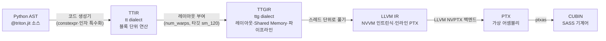

<WeekNavBar :week="7" topic="Tiled MatMul과 컴파일 과정" :researchers="[{'id': 'mbsong', 'name': 'mbsong', 'label': 'mbsong (송무복)', 'badge': 'NVIDIA A100 IR·SASS 실측'}, {'id': 'junpark', 'name': 'junpark', 'label': 'junpark (박준)', 'badge': 'RTX 5090 (sm_120) 실측 해부'}, {'id': 'singon', 'name': 'singon', 'label': 'singon (김신곤)', 'badge': 'L2 그룹핑 손계산 & IR 대응표'}, {'id': 'injokim', 'name': 'injokim', 'label': 'injokim (김인조)', 'badge': '알고리즘 & MLIR 하향 변환 종합'}, {'id': 'jaehyeong', 'name': 'jaehyeong', 'label': 'jaehyeong (이재형)', 'badge': '핵심 코드 & 컴파일 단계 요약'}]" />

> 🧑‍🔬 **연구원 리서치 노트** — 작성자: **junpark (박준)** (`RTX 5090 (sm_120) 실측 해부`)
>
> 💡 **핵심 기여 요약**: 최신 Blackwell RTX 5090(sm_120)에서 mma.sync.aligned.m16n8k16 명령 개수(워프당 64개)와 num_stages=4 순환 버퍼 동작을 PTX 수준에서 검증했습니다.

---

# 7주차 정리: Tiled MatMul과 컴파일 과정

Tutorial 03의 `matmul_kernel` 하나를 두 방향에서 읽었다. 첫째는 알고리즘 쪽이다. 출력 타일 하나를 맡은 프로그램이 2차원 포인터 블록으로 A, B 타일을 읽고 K축을 따라 누적한다. 이때 타일 크기와 실행 순서가 HBM 이동량을 정한다(1~3절). 둘째는 컴파일러 쪽이다. 같은 코드가 TTIR → TTGIR → LLVM IR → PTX → CUBIN을 거치면서 레이아웃, 파이프라이닝, Tensor Core 명령이 붙는다(4~5절). 공통 예제(M = N = K = 4096)는 가상 하드웨어로 손 계산하고, RTX 5090에서 직접 재서 비교했다(6절).

## 개념 정리

### Tensor Core 명령 하나의 크기

`tl.dot`은 결국 워프 단위 행렬곱 명령으로 바뀐다. RTX 5090(sm_120)에서 Triton이 고른 명령은 `mma.sync.aligned.m16n8k16.row.col.f32.f16.f16.f32`이다. 워프 하나가 [16, 16] FP16 × [16, 8] FP16을 FP32 [16, 8]에 누적한다(4절). Hopper의 `wgmma`나 Blackwell 데이터센터 칩의 `tcgen05.mma`는 이 칩에서 나오지 않았다.

```
명령 1개 = 워프 1개가 처리하는 조각
A 조각 [16 × 16] FP16 ─┐
                       ├─ mma.sync m16n8k16 → C 조각 [16 × 8] FP32 (+= 누적)
B 조각 [16 × 8]  FP16 ─┘

출력 타일 [BM, BN] × K 한 칸(BK)에 필요한 명령 수 = (BM·BN·BK) ÷ (16·8·16)
예: 128 × 128 × 32 → 256개, 워프 4개 → 워프당 64개 (PTX에서 센 수와 같음)
```

### 소프트웨어 파이프라이닝

K 루프의 한 반복은 "A, B 타일을 HBM에서 Shared Memory로 복사"하고 "Shared Memory에서 레지스터로 올려 `mma`"를 한다. 복사를 기다리는 동안 Tensor Core가 놀지 않도록, 컴파일러는 다음 몇 반복의 복사를 미리 비동기로 걸어 둔다(`cp.async`). `num_stages`는 이렇게 겹쳐 둘 단계 수다. 단계를 늘리면 버퍼도 늘어나서(Triton은 num_stages − 1칸, 3절) Shared Memory를 더 쓴다.

```
num_stages = 4 (Triton은 Shared Memory 버퍼 3개를 돌려 씀)
시간 →
복사  [k0][k1][k2]    [k3]    [k4] ...
계산              [k0]    [k1]    [k2] ...
                  └ 루프 전에 k0~k2 복사를 걸어 두고, k0을 계산하는 동안 k1, k2가 도착하고 k3 복사를 새로 건다
```

### Shared Memory 스위즐 (swizzle)

Shared Memory는 4 B 폭의 뱅크 32개로 나뉜다. 한 사이클에 128 B(뱅크 32개 × 4 B)를 처리한다. 워프의 접근이 서로 다른 뱅크에 흩어지면 한 번(wavefront 1개)에 끝나고, 같은 뱅크의 다른 주소에 몰리면 그 수만큼 나눠 처리한다. 아래 그림에서는 16 B(FP16 8개)를 한 칸으로 묶어, 128 B 한 줄을 0~7번 칸(칸 하나 = 뱅크 4개)으로 그린다.

#### 행렬곱에서 충돌이 생기는 곳

A, B 타일은 HBM에서 행 방향으로 읽어 Shared Memory에 행 우선으로 쓴다. 스레드 하나가 16 B씩 `cp.async`로 쓴다. 그런데 Tensor Core에 넣으려고 레지스터로 올릴 때는 `ldmatrix`로 8 × 8 조각을 읽는다. 이 명령은 8개 스레드가 서로 다른 8개 행의 같은 열 16 B를 하나씩 맡는다. 즉 쓸 때는 행을 따라가고, 읽을 때는 열을 따라 내려간다. 행 길이가 128 B의 배수이면 8개 행의 같은 열이 모두 같은 칸, 즉 같은 뱅크 4개에 떨어진다.

#### Triton의 스위즐 규칙

데이터는 그대로 두고, 저장할 주소만 행 번호에 따라 바꾼다. 16 B 칸의 열 번호를 행에서 나온 phase와 XOR한다.

```
phase  = (row / perPhase) % maxPhase
chunk  = (col / vec) XOR phase          ← 16 B 칸 단위로 자리를 바꿈
col'   = chunk * vec + col % vec         ← 칸 안의 원소 순서는 그대로
```

| 파라미터 | 뜻 | FP16 타일에서 정하는 법 |
|---|---|---|
| `vec` | 한 덩어리로 옮기는 원소 수 | 16 B ÷ 2 B = 8. `cp.async` 16 B와 `ldmatrix`의 행 16 B가 깨지지 않도록 |
| `perPhase` | 같은 phase를 쓰는 연속 행 수 | 128 B ÷ 한 행의 바이트 (최소 1). 한 줄(128 B)에 같이 들어가는 행끼리는 이미 뱅크가 다름 |
| `maxPhase` | phase 종류 수 | 8개 행을 0~7번 칸에 흩는 데 필요한 수 (한 행의 칸 수가 상한) |

XOR은 한 행 안에서 칸의 순서만 바꾸는 순열이다. 그래서 메모리를 더 쓰지 않고, 16 B 칸도 연속인 채로 남는다.

#### A 타일 [128, 32] FP16: `vec = 8, perPhase = 2, maxPhase = 4`

한 행이 64 B(4칸)라 두 행이 128 B 한 줄을 채운다. `ldmatrix`가 읽는 0번 칸 열이 행마다 어느 칸에 떨어지는지 보면 다음과 같다.

```
행        0  1  2  3  4  5  6  7
스위즐 없음  0  4  0  4  0  4  0  4    ← 짝수 행끼리, 홀수 행끼리 같은 칸: 4-way 충돌
phase     0  0  1  1  2  2  3  3
스위즐     0  4  1  5  2  6  3  7    ← 8칸 모두 다름: 충돌 없음
```

#### B 타일 [32, 128] FP16: `vec = 8, perPhase = 1, maxPhase = 8`

한 행이 256 B라 모든 행이 0번 칸에서 시작한다. 스위즐이 없으면 8개 행의 같은 열이 모두 같은 칸에 떨어져 8-way 충돌이다. phase = 행 번호 % 8로 XOR하면 행마다 칸이 한 줄씩 엇갈린다. 앞 128 B(0~7번 열 칸)만 그리면 다음과 같다.

```
            논리적 열 칸 (16 B)  0  1  2  3  4  5  6  7
행 0 (phase 0) → 저장 칸           0  1  2  3  4  5  6  7
행 1 (phase 1)                    1  0  3  2  5  4  7  6
행 2 (phase 2)                    2  3  0  1  6  7  4  5
행 3 (phase 3)                    3  2  1  0  7  6  5  4
행 4 (phase 4)                    4  5  6  7  0  1  2  3
행 5 (phase 5)                    5  4  7  6  1  0  3  2
행 6 (phase 6)                    6  7  4  5  2  3  0  1
행 7 (phase 7)                    7  6  5  4  3  2  1  0
                                  ↑ 어느 열이든 세로로 읽으면 0~7이 한 번씩 → 충돌 없음
```

#### 패딩과 비교

6주차의 `tile[32][33]`처럼 행 끝에 여분을 두는 방법(여기서는 16 B)으로도 충돌은 없어진다. 하지만 그만큼 Shared Memory를 더 쓴다. 후보 3(128 × 256 × 64, 버퍼 2개)으로 계산해 보면 다음과 같다.

| | A 버퍼 | B 버퍼 | 한 단계 | 버퍼 2개 | RTX 5090 한도 101,376 B |
|---|---|---|---|---|---|
| 스위즐 | 128 × 64 × 2 = 16,384 B | 64 × 256 × 2 = 32,768 B | 49,152 B | 98,304 B | 들어감 |
| 행마다 16 B 패딩 | 128 × 72 × 2 = 18,432 B | 64 × 264 × 2 = 33,792 B | 52,224 B | 104,448 B | 넘음 |

패딩을 쓰면 후보 3은 이 GPU에서 컴파일되지 않는다. 스위즐은 주소 비트 몇 개를 XOR할 뿐이라 공간 비용이 없다.

#### 실측

후보 2(128 × 128 × 32)를 Nsight Compute의 SASS 명령별 카운터로 봤다(4096). "이상적"은 충돌이 없을 때 필요한 wavefront 수다.

| SASS 명령 | 하는 일 | 실행 횟수 | Shared wavefront | 이상적 | 초과 |
|---|---|---|---|---|---|
| `LDSM.16.M88.4` | A 타일 → 레지스터 (`ldmatrix`) | 4,194,304 | 16,777,216 | 16,777,216 | 0 |
| `LDSM.16.MT88.4` | B 타일 → 레지스터 (`ldmatrix.trans`) | 4,194,304 | 16,777,216 | 16,777,216 | 0 |
| `LDGSTS.E.BYPASS.128` | HBM → Shared Memory (`cp.async`) | 4,292,608 | 17,367,040 | 17,170,432 | 196,608 (1.1%) |
| `STSM.16.M88.4`, `LDS.128` | 에필로그 레이아웃 변환 | 65,536씩 | 262,144씩 | 262,144씩 | 0 |

열 방향으로 읽는 `ldmatrix`는 스위즐 덕분에 이상적인 횟수 그대로였다. 남은 1.1%는 쓰는 쪽(`cp.async`)에서 나왔는데, 원인은 따로 확인하지 않았다. 커널 전체 카운터(`l1tex__data_bank_conflicts_pipe_lsu_mem_shared`)로 보면 후보 3은 0이었고, 후보 1, 2는 0이 아닌 작은 값(읽기 wavefront 대비 0.2%, 0.1%)이었다. 이 카운터와 위 표의 "초과"는 세는 방식이 달라서 숫자가 서로 맞지 않는다. 6주차에는 같은 128 × 128 × 32 타일에서 충돌이 0이라고 적었는데, 이번 측정과는 다르다.

## 실험 조건

| 항목 | 값 |
|---|---|
| GPU | NVIDIA GeForce RTX 5090 (Compute Capability 12.0, SM 170개, GDDR7 1792 GB/s, L2 96 MB, 블록당 Shared Memory 최대 101,376 B) |
| 소프트웨어 | 드라이버 580.196.07, Python 3.12, PyTorch 2.9.0+cu130 (CUDA 13.0), Triton 3.5.0, Nsight Compute 2026.2.1 |
| 코드 | Triton `release/3.5.x` 튜토리얼 `03-matrix-multiplication.py`의 `matmul_kernel`과 `get_cuda_autotune_config()` 그대로. 단일 설정 비교용으로 `@triton.autotune`만 떼어 낸 버전을 같이 사용 |
| 자료형 | 입력 A, B와 출력 C는 FP16, 누산기 FP32 |
| 크기 | 정확도: 512 × 512 × 512, 500 × 600 × 300. 성능: M = N = K = 2048, 4096, 8192, 16384 |
| 타일 설정 | 공통 예제 후보 1~3 (아래), 오토튜닝 후보 16개 |
| 측정 범위 | `triton.testing.do_bench(..., return_mode="median")`. GPU 이벤트 사이 시간이고 매 반복 전에 L2를 비운다. TFLOPs/s = 2MNK ÷ 시간 |
| Nsight Compute | DRAM·L2 바이트 수, 점유율, Shared Memory wavefront만 읽는다. ncu는 기본값으로 클럭을 기준 클럭에 고정해서 ncu의 시간은 `do_bench`보다 길다 |

공통 예제 후보 세 개는 다음과 같다. `GROUP_SIZE_M`은 모두 튜토리얼 값 8이다.

| | BLOCK_SIZE_M | BLOCK_SIZE_N | BLOCK_SIZE_K | num_stages | num_warps |
|---|---|---|---|---|---|
| 후보 1 | 64 | 32 | 32 | 5 | 2 |
| 후보 2 | 128 | 128 | 32 | 4 | 4 |
| 후보 3 | 128 | 256 | 64 | 3 | 8 |

## 1. 2차원 포인터 블록과 K축 누적: 4주차 타일 수식이 코드의 어느 줄이 되나

4주차의 블록 행렬곱은 다음과 같았다.

```python
for m in range(0, M, BM):          # 병렬: 프로그램 인스턴스 하나가 (m, n) 하나
  for n in range(0, N, BN):        # 병렬
    acc = zeros((BM, BN), float32)
    for k in range(0, K, BK):      # 순차: 프로그램 안의 루프
      acc += A[m:m+BM, k:k+BK] @ B[k:k+BK, n:n+BN]
    C[m:m+BM, n:n+BN] = acc
```

바깥 두 루프는 그리드가 되고, 안쪽 루프만 커널 본문에 남는다. 커널에서 대응하는 줄은 이렇다.

| 4주차 수식 | `matmul_kernel` |
|---|---|
| (m, n) 하나 | `pid = tl.program_id(0)` → `pid_m`, `pid_n` (2절의 순서 식) |
| `A[m:m+BM, k:k+BK]`의 주소 | `a_ptrs = a_ptr + offs_am[:, None] * stride_am + offs_k[None, :] * stride_ak` |
| `B[k:k+BK, n:n+BN]`의 주소 | `b_ptrs = b_ptr + offs_k[:, None] * stride_bk + offs_bn[None, :] * stride_bn` |
| `acc = zeros(...)` | `accumulator = tl.zeros((BM, BN), dtype=tl.float32)` |
| `for k ...: acc += a @ b` | `for k in range(0, tl.cdiv(K, BK))`: `tl.load` 두 번, `accumulator = tl.dot(a, b, accumulator)` |
| 다음 K 조각으로 | `a_ptrs += BK * stride_ak`, `b_ptrs += BK * stride_bk` |
| `C[...] = acc` | `c = accumulator.to(tl.float16)`, `tl.store(c_ptrs, c, mask=c_mask)` |

### 브로드캐스팅으로 2차원 포인터 블록 만들기

6주차에서는 `x_ptr + offsets`로 1차원 포인터 블록을 만들었다. 2차원은 행 오프셋을 세로 벡터 `[:, None]`로, 열 오프셋을 가로 벡터 `[None, :]`로 세운 뒤 더한다. 그러면 브로드캐스팅으로 [BM, BK] 격자가 된다. 작은 예로 A가 [M, K = 8] 행 우선(`stride_am = 8`, `stride_ak = 1`), BM = BK = 4, `pid_m = 1`이면 다음과 같다.

```
offs_am = 1*4 + arange(0,4) = [4, 5, 6, 7]   → [:, None] * 8 = [[32], [40], [48], [56]]
offs_k  = arange(0,4)       = [0, 1, 2, 3]   → [None, :] * 1 = [[0, 1, 2, 3]]

a_ptrs - a_ptr (k = 0)          a_ptrs - a_ptr (k = 1, += 4 * stride_ak)
[[32 33 34 35]                  [[36 37 38 39]
 [40 41 42 43]                   [44 45 46 47]
 [48 49 50 51]                   [52 53 54 55]
 [56 57 58 59]]                  [60 61 62 63]]

A (8열)         k=0 타일   k=1 타일
행 4  │ ■ ■ ■ ■ │ □ □ □ □ │
행 5  │ ■ ■ ■ ■ │ □ □ □ □ │      A 타일은 오른쪽으로 BK칸씩 이동
행 6  │ ■ ■ ■ ■ │ □ □ □ □ │      B 타일은 아래쪽으로 BK행씩 이동 (+= BK * stride_bk = BK * N)
행 7  │ ■ ■ ■ ■ │ □ □ □ □ │
```

컴파일된 TTIR에서도 이 순서가 그대로 보인다. `tt.make_range`로 벡터를 만들고 `tt.expand_dims`로 축을 세운다. 이어서 `tt.broadcast`로 [128, 32]까지 늘리고 `tt.addptr`로 포인터에 더한다(4절).

`stride_ak = 1`처럼 1인 stride는 Triton이 상수로 특수화해서 커널 인자에서 빠진다. 4096 크기로 컴파일한 TTIR의 인자 목록에는 `stride_am`, `stride_bk`, `stride_cm`만 남고 `stride_ak`, `stride_bn`, `stride_cn`은 없다. 그래서 열 방향 주소가 연속이라는 것을 컴파일러가 알고, 16 B 벡터 복사를 고를 수 있다.

### 누산기를 FP32로 두는 이유

K = 4096이면 원소 하나에 곱 4096개를 더한다. FP16은 가수가 10비트라 값이 커질수록 작은 항이 더해지지 않는다. 입력은 FP16이어도 Tensor Core는 FP32로 누적하는 형태(`.f32.f16.f16.f32`)를 지원하므로, 누산기를 FP32로 두는 데 드는 비용은 레지스터뿐이다. 출력 타일 [128, 128] FP32는 64 KiB다. 워프 4개(128 스레드)에 나누면 스레드당 128개 레지스터가 된다. 후보 2가 실제로 쓰는 스레드당 레지스터 224개 중 128개가 이 누산기다(3절, 4절).

정확도는 FP64로 구한 참값과 비교했다. 512 × 512 × 512에서 Triton과 `torch.matmul`의 결과는 비트 단위로 같았고(최대 차이 0), 둘 다 참값과의 최대 오차가 3.8 × 10⁻³이었다. 500 × 600 × 300에서도 `torch.allclose(..., atol=1e-2, rtol=0)`를 통과했다. 세 후보를 각각 고정해 돌려도 두 크기 모두 통과했다.

### 에필로그 결합 (leaky_relu)

`tl.dot` 루프가 끝난 직후 `accumulator`는 아직 레지스터에 있다. 여기서 `leaky_relu`를 적용하면 원소마다 비교와 곱 몇 번이 더해질 뿐이고, 메모리 접근은 늘지 않는다. 따로 하면 C를 HBM에 썼다가 다시 읽고 다시 써야 한다.

| 경로 | 커널 수 | 추가 HBM 이동 (M = N = 4096, FP16) | 가상 하드웨어 (1 TB/s) 추가 시간 |
|---|---|---|---|
| 결합 (`ACTIVATION="leaky_relu"`) | 1 | 0 | 0 |
| 따로 (`F.leaky_relu(matmul(a, b))`) | 2 | C 읽기 + 쓰기 = 2 × 2MN = 67 MB | 67 µs |

RTX 5090에서 잰 값(4096, 후보 설정은 오토튜닝이 고른 128 × 64 × 32, 5회 반복의 중앙값):

| 경로 | 시간 |
|---|---|
| matmul만 | 663.6 µs |
| 결합 | 663.9 µs |
| 따로 | 675.8 µs (+12.2 µs) |
| `leaky_relu`만 (L2 비우고) | 46.8 µs |

결합은 시간이 그대로였다. 따로 실행하면 12 µs가 늘었는데, `leaky_relu`를 혼자 잴 때(47 µs)보다 훨씬 적다. matmul이 방금 쓴 C(33.5 MB)가 L2(96 MB)에 남아 있기 때문이다. Nsight Compute로 L2를 비우지 않고(`--cache-control none`) matmul 바로 뒤의 `leaky_relu` 커널을 보면, DRAM 읽기는 6.85 MB로 C의 약 20%였다. L2를 비우고 재면 C 전체(33.6 MB)를 DRAM에서 읽는다. 6주차 Softmax의 [4096, 1024]와 같은 상황이다.

## 2. 프로그램 실행 순서와 L2 캐시: 같은 타일인데 순서가 성능을 바꾸는 이유

튜토리얼의 순서 식은 다음과 같다.

```python
num_pid_in_group = GROUP_SIZE_M * num_pid_n
group_id    = pid // num_pid_in_group
first_pid_m = group_id * GROUP_SIZE_M
group_size_m = min(num_pid_m - first_pid_m, GROUP_SIZE_M)
pid_m = first_pid_m + ((pid % num_pid_in_group) % group_size_m)
pid_n = (pid % num_pid_in_group) // group_size_m
```

### 9 × 9 블록 예시 (GROUP_SIZE_M = 3)

`num_pid_m = num_pid_n = 9`, K 방향 블록 9개, 처음 9개 프로그램(pid 0~8)이 동시에 돈다고 본다. 그룹 식에서 `num_pid_in_group = 27`, `group_id = 0`이므로 `pid_m = pid % 3`, `pid_n = pid // 3`이다.

| pid | 0 | 1 | 2 | 3 | 4 | 5 | 6 | 7 | 8 |
|---|---|---|---|---|---|---|---|---|---|
| 행 우선 (pid_m, pid_n) | (0,0) | (0,1) | (0,2) | (0,3) | (0,4) | (0,5) | (0,6) | (0,7) | (0,8) |
| 그룹 순서 (pid_m, pid_n) | (0,0) | (1,0) | (2,0) | (0,1) | (1,1) | (2,1) | (0,2) | (1,2) | (2,2) |

```
행 우선: C의 0번째 행 9개           그룹 순서: 3 × 3 정사각 구역
     n→ 0 1 2 3 4 5 6 7 8               n→ 0 1 2 3 4 5 6 7 8
m 0     0 1 2 3 4 5 6 7 8           m 0     0 3 6 . . . . . .
  1     . . . . . . . . .             1     1 4 7 . . . . . .
  2     . . . . . . . . .             2     2 5 8 . . . . . .
  ...                                 ...

필요한 A 행 블록: 1개 × 9 = 9         필요한 A 행 블록: 3개 × 9 = 27
필요한 B 열 블록: 9개 × 9 = 81        필요한 B 열 블록: 3개 × 9 = 27
합계: 90 타일                        합계: 54 타일
```

출력 블록 하나는 A의 행 블록 하나(K 방향 9타일)와 B의 열 블록 하나(9타일)가 필요하다. 행 우선은 A 행 하나를 9개 프로그램이 같이 쓰지만, B는 9열을 모두 읽어 81타일이다. 그룹 순서는 A 3행과 B 3열을 3 × 3 = 9개 프로그램이 나눠 쓴다. 같은 출력 9개를 계산하면서 L2에 올려야 할 입력이 90 → 54타일(0.6배)로 줄어든다. 일반적으로 동시에 도는 출력 블록이 p × q 직사각형이면 필요한 입력은 (p + q) × (K/BK) 타일이다. 개수가 같을 때는 정사각형일수록 적다.

### RTX 5090에서 잰 효과

`GROUP_SIZE_M = 1`이면 행 우선 순서가 된다. 1 vs 8로 바꿔 쟀다. "L2 요청"은 SM이 L2에 요청한 바이트로, 4주차의 "출력 타일 사이 재사용 없음" 모델과 같은 양이다. "DRAM 읽기"는 L2에서 놓쳐 실제로 메모리까지 간 양이다.

| 크기 | 타일 | L2 요청 | DRAM 읽기 GM=1 | DRAM 읽기 GM=8 | L2 적중률 GM=1 → 8 | 시간 GM=1 → 8 | TFLOPs/s GM=1 → 8 |
|---|---|---|---|---|---|---|---|
| 4096 | 128×64×32 | 3.26 GB | 67.1 MB | 67.1 MB | 96.9% → 96.9% | 차이 없음 | 같음 |
| 8192 | 128×128×32 | 17.3 GB | 3.38 GB | 1.21 GB | 79.7% → 92.2% | 4993 → 4895 µs | 220.2 → 224.6 |
| 8192 | 64×32×32 | 51.7 GB | 12.63 GB | 2.28 GB | 75.5% → 95.5% | 9595 → 7303 µs | 114.6 → 150.6 |
| 16384 | 128×128×32 | 138.0 GB | 66.19 GB | 10.45 GB | 51.4% → 92.0% | 43054 → 38727 µs | 204.3 → 227.1 |
| 16384 | 64×32×32 | 412.9 GB | 137.95 GB | 17.73 GB | 66.5% → 95.6% | 109605 → 61654 µs | 80.3 → 142.7 |

- 4096에서는 A와 B가 합쳐 64 MB라 L2에 통째로 들어간다. 순서와 관계없이 A, B를 한 번씩만 DRAM에서 읽는다(67.1 MB = 2 × 33.5 MB).
- 행렬이 L2보다 커지면 그룹 순서가 DRAM 읽기를 3~8배 줄인다. 타일이 작아 L2 요청이 많은 후보 1에서는 시간도 1.3배(8192), 1.8배(16384) 빨라졌다.
- 타일이 큰 128 × 128에서는 DRAM 읽기가 2.8배 줄어도 시간 차이는 2%(8192)였다. GM=1에서도 대역폭이 3.38 GB ÷ 4.99 ms = 0.68 TB/s로 사양의 38%라 아직 연산이 시간을 정하고 있었다. 16384에서는 GM=1일 때 66 GB를 읽어 약 1.5 TB/s(사양의 86%)를 썼고, 11% 차이가 났다.

## 3. 메타파라미터와 자동 튜닝: 타일 크기와 파이프라인 설정은 어떻게 고르나

### 하나로 고정하지 않는 이유

타일을 키우면 산술 강도가 오르지만(6절), Shared Memory와 레지스터를 더 써서 SM 하나에 동시에 올릴 수 있는 블록이 줄어든다. 그리드가 작아져 SM이 놀 수도 있다. 어디가 최적인지는 행렬 크기와 GPU의 자원 한도에 따라 달라서 미리 정할 수 없다. 그래서 후보 목록을 주고 실제로 돌려 고른다.

```python
@triton.autotune(configs=get_cuda_autotune_config(), key=['M', 'N', 'K'])
@triton.jit
def matmul_kernel(...): ...
```

- `triton.Config({...}, num_warps=..., num_stages=...)`의 딕셔너리는 `tl.constexpr` 메타파라미터(BLOCK_SIZE_*, GROUP_SIZE_M)이고, `num_warps`, `num_stages`는 컴파일 옵션이다. 어느 쪽이든 값이 바뀌면 다른 커널로 컴파일된다.
- `key`에 적은 인자 값이 처음 보는 조합이면 후보를 모두 컴파일하고 벤치마크해서 가장 빠른 것을 캐시에 넣는다. 캐시 키에는 텐서 인자의 dtype도 들어간다.

캐시 동작을 확인했다(4096, 같은 프로세스).

| 호출 | 걸린 시간 | 캐시 항목 수 |
|---|---|---|
| M = N = K = 4096 처음 | 4855 ms (후보 16개 컴파일 + 벤치마크) | 1 |
| 같은 크기 다시 | 0.7 ms | 1 |
| K만 4000으로 | 1383 ms (다시 벤치마크) | 2 |
| 같은 크기, 데이터만 다르게 | 0.7 ms | 2 |

캐시 키는 `(4096, 4096, 4096, 'torch.float16', 'torch.float16', 'torch.float16')`처럼 찍혔다. 데이터 값은 키가 아니다.

`TRITON_PRINT_AUTOTUNING=1`을 켜면 후보마다 한 줄씩 찍고 마지막에 고른 설정을 보여 준다. 4096에서는 후보 16개 중 튜토리얼이 FP8용으로 넣어 둔 설정 가운데 BLOCK_SIZE_K = 128인 5개가 Shared Memory 한도를 넘어 빠졌다.

```
Autotuning failed with out of resource: shared memory, Required: 196608, Hardware limit: 101376. ...
Triton autotuning for function matmul_kernel,
with key as (4096, 4096, 4096, 'torch.float16', 'torch.float16', 'torch.float16'),
finished after 1.38s,
best config selected: BLOCK_SIZE_M: 128, BLOCK_SIZE_N: 64, BLOCK_SIZE_K: 32, GROUP_SIZE_M: 8, num_warps: 4, num_ctas: 1, num_stages: 4, ...
```

| 크기 | 선택된 설정 |
|---|---|
| 4096 | 128 × 64 × 32, GM 8, num_warps 4, num_stages 4 |
| 8192 | 128 × 128 × 32, GM 8, num_warps 4, num_stages 4 (후보 2와 같음) |

### num_stages: Shared Memory와 지연시간 은닉

128 × 128 × 32, num_warps = 4로 고정하고 `num_stages`만 바꿨다(4096).

| num_stages | Shared Memory | 레지스터/스레드 | 시간 | TFLOPs/s |
|---|---|---|---|---|
| 1 | 16,384 B | 212 | 714.8 µs | 192.3 |
| 2 | 16,384 B | 222 | 666.4 µs | 206.3 |
| 3 | 32,768 B | 224 | 667.4 µs | 205.9 |
| 4 | 49,152 B | 224 | 668.7 µs | 205.5 |
| 5 | 65,536 B | 224 | 706.6 µs | 194.5 |

- Shared Memory는 한 단계 입력 타일(16 KiB) × (num_stages − 1)이었다. 4절의 TTGIR을 보면 num_stages = 4에서 버퍼를 `3x128x32`, `3x32x128`로 잡는다. 이번 K 조각은 `ttg.local_load`로 레지스터에 올린 뒤 `mma`에 쓰므로, 그 버퍼는 바로 다음 복사에 다시 쓸 수 있다. 그래서 단계 수보다 버퍼가 하나 적다.
- 1 → 2에서 7% 빨라졌다. 다음 K 조각 복사를 이번 `mma`와 겹치는 효과다.
- 2~4는 차이가 없었다. 이 크기에서는 A, B가 L2에 다 들어가서 복사 지연이 짧기 때문으로 보인다. 8192 이상에서는 재 보지 않았다.
- 5에서 다시 느려졌다. 64 KiB를 쓰면 SM당 블록이 1개만 올라간다(101,376 B ÷ 65,536 B). 4까지는 레지스터 한도(65,536 ÷ (224 × 128) = 2.3)로 2개가 올라갔다.

### num_warps: 레지스터 압박

같은 타일에서 `num_warps`만 바꿨다(num_stages = 4).

| num_warps | 스레드 수 | 레지스터/스레드 | spill | 시간 | TFLOPs/s |
|---|---|---|---|---|---|
| 2 | 64 | 255 (상한) | 150 | 1543.0 µs | 89.1 |
| 4 | 128 | 224 | 0 | 667.6 µs | 205.9 |
| 8 | 256 | 134 | 0 | 698.1 µs | 196.9 |

FP32 누산기 [128, 128]은 64 KiB로 고정이다. 이것을 스레드 64개에 나누면 스레드당 누산기만 256개 레지스터가 필요하다. 스레드당 한도가 255개라 넘친 값을 로컬 메모리로 내보냈고(spill), 2.3배 느려졌다. 워프를 8개로 늘리면 스레드당 부담은 줄지만 4보다 5% 느렸다. 워프 하나가 맡는 출력 조각이 작아지면 `mma` 한 번당 `ldmatrix`로 올리는 피연산자가 늘어나는 것이 이유로 보이는데, 따로 확인하지는 않았다. 이 크기에서는 4가 가장 빨랐다.

## 4. Triton 컴파일 파이프라인과 IR 계층: Python 함수가 GPU 기계어가 되기까지



한 번에 기계어로 바꾸지 않고 단계를 나누는 이유는 단계마다 풀 문제가 다르기 때문이다. TTIR에서는 하드웨어와 관계없는 최적화를 한다(상수 전파, 공통식 제거, 루프 불변식 이동). TTGIR에서는 "이 블록을 어느 스레드가 어떤 모양으로 들고 있나"를 정한다. LLVM부터는 기존 LLVM 백엔드와 NVIDIA `ptxas`를 그대로 쓴다. TTIR까지는 NVIDIA와 AMD가 같고, TTGIR부터 타깃별로 갈라진다.

### 같은 코드가 단계마다 어떻게 보이나 (후보 2: 128 × 128 × 32, num_warps 4, num_stages 4)

먼저 단계마다 무엇을 기술하는지 정리하면 다음과 같다.

| 단계 | 크기 | 다루는 단위 | 이 단계에서 새로 정해지는 것 |
|---|---|---|---|
| TTIR | 254줄 | 프로그램(블록) 하나가 다루는 텐서 | 연산 순서만. 스레드, 메모리 계층 없음 |
| TTGIR | 347줄 | 같은 텐서 + 레이아웃 (원소 → 스레드 대응표) | 스레드·워프 배치, Shared Memory 버퍼, 파이프라인, Tensor Core 명령 종류 |
| LLVM IR | 1464줄 | 스레드 하나의 스칼라 값 | 스레드마다 실제로 들고 있는 값과 명령, 동기화(barrier) 위치 |
| PTX | 1386줄 | 가상 레지스터 (`%r`, `%rd`, `%f`) | GPU 명령 이름과 순서. 레지스터 수는 아직 무제한 |
| CUBIN (SASS) | 78,408 B | 물리 레지스터 (`R0`~`R223`) | 실제 기계어, 레지스터 할당(224개), 명령 스케줄 |

같은 `for k` 루프가 단계를 내려가며 어떻게 바뀌는지 보면, 각 단계가 무엇을 덧붙이는지가 잘 드러난다. 아래 코드는 실제 덤프에서 `loc(...)` 같은 디버그 정보를 지우고 이름을 줄인 것이다.

#### TTIR: 블록 연산 그대로

```mlir
%acc_out:3 = scf.for %k = %c0 to %num_k step %c1
    iter_args(%a_ptrs = %a_ptrs0, %b_ptrs = %b_ptrs0, %acc = %zeros)
    -> (tensor<128x32x!tt.ptr<f16>>, tensor<32x128x!tt.ptr<f16>>, tensor<128x128xf32>) {
  %a   = tt.load %a_ptrs, %a_mask, %zero : tensor<128x32x!tt.ptr<f16>>
  %b   = tt.load %b_ptrs, %b_mask, %zero : tensor<32x128x!tt.ptr<f16>>
  %acc2 = tt.dot %a, %b, %acc : tensor<128x32xf16> * tensor<32x128xf16> -> tensor<128x128xf32>
  %a_ptrs2 = tt.addptr %a_ptrs, %c32 : tensor<128x32x!tt.ptr<f16>>, tensor<128x32xi32>
  %b_ptrs2 = tt.addptr %b_ptrs, %bk_stride : tensor<32x128x!tt.ptr<f16>>, tensor<32x128xi32>
  scf.yield %a_ptrs2, %b_ptrs2, %acc2
}
```

Python 코드와 거의 한 줄씩 대응한다. 차이는 하나다. MLIR은 값을 덮어쓰지 않는 SSA 형식이다. 그래서 `a_ptrs += ...`처럼 루프마다 바뀌는 값은 `iter_args`로 들어와서 `scf.yield`로 다음 반복에 넘어간다. 루프를 도는 상태가 포인터 블록 두 개와 누산기 하나라는 것이 여기서 분명해진다. 텐서 타입에는 모양과 자료형만 있다. 이 블록을 누가 들고 있는지, 어느 메모리에 있는지는 정해지지 않았다.

#### TTGIR: 소프트웨어 파이프라인으로 다시 짜인 루프

TTGIR에서는 루프 구조 자체가 바뀐다. 실제 코드는 100줄이 넘어서 구조만 줄여 적으면 다음과 같다.

```mlir
%A = ttg.local_alloc : !ttg.memdesc<3x128x32xf16, #shared>     // Shared Memory 버퍼 3칸
%B = ttg.local_alloc : !ttg.memdesc<3x32x128xf16, #shared1>

// 프롤로그: k = 0, 1, 2의 복사를 미리 건다
ttg.async_copy_global_to_local %a_ptrs(k=0) -> %A[0];  ttg.async_commit_group
ttg.async_copy_global_to_local %b_ptrs(k=0) -> %B[0];  ttg.async_commit_group
... k = 1 → 칸 1, k = 2 → 칸 2 ...

scf.for %k = 0 to %num_k iter_args(%acc, %a_ptrs, %b_ptrs, %write_slot, %read_slot, 토큰 6개) {
  %read_slot = (%read_slot + 1) % 3
  ttg.async_wait {num = 4}                                  // k번째 A, B 복사가 끝날 때까지
  %a = ttg.local_load %A[%read_slot] -> tensor<128x32xf16, #ttg.dot_op<{opIdx = 0, parent = #mma}>>
  %b = ttg.local_load %B[%read_slot] -> tensor<32x128xf16, #ttg.dot_op<{opIdx = 1, parent = #mma}>>
  %acc2 = tt.dot %a, %b, %acc -> tensor<128x128xf32, #mma>
  %write_slot = (%write_slot + 1) % 3
  ttg.async_copy_global_to_local %a_ptrs(k+3) -> %A[%write_slot] mask (k < num_k - 3)
  ttg.async_copy_global_to_local %b_ptrs(k+3) -> %B[%write_slot] mask (k < num_k - 3)
  ttg.async_commit_group × 2
  scf.yield ...
}
ttg.async_wait {num = 0}                                      // 남은 복사를 모두 기다림
```

TTIR에서 달라진 점은 다음과 같다.

- `tt.load`가 두 단계로 나뉘었다. HBM → Shared Memory는 비동기 복사(`async_copy_global_to_local`)이고, Shared Memory → 레지스터는 `local_load`다. 복사는 3반복 앞서 걸고, 읽기는 `mma` 직전에 한다.
- Shared Memory 3칸을 링 버퍼로 돌린다. `read_slot`, `write_slot`이 0 → 1 → 2 → 0으로 돈다. 반복 0에서 칸 0을 읽고, 읽고 난 칸 0에 k = 3의 복사를 건다. 이번 칸의 데이터는 이미 레지스터에 올라와 있어서 그 자리에 다음 복사를 써도 된다. `num_stages = 4`인데 버퍼가 3칸인 이유다.
- `async_wait {num = 4}`는 "아직 안 끝난 복사 그룹이 4개 이하가 될 때까지 기다려라"라는 뜻이다. 반복마다 A, B 그룹을 2개씩 커밋하고 3단계가 날아가고 있으니, 최대 6개가 진행 중이다. 4개 이하가 되면 가장 오래된 단계(k번째)의 A, B 2개가 끝난 것이다.
- 마지막 3반복에서는 더 읽을 K 조각이 없다. 이 꼬리를 위해 루프를 따로 만들지 않고, 복사를 `k < num_k - 3` 조건으로 꺼 둔다.
- 모든 텐서에 레이아웃이 붙었다. 누산기는 `#mma`, `local_load`의 결과는 `#dot_op`다. "Tensor Core 명령이 원하는 모양으로 레지스터에 올려라"라는 뜻이다. 레이아웃 자체는 아래 "TTIR과 TTGIR의 차이"에서 본다.

#### LLVM IR: 텐서가 사라지고 스레드 하나의 값만 남는다

LLVM IR부터는 `tensor<128x128xf32>` 같은 타입이 없다. 레이아웃에 따라 스레드 하나가 맡은 조각만 스칼라 값으로 남는다. 루프는 basic block 하나가 되고, `scf.for`의 `iter_args`는 블록 맨 앞의 `phi` 노드가 된다.

```llvm
212:                                    ; 루프 헤더, preds = %.lr.ph, %212
  %213 = phi i32   [ -1, %.lr.ph ], [ %347, %212 ]           ; read_slot
  %214 = phi i32   [  2, %.lr.ph ], [ %793, %212 ]           ; write_slot
  %.pn80453 = phi ptr addrspace(1) [ %168, %.lr.ph ], [ %790, %212 ]   ; 복사할 HBM 주소 (8개)
  %215 = phi float [ 0.0, %.lr.ph ], [ %624, %212 ]          ; 누산기 원소 (128개)
  ...
  call void @llvm.nvvm.cp.async.wait.group(i32 4)
  call void @llvm.nvvm.barrier.cta.sync.aligned.all(i32 0)
  %352 = call {i32,i32,i32,i32} asm "ldmatrix.sync.aligned.m8n8.x4.shared.b16 ...", ...   ; × 16
  %463 = call {float,float,float,float} asm "mma.sync.aligned.m16n8k16.row.col.f32.f16.f16.f32 ...", ...  ; × 64
  call void @llvm.nvvm.barrier.cta.sync.aligned.all(i32 0)
  call void asm "cp.async.cg.shared.global [ $0 + 0 ], [ $1 + 0 ], 0x10, $2;", ...   ; × 8
  call void @llvm.nvvm.cp.async.commit.group()                                        ; × 2
  %exitcond.not = icmp eq i32 %822, %88
  br i1 %exitcond.not, label %._crit_edge.loopexit, label %212
```

`phi` 노드를 세면 루프가 스레드마다 어떤 상태를 들고 도는지 정확히 나온다.

| `phi` | 개수 | 정체 |
|---|---|---|
| `float` | 128 | 누산기. [128, 128] FP32 ÷ 128 스레드 = 128개. 3절 레지스터 예측의 "누산기" 항이 바로 이것 |
| `ptr addrspace(1)` | 8 | 이 스레드가 복사할 HBM 주소. A 4개 + B 4개, 각각 16 B (`cp.async` 8번). PTX에서는 B 주소 4개가 기준 주소 하나 + 고정 오프셋으로 합쳐진다 |
| `i32` | 3 | 반복 횟수, `read_slot`, `write_slot` |

TTGIR에 없던 것도 두 가지 생겼다.

- `barrier`(블록 안 모든 스레드 동기화)가 루프 안에 2번 들어갔다. 첫 번째는 `wait.group` 바로 뒤에 있다. `cp.async`는 스레드마다 자기 몫만 기다리므로, 다른 스레드가 복사한 부분까지 다 도착했는지 맞추려면 블록 전체가 한 번 모여야 한다. 두 번째는 다음 복사 직전에 있다. 이번에 덮어쓸 칸을 다른 워프가 아직 `ldmatrix`로 읽고 있을 수 있어서다. TTGIR에는 이 동기화가 보이지 않는다. LLVM으로 내릴 때 Shared Memory 읽기·쓰기 순서를 분석하는 패스(membar)가 넣는다.
- `tt.dot` 하나가 `ldmatrix` 16개와 `mma.sync` 64개로 풀렸다. 워프 하나는 출력 64 × 64(`#mma`의 `warpsPerCTA = [2, 2]`)를 맡는다. 반복 한 번에 64 × 64 × 32 ÷ (16 × 8 × 16) = 64번의 `mma`가 필요하다. 피연산자는 A 64 × 32, B 32 × 64이고, `ldmatrix.x4` 하나가 16 × 16을 올리므로 A 8번 + B 8번 = 16번이다.

Tensor Core 명령과 비동기 복사는 LLVM에 대응하는 명령이 없다. 그래서 PTX 문자열을 그대로 박은 인라인 어셈블리(`asm "..."`)로 들어간다.

#### PTX: 가상 레지스터로 쓴 같은 루프

```ptx
$L__BB0_3:                                  // 루프 헤더
    setp.gt.s32   %p20, %r1613, 2;
    selp.b32      %r1744, 0, %r1613, %p20;  // read_slot = (read_slot + 1 > 2) ? 0 : read_slot + 1
    cp.async.wait_group 4;
    bar.sync      0;
    shl.b32       %r1614, %r1744, 13;       // read_slot × 8192 B (A 버퍼 한 칸 = 128 × 32 × 2 B)
    ldmatrix.sync.aligned.m8n8.x4.shared.b16 {%r709, %r710, %r711, %r712}, [%r625];
    ... ldmatrix × 16, mma.sync × 64, bar.sync, cp.async.cg × 8, cp.async.commit_group × 2 ...
    add.s64       %rd110, %rd110, 64;       // A 주소 += BK × stride_ak × 2 B = 32 × 1 × 2
    add.s64       %rd111, %rd111, %rd12;    // B 주소 += BK × stride_bk × 2 B (런타임 값)
    setp.ne.b32   %p27, %r12, %r1874;
    @%p27 bra     $L__BB0_3;                // 다음 반복으로
```

루프 안의 명령 수는 LLVM IR과 같다(`ldmatrix` 16, `mma.sync` 64, `cp.async.cg` 8, `bar.sync` 2). 달라진 것은 TTIR의 `tt.addptr`가 이제 눈에 보이는 정수 덧셈이 됐다는 점이다. A 쪽 `+64`는 `stride_ak = 1`이 상수로 특수화되어서 나온 숫자다(1절). B 쪽은 `stride_bk`가 런타임 인자라 레지스터 `%rd12`로 더한다. 링 버퍼의 칸 주소는 `slot << 13`, 즉 칸 번호 × 8 KiB로 계산한다.

PTX는 아직 가상 어셈블리라 `%r1874`처럼 레지스터를 얼마든지 쓴다. 실제로 몇 개가 필요한지는 다음 단계의 `ptxas`가 정한다.

#### SASS: 물리 레지스터와 기계어

`ptxas`가 만든 루프는 주소 `0x1e20`부터 `0x2a90`까지 명령 200개다.

| PTX | SASS | 루프 안 개수 |
|---|---|---|
| `cp.async.wait_group 4` | `DEPBAR.LE SB0, 0x4` | 1 |
| `bar.sync 0` | `BAR.SYNC.DEFER_BLOCKING 0x0` | 2 |
| `ldmatrix ... .x4` / `.x4.trans` | `LDSM.16.M88.4` / `LDSM.16.MT88.4` | 16 |
| `mma.sync.aligned.m16n8k16 ... f32` | `HMMA.16816.F32` | 64 |
| `cp.async.cg.shared.global ... 0x10` | `LDGSTS.E.BYPASS.128` | 8 |
| `cp.async.commit_group` | `LDGDEPBAR` | 2 |
| `@%p27 bra $L__BB0_3` | `@P0 BRA 0x1e20` | 1 |

명령 이름만 바뀌고 구조는 PTX와 같다. 이 단계에서 가상 레지스터가 물리 레지스터 224개로 줄어든다. 누산기 128개, 주소, 피연산자 조각이 여기에 들어간다(3절). 한도를 넘으면 spill이 생기는 것도 이 단계다. 루프 명령 200개 중 64개(32%)가 `HMMA`이고, 나머지는 복사, 동기화, 주소 계산이다.

#### 나머지 구문

| 구문 | TTIR | TTGIR | LLVM IR / PTX | SASS |
|---|---|---|---|---|
| `tl.program_id(0)` | `tt.get_program_id x` | 같음 | `llvm.nvvm.read.ptx.sreg.ctaid.x` / `%ctaid.x` | `S2R ... SR_CTAID.X` |
| `num_warps = 4` | 없음 | `ttg.num-warps = 4`, 레이아웃의 `warpsPerCTA` | `"nvvm.reqntid"="128"` / `.reqntid 128` | 블록당 스레드 128개 |
| `accumulator.to(tl.float16)` | `arith.truncf` | 같음 (`#mma` 레이아웃 유지) | `cvt.rn.f16x2.f32` 64개 (FP32 두 개 → FP16 두 개 묶음) | `F2FP.F16.F32.PACK_AB` |
| `tl.store(c_ptrs, c, mask)` | `tt.store` | `ttg.convert_layout #mma → #blocked1` 후 `tt.store` | `stmatrix`로 Shared Memory에 썼다가 16 B씩 다시 읽어 `st.global.v4` | `STSM` → `LDS.128` → `STG.E.128` 16개 |

에필로그의 `convert_layout`는 `mma`가 남긴 레이아웃을 바꾸는 단계다. 그 레이아웃에서는 스레드 하나가 행 2개에 걸친 FP32 조각을 들고 있다. 이것을 스레드마다 연속 16 B를 쓰는 레이아웃(`#blocked1`)으로 바꾼다. 그래야 C를 정렬된 128비트 저장으로 쓸 수 있다. `#mma`는 워프를 [2, 2]로, `#blocked1`은 [4, 1]로 배치해서 데이터가 워프 사이를 오가야 한다. 워프 안의 셔플로는 안 되므로 Shared Memory를 한 번 거친다. PTX 대상은 `.target sm_120a`다.

### TTIR과 TTGIR의 차이

TTIR과 TTGIR이 다루는 텐서는 같다. 모양도 데이터도 같은 프로그램 하나의 블록이다. TTIR의 `tensor<128x32xf16>`은 "이 프로그램(스레드 128개)이 128 × 32짜리 값을 다룬다"까지만 말한다. 원소 [37, 5]를 어느 스레드가 들고 있는지는 정하지 않고, 블록 전체가 함께 가진 값 하나로 취급한다. TTGIR의 `tensor<128x32xf16, #blocked>`에는 원소 (행, 열) → (워프, 레인, 스레드 안 몇 번째 값) 대응표가 붙는다. 이 대응표가 레이아웃이다.

A 타일의 `#blocked`를 풀면 다음과 같다.

```
#blocked = sizePerThread [1, 8], threadsPerWarp [8, 4], warpsPerCTA [4, 1], order [1, 0]

스레드 1개: 1행 × 8열 (한 행 안의 연속한 FP16 8개 = 16 B. order [1, 0]은 열 인덱스가 먼저 변한다는 뜻)
워프 1개:   스레드 8 × 4개 → 8행 × 32열
블록:       워프 4 × 1개 → 32행 × 32열
타일 128행: 32행 단위를 4번 반복 → 스레드마다 16 B 조각 4개 (= 128 × 32 ÷ 128 스레드 = 원소 32개)
```

스레드마다 16 B 조각 4개라는 결과가 LLVM IR에서 A 쪽 `cp.async`가 스레드당 4개였던 이유다.

같은 프로그램 안에서도 연산마다 원하는 대응표가 다르다. HBM 복사는 스레드마다 연속 16 B가 좋아서 `#blocked`를 쓴다. `mma` 입력은 명령이 정한 배치인 `#dot_op`이고, 누산기는 `#mma`다. 그래서 같은 데이터가 레이아웃을 바꿔 가며 흐른다. 바꿀 때는 스레드 사이에서 데이터를 옮겨야 하는데, `local_load`(Shared Memory → `#dot_op`)와 에필로그의 `convert_layout`(`#mma` → `#blocked1`)이 그 일을 한다. TTGIR 맨 앞에 붙는 레이아웃 정의는 다음과 같다.

```
#blocked  = #ttg.blocked<{sizePerThread = [1, 8], threadsPerWarp = [8, 4], warpsPerCTA = [4, 1], order = [1, 0]}>   ← A 타일 읽기
#blocked1 = #ttg.blocked<{sizePerThread = [1, 8], threadsPerWarp = [2, 16], warpsPerCTA = [4, 1], order = [1, 0]}>  ← B 타일 읽기, C 쓰기
#mma      = #ttg.nvidia_mma<{versionMajor = 2, versionMinor = 0, warpsPerCTA = [2, 2], instrShape = [16, 8]}>     ← 누산기
#shared   = #ttg.swizzled_shared<{vec = 8, perPhase = 2, maxPhase = 4, order = [1, 0]}>                         ← A 버퍼
#shared1  = #ttg.swizzled_shared<{vec = 8, perPhase = 1, maxPhase = 8, order = [1, 0]}>                         ← B 버퍼
```

| 정보 | TTIR | TTGIR |
|---|---|---|
| 스레드 배치 | 없음 | `#blocked`: 스레드 하나가 한 행 안의 연속한 FP16 8개(16 B)를 맡아 벡터 복사 |
| num_warps | 모름 | `warpsPerCTA`: 읽을 때 [4, 1], `mma` 때 [2, 2] (출력 타일을 워프 4개가 64 × 64씩 나눠 맡음) |
| Shared Memory | 없음 (`tt.load`가 바로 레지스터로) | `ttg.local_alloc`으로 버퍼 할당, 뱅크 충돌을 피하는 스위즐 레이아웃 (개념 정리의 스위즐) |
| num_stages | 모름 | 버퍼 `3x…`, 프롤로그의 비동기 복사 3번, 루프 안 `async_wait {num = 4}` |
| Tensor Core 명령 | 추상적인 `tt.dot` | `#mma` version 2, `instrShape = [16, 8]` → `mma.sync m16n8k16`으로 내려감 |

Triton 논문(2019)의 4.2절과 5절이 컴파일러 패스로 자동화하겠다고 한 것들이 지금은 대부분 TTGIR의 레이아웃과 패스로 들어가 있다.

| 논문 (Triton-C, 2019) | 현재 Triton 3.5 |
|---|---|
| 타일 단위 브로드캐스팅 분석 | TTIR의 `tt.expand_dims`, `tt.broadcast` |
| 계층적 타일링 (타일 → 워프 → 명령) | `#mma`의 `warpsPerCTA`와 `instrShape` |
| 메모리 병합 (coalescing) | `#blocked`의 `sizePerThread`, `order` |
| Shared Memory 할당과 동기화 자동 삽입 | `ttg.local_alloc`, `async_wait`, `bar.sync` |
| 루프 프리페칭 | `num_stages` 소프트웨어 파이프라이닝 (`async_copy_global_to_local`) |

## 5. 컴파일 산출물 확인과 벤치마크: 생성된 IR과 TFLOPs/s 읽기

### 컴파일된 커널 꺼내기

autotune을 떼어 낸 커널을 한 번 실행하면, 실행 호출이 컴파일된 커널 객체를 돌려준다.

```python
k = matmul_kernel[grid](a, b, c, M, N, K, ...,
                        BLOCK_SIZE_M=128, BLOCK_SIZE_N=128, BLOCK_SIZE_K=32, GROUP_SIZE_M=8,
                        ACTIVATION="", num_warps=4, num_stages=4)
k.asm.keys()             # ['source', 'ttir', 'ttgir', 'llir', 'ptx', 'cubin']
k.asm["ttgir"]           # 문자열
k.metadata.shared        # 49152
k.metadata.num_warps     # 4
k.metadata.num_stages    # 4
k.metadata.target        # GPUTarget(backend='cuda', arch=120, warp_size=32)
k.n_regs, k.n_spills     # 224, 0  (cubin을 올릴 때 채워짐)
```

세 후보의 메타데이터는 다음과 같다(4096). PTX 명령 수는 루프 본문과 프롤로그를 포함해 정적으로 센 값이다.

| | shared | 레지스터/스레드 | `mma.sync` | `cp.async.cg` | `ldmatrix` |
|---|---|---|---|---|---|
| 후보 1 (64×32×32, s5, w2) | 24,576 B | 96 | 16 | 30 | 12 |
| 후보 2 (128×128×32, s4, w4) | 49,152 B | 224 | 64 | 32 | 16 |
| 후보 3 (128×256×64, s3, w8) | 98,304 B | 230 | 128 | 36 | 48 |

`mma.sync` 수는 개념 정리의 식 (BM·BN·BK) ÷ (16·8·16) ÷ 워프 수와 맞는다. 후보 1: 65,536 ÷ 2048 ÷ 2 = 16, 후보 3: 2,097,152 ÷ 2048 ÷ 8 = 128.

### 환경변수

| 변수 | 하는 일 |
|---|---|
| `TRITON_KERNEL_DUMP=1` + `TRITON_DUMP_DIR=경로` | 컴파일할 때 단계별 파일을 남김. 이번 실행에서는 `matmul_kernel.ttir`, `.ttgir`, `.llir`, `.ptx`, `.cubin`, `.sass`가 생겼다 |
| `TRITON_PRINT_AUTOTUNING=1` | 오토튜닝 후보, 실패 이유, 고른 설정과 걸린 시간 출력 (3절) |
| `TRITON_ALWAYS_COMPILE=1` | 캐시(`~/.triton/cache`)를 무시하고 다시 컴파일 |
| `TRITON_INTERPRET=1` | CPU 해석기. 컴파일 파이프라인을 거치지 않으므로 `.asm`이나 시간 비교에는 쓸 수 없음 |

캐시 디렉터리(`~/.triton/cache/<해시>/`)에도 `.source`, `.ttir`, `.ttgir`, `.llir`, `.ptx`, `.cubin`, `.json`(메타데이터)이 남는다. SASS는 `cuobjdump -sass matmul_kernel.cubin`으로 볼 수 있다.

### 왜 Softmax는 GB/s, 행렬곱은 TFLOPs/s인가

같은 질문을 4주차 Roofline으로 바꾸면 "이 커널의 시간을 정하는 것이 메모리인가 연산인가"가 된다.

| | Softmax (6주차, [4096, 1024] FP32) | MatMul (M = N = K = 4096 FP16) |
|---|---|---|
| 꼭 필요한 이동량 | 2MN × 4 B = 33.6 MB | (MK + KN + MN) × 2 B = 100.7 MB |
| 연산량 | 5MN ≈ 21 MFLOP | 2MNK ≈ 137.4 GFLOP |
| 최소 이동 기준 산술 강도 | 0.6 FLOP/B | 1365 FLOP/B |
| 5090의 꺾이는 점 (cuBLAS 실측 약 220 TFLOPs/s ÷ 1.79 TB/s) | 약 123 FLOP/B | 같음 |
| 시간을 정하는 것 | 메모리 → 대역폭을 얼마나 썼나 (GB/s) | 연산 → Tensor Core를 얼마나 썼나 (TFLOPs/s) |

벤치마크 식 `2 * M * N * K * 1e-12 / (ms * 1e-3)`의 분자도 6주차 GB/s와 같은 성격이다. 실제로 실행한 명령 수가 아니라 행렬곱에 꼭 필요한 연산량이다. 모든 구현에 같은 분자를 쓰므로 TFLOPs/s가 곧 "같은 일을 얼마나 빨리 끝냈나"가 된다.

### RTX 5090 실측 (FP16 입력, FP32 누산, `do_bench` 중앙값)

| 구현 | 2048 | 4096 | 8192 |
|---|---|---|---|
| cuBLAS (`torch.matmul`) | 100.6 µs, 170.8 | 635.1 µs, 216.4 | 4914.5 µs, 223.7 |
| Triton 오토튜닝 | – | 666.0 µs, 206.4 | 4922.4 µs, 223.4 |
| 후보 1 | – | 969.7 µs, 141.7 | 7700.5 µs, 142.8 |
| 후보 2 | – | 679.9 µs, 202.1 | 4921.1 µs, 223.4 |
| 후보 3 | – | 765.8 µs, 179.5 | 4988.9 µs, 220.4 |
| 고정 설정 128×64×32 | 104.2 µs, 164.9 | 663.6 µs, 207.1 | – |

(시간, TFLOPs/s) 순서다. 오토튜닝 버전은 4096에서 cuBLAS의 95%, 8192에서 같은 속도였다. 튜토리얼 문서의 A100 그래프와는 섞어 비교하지 않았다.

## 6. 공통 예제: M = N = K = 4096을 가상 하드웨어로 손 계산하기

가정: P = 80 TFLOPs/s, BW = 1 TB/s(꺾이는 점 80 FLOP/B), 입력은 이미 장치 메모리에 있고, 출력 타일 사이 L2 재사용은 없다.

전체 연산량 F = 2MNK = 2 × 4096³ = 137,438,953,472 FLOP (137.4 GFLOP), 연산 시간 F ÷ P = 1.718 ms.

### 그리드, 이동량, 산술 강도

입력 읽기는 출력 타일마다 A의 [BM, K]와 B의 [K, BN]을 한 번씩 읽으므로 2 B × (MNK/BN + MNK/BM) = 2MNK × (1/BN + 1/BM)이다. 출력 쓰기는 2MN = 33,554,432 B다.

| | 후보 1 (64×32×32) | 후보 2 (128×128×32) | 후보 3 (128×256×64) |
|---|---|---|---|
| grid = cdiv(M, BM) × cdiv(N, BN) | 64 × 128 = 8192 | 32 × 32 = 1024 | 32 × 16 = 512 |
| K 루프 반복 K/BK | 128 | 128 | 64 |
| 1/BN + 1/BM | 3/64 | 2/128 | 3/256 |
| 입력 읽기 | 6,442,450,944 B (6.44 GB) | 2,147,483,648 B (2.15 GB) | 1,610,612,736 B (1.61 GB) |
| 출력 쓰기 | 33.6 MB | 33.6 MB | 33.6 MB |
| 총 이동량 Q | 6.476 GB | 2.181 GB | 1.644 GB |
| 산술 강도 I = F/Q | 21.2 FLOP/B | 63.0 FLOP/B | 83.6 FLOP/B |
| 메모리 시간 Q ÷ BW | 6.476 ms | 2.181 ms | 1.644 ms |
| T_ideal (둘 중 큰 값) | 6.48 ms | 2.18 ms | 1.72 ms |
| 병목 | 대역폭 | 대역폭 (꺾이는 점 바로 아래) | 연산 |

타일을 키울수록 같은 A, B 타일을 더 많은 출력 원소가 나눠 쓰므로 Q가 줄고 I가 오른다. 후보 3에서 처음으로 꺾이는 점(80)을 넘는다.

### 온칩 버퍼 크기

| | 후보 1 | 후보 2 | 후보 3 |
|---|---|---|---|
| 한 단계 입력 타일 2 × (BM·BK + BK·BN) | 6 KiB | 16 KiB | 48 KiB |
| × num_stages (손 계산) | × 5 = 30 KiB | × 4 = 64 KiB | × 3 = 144 KiB |
| Triton 실제 shared (× (num_stages − 1)) | 24 KiB | 48 KiB | 96 KiB |
| FP32 누산기 4 × BM × BN (레지스터) | 8 KiB | 64 KiB | 128 KiB |
| 누산기 ÷ 스레드 수 | 32개/스레드 (64 스레드) | 128개/스레드 (128 스레드) | 128개/스레드 (256 스레드) |

블록당 Shared Memory 한도가 64 KiB라면, 손 계산으로는 후보 3(144 KiB)이 넘고 후보 2는 정확히 64 KiB로 한도에 걸린다. Triton 실제 사용량으로는 후보 3(96 KiB)만 넘는다. Triton이 보는 한도를 64 KiB로 바꿔 컴파일해 보니 그대로 나왔다.

```
c1 OK shared 24576
c2 OK shared 49152
c3 OutOfResources: shared memory, Required: 98304, Hardware limit: 65536. Reducing block sizes or `num_stages` may help.
```

RTX 5090의 실제 한도는 101,376 B(99 KiB)라 후보 3도 들어간다. 다만 SM당 블록이 1개만 올라간다(Nsight Compute의 occupancy limit: shared 1, 레지스터 1). 누산기는 Shared Memory가 아니라 레지스터에 있다. 그래서 레지스터 한도(SM당 65,536개)도 함께 봐야 한다. 후보 2는 224 × 128 = 28,672개라 SM당 2블록, 후보 3은 230 × 256 = 58,880개라 1블록이다.

### 손 계산과 실측 비교

| | 후보 1 | 후보 2 | 후보 3 |
|---|---|---|---|
| 손 계산 Q (L2 재사용 없음) | 6.476 GB | 2.181 GB | 1.644 GB |
| ncu L2 요청 바이트 | 6.48 GB | 2.18 GB | 1.64 GB |
| ncu DRAM 읽기 | 67.1 MB | 67.4 MB | 67.1 MB |
| ncu DRAM 쓰기 | 7.6 MB | 6.4 MB | 3.9 MB |
| 5090 실측 시간 | 969.7 µs | 679.9 µs | 765.8 µs |
| 5090 TFLOPs/s | 141.7 | 202.1 | 179.5 |

- 손 계산의 Q는 SM이 L2에 요청한 바이트와 소수점까지 맞았다. 4주차 모델이 센 것은 "SM 바깥에서 가져와야 하는 양"이다.
- 그러나 RTX 5090에서는 그 요청이 거의 L2에서 끝난다. 4096에서는 A, B(64 MB)가 L2(96 MB)에 통째로 들어가서 DRAM 읽기는 A, B를 한 번씩 읽는 67 MB뿐이었다. C도 대부분 L2에 남은 채 커널이 끝나 DRAM 쓰기가 33.6 MB보다 적다. 그래서 세 후보 모두 HBM 기준으로는 연산 병목이다. 가상 하드웨어에서 대역폭 병목이던 후보 1, 2도 마찬가지다.
- 후보 1이 가장 느린 것은 손 계산과 순서가 같다. 하지만 원인은 HBM이 아니다. L2 요청 6.48 GB를 0.97 ms에 처리하면 약 6.7 TB/s다. 작은 타일이라 같은 데이터를 L2에서 여러 번 가져온다. 워프 2개짜리 블록이라 `mma` 한 번당 복사와 동기화 비중도 크다. 둘 중 어느 쪽이 더 큰지는 따로 확인하지 않았다.
- 후보 3은 산술 강도가 가장 높은데 후보 2보다 느렸다. HBM이 병목이 아니므로 이동량을 줄인 이득이 없고, SM당 블록이 1개(워프 8개)뿐이라 동기화나 복사 대기를 다른 블록으로 숨기기 어려운 것으로 보인다(후보 2는 SM당 2블록). 8192에서는 후보 2와의 차이가 1.4%로 줄었다.

### 같은 커널을 두 관점에서

| 코드 | 알고리즘·메모리 재사용 (1~3절, 6절) | 컴파일러 IR (4~5절) |
|---|---|---|
| `pid → (pid_m, pid_n)` | 그룹 순서로 동시에 도는 출력 블록을 정사각형으로 → L2 적중 | `tt.get_program_id` → `ctaid.x`, 나머지는 정수 연산 |
| `a_ptrs`, `b_ptrs` 2차원 포인터 블록 | [BM, BK], [BK, BN] 입력 타일 | TTIR `expand_dims`/`broadcast`/`addptr` → TTGIR `#blocked` 16 B 벡터 복사 |
| `for k` + `tl.load` | K/BK번 입력 타일 읽기, Q의 원천 | `num_stages`에 따라 Shared Memory 버퍼와 `cp.async` 파이프라인 |
| `tl.dot(a, b, acc)` | 타일 하나의 FLOP | `#mma` 레이아웃 → `ldmatrix` + `mma.sync m16n8k16` (SASS `HMMA.16816.F32`) |
| FP32 `accumulator` | 정확도, 레지스터 사용량 | `#mma` 레이아웃의 레지스터 배열, num_warps로 나뉨 |
| `leaky_relu`, `.to(fp16)`, `tl.store` | 에필로그 결합, 출력 쓰기 2MN | `cvt.rn.f16x2.f32`, `convert_layout`(`stmatrix`) 후 `STG.E.128` |

## 참고 자료

- [Triton Tutorial 03: Matrix Multiplication](https://triton-lang.org/main/getting-started/tutorials/03-matrix-multiplication.html) — Motivations, Compute Kernel(Pointer Arithmetic, L2 Cache Optimizations), Final Result, Unit Test, Benchmark (FP8은 건너뜀)
- 튜토리얼 소스: [`03-matrix-multiplication.py` (release/3.5.x)](https://github.com/triton-lang/triton/blob/release/3.5.x/python/tutorials/03-matrix-multiplication.py)
- [Tillet et al., Triton: An Intermediate Language and Compiler for Tiled Neural Network Computations (MAPL 2019)](https://www.eecs.harvard.edu/~htk/publication/2019-mapl-tillet-kung-cox.pdf) — 4.2절, 5.1~5.3절, Figure 4~7
- [Modern GPU Programming: What Makes a Kernel Fast](https://mlc.ai/modern-gpu-programming-for-mlsys/chapter_performance/index.html) — GEMM & The Optimization Ladder, Reducing Idle Time Through Overlap, Occupancy and Resource Pressure
- Triton API: [`tl.dot`](https://triton-lang.org/main/python-api/generated/triton.language.dot.html), [`triton.Config`](https://triton-lang.org/main/python-api/generated/triton.Config.html), [`triton.autotune`](https://triton-lang.org/main/python-api/generated/triton.autotune.html)
- [Triton MLIR Dialects (tt, ttg)](https://triton-lang.org/main/dialects/dialects.html), [MLIR](https://mlir.llvm.org/)
- [Triton GitHub README: Tips for Hacking](https://github.com/triton-lang/triton?tab=readme-ov-file#tips-for-hacking) — `TRITON_KERNEL_DUMP`, `TRITON_DUMP_DIR`, `TRITON_ALWAYS_COMPILE` 등 환경변수 목록
- [NVIDIA Matrix Multiplication Background: Math and Memory Bounds](https://docs.nvidia.com/deeplearning/performance/dl-performance-matrix-multiplication/index.html#math-mem)
- [PTX ISA: Warp-level matrix instructions (`mma.sync`)](https://docs.nvidia.com/cuda/parallel-thread-execution/index.html#warp-level-matrix-instructions-mma)
