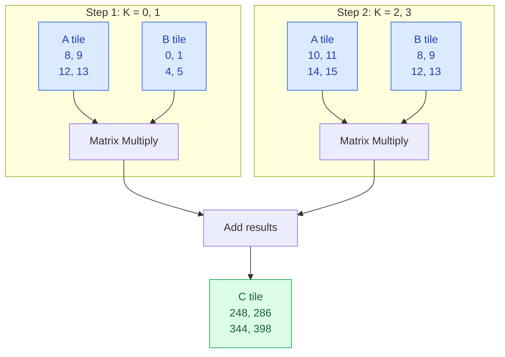
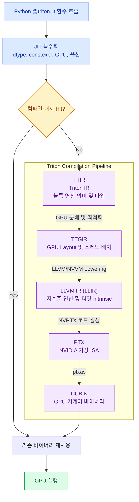

<WeekNavBar :week="7" topic="Tiled MatMul과 컴파일 과정" :researchers="[{'id': 'mbsong', 'name': 'mbsong', 'label': 'mbsong (송무복)', 'badge': 'NVIDIA A100 IR·SASS 실측'}, {'id': 'junpark', 'name': 'junpark', 'label': 'junpark (박준)', 'badge': 'RTX 5090 (sm_120) 실측 해부'}, {'id': 'singon', 'name': 'singon', 'label': 'singon (김신곤)', 'badge': 'L2 그룹핑 손계산 & IR 대응표'}, {'id': 'injokim', 'name': 'injokim', 'label': 'injokim (김인조)', 'badge': '알고리즘 & MLIR 하향 변환 종합'}, {'id': 'jaehyeong', 'name': 'jaehyeong', 'label': 'jaehyeong (이재형)', 'badge': '핵심 코드 & 컴파일 단계 요약'}]" />

> 🧑‍🔬 **연구원 리서치 노트** — 작성자: **singon (김신곤)** (`L2 그룹핑 손계산 & IR 대응표`)
>
> 💡 **핵심 기여 요약**: Row-major 순서와 Grouped Ordering(GROUP_SIZE_M)의 L2 캐시 적중 차이를 손계산으로 증명하고, Python 코드와 각 IR 단계를 1:1로 대응시켰습니다.

---

### Tiled MatMul과 컴파일 과정 — 2차원 타일 재사용에서 GPU 기계어까지

> **핵심 질문**  
> Python으로 작성한 2차원 Tiled MatMul 커널은 어떻게 타일 단위로 데이터를 재사용하며, 어떤 컴파일 단계를 거쳐 GPU 기계어로 바뀔까?

---

## 목차

1. [이번 주에 알아야 할 큰 그림](#1-이번-주에-알아야-할-큰-그림)
2. [공통 읽기와 다섯 가지 질문](#2-공통-읽기와-다섯-가지-질문)
3. [2차원 포인터 블록과 K축 누적](#3-2차원-포인터-블록과-k축-누적)
4. [Grouped Ordering과 L2 캐시](#4-grouped-ordering과-l2-캐시)
5. [메타파라미터와 자동 튜닝](#5-메타파라미터와-자동-튜닝)
6. [HBM 이동량과 Roofline 손계산](#6-hbm-이동량과-roofline-손계산)
7. [온칩 버퍼와 자원 한계](#7-온칩-버퍼와-자원-한계)
8. [Python AST에서 CUBIN까지](#8-python-ast에서-cubin까지)
9. [같은 커널을 코드와 IR로 읽기](#9-같은-커널을-코드와-ir로-읽기)
10. [NVIDIA GPU 실습 코드와 실행 방법](#10-nvidia-gpu-실습-코드와-실행-방법)
11. [컴파일 산출물과 벤치마크 읽기](#11-컴파일-산출물과-벤치마크-읽기)
12. [자주 생기는 오해와 문제 찾기](#12-자주-생기는-오해와-문제-찾기)
13. [연습문제와 해설](#13-연습문제와-해설)
14. [스터디 발표와 함께 이야기할 질문](#14-스터디-발표와-함께-이야기할-질문)
15. [참고자료와 읽은 절](#15-참고자료와-읽은-절)

---

## 1. 이번 주에 알아야 할 큰 그림

### 1.1 지난주에서 이번 주로

**한 프로그램이 출력 타일 하나를 맡고, K 방향으로 입력 타일을 읽어 FP32 중간 합에 누적한다. 컴파일러는 이 블록 연산을 워프·메모리 레이아웃·GPU 명령으로 구체화한다.**

| 이전에 배운 내용 | 이번 주 코드에서 만나는 모습 |
|---|---|
| 4주차: 출력 타일 안에서 A·B 재사용 | `[BM,BK] @ [BK,BN] → [BM,BN]`인 `tl.dot` |
| 4주차: `I = F/Q`와 Roofline | 타일별 HBM 읽기량과 80 FLOP/Byte 분기점 비교 |
| 6주차: `pid`, `offsets`, `mask` | pid를 `(pid_m,pid_n)`으로 바꾸고 2차원 주소·마스크 생성 |
| 6주차: 중간 결과를 저장하지 않는 Fusion | 누산기에 활성화를 적용한 뒤 최종 C만 저장 |
| 6주차: Python 문법의 GPU 커널 | AST → TTIR → TTGIR → LLVM IR → PTX → CUBIN |

### 1.2 이번 문서의 범위와 실행 상태

공통 연산은 `C = A @ B`, A는 `[M,K]`, B는 `[K,N]`, C는 `[M,N]`이다. 입력·출력은 FP16, 누산은 FP32이며, 기본 성능 비교에서는 활성화를 끈다. FP8, 역전파, B200의 TMEM·`tcgen05.mma` 세부 구현은 범위 밖이다.

---

## 2. 공통 읽기와 다섯 가지 질문

### 2.1 먼저 읽어올 자료

| 자료 | 읽을 절 | 확인할 것 |
|---|---|---|
| [Tutorial 03](https://triton-lang.org/main/getting-started/tutorials/03-matrix-multiplication.html) | Motivations, Pointer Arithmetic, L2 Cache Optimizations, Final Result, Unit Test, Benchmark | 포인터 블록, K 루프, 그룹 순서, FP16 검증 |
| [Triton 논문, MAPL 2019](https://www.eecs.harvard.edu/~htk/publication/2019-mapl-tillet-kung-cox.pdf) | §4.2, §5.1~5.3, Figure 4~7 | 타일 정보를 유지한 분석, 프리페칭, 계층적 타일링, 병합 접근, 공유 메모리 |
| [Modern GPU Programming](https://mlc.ai/modern-gpu-programming-for-mlsys/chapter_performance/index.html) | GEMM, The Optimization Ladder, Reducing Idle Time Through Overlap, Occupancy and Resource Pressure | 재사용 이후에도 필요한 연산·전송 중첩과 자원 균형 |

논문은 절 번호와 Figure 번호를 기준으로 찾는다. 2019년의 Triton-C·LLVM 기반 Triton-IR을 현재의 Python 프런트엔드·MLIR TTIR과 같은 문법으로 읽지 않는다.

### 2.2 다섯 질문의 핵심과 용어 3개

| 질문 | 먼저 잡을 답 | 핵심 용어 3개 |
|---|---|---|
| ① 2차원 주소와 누적 | 행·열 오프셋을 브로드캐스트하고 K 조각마다 같은 출력 타일에 더한다. | Broadcasting, Accumulator, Epilogue Fusion |
| ② 같은 타일인데 실행 순서가 왜 중요한가? | 가까운 pid가 사용할 입력의 작업 집합을 줄여 L2 재사용 가능성을 높인다. | Grouped Ordering, Working Set, L2 Cache |
| ③ 타일과 파이프라인은 어떻게 고르는가? | shape·dtype·장치에 맞는 후보를 측정하되 자원 한계를 함께 본다. | Meta-parameter, Autotuning, Software Pipelining |
| ④ 왜 여러 IR을 거치는가? | 블록 의미를 보존하는 최적화 뒤에 장치별 배치와 명령을 정한다. | Lowering, Dialect, Layout |
| ⑤ 생성 코드와 성능은 어떻게 읽는가? | IR·자원 메타데이터·측정 조건을 연결하고 유효 연산량을 시간으로 나눈다. | PTX, CUBIN, TFLOPs/s |

---

## 3. 2차원 포인터 블록과 K축 누적

### 3.1 수식에서 프로그램 하나의 일 찾기

출력 원소는 다음과 같다.

$$
C_{m,n}=\sum_{k=0}^{K-1}A_{m,k}B_{k,n}
$$

프로그램 하나는 원소 하나가 아니라 `C[m0:m0+BM, n0:n0+BN]`을 계산한다. K축을 BK씩 나누면 다음 과정이 된다.

$$
C_{\mathrm{tile} }\mathrel{+}=
A[m_0:m_0+BM,\;k_0:k_0+BK]
B[k_0:k_0+BK,\;n_0:n_0+BN]
$$

한 K 단계에서 A의 원소 하나는 BN개 출력 열에, B의 원소 하나는 BM개 출력 행에 기여한다. 이 재사용이 4주차의 Tiling이다. `BM×BN`은 논리적 출력 개수이며 스레드 개수가 아니다.

### 3.2 브로드캐스팅으로 주소 행렬 만들기

아래는 커널 내부의 설명용 조각이다. stride는 **Byte가 아니라 원소 단위**다. FP16 포인터에 `+1`을 하면 실제 주소가 2 Byte 전진하므로 주소 식에 다시 `*2`를 넣지 않는다.

```python
# 각각 [BM], [BN], [BK]인 1차원 오프셋
m = pid_m * BM + tl.arange(0, BM)
n = pid_n * BN + tl.arange(0, BN)
r = tl.arange(0, BK)

# [BM,1] + [1,BK] → [BM,BK]
pa = A + m[:, None] * stride_am + r[None, :] * stride_ak
# [BK,1] + [1,BN] → [BK,BN]
pb = B + r[:, None] * stride_bk + n[None, :] * stride_bn
```

`[:, None]`은 열벡터처럼, `[None, :]`는 행벡터처럼 shape를 바꾼다. 두 축이 합쳐져 모든 행·열 조합의 주소가 만들어진다. 주소 텐서를 만든다고 동일 크기의 HBM 배열을 새로 할당하는 것은 아니다. [Triton의 `expand_dims`](https://triton-lang.org/main/python-api/generated/triton.language.expand_dims.html), [포인터 연산 `tt.addptr`](https://triton-lang.org/main/dialects/TritonOps.html#tt-addptr-triton-addptrop)

작은 손계산으로 `M=N=K=4`, `BM=BN=BK=2`, `(pid_m,pid_n)=(1,0)`을 보자. 연속 행렬의 stride는 A·B 모두 `(4,1)`이다.


<table>
<tr>
<td valign="top">

<b>A 행렬 (K 방향: 열 →)</b>

<pre>
       k=0  k=1  k=2  k=3
m=0     0    1    2    3
m=1     4    5    6    7
m=2    🔵8  🔵9  🟢10 🟢11
m=3    🔵12 🔵13 🟢14 🟢15
</pre>

</td>
<td valign="top">

<b>B 행렬 (K 방향: 행 ↓)</b>

<pre>
       n=0  n=1  n=2  n=3
k=0    🔵0  🔵1    2    3
k=1    🔵4  🔵5    6    7
k=2    🟢8  🟢9   10   11
k=3    🟢12 🟢13  14   15
</pre>

</td>
</tr>
</table>

🔵 첫 번째 K 타일 (K=0,1)  
🟢 두 번째 K 타일 (K=2,3)




A는 같은 행 안에서 K축으로 오른쪽 이동하고, B는 같은 열 범위를 유지한 채 K축으로 아래쪽 이동한다. C 타일의 위치는 루프 내내 고정된다.

### 3.3 K축 누적과 마지막 타일 마스킹

```python
acc = tl.full((BM, BN), 0, tl.float32)
for step in range(tl.cdiv(K, BK)):
    valid_k = step * BK + r < K
    a = tl.load(pa, (m[:, None] < M) & valid_k[None, :], other=0)
    b = tl.load(pb, valid_k[:, None] & (n[None, :] < N), other=0)
    acc = tl.dot(a, b, acc)
    pa += BK * stride_ak
    pb += BK * stride_bk
```

`tl.dot`의 두 입력은 `[BM,BK]`, `[BK,BN]`, 누산기는 `[BM,BN]`이다. 범위 밖 K값은 0으로 채워 합에 기여하지 않게 한다. FP16 입력의 긴 합을 매번 FP16에 반올림하면 오차가 커지기 쉬우므로 FP32로 누적하고 마지막에 출력 형식으로 변환한다. FP32 누산도 무한 정밀도는 아니므로 라이브러리와 비트 단위 일치를 보장하지 않는다. [tl.dot API](https://triton-lang.org/main/python-api/generated/triton.language.dot.html)

예를 들어 `(M,N,K)=(500,600,300)`, `(BM,BN,BK)=(128,128,32)`이면 마지막 출력 행 타일에서 m은 384~511이다. m=500~511은 읽지 않고 쓰지도 않는다. 마지막 K 단계는 k=288~319이므로 300~319의 곱을 0으로 만든다.

공식 예제는 M·N 입력 인덱스를 `% M`, `% N`으로 유효 범위에 감싸고 K축을 마스킹한다. 이 문서의 실행 코드는 학습하기 쉽도록 M·N·K 모두 명시적으로 마스킹한다. 두 방식 모두 **출력 저장에는 원래 좌표로 만든 M·N 마스크가 필요하다.**

### 3.4 누산 직후 활성화를 넣는 Epilogue Fusion

```python
# K 루프를 끝낸 뒤, 아직 최종 C를 저장하기 전
if ACT:
    acc = tl.where(acc >= 0, acc, 0.01 * acc)  # 표준 leaky ReLU
c = acc.to(tl.float16)
tl.store(C + m[:, None] * stride_cm + n[None, :] * stride_cn,
         c, (m[:, None] < M) & (n[None, :] < N))
```

중간 합을 온칩에서 바로 변환하므로 활성화 전의 C를 HBM에 썼다가 다시 읽을 필요가 없다. FP16 중간 C를 따로 저장하는 2커널 구현과 비교하면, 단순 트래픽 모델에서 중간 쓰기·읽기 `4MN Byte`를 없앤다. 최종 출력 쓰기 `2MN Byte`는 남는다.

이 코드의 표준 leaky ReLU는 공식 예제의 helper를 그대로 복사한 것이 아니다. 공식 페이지의 helper에는 `x + 1`이 들어 있는 버전이 있으므로 활성화 결과를 비교할 때는 함수 정의까지 맞춰야 한다. 또한 FP32에서 활성화 후 FP16 변환하는 결과와, 먼저 FP16으로 저장한 뒤 활성화하는 결과는 반올림 때문에 다를 수 있다.

---

## 4. Grouped Ordering과 L2 캐시

### 4.1 pid와 실제 실행 시각은 다르다

타일 안의 재사용은 프로그램 하나가 해결한다. 타일 **사이**의 재사용에는 모든 SM이 공유하는 L2 캐시가 관여한다. Grouped Ordering은 가까운 프로그램 번호에 어떤 출력 좌표를 배정할지 바꾼다.

GPU 스케줄러가 pid 순서대로 완료시키거나 처음 9개를 반드시 동시에 실행한다는 뜻은 아니다. 여기서는 **pid 0~8이 요구하는 입력의 합집합**을 센다. 실제 L2 적중률은 실행 겹침, 용량, 교체, 다른 커널의 트래픽에도 좌우된다.

### 4.2 9×9 블록에서 좌표를 직접 대입하기

`num_pid_m=num_pid_n=9`, `K/BK=9`, `GROUP_SIZE_M=3`으로 둔다. 행 우선 순서는 다음과 같다.

```python
pid_m = pid // num_pid_n
pid_n = pid % num_pid_n
```

그룹 순서는 다음처럼 매핑한다. 마지막 그룹의 행 수가 GM보다 작을 수 있으므로 `height`가 필요하다.

```python
group_span = GROUP_SIZE_M * num_pid_n
group_id = pid // group_span
first_m = group_id * GROUP_SIZE_M
height = min(num_pid_m - first_m, GROUP_SIZE_M)
local_pid = pid % group_span
pid_m = first_m + local_pid % height
pid_n = local_pid // height
```

| pid | 행 우선 `(pid_m,pid_n)` | 그룹 순서 `(pid_m,pid_n)` |
|---:|---|---|
| 0 | (0,0) | (0,0) |
| 1 | (0,1) | (1,0) |
| 2 | (0,2) | (2,0) |
| 3 | (0,3) | (0,1) |
| 4 | (0,4) | (1,1) |
| 5 | (0,5) | (2,1) |
| 6 | (0,6) | (0,2) |
| 7 | (0,7) | (1,2) |
| 8 | (0,8) | (2,2) |

```text
처음 9개 출력 타일의 pid (·는 아직 선택하지 않은 출력)

행 우선                         GROUP_SIZE_M = 3
       n=0 1 2 3 4 5 6 7 8           n=0 1 2 3 4 5 6 7 8
m=0      0 1 2 3 4 5 6 7 8     m=0     0 3 6 · · · · · ·
m=1      · · · · · · · · ·     m=1     1 4 7 · · · · · ·
m=2      · · · · · · · · ·     m=2     2 5 8 · · · · · ·
m=3~8    모두 ·                 m=3~8   모두 ·
```

### 4.3 왜 90개에서 54개인가?

출력 블록 `C[i,j]` 하나에는 `A[i,0:9]`의 9개와 `B[0:9,j]`의 9개가 필요하다.

| 처음 9개 출력의 범위 | 서로 다른 A 입력 타일 | 서로 다른 B 입력 타일 | 합계 |
|---|---:|---:|---:|
| 행 우선: 한 행 × 9열 | 1행 × K 9개 = 9 | K 9개 × 9열 = 81 | **90** |
| 그룹: 3행 × 3열 | 3행 × K 9개 = 27 | K 9개 × 3열 = 27 | **54** |

그룹 방식은 A의 작업 집합을 9→27로 늘리는 대신 B를 81→27로 줄인다. 합계가 40% 작아진다. 이 예시는 블록 크기가 같은 정사각 블록의 **개수** 비교이며, 일반적인 직사각 타일은 A·B 타일의 Byte 크기도 따로 고려해야 한다. [Tutorial 03 — L2 Cache Optimizations](https://triton-lang.org/main/getting-started/tutorials/03-matrix-multiplication.html#l2-cache-optimizations)

**90·54는 실제 `tl.load` 호출 수나 측정한 HBM 트랜잭션 수가 아니다.** 프로그램 사이에 전혀 캐시 재사용이 없다면 두 순서 모두 `9출력 × 9 K단계 × 2입력 = 162`회의 입력 타일 요청을 한다. 90·54는 해당 작업 집합의 중복을 제거한 값이다. 캐시에 유지된 입력을 다시 사용할 때 HBM 재읽기가 줄어들 여지가 생긴다.

따라서 6절의 “출력 타일 사이 L2 재사용 없음” 계산에 54/90을 곱하지 않는다. 두 계산은 다른 가정을 쓰고 있다.

---

## 5. 메타파라미터와 자동 튜닝

### 5.1 후보가 바꾸는 것

| 항목 | 커질 때 기대하는 효과 | 함께 늘거나 달라지는 비용 |
|---|---|---|
| BM | B 원소를 더 많은 출력 행에서 재사용 | A 입력 타일·누산기 증가, 출력 프로그램 수 감소 |
| BN | A 원소를 더 많은 출력 열에서 재사용 | B 입력 타일·누산기 증가 |
| BK | K 루프 반복 횟수 감소 | 한 번에 준비할 입력 증가; BM·BN 고정이면 이상적 총 입력량은 동일 |
| GROUP_SIZE_M | 인접 pid 사이 B 타일 재사용 기회 | A 작업 집합 증가; 너무 큰 그룹은 캐시에 불리할 수 있음 |
| num_warps | 프로그램 내부 병렬성 증가 | 스레드 자원 증가, 스레드당 레지스터 분배와 occupancy 변화 |
| num_stages | 다음 입력을 미리 준비하여 연산·전송 중첩 | 살아 있는 입력 버퍼와 주소·임시값 증가 |

`num_warps=4`는 일반적인 NVIDIA CTA 하나에서 128개 스레드가 협력한다는 뜻이다. 128개 출력만 계산한다는 뜻은 아니다. `num_stages`는 프로그램 개수나 warp 개수가 아니라 루프 소프트웨어 파이프라이닝 옵션이다. [triton.Config API](https://triton-lang.org/main/python-api/generated/triton.Config.html)

```text
순차 처리:  load 0 → dot 0 → load 1 → dot 1 → load 2 → dot 2
중첩 개념:  load 0 → load 1 → load 2 → ...
                       dot 0  → dot 1  → dot 2 → ...
```

중첩은 필요한 Byte 자체를 줄이지 않는다. 다음 입력을 기다리는 빈 시간을 줄인다. 반면 버퍼 증가로 한 SM에 상주하는 CTA가 줄어들 수 있다. 연산 병목 구간에서도 Tensor Core를 계속 바쁘게 유지하려면 이 균형이 필요하다. [Modern GPU Programming — Overlap와 Occupancy](https://mlc.ai/modern-gpu-programming-for-mlsys/chapter_performance/index.html)

### 5.2 세 후보를 Config로 표현하기

실행 파일에서는 읽기 쉽게 `BLOCK_SIZE_M/N/K`, `GROUP_SIZE_M`을 각각 `BM/BN/BK`, `GM`으로 줄였다. GM=8은 세 후보의 기본값이고, 앞 절의 GM=3은 별도 손계산 예시다.

```python
configs = [
    triton.Config(dict(BM=64, BN=32, BK=32, GM=8), num_stages=5, num_warps=2),
    triton.Config(dict(BM=128, BN=128, BK=32, GM=8), num_stages=4, num_warps=4),
    triton.Config(dict(BM=128, BN=256, BK=64, GM=8), num_stages=3, num_warps=8),
]
# 통상적인 사용 형태
@triton.autotune(configs=configs, key=['M', 'N', 'K'])
@triton.jit
def kernel(...):
    ...
```

위 `def kernel(...)`은 데코레이터 배치 설명용 의사 코드다. 실행 파일에서는 같은 JIT 함수에 `triton.autotune(...)(matmul_kernel)`을 적용해 단일 Config 실행과 자동 튜닝을 모두 비교한다.

### 5.3 언제 다시 후보들을 측정하는가?

현행 autotuner 구현은 `key`에 지정한 M·N·K 값과 텐서 인자의 dtype을 사용해 튜닝 결과 캐시를 찾는다.

1. **아직 없는 key·dtype 조합**이면 사용 가능한 후보를 벤치마크해 선택한다.
2. 같은 조합을 다시 호출하면 선택 결과를 재사용한다. shape가 바뀌었다가 이미 측정한 shape로 돌아왔다고 반드시 재측정하지는 않는다.
3. dtype이 달라지면 별도 조합이 된다. 다만 이 실습 래퍼는 FP16만 허용한다.
4. 디스크 튜닝 결과 캐시를 활성화한 경우 저장 결과를 재사용할 수 있다. 단일 후보만 남은 경우 후보 간 비교가 필요 없다.

JIT 컴파일 캐시와 autotune 선택 캐시는 다르다. 새 shape에서 튜닝해도 후보 바이너리가 이미 있으면 컴파일을 재사용할 수 있다. 반대로 stride·constexpr 변화로 컴파일 특수화가 달라져도 그것이 모두 autotune key에 자동 포함되는 것은 아니다. 이 파일은 연속 입력·동일 GPU·ACT=False를 성능 비교 조건으로 고정한다. 레이아웃이나 활성화별로 선택을 달리하려면 관련 인자를 key에 추가하거나 튜너를 분리한다. [autotune API](https://triton-lang.org/main/python-api/generated/triton.autotune.html), [Autotuner.run 구현](https://github.com/triton-lang/triton/blob/main/python/triton/runtime/autotuner.py)

후보를 여러 번 실행하므로 누적 쓰기나 입력을 수정하는 커널은 초기화에 주의해야 한다. 여기서는 매번 C 전체를 덮어쓰며 A·B를 변경하지 않는다.

---

## 6. HBM 이동량과 Roofline 손계산

### 6.1 조건과 단위 고정

| 항목 | 공통 조건 |
|---|---|
| 연산 | `C = A @ B`, 활성화 없음, 기존 C 읽기 없음 |
| 크기 | M=N=K=4096 |
| 자료형 | A·B·C FP16: 2 Byte/원소, 누산 FP32: 4 Byte/원소 |
| 가상 연산 성능 P | FP16 입력·FP32 누산에 적용 가능한 80×10¹² FLOPs/s |
| 가상 HBM 대역폭 BW | 1×10¹² Byte/s |
| 분기점 | `P/BW = 80 FLOP/Byte` |
| 재사용 | 출력 타일 내부 재사용, 출력 타일 사이 L2 재사용 없음 |
| 제외 | CPU↔GPU 전송, JIT·튜닝, launch 비용, spill, 패딩 추가 연산, 자원 부족 |
| 단위 | KiB=1024 Byte, MiB=2²⁰ Byte; TB/s·TFLOPs/s는 10¹² 기준 |

실제 GPU에 80 TFLOPs/s를 적용한 표가 아니다. 온칩 자원이 충분하고 연산과 메모리 이동이 이상적으로 중첩된다는 시간 하한을 구한다.

### 6.2 연산량·그리드·K 반복 횟수

$$
F=2MNK=2\times4096^3=137,438,953,472\;\mathrm{FLOP}
$$

곱셈과 덧셈을 각각 1 FLOP으로 세어 약 137.439 GFLOP이다. 경계가 없는 이번 크기에서는 출력 타일 수가 정확히 `(M/BM)(N/BN)`이다.

| 후보 | BM×BN×BK | num_stages / num_warps | 출력 블록 행×열 | grid | K/BK |
|---|---|---|---|---|---:|
| 1 | 64×32×32 | 5 / 2 | 64×128 | `(8192,)` | 128 |
| 2 | 128×128×32 | 4 / 4 | 32×32 | `(1024,)` | 128 |
| 3 | 128×256×64 | 3 / 8 | 32×16 | `(512,)` | 64 |

### 6.3 입력량 수식이 나오는 이유

한 출력 타일은 전체 K축을 따라 A를 `BM×K`, B를 `K×BN`개 읽는다. 따라서 다음과 같다.

$$
\begin{aligned}
Q_{\mathrm{in,tile} } &= 2K(BM+BN) \\
Q_{\mathrm{in} } &= \frac{MN}{BM\,BN}\times2K(BM+BN) \\
&=2MNK\left(\frac1{BN}+\frac1{BM}\right) \\
Q_{\mathrm{out} } &= 2MN=33,554,432\;\mathrm{Byte}=32\;\mathrm{MiB} \\
Q&=Q_{\mathrm{in} }+Q_{\mathrm{out} },\qquad I=F/Q
\end{aligned}
$$

BK가 사라지는 이유는 한 번의 입력 크기가 BK에 비례하고 반복 횟수는 `K/BK`이기 때문이다. FP32 누산기는 온칩에 유지한다고 가정하므로 HBM Q에 더하지 않는다.

| 후보 | 입력 읽기 Q_in (Byte) | 출력 쓰기 (Byte) | 총 Q (Byte) | 총 Q (MiB) | I (FLOP/Byte) |
|---|---:|---:|---:|---:|---:|
| 1 | 6,442,450,944 | 33,554,432 | **6,476,005,376** | 6,176 | **21.2228** |
| 2 | 2,147,483,648 | 33,554,432 | **2,181,038,080** | 2,080 | **63.0154** |
| 3 | 1,610,612,736 | 33,554,432 | **1,644,167,168** | 1,568 | **83.5918** |

입력만 보면 `I≈BM×BN/(BM+BN)`이지만 위 표에는 출력 쓰기도 포함했다. 큰 타일은 입력 재사용을 늘려 I를 높인다. 이 값은 실측 HBM 카운터가 아니라 정해 둔 모델의 결과다.

### 6.4 이상적 시간과 병목

$$
T_{\mathrm{compute} }=F/P,\quad T_{\mathrm{memory} }=Q/BW
$$

$$
T_{\mathrm{ideal} }=\max(T_{\mathrm{compute} },T_{\mathrm{memory} }),\qquad
P_{\mathrm{roof} }=\min(P,BW\times I)
$$

| 후보 | 연산 시간 (ms) | HBM 시간 (ms) | T_ideal (ms) | 성능 상한 (TFLOPs/s) | 모델의 병목 |
|---|---:|---:|---:|---:|---|
| 1 | 1.717987 | 6.476005 | **6.476005** | 21.2228 | 대역폭 |
| 2 | 1.717987 | 2.181038 | **2.181038** | 63.0154 | 대역폭 |
| 3 | 1.717987 | 1.644167 | **1.717987** | 80.0000 | 연산 |

두 시간을 더하지 않고 큰 쪽을 취한 것은 완전한 중첩을 가정하기 때문이다. 후보 3은 산술 강도상 연산 병목에 들어가지만, 다음 절의 자원 조건까지 만족해야 실행 가능한 후보가 된다. **시간 하한이 가장 작다고 실제 선택 가능한 최적 Config가 되는 것은 아니다.**

### 6.5 GPU 없이 재계산하는 코드

```python
# 표준 Python만 사용. GPU 벤치마크가 아니다.
M = N = K = 4096
P, BW = 80e12, 1e12
F = 2 * M * N * K
for bm, bn, bk, stages, warps in [(64,32,32,5,2),
                                  (128,128,32,4,4),
                                  (128,256,64,3,8)]:
    qin = 2 * M * N * K // bn + 2 * M * N * K // bm
    qout = 2 * M * N
    q = qin + qout
    stage = 2 * bk * (bm + bn)
    print(dict(tile=(bm,bn,bk), grid=(M//bm * (N//bn),), loops=K//bk,
               input_bytes=qin, output_bytes=qout, total_bytes=q,
               intensity=F/q, ideal_ms=max(F/P,q/BW)*1e3,
               stage_KiB=stage/1024, pipeline_KiB=stage*stages/1024,
               accumulator_KiB=4*bm*bn/1024))
```

---

## 7. 온칩 버퍼와 자원 한계

### 7.1 입력 버퍼와 누산기를 나누어 계산하기

한 단계에 필요한 FP16 입력 타일과 FP32 출력 누산기의 논리적 크기는 다음과 같다.

$$
S_{\mathrm{stage} }=2(BM\,BK+BK\,BN),\quad
S_{\mathrm{pipeline} }=\mathrm{num\_stages}\times S_{\mathrm{stage} },\quad
R_{\mathrm{acc} }=4BM\,BN
$$

| 후보 | 한 단계 입력 (Byte / KiB) | 파이프라인 입력 (KiB) | FP32 누산기 (Byte / KiB) | 64 KiB/CTA와 입력 버퍼 비교 |
|---|---|---:|---|---|
| 1 | 6,144 / 6 | **30** | 8,192 / 8 | 여유 34 KiB |
| 2 | 16,384 / 16 | **64** | 65,536 / 64 | 경계에 정확히 도달 |
| 3 | 49,152 / 48 | **144** | 131,072 / 128 | 한계보다 80 KiB 큼 |

**단계별 입력 버퍼를 전부 Shared Memory에 둔다는 단순 모델에서는 후보 3이 64 KiB 한계를 초과한다.** 후보 2는 추가 공간이 전혀 없는 경우에만 한계에 맞는다. 레이아웃 패딩, 임시 버퍼, 동기화 관련 공간 등 추가 요구가 있다면 초과할 수 있다.

실제 컴파일러는 GPU 세대와 패스에 따라 버퍼의 개수·수명·재사용을 다르게 정한다. 그러므로 위 곱셈만으로 모든 GPU에서 후보 3이 반드시 같은 `OutOfResources`를 낸다고 단정하지 않는다. 실제 판정에는 `.metadata.shared`와 해당 장치의 CTA당 허용량을 사용한다. 후보 1·2도 다른 자원 때문에 실패하거나 낮은 occupancy를 보일 수 있다.

### 7.2 누산기 64 KiB를 Shared Memory에 더하면 안 되는 이유

이 커널의 전통적인 Tensor Core 경로에서는 FP32 누산기를 주로 스레드별 레지스터 조각에 분산한다. `4BM×BN`은 논리적 누산 데이터 크기이지 Shared Memory 할당량이 아니다. 단순 균등 분할로 누산값만 세면 다음과 같다.

| 후보 | 스레드 수 `32×num_warps` | 스레드당 FP32 누산값의 단순 평균 |
|---|---:|---:|
| 1 | 64 | 2,048/64 = 32개 |
| 2 | 128 | 16,384/128 = 128개 |
| 3 | 256 | 32,768/256 = 128개 |

이것도 실제 레지스터 수가 아니다. 주소, mask, 로드 조각, 중간 계산값과 배치 방식까지 포함하면 달라진다. 실제 `n_regs`, `n_spills`를 별도로 살펴야 한다. spill이 생기면 이 문서의 HBM Q 모델에 없는 이동도 발생할 수 있다.

### 7.3 더 많은 warp·stage가 항상 빠르지 않은 이유

warp를 늘리면 누산값이 더 많은 스레드에 분산될 수 있지만 CTA(Cooperative Thread Array) 전체 스레드 자원도 더 사용한다. stage를 늘리면 입력 대기를 숨길 수 있지만 Shared Memory 사용이 커져 상주 CTA 수가 줄어들 수 있다. 자원 제한은 CTA당 한도와 SM 전체 한도를 구분해야 한다. 한 CTA가 실행 가능해도 SM에 하나밖에 상주하지 못할 수 있다.

이 때문에 “가장 큰 타일”, “가장 높은 occupancy”, “가장 많은 stage” 중 어느 하나만으로 최적값을 정할 수 없다. [Modern GPU Programming — Occupancy and Resource Pressure](https://mlc.ai/modern-gpu-programming-for-mlsys/chapter_performance/index.html)

---

## 8. Python AST에서 CUBIN까지

### 8.1 처음 호출할 때 일어나는 일

`@triton.jit`가 붙었다고 정의 시점에 GPU 코드가 모두 만들어지는 것은 아니다. 처음 특정 자료형·상수·장치·옵션 조합으로 호출하면 JIT가 특수화와 캐시 조회를 수행한다. 재사용 가능한 산출물이 없다면 컴파일하고 실행 가능한 바이너리를 로드한다. 자동 튜닝은 여러 후보에 대해 이 과정을 수행하고 시간을 비교할 수 있다.



- TTIR: Triton 연산을 블록 단위로 표현하는 중간 표현
- TTGIR: GPU의 워프·스레드 배치 및 데이터 레이아웃을 반영한 표현
- LLIR: LLVM 기반의 저수준 중간 표현
- PTX: NVIDIA GPU를 위한 가상 명령어 집합
-  CUBIN: 특정 NVIDIA GPU 아키텍처에서 실행할 수 있는 바이너리

이는 NVIDIA CUDA 백엔드의 경로다. PTX는 최종 GPU 기계어가 아니며, CUBIN 안의 기계 명령을 사람이 읽는 형태로 표현할 때 흔히 SASS라고 부른다. AMD 백엔드는 다른 마지막 경로를 사용한다. [NVIDIA Triton 백엔드](https://github.com/triton-lang/triton/blob/main/third_party/nvidia/backend/compiler.py)

### 8.2 단계별 비교표

| 단계 | 유지하거나 새로 정하는 정보 | MatMul에서 볼 단서 |
|---|---|---|
| Python AST | 함수·루프·조건의 문법 구조; 호출 시 상수와 타입을 반영 | `tl.arange`, `tl.load`, `tl.dot` 호출 |
| TTIR | 타일 shape, dtype, 브로드캐스트, 마스크, 데이터 의존성; 아직 구체적인 스레드 배치 없음 | `tt.make_range`, `tt.expand_dims`, `tt.broadcast`, `tt.addptr`, `tt.load`, `tt.dot`, `scf.for` |
| TTGIR | 타깃 GPU, warp 수, 타일의 스레드 분배·Shared Memory 배치; dot 구현 선택과 파이프라인 변환 | blocked/shared/dot operand 계열 encoding, layout conversion, async copy·wait 등 |
| LLVM IR / LLIR | 스레드별 저수준 연산, 주소 공간, 제어 흐름, NVVM intrinsic·inline assembly | 스칼라/벡터 포인터 연산, 장치 builtin, MMA 관련 저수준 호출 |
| PTX | 가상 레지스터와 GPU 명령, predication, global/shared 접근 | `ld.global`, `st.global`, 대상에 따라 `mma.sync`, `wgmma` 등 |
| CUBIN | 실제 대상 아키텍처용 바이너리와 자원 정보 | 로드할 실행 코드; 필요하면 별도 도구로 SASS 확인 |

TTIR·TTGIR은 각각 `tt`·`ttg` 연산만 들어 있는 순수한 상자가 아니다. `arith`, `scf` 등 공통 MLIR dialect와 NVIDIA 전용 dialect도 함께 나타날 수 있다. [Triton dialect](https://triton-lang.org/main/dialects/TritonOps.html), [TritonGPU dialect](https://triton-lang.org/main/dialects/TritonGPUOps.html)

### 8.3 TTIR과 TTGIR을 구분하는 기준

TTIR의 `[128,32]` 블록은 **어떤 값들이 필요한지**를 표현한다. TTGIR의 레이아웃은 그 값들을 **어떤 lane·warp·레지스터·공유 메모리에 놓을지**를 표현한다.

- **blocked layout:** 블록 원소를 스레드·warp로 나누는 분배 방식.
- **shared layout:** Shared Memory 안의 저장 배치. 접근·은행 충돌을 고려한 배치가 포함될 수 있다.
- **dot operand layout:** 행렬 연산이 요구하는 입력 조각 배치. 누산기에도 MMA 구현에 맞는 배치가 필요하다.

`num_warps`는 GPU 변환에 반영되고 `num_stages`는 적합한 루프의 스케줄·버퍼링 변환에 영향을 준다. TTGIR 단계에서 Tensor Core 구현을 선택·준비하지만 최종 `mma` 명령 문자열의 구체화는 후속 lowering과 PTX 생성까지 이어진다. 단순히 “TTGIR의 모든 `tt.dot`이 곧 PTX 한 줄”이라고 보면 안 된다. [현재 make_ttgir 구현](https://github.com/triton-lang/triton/blob/main/third_party/nvidia/backend/compiler.py)

### 8.4 왜 한 번에 기계어로 내리지 않을까?

높은 수준에서는 타일의 shape·브로드캐스팅·수학적 연산을 볼 수 있어 중복 계산이나 불필요한 변환을 없애기 좋다. 너무 일찍 스칼라 명령으로 풀어버리면 “이 연산 묶음이 행렬곱이다”라는 정보를 다시 찾아야 한다.

낮은 수준에서는 warp 구조, 공유 메모리, 명령 제약이 드러나야 실제 GPU에 맞춘 최적화를 할 수 있다. 여러 IR은 각 단계에서 필요한 정보를 유지하고, 다음 단계에서 더 구체적인 결정을 내리도록 한다. MLIR의 dialect는 이런 추상화 수준과 도메인별 연산을 표현하는 장치다. [MLIR 개요](https://mlir.llvm.org/)

### 8.5 2019년 논문과 현대 파이프라인 연결하기

| 논문의 절·그림 | 핵심 개념 | 현대 커널을 읽을 때의 연결 |
|---|---|---|
| §4.2, Figure 4 | reshape·broadcast를 타일 연산으로 분석 | 2차원 포인터의 축 확장과 브로드캐스트 |
| §5.1 | 다음 루프 입력의 prefetch, 타일 연산 단순화 | K 루프의 입력 준비와 계산 중첩 |
| §5.2, Figure 5 | 큰 타일을 하위 계산 단위로 나누는 계층적 타일링 | CTA→warp→lane의 논리적 분배 |
| §5.2, Figure 6 | 연속 메모리 접근을 만들기 위한 배치 | coalescing과 스레드별 데이터 분배 |
| §5.2, Figure 7 | 공유 메모리 할당·재사용을 다루는 예시 | 버퍼 수명·공간과 충돌 관리 |
| §5.2~5.3 | 공유 메모리 동기화, 후보 자동 탐색 | 생산·소비 의존성 보장과 Config 측정 |

타일의 shape·주소·사용 시점이 IR에 드러나야 안전한 프리페칭, 공유 공간 재사용, 필요한 동기화를 분석할 수 있다. 이 설계 방향은 오늘날에도 연결되지만 **2019년 논문이 TTIR→TTGIR의 현재 MLIR 패스를 설명하는 것은 아니다.** Figure의 개념을 오늘날 코드와 연결한 해석이며 패스의 일대일 대응은 아니다. [Triton 논문 §4.2·§5](https://www.eecs.harvard.edu/~htk/publication/2019-mapl-tillet-kung-cox.pdf)

---

## 9. 같은 커널을 코드와 IR로 읽기

### 9.1 핵심 구문별 변환 내용

| Python 커널 구문 | TTIR에서의 의미 | TTGIR에서 구체화되는 것 | LLVM IR → PTX |
|---|---|---|---|
| `tl.program_id(0)` | 프로그램 ID 조회 | CTA와 출력 타일 매핑, 레이아웃과 함께 사용 | block ID 관련 builtin/특수 레지스터 조회 |
| 2차원 주소와 `tl.load` | 주소·mask의 블록 계산과 읽기 | 접근 병합, 스레드 분배, 필요시 공유 메모리 staging | 주소 계산, predicated load, 타깃별 비동기 복사 |
| `for step ...` | 루프와 누산 데이터 의존성 | 반복 간 load·dot 스케줄, 버퍼링·대기 | 분기·루프·동기화 또는 unroll된 명령 |
| `tl.dot(a,b,acc)` | 블록 행렬곱 누산 | 지원되는 Tensor Core 방식과 operand/accumulator 배치 | intrinsic/inline asm → MMA 계열 명령 |
| `tl.store` | 출력 블록과 mask 저장 | 스레드별 출력 분배, 필요시 레이아웃 변환 | FP16 변환과 global store |

주소 stride·형상·정렬이 좋지 않으면 `tl.load`가 항상 최적으로 병합되는 것은 아니다. 역시 `num_stages`가 지정되었다고 모든 루프에 동일한 비동기 명령이 생기는 것도 아니다. 생성된 IR에서 확인할 질문이다.

### 9.2 설명용 IR 조각을 읽는 순서

다음은 **실제 덤프가 아닌, 의미를 보여주는 축약 표기**다. 생략된 타입·속성이 있어 그대로 컴파일할 수 없다.

```text
# TTIR 개념: 아직 스레드 레이아웃을 표시하지 않음
%a = tt.load %a_ptrs, %a_mask, %zero : tensor<64x32x...>
%b = tt.load %b_ptrs, %b_mask, %zero : tensor<32x32x...>
%next = tt.dot %a, %b, %acc : ... -> tensor<64x32xf32>

# TTGIR 개념: 타입/메모리 표현에 레이아웃이 추가됨
%a_fragment = ttg.convert_layout %a : ... -> tensor<64x32xf16, #dot_operand>
# 실제 출력의 encoding 이름·변환 수·dot 연산 이름은 버전/GPU에 따라 다름

# PTX에서 찾을 수 있는 명령 계열의 예: 특정 GPU의 생성 결과를 보장하지 않음
mma.sync.aligned...   # warp 단위 행렬곱 누산 계열
ld.global...         # global memory 읽기
st.global...         # global memory 쓰기
```

먼저 TTIR에서 타일 shape와 FP32 누산을 찾고, TTGIR에서 layout과 copy/wait를 찾는다. 마지막으로 PTX에서 실제 대상이 선택한 행렬 연산을 찾는다. `mma.sync`가 보이지 않는다면 즉시 Tensor Core 미사용이라고 단정하지 말고 GPU 세대와 다른 명령 계열도 확인한다.

---

## 10. NVIDIA GPU 실습 코드와 실행 방법

### 10.1 실행 파일이 수행하는 순서

전체 코드는 문서의 설명용 조각들을 합칠 필요 없이 이 파일을 실행한다.

```
"""Week 7 CUDA lab. Run on a supported NVIDIA GPU; no Mac GPU fallback."""
import argparse
import json
import os
from pathlib import Path

os.environ.setdefault("TRITON_PRINT_AUTOTUNING", "1")

import torch
import triton
import triton.language as tl
import triton.testing
from triton.runtime.errors import OutOfResources


CONFIGS = [
    triton.Config(dict(BM=64, BN=32, BK=32, GM=8), num_stages=5, num_warps=2),
    triton.Config(dict(BM=128, BN=128, BK=32, GM=8), num_stages=4, num_warps=4),
    triton.Config(dict(BM=128, BN=256, BK=64, GM=8), num_stages=3, num_warps=8),
]


@triton.jit
def matmul_kernel(A, B, C, M, N, K, am, ak, bk, bn, cm, cn,
                  BM: tl.constexpr, BN: tl.constexpr, BK: tl.constexpr,
                  GM: tl.constexpr, ACT: tl.constexpr):
    pid = tl.program_id(0)
    rows = tl.cdiv(M, BM)
    cols = tl.cdiv(N, BN)
    group = pid // (GM * cols)
    first = group * GM
    height = tl.minimum(rows - first, GM)
    local = pid % (GM * cols)
    tile_m = first + local % height
    tile_n = local // height
    m = tile_m * BM + tl.arange(0, BM)
    n = tile_n * BN + tl.arange(0, BN)
    r = tl.arange(0, BK)
    pa = A + m[:, None] * am + r[None, :] * ak
    pb = B + r[:, None] * bk + n[None, :] * bn
    acc = tl.full((BM, BN), 0, tl.float32)
    for step in range(tl.cdiv(K, BK)):
        valid_k = step * BK + r < K
        a = tl.load(pa, (m[:, None] < M) & valid_k[None, :], other=0)
        b = tl.load(pb, valid_k[:, None] & (n[None, :] < N), other=0)
        acc = tl.dot(a, b, acc)
        pa += BK * ak
        pb += BK * bk
    if ACT:
        acc = tl.where(acc >= 0, acc, 0.01 * acc)
    pc = C + m[:, None] * cm + n[None, :] * cn
    tl.store(pc, acc.to(tl.float16), (m[:, None] < M) & (n[None, :] < N))


# One JIT implementation, two launch paths: explicit Config or autotuning.
auto_kernel = triton.autotune(configs=CONFIGS, key=["M", "N", "K"])(matmul_kernel)


def launch(a, b, c, config=None, activation=False):
    m, k = a.shape
    n = b.shape[1]
    grid = lambda meta: (triton.cdiv(m, meta["BM"]) * triton.cdiv(n, meta["BN"]),)
    args = (a, b, c, m, n, k, *a.stride(), *b.stride(), *c.stride())
    if config is None:
        return auto_kernel[grid](*args, ACT=activation)
    return matmul_kernel[grid](
        *args, **config.kwargs, ACT=activation,
        num_warps=config.num_warps, num_stages=config.num_stages,
    )


def matmul(a, b, config=None, activation=False):
    if not (a.is_cuda and b.is_cuda and a.device == b.device):
        raise ValueError("A and B must be on the same CUDA GPU")
    if a.dtype != torch.float16 or b.dtype != torch.float16:
        raise ValueError("This lab supports FP16 inputs only")
    if a.ndim != 2 or b.ndim != 2 or a.shape[1] != b.shape[0]:
        raise ValueError("Expected [M,K] @ [K,N]")
    if min(*a.shape, *b.shape) <= 0:
        raise ValueError("This lab requires positive dimensions")
    if not (a.is_contiguous() and b.is_contiguous()):
        raise ValueError("This lab uses contiguous inputs")
    c = torch.empty((a.shape[0], b.shape[1]), device=a.device, dtype=a.dtype)
    with torch.cuda.device(a.device):
        launch(a, b, c, config, activation)
    return c


def check(a, b, config=None):
    actual = matmul(a, b, config)
    expected = torch.matmul(a, b)
    error = (actual.float() - expected.float()).abs().max().item()
    passed = torch.allclose(actual, expected, atol=1e-2, rtol=0)
    print(f"accuracy shape={(a.shape[0], b.shape[1], a.shape[1])} "
          f"config={config or 'autotune'} max_abs_error={error:.8g} pass={passed}")
    if not passed:
        raise AssertionError("FP16 comparison failed: atol=1e-2, rtol=0")


def dump_kernel(compiled, folder):
    folder.mkdir(parents=True, exist_ok=True)
    metadata = {name: getattr(compiled.metadata, name, None)
                for name in ("shared", "num_warps", "num_stages")}
    metadata.update(n_regs=getattr(compiled, "n_regs", None),
                    n_spills=getattr(compiled, "n_spills", None))
    print("compiled metadata:", metadata)
    (folder / "metadata.json").write_text(json.dumps(metadata, indent=2))
    for kind in ("ttir", "ttgir", "llir", "ptx", "cubin"):
        content = compiled.asm.get(kind)
        if content is None:
            print(f"{kind}: unavailable in this version/backend")
            continue
        path = folder / f"matmul.{kind}"
        if isinstance(content, bytes):
            path.write_bytes(content)
            continue
        path.write_text(content)
        print(f"\n[{kind}: first 12 lines]\n" + "\n".join(content.splitlines()[:12]))
        hits = [line for line in content.splitlines()
                if any(token in line for token in ("tt.dot", "mma", "dot_op", "async_copy"))]
        print("\n".join(hits[:12]))
    return metadata


def main():
    parser = argparse.ArgumentParser(description=__doc__)
    parser.add_argument("--size", type=int, default=4096, choices=(2048, 4096))
    parser.add_argument("--output", type=Path, default=Path("artifacts/week7"))
    args = parser.parse_args()
    if os.environ.get("TRITON_INTERPRET") == "1":
        raise SystemExit("Disable TRITON_INTERPRET for this CUDA benchmark and IR lab")
    if not torch.cuda.is_available() or torch.version.hip is not None:
        raise SystemExit("A supported NVIDIA CUDA GPU is required; not run on Mac/ANE")
    torch.manual_seed(7)
    torch.backends.cuda.matmul.allow_fp16_reduced_precision_reduction = False
    prop = torch.cuda.get_device_properties(0)
    report = dict(gpu=prop.name, compute_capability=list(torch.cuda.get_device_capability(0)),
                  torch=torch.__version__, triton=triton.__version__, cuda=torch.version.cuda,
                  shared_memory_per_block=prop.shared_memory_per_block,
                  shared_memory_per_block_optin=getattr(prop, "shared_memory_per_block_optin", None),
                  dtype="FP16 input/output, FP32 accumulator", size=args.size,
                  seed=7, input_distribution="randn * 0.1",
                  atol=1e-2, rtol=0,
                  measurement="preallocated GPU inputs/outputs; do_bench median, warmup=25ms, rep=100ms; excludes JIT/autotune/transfers",
                  timings=[])
    print(json.dumps(report, indent=2))
    # Scaled random inputs keep the absolute FP16 tolerance meaningful.
    for m, n, k in ((512, 512, 512), (500, 600, 300)):
        a = torch.randn((m, k), device="cuda", dtype=torch.float16) * 0.1
        b = torch.randn((k, n), device="cuda", dtype=torch.float16) * 0.1
        for index, config in enumerate(CONFIGS, 1):
            try:
                check(a, b, config)
            except OutOfResources as error:
                print(f"accuracy candidate {index} SKIP: {error}")
        check(a, b)
    s = args.size
    a = torch.randn((s, s), device="cuda", dtype=torch.float16) * 0.1
    b = torch.randn((s, s), device="cuda", dtype=torch.float16) * 0.1
    c = torch.empty((s, s), device="cuda", dtype=torch.float16)
    reference = torch.empty_like(c)
    torch.matmul(a, b, out=reference)
    launches = [(f"candidate_{i}", config) for i, config in enumerate(CONFIGS, 1)]
    launches.append(("autotune", None))
    for name, config in launches:
        try:
            compiled = launch(a, b, c, config)  # compilation/autotuning before timer
            torch.cuda.synchronize()
            if not torch.allclose(c, reference, atol=1e-2, rtol=0):
                raise AssertionError(f"Benchmark shape accuracy failed: {name}")
            selected = auto_kernel.best_config if config is None else config
            print(name, "selected:", selected)
            # Explicitly re-launch the chosen JIT configuration to get its compiled object.
            if config is None:
                compiled = launch(a, b, c, selected)
            metadata = dump_kernel(compiled, args.output / name)
            ms = triton.testing.do_bench(lambda: launch(a, b, c, config),
                                         warmup=25, rep=100, return_mode="median")
            row = dict(name=name, config=str(selected), ms=ms,
                       tflops=2 * s**3 * 1e-12 / (ms * 1e-3), metadata=metadata)
        except OutOfResources as error:
            row = dict(name=name, status="OutOfResources", reason=str(error))
        report["timings"].append(row)
        print(row)
    torch.matmul(a, b, out=reference)
    ms = triton.testing.do_bench(lambda: torch.matmul(a, b, out=reference),
                                 warmup=25, rep=100, return_mode="median")
    report["timings"].append(dict(name="torch.matmul", ms=ms,
                                  tflops=2 * s**3 * 1e-12 / (ms * 1e-3)))
    args.output.mkdir(parents=True, exist_ok=True)
    (args.output / "results.json").write_text(json.dumps(report, indent=2))
    print("Saved:", args.output / "results.json")


if __name__ == "__main__":
    main()

```
1. GPU 이름, Compute Capability, PyTorch·Triton·CUDA 버전을 기록한다.
2. `512×512`와 `(M,N,K)=(500,600,300)`에서 단일 후보들과 자동 튜닝 결과를 `torch.matmul`과 비교한다.
3. `4096×4096` 또는 `2048×2048`에서 후보 3개·자동 튜닝·PyTorch를 비교한다. 성능용 shape도 측정 전에 정확도를 확인한다.
4. 실행 가능한 각 Config의 컴파일 객체에서 IR·PTX·CUBIN과 메타데이터를 저장한다.
5. 선택된 Config와 ms·TFLOPs/s를 `results.json`에 저장한다.

입력은 seed=7의 `randn * 0.1` FP16이며, 모든 정확도 검사는 `atol=1e-2, rtol=0`을 유지한다. 절대 오차 기준은 입력 스케일에 영향을 받으므로 분포도 기록한다. 허용오차가 모든 임의 입력의 정확성을 보장하는 것은 아니다. 비교 기준에서 FP16 중간 reduction의 정밀도 축소를 끄고 최대 절대 오차를 출력한다. **현재 문서는 통과 결과를 주장하지 않는다.**

### 10.2 무료 GPU 런타임에서 실행

CUDA가 제공되는 Linux GPU 런타임에서 호환되는 PyTorch와 Triton을 준비한 뒤 파일을 업로드하거나 저장소를 가져온다. 드라이버·PyTorch CUDA 배포판·Triton의 GPU 지원 범위를 함께 확인한다. 환경이 이미 준비되었다면 다음 명령으로 진행한다.

```bash
nvidia-smi
TRITON_PRINT_AUTOTUNING=1 python scripts/week7_matmul.py --size 4096
# 메모리 여유가 작으면 대신 실행
TRITON_PRINT_AUTOTUNING=1 python scripts/week7_matmul.py --size 2048
```

무료로 할당되는 GPU 모델은 고정하지 않는다. 예를 들어 T4가 배정되더라도 설치한 Triton 버전이 해당 Compute Capability를 지원하는지 확인해야 한다. GPU 세대에 따라 소프트웨어 파이프라인 구현도 다르다.

스크립트는 개별 후보의 `OutOfResources`를 출력하고 다음 후보를 계속 확인한다. 정확도 실패나 일반 컴파일 오류는 숨기지 않고 중단한다. 모든 후보가 실행 불가능하면 더 작은 타일·stage 후보가 필요하다. 자동 튜닝이 지원되지 않는 GPU를 실행 가능하게 만들어 주지는 않는다.

### 10.3 실습 핵심 호출

```python
# 실행 파일 안의 함수들을 사용한 예시
actual = matmul(a, b)  # 자동 튜닝 경로
assert torch.allclose(actual, torch.matmul(a, b), atol=1e-2, rtol=0)

c = torch.empty((a.shape[0], b.shape[1]), device=a.device, dtype=a.dtype)
compiled = launch(a, b, c, config=CONFIGS[0])  # 단일 후보의 컴파일 객체
print(compiled.metadata)
print(compiled.asm['ttir'][:1000])
print(compiled.asm['ttgir'][:1000])
print(compiled.asm['llir'][:1000])
print(compiled.asm['ptx'][:1000])
```

일반 `matmul` 래퍼는 결과 텐서를 반환한다. IR 확인은 그 안의 JIT launch가 반환한 컴파일 객체에 해야 한다. 자동 튜닝 후에는 `best_config`를 즉시 기록하고, 같은 입력·옵션으로 해당 Config를 직접 실행하여 확인할 객체를 얻는다.

### 10.4 GPU 없이 확인할 부분

3절의 주소 예시는 표준 Python 리스트로도 검산할 수 있다.

```python
m, n, r = [2, 3], [0, 1], [0, 1]
print([[i * 4 + k for k in r] for i in m])  # [[8,9],[12,13]]
print([[k * 4 + j for j in n] for k in r])  # [[0,1],[4,5]]
# M=5, K=3의 마지막 2×2 타일: m=4,5 / k=2,3
print([[(i < 5) and (k < 3) for k in [2,3]] for i in [4,5]])
# [[True, False], [False, False]]
```

호환되는 Triton 설치 환경에서는 `TRITON_INTERPRET=1`로 주소·마스크를 해석 실행할 수도 있다. 해석기는 NumPy 기반 순차 실행으로 컴파일 파이프라인을 우회하므로 `.asm`이나 CUDA 성능을 분석할 수 없다. 제공한 GPU 실습 스크립트는 해석기 모드를 명시적으로 거부한다. 해석 실험은 벤치마크·메타데이터 코드 없이 별도 최소 커널로 한다. [Triton Debugging — Interpreter](https://triton-lang.org/main/programming-guide/chapter-3/debugging.html)

---

## 11. 컴파일 산출물과 벤치마크 읽기

### 11.1 저장되는 파일과 자원 메타데이터

기본 출력 경로는 `artifacts/week7/`이며 실행 시 생성된다.


```text
artifacts/week7/
  results.json
  candidate_1/    # 실행 가능한 후보만 생성
    metadata.json
    matmul.ttir
    matmul.ttgir
    matmul.llir
    matmul.ptx
    matmul.cubin
  candidate_2/ ...
  candidate_3/ ...
  autotune/ ...
```

| 확인 항목 | 해석 |
|---|---|
| `.metadata.shared` | CTA의 컴파일된 Shared Memory 요구량, Byte |
| `.metadata.num_warps` | 선택한 warp 수 |
| `.metadata.num_stages` | 컴파일에 사용한 stage 옵션; 손계산 버퍼 곱과 실제 할당이 같다는 뜻은 아님 |
| `.n_regs` | 제공되는 버전에서 로드된 커널의 스레드당 레지스터 수 |
| `.n_spills` | 제공되는 버전의 spill 관련 정보; 실제 HBM 이동 Byte로 곧바로 해석하지 않음 |
| `.asm[...]` | 단계별 텍스트 또는 CUBIN 바이너리 |

내부 속성과 저장 key는 Triton 버전에 따라 달라질 수 있어 실행 파일은 없는 필드를 `None`으로 기록한다. PTX의 가상 레지스터 선언 개수를 실제 물리 레지스터 수로 세지 않는다. 실제 할당은 후속 조립 과정에서 달라질 수 있다.

### 11.2 환경변수로 전체 컴파일 단계 덤프하기

```bash
TRITON_KERNEL_DUMP=1 \
TRITON_DUMP_DIR=artifacts/week7/compiler_dump \
TRITON_PRINT_AUTOTUNING=1 \
python scripts/week7_matmul.py --size 2048
```

`TRITON_KERNEL_DUMP`는 컴파일 단계 산출물을, `TRITON_PRINT_AUTOTUNING`은 튜닝 정보를 확인할 때 쓴다. 변수를 설정한 뒤 새 Python 프로세스로 실행한다. 캐시 때문에 필요한 덤프가 생기지 않는 경우 **별도의 덤프 실행에서만** `TRITON_ALWAYS_COMPILE=1`을 추가할 수 있다. 강제 컴파일을 켠 실행의 벤치마크 값은 성능 결과로 사용하지 않고, 끈 뒤 다시 측정한다. [Triton GitHub — Tips for Hacking](https://github.com/triton-lang/triton#tips-for-hacking)

### 11.3 왜 Softmax는 GB/s, MatMul은 TFLOPs/s인가?

6주차 Softmax는 원소를 읽고 쓰는 양에 비해 계산량이 작아 HBM 대역폭의 활용이 중요한 지표였다. 그때의 GB/s도 필수 입출력량에 기반한 실효 대역폭이지 하드웨어 카운터로 측정한 HBM 트래픽은 아니었다.

행렬곱은 타일 재사용으로 데이터 한 번 읽기당 많은 곱셈·덧셈을 할 수 있다. 그래서 유효 연산량 `2MNK`를 실행시간으로 나눈 TFLOPs/s가 계산 처리율을 비교하기 좋다. 단, 작은 타일·작은 행렬·불리한 shape는 여전히 대역폭이나 다른 요인에 제한될 수 있다. [NVIDIA Matrix Multiplication Background — Math and Memory Bounds](https://docs.nvidia.com/deeplearning/performance/dl-performance-matrix-multiplication/index.html)

$$
\mathrm{TFLOPs/s}=\frac{2MNK\times10^{-12} }{ms\times10^{-3} }
$$

```python
ms = triton.testing.do_bench(
    lambda: launch(a, b, c, config=CONFIGS[0]),
    warmup=25, rep=100, return_mode='median',
)
tflops = 2 * M * N * K * 1e-12 / (ms * 1e-3)
```

例えば 4096³을 **가정상 2 ms**에 처리하면 약 68.7195 TFLOPs/s다. 이 예시는 단위 환산이며 실측값이 아니다. 패딩 타일의 불필요 연산이나 포인터 명령을 분자에 더하지 않으므로 이 수치는 유효 행렬 연산 처리율이다.

### 11.4 측정 범위와 결과 기록표

실행 파일의 비교는 입력과 출력 버퍼를 미리 할당한다. PyTorch도 `out=`으로 사전 할당한 출력을 사용한다. 첫 컴파일·자동 튜닝·정확도 확인과 IR 저장은 측정 밖에서 수행한다. `do_bench`의 warmup=25, rep=100은 **횟수가 아니라 ms**다. 중앙값 시간을 보고한다.

측정 대상은 준비된 입력에 대한 반복 GPU 연산이며 CPU↔GPU 전송, 파일 입출력, 첫 컴파일 비용, 출력 할당은 제외한다. 자동 튜닝 경로의 반복 호출에는 캐시 조회와 launch 경로가 남으므로 완전히 순수한 하드웨어 명령 시간과 같다고 단정하지 않는다. 반복 측정의 캐시 상태 역시 실제 애플리케이션과 다를 수 있다.

| 기록 항목 | 이 리포트의 상태 / GPU 실행 후 채울 내용 |
|---|---|
| GPU 이름·Compute Capability | 미측정; `results.json`에서 확인 |
| PyTorch·Triton·CUDA 버전·드라이버 | GPU 실행 전 버전 기록; 드라이버는 `nvidia-smi` |
| 검증 shape | 512³, 500×600×300; 코드 작성, GPU 미실행 |
| 입력·누산·출력 | FP16 / FP32 / FP16, seed=7, `randn * 0.1` |
| 정확도 | `atol=1e-2, rtol=0`; 통과 여부와 최대 절대 오차는 미측정 |
| 성능 shape | 기본 4096³, 선택 2048³ |
| 후보 1·2·3의 ms / TFLOPs/s | 미측정; 자원 초과 시 원인 기록 |
| 자동 튜닝 선택 Config / 시간 | 미측정; 선택 당시 BM·BN·BK·GM·warp·stage 기록 |
| PyTorch 시간 / TFLOPs/s | 미측정 |
| Shared Memory / 레지스터 / spill | 미측정; 각 컴파일 객체에서 확인 |

Tutorial의 A100 수치, 가상 80 TFLOPs/s 상한, 새로 할당된 GPU의 실측값은 서로 다른 조건이다. 한 표에 결과를 옮길 때도 출처와 GPU를 분리한다.

---

## 12. 자주 생기는 오해와 문제 찾기

| 오해 또는 증상 | 확인할 부분 |
|---|---|
| `[BM,BN]`이 곧 스레드 수다 | 논리적 출력 shape와 `32×num_warps`를 구분한다. |
| BK를 두 배로 하면 총 입력 HBM이 절반이다 | BM·BN 고정이면 한 번의 입력이 두 배, 반복이 절반이다. |
| 90→54이므로 전체 실행시간도 40% 감소한다 | 작업 집합과 실제 HBM 미스·연산시간은 다르다. |
| Grouped Ordering은 실행 순서를 강제한다 | pid와 출력 좌표의 매핑이며 스케줄러 완료 순서는 보장하지 않는다. |
| 후보 2는 누산 64 KiB까지 더해 반드시 SMEM 초과다 | 누산기와 Shared Memory는 별도 자원이다. |
| `num_stages×입력 크기`가 항상 실제 SMEM이다 | 추정 모델과 `.metadata.shared`를 비교한다. |
| 같은 shape인데 튜닝을 반복한다 | dtype, 캐시 수명, 새 프로세스, 튜닝 key를 확인한다. |
| 비정규 크기에서만 결과가 틀린다 | M·N 입력/출력 mask, K zero padding과 포인터 전진을 본다. |
| FP16 allclose가 실패한다 | 입력 분포, 누산 방식, 최대 오차, 기준 라이브러리 설정을 기록한다. |
| PTX가 곧 최종 기계어다 | PTX 뒤에 대상 GPU용 조립과 CUBIN 생성이 남아 있다. |
| 해석기에서 빨랐으므로 GPU에서도 빠르다 | 해석기는 GPU 코드 생성과 실행 경로를 우회한다. |

---

## 13. 연습문제와 해설

### 문제 1 — 포인터를 한 단계 더 전진시키기

연속 A `[4,4]`, B `[4,4]`, `BM=BN=BK=2`, 출력 타일 `(1,0)`에서 두 번째 K 단계의 A·B 원소 좌표는 무엇일까?

**해설:** A는 행 2·3과 열 2·3, B는 행 2·3과 열 0·1이다. A 오프셋은 `[[10,11],[14,15]]`, B는 `[[8,9],[12,13]]`이다. A 포인터는 `BK×stride_ak=2`, B는 `BK×stride_bk=8`만큼 전진한다.

### 문제 2 — 마지막 그룹의 높이

`num_pid_m=5`, `num_pid_n=4`, `GM=3`일 때 pid=12~19는 어디를 계산할까?

**해설:** group_span=12, group_id=1, first_m=3, height=2이다. 순서대로 `(3,0),(4,0),(3,1),(4,1),(3,2),(4,2),(3,3),(4,3)`이다. 마지막 그룹에도 높이 3을 쓰면 존재하지 않는 행을 배정하거나 열 매핑을 틀리게 만든다.

### 문제 3 — BK만 키우기

후보 2에서 BK=32를 64로 바꾸고 stage=4를 유지하면 HBM 입력량과 버퍼는 어떻게 될까?

**해설:** K 반복은 128→64, 총 입력량은 2,147,483,648 Byte로 같다. 한 단계 입력은 16→32 KiB, 파이프라인 입력은 64→128 KiB다. 누산기는 출력 크기가 같아 64 KiB로 유지된다. 입력 버퍼를 모두 Shared Memory에 두는 모델에서는 64 KiB 한도를 초과한다.

### 문제 4 — 후보 3을 무조건 선택할 수 있을까?

후보 3의 산술 강도는 분기점보다 높고 이상적 시간도 가장 짧다. 그러면 항상 가장 빠른가?

**해설:** 아니다. 64 KiB/CTA라는 단순 입력 버퍼 모델에서 후보 3은 자원 한도를 넘는다. 실행 가능한 GPU에서도 레지스터 압박, 상주 CTA 감소, 파이프라인 효율 때문에 다른 후보가 이길 수 있다. 실제 Config 선택은 정확도·컴파일 가능성·자원·측정 결과를 함께 본다.

### 문제 5 — IR에서 어느 정보를 찾아야 할까?

“블록 shape가 올바른가”, “warp에 어떻게 분산되는가”, “행렬 연산 명령이 무엇인가”를 각각 어디에서 확인할까?

**해설:** shape와 데이터 의존성은 TTIR부터, GPU 레이아웃은 TTGIR, 명령 계열은 PTX에서 확인한다. 최종 대상 GPU 기계 명령은 CUBIN을 역어셈블한 SASS에서 확인한다. 하나의 IR만 읽어 전체 실행 성능을 알 수는 없다.

---

## 14. 스터디 발표와 함께 이야기할 질문

발표는 **담당 질문의 답 → 핵심 용어 3개 → 작은 그림 → 계산표 또는 IR 표 → 조건과 근거 → 토론 질문** 순서로 구성한다. 3절의 포인터 그림, 4절의 9×9 그룹 그림, 8절의 컴파일 도식 중 하나를 선택하면 된다.

| 담당 | 설명에 사용할 근거 | 함께 이야기할 질문 |
|---|---|---|
| ① 포인터·누적 | 3절의 2×2 주소 예시와 K 루프 | M·N 경계에 modulo 대신 mask를 쓰면 접근 패턴은 어떻게 달라질까? |
| ② L2 그룹핑 | 4절 pid 표와 90·54·162의 구분 | 같은 그룹이라도 실제 캐시 적중률이 낮다면 무엇을 측정해야 할까? |
| ③ 자동 튜닝 | 6·7절의 세 후보 비교 | 후보 2가 64 KiB 경계라면 stage를 먼저 줄일까, 타일을 줄일까? |
| ④ 컴파일 단계 | 8·9절의 IR 비교표 | 타일 의미를 너무 일찍 스칼라화하면 어떤 최적화가 어려워질까? |
| ⑤ 산출물·성능 | 10·11절의 CUDA 코드와 기록 양식 | 컴파일 결과에서 먼저 확인할 병목 단서는 SMEM, 레지스터, copy 중 무엇일까? |

마지막에는 같은 `tl.dot` 한 줄을 두 관점으로 설명해 본다. 알고리즘 관점에서는 가져온 A·B 타일을 재사용해 FP32 결과에 더한다. 컴파일 관점에서는 타일 연산이 operand layout·warp 분배를 얻고 타깃에 맞는 행렬 명령으로 내려간다. **타일 선택은 데이터 이동량과 컴파일러가 만들어야 하는 실행 구조를 동시에 바꾼다.**

---

## 15. 참고자료와 읽은 절

자료 확인일: **2026-10-29**. `main` 문서·소스는 바뀔 수 있으므로 재현 시 설치 버전과 실제 산출물을 함께 보관한다.

| 자료 | 읽은 절 / 용도 |
|---|---|
| [Triton Tutorial 03: Matrix Multiplication](https://triton-lang.org/main/getting-started/tutorials/03-matrix-multiplication.html) | Motivations, Pointer Arithmetic, L2 Cache Optimizations, Final Result, Unit Test, Benchmark; 전체 과제의 기준 |
| [Triton 논문, MAPL 2019](https://www.eecs.harvard.edu/~htk/publication/2019-mapl-tillet-kung-cox.pdf) | §4.2, §5.1~5.3, Figure 4~7; 타일 IR과 컴파일 패스의 설계 배경 |
| [Modern GPU Programming: What Makes a Kernel Fast](https://mlc.ai/modern-gpu-programming-for-mlsys/chapter_performance/index.html) | GEMM, The Optimization Ladder, Reducing Idle Time Through Overlap, Occupancy and Resource Pressure |
| [tl.dot API](https://triton-lang.org/main/python-api/generated/triton.language.dot.html) | 블록 행렬곱, 입력·누산 타입 |
| [triton.autotune API](https://triton-lang.org/main/python-api/generated/triton.autotune.html) | configs, key, 반복 실행 주의, cache_results |
| [triton.Config API](https://triton-lang.org/main/python-api/generated/triton.Config.html) | num_warps, num_stages와 메타파라미터 |
| [Autotuner 소스](https://github.com/triton-lang/triton/blob/main/python/triton/runtime/autotuner.py) | run의 key·dtype 구성과 선택 캐시 |
| [Triton dialect](https://triton-lang.org/main/dialects/TritonOps.html) / [TritonGPU dialect](https://triton-lang.org/main/dialects/TritonGPUOps.html) | tt 블록 연산, ttg layout 변환·비동기 메모리 연산 |
| [MLIR 개요](https://mlir.llvm.org/) | 다단계 중간 표현과 dialect의 목적 |
| [NVIDIA backend compiler.py](https://github.com/triton-lang/triton/blob/main/third_party/nvidia/backend/compiler.py) | make_ttir, make_ttgir, make_llir, make_ptx, make_cubin, add_stages |
| [Triton GitHub — Tips for Hacking](https://github.com/triton-lang/triton#tips-for-hacking) / [Debugging](https://triton-lang.org/main/programming-guide/chapter-3/debugging.html) | 컴파일 덤프 환경변수, 해석기의 역할과 한계 |
| [NVIDIA Matrix Multiplication Background](https://docs.nvidia.com/deeplearning/performance/dl-performance-matrix-multiplication/index.html) | Math and Memory Bounds, GPU Implementation, 타일과 연산 처리율 |
