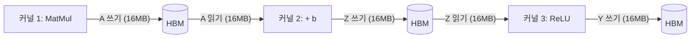
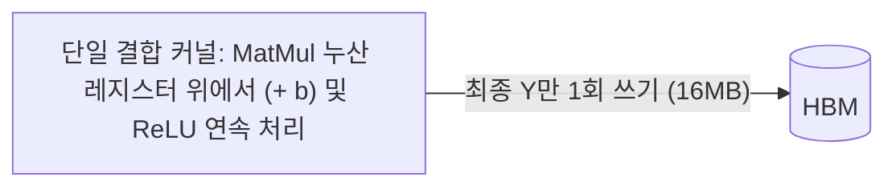

# [핵심 압축 교안] 모델에서 실리콘까지 — AI 실행 스택 5대 계층 해부

<div class="t2s-digest-banner">
  <div class="t2s-digest-banner-top">
    <span class="t2s-digest-eyebrow">⚡ CORE DIGEST · 15분 핵심 압축 교안</span>
    <span class="t2s-digest-stats">압축률: 심화 본문 2,150줄 → 핵심 310줄 요약</span>
  </div>
  <p>
    이 문서는 바쁜 독자와 복습자를 위해 <strong>Chapter 01 전체의 핵심 수식·아키텍처·3대 스택 비교표·손계산·커널 코드·오개념</strong>만 빠짐없이 추려 정리한 압축 교안입니다. 이 페이지 하나만 읽어도 단원 전체의 뼈대와 결론을 완전히 파악할 수 있으며, 상세 유도 과정이나 전체 코드가 필요할 때는 각 절의 <strong>심화 본문 바로가기</strong>를 눌러 이동하세요.
  </p>
  <div class="t2s-digest-jump-row">
    <span>💡 <strong>챕터 핵심 질문:</strong> 모델의 연산 하나가 가속기 실리콘에서 실행되기까지 어떤 단계를 거치며, 각 계층은 무엇을 결정할까?</span>
    <a class="t2s-author-gh-btn" href="./">📘 1~15절 전체 심화 본문 열기 →</a>
  </div>
</div>

---

## 1. 큰 그림: 모델 수식이 실리콘에 닿는 5대 계층

> 📖 심화 학습 연결: [📘 심화 본문 1절(큰 그림) →](/ch01/#1-이-장에서-알아야-할-큰-그림) · [📘 심화 본문 3~4절(모델과 IR) →](/ch01/#4-연산에서-그래프ir로)

Python 코드에서 `y = torch.relu(x @ w + b)` 한 줄을 적었다고 해서 Python 인터프리터가 GPU 안에서 직접 곱셈을 수행하는 것은 아닙니다. 모든 현대 AI 실행 스택은 아래 **5대 계층**을 거쳐 수학적 선언을 물리적 전기 신호(데이터 이동 + 연산 명령)로 바꿉니다.


| 계층 | 담당하는 핵심 질문 | 입력 → 출력 | 대표 구성 요소 |
| :--- | :--- | :--- | :--- |
| **1. 모델·연산** | 수학적으로 **무엇을** 계산할 것인가? | 텐서(`X, W, b`) → 수식 관계 | PyTorch `nn.Module`, JAX 함수 |
| **2. 그래프·IR** | 최적화기가 앞뒤 맥락을 한눈에 볼 수 있게 **어떻게 표현**할까? | Python 실행 흐름 → 연산 그래프(IR) | `TorchDynamo(FX)`, `Jaxpr`, `StableHLO` |
| **3. 컴파일러** | 대상 하드웨어에 맞춰 **어떻게 결합·분할·번역**할까? | 고수준 IR → 커널 코드 + 라이브러리 호출 | `TorchInductor`, `XLA`, `MAX/Mojo` |
| **4. 런타임** | 실제 메모리 버퍼와 실행 순서를 **어떻게 비동기 중재**할까? | 컴파일된 바이너리 → 스트림 큐 제출·동기화 | CUDA Runtime/Stream, `PJRT` |
| **5. 칩 내부** | 데이터를 **어느 저장소에 올려 어느 유닛으로** 계산할까? | 기계어 명령(`SASS` 등) → 물리적 연산 결과 | `HBM`, `SRAM/VMEM`, `Tensor Core`, `MXU` |

::: tip 💡 가장 먼저 구분할 두 시간축: 컴파일 시점(Compile-time) vs 실행 시점(Runtime)
- **컴파일 시점 (`torch.compile`, `jax.jit` 첫 호출 등)**: 계산 그래프를 추적(Tracing/Capture)하고, 연산을 합치며(Fusion), 타겟 기계어를 생성하는 **설계도 작성 비용**이 발생합니다.
- **반복 실행 시점 (Steady-state Runtime)**: 이미 만들어진 실행 계획을 입력 버퍼만 바꿔가며 비동기 큐에 빠르게 발사(Dispatch)합니다. 따라서 **첫 1회 호출 시간과 워밍업 이후 반복 실행 시간은 반드시 분리해서 측정**해야 합니다.
:::

---

## 2. 공통 수식 예제와 ‘논리적 중간값 vs 물리적 버퍼’ 손계산

> 📖 심화 학습 연결: [📘 심화 본문 2절(공통 수식과 텐서) →](/ch01/#2-공통-예제의-수학과-텐서) · [📘 심화 본문 5절(컴파일러 Fusion) →](/ch01/#5-ir에서-실행-코드로-컴파일러의-결정)

### 2.1 공통 수식 및 텐서 4대 속성

본 장 전체에서 일관되게 추적하는 기본 블록은 선형 변환 후 편향과 활성화를 거치는 **`Y = ReLU(X @ W + b)`** 입니다.

<div class="t2s-formula-card">

- **수식 분해**: $A_{ij} = \sum_{k=0}^{K-1} X_{ik}W_{kj}$ (`[N, K] @ [K, M] → [N, M]`) $\;\rightarrow\;$ $Z_{ij} = A_{ij} + b_j$ (`b:[M]` 브로드캐스트) $\;\rightarrow\;$ $Y_{ij} = \max(0, Z_{ij})$
- **텐서의 4가지 독립 속성**:
  1. **`shape`**: 축별 원소 개수 (`[128, 256]`)
  2. **`dtype`**: 숫자 표현 형식과 원소당 바이트 수 (`float32` = 4B, `float16`/`bfloat16` = 2B)
  3. **`layout · stride`**: 논리적 다차원 원소가 1차원 물리 메모리에 놓이는 순서 (Row-major, 전치 View 등 — `shape`가 같아도 `stride`가 다르면 다른 커널 경로가 필요할 수 있음)
  4. **`device`**: 실제 바이트가 상주하는 물리 장치 (`cpu`, `cuda:0`, `tpu:0`)

</div>

### 2.2 미니 손계산 검증 (`N=2, K=3, M=2`)

$$
X = \begin{bmatrix} 1.0 & -2.0 & 3.0 \\ 0.0 & 1.0 & -1.0 \end{bmatrix}, \quad
W = \begin{bmatrix} 1.0 & 2.0 \\ 0.0 & -1.0 \\ -1.0 & 1.0 \end{bmatrix}, \quad
b = \begin{bmatrix} 0.5 & -1.0 \end{bmatrix}
$$

1. **행렬곱 (`A = X @ W`)**: $A_{00} = 1(1) + (-2)(0) + 3(-1) = -2.0$, 같은 방식으로 $A = \begin{bmatrix} -2.0 & 7.0 \\ 1.0 & -2.0 \end{bmatrix}$
2. **브로드캐스트 덧셈 (`Z = A + b`)**: `b`를 물리적으로 2행으로 복사할 필요 없이 열 인덱스(`col = j`)만 맞춰 더하면 $Z = \begin{bmatrix} -1.5 & 6.0 \\ 1.5 & -3.0 \end{bmatrix}$
3. **활성화 (`Y = max(Z, 0)`)**: 음수를 0으로 자르면 최종 정답 $Y = \begin{bmatrix} 0.0 & 6.0 \\ 1.5 & 0.0 \end{bmatrix}$

### 2.3 핵심 통찰: 왜 Eager 실행보다 컴파일러 Fusion이 빠른가?

수식에는 중간 결과 `A`와 `Z`가 등장하지만, **수식상의 논리적 중간값이 곧 물리적 HBM 메모리 버퍼의 생성을 뜻하지는 않습니다.** `A`, `Z`, `Y` 텐서 하나가 각각 **`16 MB`** 라고 가정하고 데이터 이동을 비교해 봅시다.

**① ❌ Eager 분리 실행** — 연산마다 커널을 따로 띄워 **중간 HBM 왕복 `64 MB`** 발생 (`A` 쓰기·읽기 32MB + `Z` 쓰기·읽기 32MB)



**② ✅ Epilogue Fusion 결합 실행** — 온칩 레지스터 위에서 즉시 후처리하여 **중간 HBM 왕복 `0 MB`** 달성!



- **결론**: 그래프 컴파일러(`Inductor`, `XLA`, `MAX`)는 앞뒤 연산을 먼저 포착한 뒤 여러 연산을 하나의 커널로 묶어(**Kernel / Epilogue Fusion**), 느린 HBM에 중간 텐서 `A`, `Z`를 썼다 읽는 **`64 MB`의 불필요한 메모리 트래픽을 `0 MB`로 제거**합니다.
- **주의할 구분**: 그래프 수준의 연산 결합(**Kernel Fusion**)과 하드웨어 명령어 수준의 곱셈-덧셈 결합(**FMA**, `a * b + c`)은 서로 다른 계층의 개념이며, **연산 수 $\neq$ 그래프 노드 수 $\neq$ 실행 커널 수**입니다.

---

## 3. 비동기 런타임과 칩 내부 실리콘 (GPU vs TPU)

> 📖 심화 학습 연결: [📘 심화 본문 6절(런타임과 비동기성) →](/ch01/#6-실행-요청에서-커널-실행으로-런타임과-비동기성) · [📘 심화 본문 7절(GPU와 TPU 내부) →](/ch01/#7-커널에서-칩-내부로-gpu와-tpu)

### 3.1 비동기 실행(Asynchronous Dispatch)과 벤치마크 착시

CPU(Host)가 가속기(Device)에 연산을 시킬 때 매번 끝날 때까지 멈춰 기다리면 가속기가 쉬는 구간(Bubble)이 생깁니다. 그래서 런타임은 **실행 큐(Stream)에 작업 요청만 등록하고 Python 함수를 즉시 반환**합니다.

```python
# ❌ 잘못된 측정: GPU 계산 시간이 아니라 'CPU가 큐에 작업을 등록한 시간(수십 μs)'만 측정됨!
start = time.perf_counter()
y = model(x)
fake_elapsed = time.perf_counter() - start

# ✅ 올바른 측정: 워밍업 후 앞뒤 동기화(Synchronization)로 실제 실리콘 완료 시점을 맞춤
for _ in range(5): _ = model(x)          # 1) JIT 컴파일·초기화 분리 (Warmup)
torch.cuda.synchronize()                 # 2) 이전 큐 작업 완료 대기
start = time.perf_counter()
y = model(x)
torch.cuda.synchronize()                 # 3) 측정 대상 커널이 실제 완료될 때까지 대기!
real_elapsed = time.perf_counter() - start
```

> 💡 JAX에서도 마찬가지로 `y = jit_fn(x)` 직후에는 아직 계산이 완료되지 않은 `Array` 핸들만 반환되므로, 시간 측정 시에는 반드시 **`y.block_until_ready()`** 를 호출해야 합니다.

### 3.2 GPU vs TPU 칩 내부 하드웨어 구성 대조

공통 예제 `Y = ReLU(X @ W + b)`가 실제 실리콘 내부로 들어가면 **행렬 연산 유닛**, **원소별 벡터 유닛**, **온칩 고속 메모리**, **오프칩 대용량 메모리(HBM)** 가 역할을 분담합니다.

| 물리적 역할 | NVIDIA GPU 대응 요소 | Google TPU 대응 요소 | 공통 예제(`ReLU(XW+b)`)에서의 담당 작업 |
| :--- | :--- | :--- | :--- |
| **대규모 행렬곱 가속** | **Tensor Core** (SM 내부 유닛) | **MXU** (Matrix Multiply Unit, 시스톨릭 배열) | 조건(dtype·shape)이 맞는 `X @ W` 고속 누산 |
| **원소별·벡터 산술** | **일반 산술 유닛 (CUDA Core / ALU)** | **VPU** (Vector Processing Unit) | `+ b` 편향 덧셈, `max(Z, 0)` ReLU 비교·선택 |
| **온칩 고속 저장소** | **Register · Shared Memory · L1/L2** | **VMEM** (컴파일러가 제어하는 스크래치패드) | 현재 계산 중인 타일 조각과 중간 누산값 보관 |
| **오프칩 대용량 메모리** | **HBM / GDDR 글로벌 메모리** | **HBM** | 전체 입력 `X`, 모델 가중치 `W`, 최종 출력 `Y` 저장 |

> ⚠️ **용어 함정 주의**: NVIDIA의 **Tensor Core**는 SM 내부의 ‘행렬 연산기’ 부품 이름이지만, TPU 문서의 **TensorCore**(붙여 씀)는 `MXU + VPU + VMEM` 전체를 묶은 상위 코어 단위를 뜻합니다. 이름이 비슷해도 가리키는 계층 크기가 다릅니다!

---

## 4. 3대 실행 스택 비교표 & 핵심 커널 코드 해부

> 📖 심화 학습 연결: [📘 심화 본문 8~10절(PyTorch·JAX·MAX) →](/ch01/#8-pytorch-경로와-예제) · [📘 심화 본문 11~12절(Triton·스택 비교) →](/ch01/#12-세-스택을-같은-기준으로-비교하기)

### 4.1 PyTorch · JAX(OpenXLA) · Modular(MAX·Mojo) 한눈에 비교

| 비교 기준 | PyTorch 2 (`torch.compile`) | JAX · OpenXLA 경로 | Modular MAX · Mojo 경로 |
| :--- | :--- | :--- | :--- |
| **사용자 코드 표현** | 동적 Python `Tensor` · `nn.Module` | 순수 함수형 배열 변환 (`jax.numpy`) | `MAX Graph` 심볼릭 선언 / Python Module |
| **그래프 포착 방식** | `TorchDynamo` (Python 바이트코드 가로채기) | 함수 Tracing → `Jaxpr` 생성 | 명시적 그래프 구성 (`Graph` API) |
| **핵심 고수준 IR** | `FX` · `ATen` · `Prims` 그래프 | `Jaxpr` → **`StableHLO`** → `HLO` | MLIR 기반 `MAX Graph` 내부 표현 |
| **주력 컴파일러 백엔드** | **`TorchInductor`** | **`XLA`** (CPU / GPU / TPU 컴파일러) | `MAX Compiler` 및 `Mojo Compiler` |
| **직접 커널 작성 계층** | **Triton** (`@triton.jit`), CUDA C++ | **Pallas**, Custom Call | **Mojo** (단일 언어로 그래프 연동 + GPU 커널) |
| **런타임 & 장치 연결** | PyTorch Caching Allocator · Stream | **`PJRT`** 플러그인 인터페이스 | `MAX Runtime` · `DeviceContext` |

### 4.2 핵심 코드 해부: 커널 안에서 브로드캐스트와 Fusion이 일어나는 실제 모습

컴파일러(`TorchInductor` 등)가 자동 생성하거나 엔지니어가 직접 작성하는 **Triton 결합 커널(`Z = A + b`와 `Y = ReLU(Z)` 결합)** 의 핵심 9줄을 보면, 앞선 개념들이 코드 한 줄마다 어떻게 대응되는지 명확히 보입니다.

```python
@triton.jit
def bias_relu_kernel(a_ptr, b_ptr, y_ptr, n_elements, M: tl.constexpr, BLOCK_SIZE: tl.constexpr):
    pid = tl.program_id(axis=0)                              # 1) 현재 프로그램 인스턴스(블록) 번호
    offsets = pid * BLOCK_SIZE + tl.arange(0, BLOCK_SIZE)    # 2) 이 블록이 담당할 연속 원소 인덱스 묶음
    mask = offsets < n_elements                              # 3) 텐서 끝 경계를 넘어가는 레인 보호 마스크

    cols = offsets % M                                       # 4) Broadcast 핵심: b[M]을 복제하지 않고 열 번호만 계산!
    a = tl.load(a_ptr + offsets, mask=mask, other=0.0)       # 5) HBM -> 온칩 레지스터로 A 조각 로드
    b = tl.load(b_ptr + cols, mask=mask, other=0.0)          # 6) 같은 열 편향 b 적재 (캐시 재사용)
    y = tl.maximum(a + b, 0.0)                               # 7) Fusion 핵심: HBM 저장 없이 온칩에서 (+ b)와 ReLU 연속 수행!
    tl.store(y_ptr + offsets, y, mask=mask)                  # 8) 최종 결과 Y만 HBM에 단 1회 기록
```

---

## 5. 자주 빠지는 오개념 Top 6 & 문제 진단 가이드

> 📖 심화 학습 연결: [📘 심화 본문 14절(오해와 문제 찾기) →](/ch01/#14-자주-생기는-오해와-문제-찾기)

| 흔한 오해 (❌) | 실제 시스템 동작 (✅) |
| :--- | :--- |
| **“그래프 노드 1개 = GPU 커널 1개다”** | 분해(Decomposition)로 1개 연산이 여러 노드가 되기도 하고, **Fusion**으로 수십 개 노드가 커널 1개로 합쳐지기도 합니다. |
| **“모든 행렬곱은 무조건 Tensor Core에서 돈다”** | `dtype`(예: 일부 구형 환경 FP64/FP32), 행렬 크기·정렬, 백엔드 선택에 따라 일반 연산 유닛에서 실행될 수 있습니다. |
| **“`synchronize()`를 호출해야 GPU가 계산을 시작한다”** | 계산은 큐 제출 직후 이미 비동기로 시작됩니다. `synchronize()`는 이미 돌고 있는 작업이 **끝날 때까지 CPU가 기다리는 것**입니다. |
| **“`torch.compile`을 붙이면 무조건 빨라진다”** | 입력이 아주 작아 호스트 오버헤드가 지배적이거나, 동적 분기로 **Graph Break / 재컴파일**이 반복되면 오히려 느려질 수 있습니다. |
| **“Mojo는 OpenXLA의 1:1 대체재다”** | Mojo는 **프로그래밍 언어**이고 OpenXLA는 **컴파일러 생태계**입니다. 스택 전체를 비교할 때는 `MAX + Mojo` 묶음과 비교해야 맞습니다. |
| **“수식이 같으면 Eager와 Compile의 결과 비트가 100% 같다”** | 부동소수점 덧셈 결합 순서 변경이나 낮은 정밀도 누산 때문에 미세한 수치 오차가 생길 수 있으므로 `assert_close(rtol, atol)`로 검증합니다. |

- **문제 발생 시 계층별 빠른 진단**:
  - `Shape / Dtype 불일치 에러` 👉 **1·2계층** (수식 차원 축약 규칙 `K` 및 텐서 입력 명세 확인)
  - `첫 실행만 유독 느리거나 입력마다 다시 느려짐` 👉 **2·3계층** (JIT 컴파일 캐시 미스, 동적 `shape`로 인한 재컴파일 확인)
  - `디바이스 불일치(cpu vs cuda) 또는 비정상 측정 시간` 👉 **4계층** (런타임 버퍼 위치 및 `synchronize` 누락 확인)

---

## 6. 단원 핵심 자가 점검 연습문제 (3문항)

방금 읽은 압축 교안의 내용만으로 스스로 답을 떠올려 본 뒤, 아래 토글을 눌러 풀이를 확인해 보세요.

1. **브로드캐스트와 물리 메모리**: `A`의 크기가 `[1024, 4096]`(`float32`)이고 편향 `b`의 크기가 `[4096]`(`float32`)일 때, `Z = A + b`를 수행하기 위해 `b`가 차지하는 실제 물리 메모리 크기와 논리적으로 확장되어 더해지는 횟수를 구분해 설명해 보세요.
2. **Eager vs Fusion 트래픽 계산**: 크기가 각각 `32 MB`인 텐서 흐름 `Z = A + B` → `W = Z * C` → `Y = ReLU(W)`를 ① 3개의 분리된 커널(Eager)로 실행할 때와 ② 단일 결합 커널(Fused)로 실행할 때, 전체 HBM 읽기+쓰기 총합(`MB`)은 각각 얼마인가요? *(단, 입력 `A, B, C`와 출력 `Y`도 모두 각 `32 MB`라고 가정)*
3. **벤치마크 해석**: 동료가 `jax.jit`로 컴파일한 함수를 첫 1회만 실행하며 `block_until_ready()` 없이 `0.4 s`를 기록한 뒤 “XLA 컴파일을 써도 Eager(`0.05 s`)보다 8배 느리다”고 결론 내렸습니다. 측정 설계에서 잘못된 두 가지를 짚어 보세요.

## 해답과 해설

<details class="t2s-solution-toggle">
<summary>💡 연습문제 해답 및 상세 풀이 펼치기 (스스로 먼저 풀어본 뒤 클릭하세요)</summary>

1. **브로드캐스트와 물리 메모리 해답**
   - 물리적으로 메모리에 저장된 `b`의 크기는 `4096 × 4 Byte = 16 KB` 하나뿐입니다.
   - 컴파일된 커널에서는 `b`를 `[1024, 4096]`(`16 MB`) 크기로 미리 복제하지 않고, 각 원소의 열 인덱스(`col = idx % 4096`)로 동일한 `16 KB` 버퍼(온칩 캐시에 상주)를 1,024개 행이 반복 참조하여 더합니다.

2. **Eager vs Fusion 트래픽 계산 해답**
   - **① Eager 분리 실행 (`256 MB`)**:
     - 커널 1 (`Z = A + B`): `A` 읽기(32) + `B` 읽기(32) + `Z` 쓰기(32) = `96 MB`
     - 커널 2 (`W = Z * C`): `Z` 읽기(32) + `C` 읽기(32) + `W` 쓰기(32) = `96 MB`
     - 커널 3 (`Y = ReLU(W)`): `W` 읽기(32) + `Y` 쓰기(32) = `64 MB` → 합계 **`256 MB`** *(중간 텐서 `Z`, `W` 쓰기·읽기 왕복만으로 `128 MB` 소비)*
   - **② Fused 단일 커널 실행 (`128 MB`)**:
     - 필수 입력 `A, B, C` 각 1회 읽기(`32 × 3 = 96 MB`) + 온칩 레지스터에서 덧셈·곱셈·ReLU 연속 처리 + 최종 `Y` 1회 쓰기(`32 MB`) = **`128 MB`**!
   - **비교 결론**: 총 HBM 데이터 이동량이 **`256 MB → 128 MB`로 정확히 절반(2배 감소)** 으로 줄어듭니다.

3. **벤치마크 해석 해답**
   - **오류 1 (컴파일 시간 혼입)**: 첫 1회 호출에는 Python 함수 Tracing + StableHLO/HLO 변환 + XLA 커널 코드 생성(컴파일) 시간이 포함되어 있으므로, 반드시 워밍업 호출을 먼저 수행해 컴파일 비용과 반복 실행(Steady-state) 시간을 분리해야 합니다.
   - **오류 2 (비동기 동기화 누락)**: `block_until_ready()` 없이는 실제 가속기 연산 완료 시점이 아니라 호스트 측 컴파일·큐 등록 반환 시점만 측정되므로, 워밍업 이후 반복 구간에서 `block_until_ready()`를 포함해 비교해야 정확합니다.

</details>

---

> 🚀 **더 깊이 파고들고 싶다면?**  
> PyTorch FX 그래프 출력, JAX StableHLO 전문, Modular MAX Graph + Mojo 커스텀 커널 전체 코드는 **[📘 Chapter 01 전체 심화 본문](/ch01/)** 과 **[🧑‍🔬 5인의 연구진 심화 노트](/ch01/#-연구진-심화-분석-하드웨어-실측-아카이브)** 에서 이어서 확인하실 수 있습니다!
