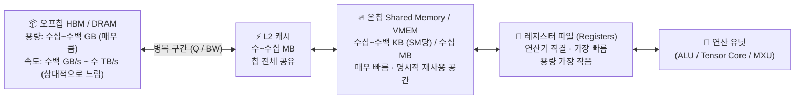
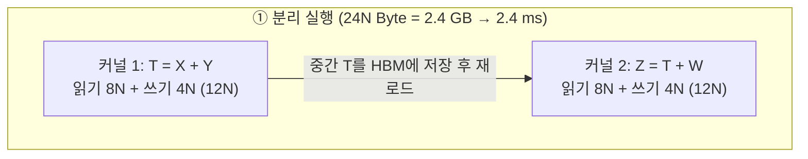
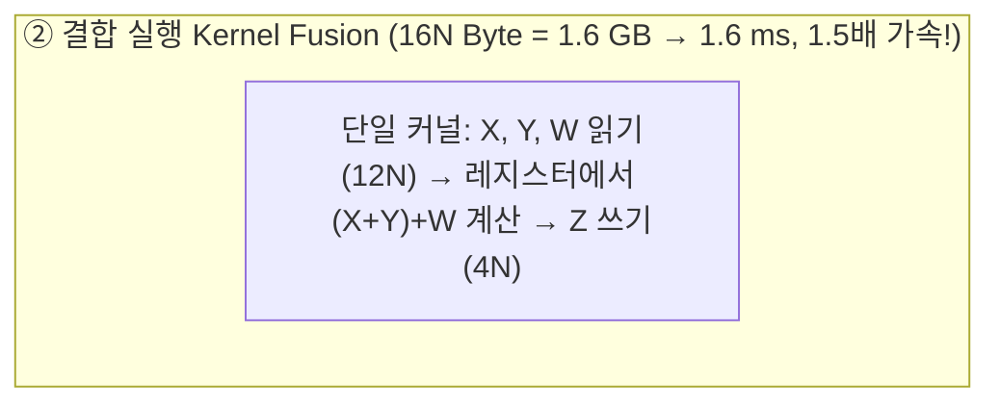

# [핵심 압축 교안] 커널의 시간은 어디에서 소비되는가 — 연산 vs 메모리 병목

<div class="t2s-digest-banner">
  <div class="t2s-digest-banner-top">
    <span class="t2s-digest-eyebrow">⚡ CORE DIGEST · 15분 핵심 압축 교안</span>
    <span class="t2s-digest-stats">압축률: 심화 본문 1,675줄 → 핵심 305줄 요약</span>
  </div>
  <p>
    이 문서는 <strong>Chapter 02 전체의 핵심 수식(두 시간 모델)·메모리 계층 구조·Vector Add 및 Kernel Fusion 손계산·코드 판독법·연습문제</strong>를 15분 분량으로 정밀 압축한 핵심 교안입니다. 상세 수식 유도나 실험 스크립트가 필요할 때는 각 절의 <strong>심화 본문 바로가기</strong>를 눌러 이동하세요.
  </p>
  <div class="t2s-digest-jump-row">
    <span>💡 <strong>챕터 핵심 질문:</strong> 같은 연산인데 왜 어떤 커널은 빠르고 어떤 커널은 느릴까? 계산 시간과 데이터 이동 시간을 어떻게 구분할까?</span>
    <a class="t2s-author-gh-btn" href="./">📘 1~17절 전체 심화 본문 열기 →</a>
  </div>
</div>

---

## 1. 큰 그림: 커널 시간을 지배하는 두 축과 메모리 계층

> 📖 심화 학습 연결: [📘 심화 본문 1~4절(FLOPs와 대역폭) →](/ch02/#3-flops와-flopss-계산의-양과-속도) · [📘 심화 본문 5절(메모리 계층) →](/ch02/#5-hbm에서-연산-장치까지-메모리-계층)

가속기 위에서 실행되는 모든 커널은 **① 데이터를 메모리에서 연산기까지 실어 나르는 일(데이터 이동)** 과 **② 연산기에서 곱하고 더하는 일(산술 계산)** 두 가지를 수행합니다. 커널이 느릴 때 무작정 연산 성능을 의심하기 전에, 먼저 **양(Amount)과 속도(Rate)** 그리고 **용량(Capacity)과 대역폭(Bandwidth)** 을 엄격히 구분해야 합니다.

| 구분 축 | 계산 (Compute) | 데이터 이동 (Memory Traffic) | 흔히 빠지는 개념 혼동 주의 |
| :--- | :--- | :--- | :--- |
| **일의 총량 (Amount)** | **`F` (`FLOPs`)** — 총 부동소수점 연산 횟수 | **`Q` (`Byte`)** — 총 메모리 읽기+쓰기 바이트 | `FLOPs`(횟수)와 `FLOPs/s`(초당 처리율)는 거리와 속력만큼 다릅니다. |
| **하드웨어 속도 (Rate)** | **`P` (`FLOPs/s`)** — 초당 최대 연산 처리율 | **`BW` (`Byte/s`, `TB/s`)** — 초당 최대 전송 대역폭 | **용량(`80 GB`)은 창고 크기**이고, **대역폭(`1 TB/s`)은 도로 폭**입니다. 용량만 늘려도 속도는 빨라지지 않습니다! |

### 왜 데이터 이동이 병목이 되는가? (메모리 계층 피라미드)



- 물리적으로 연산기 바로 옆에 붙은 **온칩 SRAM(레지스터·Shared Memory)** 은 초고속이지만 면적·전력 한계로 용량이 매우 작고, 거대한 텐서를 담는 **오프칩 DRAM(HBM)** 은 용량이 큰 대신 데이터를 길게 끌어와야 하므로 대역폭이 훨씬 낮습니다.

---

## 2. 필수 공식: 두 시간(Two-Time) 비교 모델

> 📖 심화 학습 연결: [📘 심화 본문 6절(두 시간을 계산하는 공통 모델) →](/ch02/#6-두-시간을-계산하는-공통-모델)

데이터 이동과 연산이 이상적으로 완전히 겹쳐서(Overlap) 실행된다고 가정하더라도, 전체 실행 시간은 둘 중 **더 오래 걸리는 시간**보다 짧아질 수 없습니다.

<div class="t2s-formula-card">

- **이상적 연산 시간**: $\displaystyle T_{\text{compute}} = \frac{F}{P}$ &nbsp;&nbsp;|&nbsp;&nbsp; **이상적 메모리 시간**: $\displaystyle T_{\text{memory}} = \frac{Q}{\text{BW}}$
- **이상적 실행 시간 하한 (Lower Bound)**:
  $$T_{\text{ideal}} = \max\!\left(T_{\text{compute}},\; T_{\text{memory}}\right) = \max\!\left(\frac{F}{P},\; \frac{Q}{\text{BW}}\right)$$
- **병목 판정 기준**:
  - $T_{\text{memory}} > T_{\text{compute}}$ 👉 **메모리 대역폭 병목 (Memory-Bound)**: 연산기가 데이터를 기다리며 쉼 → **`Q`를 줄이거나(Fusion·재사용) `BW`가 큰 장치 필요**
  - $T_{\text{compute}} > T_{\text{memory}}$ 👉 **연산 병목 (Compute-Bound)**: 데이터 공급은 충분하나 계산이 바쁨 → **더 빠른 연산 유닛(Tensor Core) 활용 또는 정밀도 조정 필요**

</div>

> ⚠️ **모델 사용 시 주의**: $T_{\text{ideal}}$은 커널 런치 오버헤드, 동기화 지연, 불완전한 중첩을 제외한 **이론적 최소 시간(하한)** 입니다. 실제 측정 시간은 항상 $T_{\text{actual}} \ge T_{\text{ideal}}$ 입니다.

---

## 3. 대표 손계산 워크스루: Vector Add와 Kernel Fusion

> 📖 심화 학습 연결: [📘 심화 본문 7절(Vector Add 손계산) →](/ch02/#7-계산-예제-1-vector-add의-시간) · [📘 심화 본문 8절(Kernel Fusion 손계산) →](/ch02/#8-계산-예제-2-커널을-합치면-무엇이-달라질까)

본 장의 표준 가상 하드웨어 조건을 **`P = 20 TFLOPs/s` ($20 \times 10^{12}$ FLOPs/s)**, **`BW = 1 TB/s` ($10^{12}$ Byte/s)** 로 두고, 길이 **`N = 10⁸`**(1억 개)인 `FP32`(`4 Byte`) 벡터 연산을 직접 계산해 봅시다.

### 3.1 예제 1 — 단일 Vector Add (`Z = X + Y`)

1. **총 연산량 `F`**: 원소마다 덧셈 1회 $\rightarrow F = 10^8\text{ FLOPs}$
2. **총 HBM 이동량 `Q`**: `X` 읽기($4N$) + `Y` 읽기($4N$) + `Z` 쓰기($4N$) $= 12N = 1.2 \times 10^9\text{ Byte}$ (`1.2 GB`)
3. **두 시간 대입**:
   $$T_{\text{compute}} = \frac{10^8}{20 \times 10^{12}} = 0.005\text{ ms}\;(5\;\mu\text{s}), \qquad T_{\text{memory}} = \frac{1.2 \times 10^9}{10^{12}} = \mathbf{1.2\text{ ms}}$$
4. **해석**: 메모리 이동 시간이 연산 시간보다 무려 **`240배`** 깁니다! 연산 성능 `P`를 10배 높여도($0.0005\text{ ms}$) 실행 시간은 여전히 **`1.2 ms` 그대로**입니다.

### 3.2 예제 2 — 2단계 벡터 덧셈의 분리 실행 vs 커널 결합(Fusion)

세 입력 벡터를 더하는 `Z = (X + Y) + W`를 두 가지 방식으로 비교합니다 (캐시에 남지 않고 매 커널이 HBM을 거치는 큰 텐서 가정).





| 실행 방식 | 총 연산량 `F` | `T_compute` | 총 HBM 이동량 `Q` | `T_memory` (`= T_ideal`) | 핵심 차이 |
| :--- | :---: | :---: | :---: | :---: | :--- |
| **분리 실행 (Unfused)** | $2N = 2\times 10^8$ | `0.010 ms` | **$24N$ (`2.4 GB`)** | **`2.4 ms`** | 중간 텐서 `T` 쓰기($4N$) + 다시 읽기($4N$) 발생 |
| **결합 실행 (Fused)** | $2N = 2\times 10^8$ | `0.010 ms` | **$16N$ (`1.6 GB`)** | **`1.6 ms`** | 중간 `T` 왕복($8N$) 제거 → **시간 33.3% 단축 (`1.5배` 빠름)** |

> 💡 **핵심 교훈**: 커널 결합(Fusion)은 **곱셈·덧셈 횟수(`F`)를 줄이는 기법이 아닙니다.** 같은 계산을 수행하면서 느린 HBM에 중간 결과를 내렸다 올리는 바이트(`Q`)를 없애 대역폭 병목 시간을 줄이는 기법입니다!

---

## 4. 코드 판독법: 코드만 보고 읽기·계산·쓰기 바이트 세기

> 📖 심화 학습 연결: [📘 심화 본문 9~11절(병목 해석과 코드 분석) →](/ch02/#10-코드에서-읽기와-계산과-쓰기-찾기)

Python/PyTorch 코드와 커널 코드를 볼 때 아래 **3단계 체크리스트**로 바이트를 셉니다.

```python
# [비교 A] PyTorch 기본 체인 (Eager 모드: 커널 3개 연속 실행 -> HBM 왕복 누적)
def eager_chain(x, y, w):
    t = x + y          # 커널 1: X, Y 읽기(8N) -> T 쓰기(4N)
    u = t + w          # 커널 2: T, W 읽기(8N) -> U 쓰기(4N)
    return torch.relu(u)  # 커널 3: U 읽기(4N) -> Z 쓰기(4N)  ==> 총 32N Byte!

# [비교 B] 단일 결합 커널 개념 (torch.compile 또는 Triton 커널 1개)
# x, y, w 각 1회 로드(12N) -> 레지스터 위에서 덧셈 2회 + max(0) -> 최종 z 1회 스토어(4N) ==> 총 16N Byte! (2배 절감)
```

1. **커널 경계 확인**: 각 줄이 별도 커널을 띄우는가(Eager), 아니면 컴파일러/DSL로 한 커널 안에 묶여 있는가?
2. **필수 입출력 vs 중간 버퍼 구분**: 커널 밖으로 살아남아야 하는 텐서만 HBM 쓰기로 세고, 커널 내부 지역 변수(레지스터)는 HBM 이동량 `Q`에서 제외합니다.
3. **실효 대역폭(`Effective Bandwidth`) 환산**: 실제 측정 시간 $t_{\text{measured}}$를 얻었다면 $\text{BW}_{\text{eff}} = Q / t_{\text{measured}}$를 계산해 하드웨어 피크 대역폭 대비 몇 %를 달성했는지 확인합니다.

---

## 5. 자주 빠지는 오개념 Top 5

> 📖 심화 학습 연결: [📘 심화 본문 13절(자주 생기는 오해와 문제 찾기) →](/ch02/#13-자주-생기는-오해와-문제-찾기)

| 흔한 오해 (❌) | 정확한 실체 (✅) |
| :--- | :--- |
| **“GPU 메모리가 80 GB로 커지면 커널도 빨라진다”** | 용량(GB)은 OOM 없이 올릴 수 있는 모델·배치 크기를 결정할 뿐, 속도는 **대역폭(`TB/s`)** 이 좌우합니다. |
| **“연산 횟수(FLOPs)가 2배 늘면 실행 시간도 2배 늘어난다”** | 대역폭 병목 커널에서는 레지스터에 이미 올라온 값에 연산 몇 개를 더 얹어도($T_{\text{compute}} \ll T_{\text{memory}}$) 실행 시간은 거의 그대로입니다. |
| **“커널을 합치면 무조건 빨라진다”** | 너무 많은 연산과 큰 버퍼를 억지로 한 커널에 우겨 넣으면 **레지스터 스필(Register Spill)** 이 발생하거나 병렬성(Occupancy)이 떨어져 역효과가 날 수 있습니다. |
| **“입력 텐서가 아주 작아도(예: `N = 1,000`) 대역폭 공식대로 시간이 나온다”** | 데이터가 아주 작을 때는 전송 시간(`0.01 μs`)보다 **CPU 커널 런치 오버헤드(수~수십 `μs`)** 가 전체 시간을 지배합니다(**Latency/Overhead-bound**). |
| **“스펙시트 대역폭이 `1.0 TB/s`면 실제 커널도 `1.0 TB/s`가 그대로 찍힌다”** | 메모리 컨트롤러 효율, 주소 정렬(Coalescing), 프로토콜 오버헤드 때문에 실효 대역폭은 보통 피크의 `75~90%` 수준에서 형성됩니다. |

---

## 6. 단원 핵심 자가 점검 연습문제 (3문항)

> 📖 원문 문제 & 상세 풀이: [📘 심화 본문 14~15절 →](/ch02/#14-연습문제-3개) *(공통 조건: `P = 20 TFLOPs/s`, `BW = 1 TB/s`, FP32 = `4 Byte`)*

1. **연산이 2배로 늘어난 SAXPY ($Z_i = a X_i + Y_i$)**: 길이 `N = 5 × 10⁷`인 FP32 벡터 `X, Y`를 읽고 스칼라 상수 `a`를 곱해 더한 뒤 `Z`를 씁니다(원소당 곱셈 1 + 덧셈 1 = `2 FLOPs`). 총 HBM 이동량 `Q`, 총 연산량 `F`, `T_compute`, `T_memory`, `T_ideal` 및 병목을 구해 보세요.
2. **3단계 연산 결합 효과**: 길이 `N = 10⁸`인 FP32 벡터에 대해 ① `A = X + Y`, ② `B = A * W`, ③ `Z = max(B, 0)` 세 단계를 분리 실행할 때와 단일 커널로 결합할 때의 총 HBM 이동량(`GB`)과 이상적 실행 시간(`ms`) 비율을 구해 보세요.
3. **하드웨어 업그레이드 선택**: 문제 1의 SAXPY 커널을 가장 빠르게 만들고 싶을 때, **옵션 A(연산 성능 `P`만 `40 TFLOPs/s`로 2배 향상)** 와 **옵션 B(메모리 대역폭 `BW`만 `2 TB/s`로 2배 향상)** 중 어느 쪽이 이상적 실행 시간을 얼마나 줄여 주나요?

## 해답과 해설

<details class="t2s-solution-toggle">
<summary>💡 연습문제 해답 및 상세 풀이 펼치기 (스스로 먼저 풀어본 뒤 클릭하세요)</summary>

1. **문제 1 (SAXPY) 해답**
   - **HBM 이동량 `Q`**: `X` 읽기($4N$) + `Y` 읽기($4N$) + `Z` 쓰기($4N$) $= 12 \times (5 \times 10^7) = 6 \times 10^8\text{ Byte} = \mathbf{0.6\text{ GB}}$
   - **총 연산량 `F`**: $2N = 2 \times (5 \times 10^7) = \mathbf{10^8\text{ FLOPs}}$
   - **두 시간 비교**: $T_{\text{compute}} = 10^8 / (20 \times 10^{12}) = \mathbf{0.005\text{ ms}}$, $\;T_{\text{memory}} = 0.6 \times 10^9 / 10^{12} = \mathbf{0.6\text{ ms}}$
   - **결론**: $T_{\text{ideal}} = \max(0.005,\; 0.6) = \mathbf{0.6\text{ ms}}$ (**메모리 대역폭 병목**). 단순 덧셈 대비 원소당 연산이 2배 늘었지만 메모리 이동 바이트가 같으므로 이상적 실행 시간은 전혀 늘어나지 않습니다!

2. **문제 2 (3단계 결합 효과) 해답**
   - **분리 실행**: 커널 1(`12N`) + 커널 2(`A, W` 읽기 $8N$ + `B` 쓰기 $4N = 12N$) + 커널 3(`B` 읽기 $4N$ + `Z` 쓰기 $4N = 8N$) $= 32N\text{ Byte} = \mathbf{3.2\text{ GB}} \implies T_{\text{ideal}} = \mathbf{3.2\text{ ms}}$
   - **단일 결합 실행**: 필수 입력 `X, Y, W` 읽기($12N$) + 최종 `Z` 쓰기($4N$) $= 16N\text{ Byte} = \mathbf{1.6\text{ GB}} \implies T_{\text{ideal}} = \mathbf{1.6\text{ ms}}$
   - **결론**: 중간 텐서 `A`, `B`의 왕복(`16N`)이 사라져 이상적 실행 속도가 정확히 **`2.0배` 향상**됩니다.

3. **문제 3 (업그레이드 선택) 해답**
   - **옵션 A (`P = 40 TFLOPs/s`)**: $T_{\text{compute}}$가 `0.005 ms → 0.0025 ms`로 줄지만 $T_{\text{memory}} = 0.6\text{ ms}$가 그대로이므로 $T_{\text{ideal}} = \mathbf{0.6\text{ ms}}$ (**속도 향상 0%**).
   - **옵션 B (`BW = 2 TB/s`)**: $T_{\text{memory}} = 0.6 \times 10^9 / (2 \times 10^{12}) = \mathbf{0.3\text{ ms}}$로 줄어 $T_{\text{ideal}} = \mathbf{0.3\text{ ms}}$ (**정확히 2배 가속!**).

</details>
