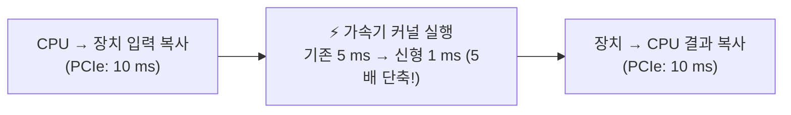

# [핵심 압축 교안] xPU를 어떻게 비교할 것인가 — 사양표에서 워크로드 실측까지

  

    ⚡ CORE DIGEST · 15분 핵심 압축 교안
    압축률: 심화 본문 1,281줄 → 핵심 305줄 요약
  

  

    이 문서는 <strong>Chapter 04 전체의 핵심 내용(GPU·TPU·NPU 아키텍처 대조, 스펙시트 조건 해독법, 장치 역전 손계산, 호스트 전송 경계, LLM TTFT·TPOT 및 전력 효율 지표)</strong>을 15분 분량으로 정밀 압축한 핵심 교안입니다. 상세 사양표 사례나 실험 코드는 각 절의 <strong>심화 본문 바로가기</strong>를 눌러 확인하세요.
  

  

    💡 <strong>챕터 핵심 질문:</strong> 서로 다른 가속기(GPU, TPU, NPU/LPU)와 프로그래밍 모델을 어떤 기준으로 공정하게 비교해야 할까?
    <a class="t2s-author-gh-btn" href="./">📘 1~16절 전체 심화 본문 열기 →</a>
  

---

## 1. 큰 그림: GPU · TPU · NPU/LPU 3대 아키텍처 비교 축

> 📖 심화 학습 연결: [📘 심화 본문 1~3절(하드웨어 구조 비교) →](/ch04/#3-하드웨어-구조-계산과-데이터-이동은-누가-맡을까) · [📘 심화 본문 5절(소프트웨어 실행 경로) →](/ch04/#5-소프트웨어와-실행-경로-같은-모델이-가속기까지-내려가는-과정)

서로 다른 AI 가속기(`xPU`)는 마케팅 이름보다 **① 행렬·벡터 연산을 어떤 모양의 유닛이 수행하는가**, **② 온칩 메모리를 하드웨어 캐시가 관리하는가 컴파일러가 직접 스케줄링하는가**, **③ 제어 흐름을 얼마나 동적으로 처리하는가**라는 세 가지 구조 축으로 구분해야 본질이 보입니다.

| 비교 축 | 범용 병렬 GPU (`NVIDIA H100/B200` 등) | 대규모 행렬 특화 TPU (`Google TPU v5e/v6e`) | 추론·도메인 특화 NPU / LPU |
| :--- | :--- | :--- | :--- |
| **핵심 실행 모델** | **SIMT** (수많은 워프/스레드 묶음을 하드웨어 스케줄러가 동적 교차 실행) | **거대 시스톨릭 배열(Systolic Array)** 기반 정형 블록 파이프라인 | 정적 데이터플로우 · 결정론적(Deterministic) 명령 스케줄링 |
| **주력 연산 유닛** | SM 내부 **Tensor Core** (`16×8×16` 등 타일 MMA) + CUDA Core(ALU) | **MXU** (`128×128` 또는 `256×256` 시스톨릭 행렬기) + **VPU**(벡터) | 대규모 MAC 배열 + 온칩 벡터/활성화 전용 파이프라인 |
| **온칩 메모리 제어** | 하드웨어 관리 **L1/L2 캐시** + 프로그래머 제어 **Shared Memory** 공존 | 하드웨어 데이터 캐시 대신 컴파일러(`XLA`)가 직접 배치하는 대용량 **VMEM** | 대용량 온칩 **SRAM 스크래치패드** 중심 (컴파일 시점 정적 할당) |
| **유리한 워크로드** | 동적 분기·가변 길이·커스텀 커널 실험·범용 학습 및 추론 전반 | 정형화된 대규모 행렬곱·고정 shape 컴파일(`XLA`) 기반 학습·서빙 | 목표 모델 구조가 명확한 저지연 추론(Decode 등) 및 전력 효율 최적화 |
| **대표 SW 진입점** | PyTorch(`Inductor`), CUDA, **Triton** | JAX / PyTorch-XLA → `StableHLO` → **`XLA`** → `PJRT` | 벤더 전용 그래프 컴파일러 (ONNX/MLIR 기반 정적 컴파일, `Legato` 등) |

---

## 2. 사양표(Spec-sheet) 숫자 해독: 브로셔에 숨은 5가지 전제 조건

> 📖 심화 학습 연결: [📘 심화 본문 4절(성능표의 숫자 읽기) →](/ch04/#4-성능표의-숫자-읽기-조건이-붙은-처리율과-대역폭) · [📘 심화 본문 6절(비교 조건표 11항목) →](/ch04/#6-공동-활동-같은-작업의-비교-조건표-만들기)

홍보 자료의 가장 큰 `TFLOPs/s` 또는 `TOPS` 숫자 하나만 가져와 `T_compute = F / P`에 대입하면 **최대 2~8배까지 성능이 부풀려지는 심각한 오류**가 발생합니다. 비교 전 반드시 아래 **5대 조건**을 동일하게 맞춰야 합니다.

1. **수치 자료형 (Precision / Dtype)**: `FP32` vs `TF32` vs `BF16/FP16` vs `FP8` vs `INT8` — 비트가 절반이 될 때마다 피크 연산 수치는 보통 **2배씩 증가**합니다. 내 모델이 `BF16`이면 반드시 `BF16` 처리율을 읽어야 합니다.
2. **구조적 희소성 (2:4 Sparsity 유무)**: 사양표 각주에 *“with sparsity”* 가 붙어 있다면 0이 절반인 특수 가중치를 가정해 **조밀(Dense) 행렬 대비 2배 부풀린 수치**입니다. 일반 모델 계산 시에는 반드시 **`÷ 2`(Dense 기준)** 로 환산합니다!
3. **메모리 대역폭의 위치**: 수십 `TB/s`라고 적힌 숫자가 **온칩 SRAM 내부 대역폭**인지, 가중치를 읽어오는 **오프칩 HBM/LPDDR 대역폭**인지 구분해야 합니다.
4. **메모리 용량 (Capacity Fit)**: 연산기가 아무리 빨라도 모델 가중치 + KV 캐시가 장치 메모리에 안 들어가면 다중 칩 분할 통신이나 호스트 오프로딩 비용이 지배합니다.
5. **측정 경계 (Measurement Boundary)**: 순수 커널 시간인지, 첫 컴파일·호스트↔디바이스(`PCIe`) 전송·토크나이저까지 포함한 종단간(End-to-End) 시간인지 일치시켜야 합니다.

---

## 3. 대표 손계산 워크스루 2선: 역전 현상과 전송 경계

> 📖 심화 학습 연결: [📘 심화 본문 7절(계산 예제 1: 장치 A vs B) →](/ch04/#7-계산-예제-1-연산-성능이-더-큰-장치가-항상-빠를까) · [📘 심화 본문 8절(계산 예제 2: 전체 응답 시간) →](/ch04/#8-계산-예제-2-장치-연산이-빠르면-전체-응답도-빠를까)

### 3.1 예제 1 — 피크 연산 성능이 절반인 장치가 2배 이기는 경우

| 가상 가속기 | 조밀 피크 연산 `P` | 메모리 대역폭 `BW` | 하드웨어 분기점 $I^* = P/\text{BW}$ |
| :---: | :---: | :---: | :---: |
| **장치 A (연산 특화형)** | **`200 TFLOPs/s`** | `1 TB/s` | `200 FLOP/Byte` |
| **장치 B (대역폭 특화형)** | `100 TFLOPs/s` | **`2 TB/s`** | `50 FLOP/Byte` |

- **작업 1 — 낮은 산술 강도 (`F = 10¹² FLOPs, Q = 100 GB` $\Rightarrow I = 10$, 예: 소배치 추론 / LLM Decode)**:
  - **장치 A**: $\max(10^{12}/2\cdot 10^{14},\; 100/1000) = \max(5\text{ ms},\; 100\text{ ms}) = \mathbf{100\text{ ms}}$
  - **장치 B**: $\max(10^{12}/10^{14},\; 100/2000) = \max(10\text{ ms},\; 50\text{ ms}) = \mathbf{50\text{ ms}}$ 👉 **피크 TFLOPs가 절반인 장치 B가 2배 승리!**
- **작업 2 — 높은 산술 강도 (`F = 10¹⁴ FLOPs, Q = 100 GB` $\Rightarrow I = 1000$, 예: 대규모 행렬곱 / LLM Prefill)**:
  - **장치 A**: $\max(500\text{ ms},\; 100\text{ ms}) = \mathbf{500\text{ ms}}$ 👉 **연산 병목 구간에서는 장치 A가 2배 승리!** (`장치 B`는 `1000 ms`)

### 3.2 예제 2 — 커널은 5배 빨라졌는데 전체 응답은 왜 1.19배만 빨라질까? (Amdahl의 법칙)

- 매 요청마다 호스트↔장치 전송(`10 + 10 = 20 ms`)이 고정되어 있다면, 커널 실행을 `5 ms → 1 ms`로 5배 줄여도 전체 응답 시간은 **`25 ms → 21 ms` (`1.19배` 개선)** 에 그칩니다.
- **엔지니어링 해법**: 가중치와 중간 텐서를 **장치 메모리에 상주(Device-resident)** 시키고 여러 단계를 파이프라인으로 묶어 PCIe 왕복 자체를 실행 루프 밖으로 빼내야 가속기 업그레이드 효과가 실감됩니다.

---

## 4. 실전 서비스 지표: LLM 추론(`TTFT` vs `TPOT`)과 에너지 효율

> 📖 심화 학습 연결: [📘 심화 본문 9절(실제로 빠르다는 뜻: LLM 지표·비용·에너지) →](/ch04/#9-실제로-빠르다는-뜻-벤치마크-llm-지표-비용과-에너지)

LLM 서빙에서는 하나의 요청 안에서도 **성격이 정반대인 두 단계**가 이어지므로 지표를 쪼개서 봐야 합니다.

| 지표 (Metric) | 측정 구간 및 의미 | 산술 강도 `I` 특성 | 성능을 결정하는 핵심 하드웨어 스펙 |
| :--- | :--- | :---: | :--- |
| **`TTFT`** *(Time To First Token)* | 사용자 프롬프트 전체를 한 번에 처리해 **첫 토큰이 나올 때까지의 지연** (**Prefill** 단계) | **높음** (`[Seq, Hidden]` 큰 행렬곱) | **실효 연산 처리율 (`TFLOPs/s`)** 및 시퀀스 병렬 처리 능력 |
| **`TPOT`** *(Time Per Output Token)* | 이후 **출력 토큰 1개씩 순차 생성할 때 걸리는 간격** (**Decode** 단계) | **매우 낮음** (토큰 1개 생성마다 수십 GB 가중치 + KV 캐시 로드) | **메모리 대역폭 (`TB/s`)** 및 온칩 SRAM 용량 |
| **처리량 (`Throughput`)** | 초당 전체 시스템이 처리하는 총 토큰/요청 수 (`tokens/s`, `req/s`) | 배치 크기(`Batch`)가 커질수록 `I` 상승 | 메모리 용량(동시 KV 캐시 수용량) + 연산·대역폭 균형 |
| **요청당 에너지 (`J/req`)** | $\displaystyle \frac{\text{평균 소비 전력 (W = J/s)}}{\text{유효 처리량 (req/s)}}$ | — | 단순히 전력(`W`)이 낮은 칩이 아니라, **단위 전력당 처리량이 높은 칩**이 에너지를 덜 씀! |

---

## 5. 자주 빠지는 오개념 Top 5

> 📖 심화 학습 연결: [📘 심화 본문 12절(자주 생기는 오해와 비교표 점검) →](/ch04/#12-자주-생기는-오해와-비교표-점검)

| 흔한 오해 (❌) | 정확한 실체 (✅) |
| :--- | :--- |
| **“`INT8 Sparse 400 TOPS` 칩이 `BF16 Dense 200 TFLOPs` 칩보다 2배 빠르다”** | 자료형(1B vs 2B)과 희소성(2배) 조건을 모두 맞추면 두 칩의 BF16 Dense 환산 연산급은 다르거나 오히려 역전될 수 있으며, 양자화 정확도 손실도 별개입니다. |
| **“배치 크기 `Batch = 1` 지연시간이 가장 짧은 칩이 대규모 서빙 처리량도 1등이다”** | `Batch = 1`은 순수 대역폭(`BW`) 싸움이지만, 고배치 서빙은 메모리 용량(KV 캐시)과 연산 성능(`P`) 싸움으로 병목이 바뀝니다. |
| **“소비 전력(`250 W`)이 낮은 가속기가 `400 W` 가속기보다 무조건 친환경·저전력이다”** | `250 W` 칩이 초당 50건을 처리(`5 J/건`)하고 `400 W` 칩이 초당 100건을 처리(`4 J/건`)한다면, 같은 일량을 끝내는 총에너지는 `400 W` 칩이 더 적게 듭니다! |
| **“시뮬레이터(SCALE-Sim 등)나 CPU 에뮬레이터 시간을 실제 NPU 속도로 인용해도 된다”** | 시뮬레이터는 가정한 아키텍처의 사이클 추정치일 뿐이며, 런타임·드라이버·실제 메모리 컨트롤러 지연을 대체할 수 없습니다. |
| **“하드웨어 스펙만 좋으면 어떤 모델이든 곧바로 제 성능이 나온다”** | 컴파일러(`XLA`, `Inductor`, 벤더 SDK)가 내 모델의 연산자를 Fusion·타일링하지 못해 CPU Fallback이 일어나면 사양표 성능의 10%도 못 낼 수 있습니다. |

---

## 6. 단원 핵심 자가 점검 연습문제 (3문항)

> 📖 원문 문제 & 상세 풀이: [📘 심화 본문 13~14절 →](/ch04/#13-연습문제-3개)

1. **사양표 숫자 비교 조건 맞추기**: 광고에 **“장치 X: `INT8 sparse 400 TOPS`”**, **“장치 Y: `BF16 dense 200 TFLOPs/s`”** 라고 적혀 있습니다. 이 숫자만으로 X가 2배 빠르다고 할 수 없는 이유와, 공정한 비교를 위해 맞춰야 할 조건 5가지를 말해보세요.
2. **메모리 용량 제약 판정**: 3절의 장치 A(`P = 200 TFLOPs/s, BW = 1 TB/s, 메모리 용량 16 GB`)와 장치 B(`P = 100 TFLOPs/s, BW = 2 TB/s, 메모리 용량 64 GB`)에서 가중치와 필수 버퍼 합계가 **`40 GB`** 인 모델을 단일 장치 상주 조건으로 실행하려 합니다. 연산 집약 작업이라도 장치 A를 그대로 고를 수 있을까요?
3. **전력과 요청당 에너지 계산**: 동일한 SLA와 정확도를 만족하는 두 시스템에서 **시스템 가**는 평균 전력 `400 W`로 `100 req/s`를 처리하고, **시스템 나**는 평균 전력 `250 W`로 `50 req/s`를 처리합니다. 각 시스템의 요청당 에너지(`J/req`)를 구하고 어느 쪽이 에너지 효율이 높은지 판정하세요.

## 해답과 해설

💡 연습문제 해답 및 상세 풀이 펼치기 (스스로 먼저 풀어본 뒤 클릭하세요)

1. **문제 1 해답**
   - 결론 내릴 수 없습니다! X는 `INT8`(정수 양자화) + `2:4 Sparsity`(2배 부풀림) 조건이고 Y는 `BF16` 조밀(Dense) 부동소수점 조건이라 단위 자체가 다릅니다.
   - **맞춰야 할 5대 조건**: ① 수치 정밀도(`dtype`)와 모델 정확도(품질) 동등성, ② 조밀(Dense) vs 희소(Sparse) 조건, ③ 메모리 용량 및 오프칩 HBM 대역폭(`BW`), ④ 대상 워크로드와 배치 크기(Prefill vs Decode), ⑤ 측정 경계(워밍업 제외 여부, 호스트 전송 포함 여부, SLA 지연 제약).

2. **문제 2 해답**
   - 단일 장치 상주 조건에서는 장치 A(`16 GB`)에 `40 GB` 모델이 적재조차 되지 않으므로(`Out of Memory`), `P`가 아무리 높아도 선택할 수 없습니다.
   - 장치 A를 쓰려면 ① 양자화(예: FP16→INT4)로 모델 크기를 `16 GB` 이하로 줄이거나(정확도 재검증 필요), ② 여러 대의 장치 A로 텐서/파이프라인 병렬 분할을 하거나, ③ CPU 메모리 오프로딩을 써야 하며, ②·③의 경우 단순 `max(F/P, Q/BW)` 모델에 **칩 간 통신 시간 또는 PCIe 전송 시간**을 반드시 추가해야 합니다.

3. **문제 3 해답**
   - $1\text{ W} = 1\text{ J/s}$이므로 요청당 에너지는 $\text{전력} \div \text{처리량}$입니다:
     - **시스템 가**: $400\text{ J/s} \div 100\text{ req/s} = \mathbf{4.0\text{ J/request}}$
     - **시스템 나**: $250\text{ J/s} \div 50\text{ req/s} = \mathbf{5.0\text{ J/request}}$
   - **결론**: 순간 소비 전력(`W`)은 시스템 나가 낮지만, 더 빨리 많은 요청을 처리하는 **시스템 가가 요청 1건당 에너지를 20% 더 적게 소비(`4.0 J` vs `5.0 J`)** 합니다! (단, 야간 유휴 시간 비중이 크다면 유휴 전력(Idle Power) 조건도 함께 검토해야 합니다.)

