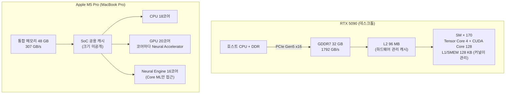

# 5주차 정리: xPU를 어떻게 비교할 것인가

가속기 비교는 "어느 칩이 빠른가"가 아니라 "어떤 조건에서 무엇을 재었는가"를 맞추는 일이다. 이번 주는 실험에 쓸 수 있는 두 장치, MacBook Pro의 Apple M5 Pro와 데스크톱의 NVIDIA RTX 5090에서 공통 예제 `Y = ReLU(XW + b)`(X [B, 1024], W [1024, 1024], b [1024], 추론)를 직접 재 보면서 ①~⑤의 질문을 정리했다.

표기 약속: **미공개**(제조사가 밝히지 않음), **미확인**(이번 조사에서 찾지 못함), **미측정**(실행해야 알 수 있는데 아직 안 잼), **추정**(공개값이나 다른 칩의 측정에서 계산한 값). 성능 단위는 제조사 사양을 옮길 때 TFLOPS/TOPS, 직접 잰 값에는 TFLOP/s를 쓴다.

## 1. 무엇을 비교하나: 칩, 시스템, 사용 목적

| 항목 | Apple M5 Pro (MacBook Pro) | NVIDIA GeForce RTX 5090 |
|---|---|---|
| 비교 단위 | SoC 1개 안의 GPU·Neural Engine·CPU (같은 메모리 공유) | 독립 GPU 카드 1장, PCIe Gen5 x16로 호스트 CPU에 연결 |
| 세부 구성 | 18코어 CPU, 20코어 GPU(코어마다 Neural Accelerator), 16코어 Neural Engine, 통합 메모리 48 GB | GB202, SM 170개, Tensor Core 680개, GDDR7 32 GB |
| 사용 목적 | 맥북, 배터리·발열 한도 안의 로컬 추론 | 데스크톱, 전력 한도 600 W(사양상 TGP 575 W) |
| 소프트웨어 | macOS 26.5.1, Python 3.12, NumPy 2.5.4, MLX 0.32.4, PyTorch 2.14.1(MPS), coremltools 9.0 | 드라이버 595.99.02, PyTorch 2.9.0+cu130(CUDA 13.0), Triton 3.5.0 |
| 작업 | `Y = ReLU(XW + b)` 한 층, B = 1과 B = 128, 추론 | 같음 |

둘 다 "장치 1개"지만 층이 다르다. M5 Pro는 TPU v5e 문서의 "칩"보다 한 층 위인 SoC이고, 같은 SoC 안의 GPU와 Neural Engine이 메모리 대역폭을 나눠 쓴다. RTX 5090은 카드 1장이고, 데이터가 호스트 메모리에서 PCIe를 건너와야 한다. 쓰임새도 달라서 "5090이 M5 Pro보다 N배 빠르다" 같은 한 문장은 의미가 약하다. 같은 작업을 정해 놓고 각자 어떤 조건에서 얼마가 나오는지를 나란히 적는 것이 이번 정리의 목표다.

## 2. 하드웨어 구조: 계산과 데이터 이동은 누가 맡나



| 부분 | RTX 5090 (PyTorch eager, BF16) | M5 Pro GPU (MLX) | M5 Pro Neural Engine (Core ML) |
|---|---|---|---|
| `XW` 행렬곱 | B = 128: Tensor Core 커널 (`cutlass_80_wmma_tensorop_bf16_..._32x32`)<br/>B = 1: `gemvx` 커널 | GPU Metal 커널 (`mx.compile`과 무관하게 별도 커널) | Core ML이 정함 (아래 4절) |
| `+ b` | GEMM 커널 안에서 같이 처리 (별도 커널 없음) | `mx.compile` 시 ReLU와 한 커널로 융합 | 같은 Core ML 프로그램 |
| ReLU | 별도 elementwise 커널 (약 0.9 µs) | `mx.compile` 시 `+ b`와 한 커널로 융합 | 같은 Core ML 프로그램 |
| 실행 제어 | 호스트가 커널 2개를 띄우고 SM의 warp scheduler가 실행 | 호스트가 Metal command buffer를 제출 | Core ML 런타임이 장치를 골라 실행 |
| W 위치 | GDDR7. 2 MiB라 반복 호출 시 L2에 남음 | 통합 메모리. 반복 호출 시 공용 캐시에 남는 것으로 보임 (5절) | 통합 메모리 |
| 온칩 재사용을 정하는 쪽 | cuBLAS 커널(SMEM 타일), L2는 하드웨어 | MLX 커널 | Core ML 컴파일러 |

RTX 5090의 커널 이름은 `torch.profiler`로 직접 확인했다. CPU와 GPU가 같은 메모리를 쓰는 M5 Pro에는 PCIe로 X를 옮기는 단계가 없다. 대신 CPU·GPU·Neural Engine이 307 GB/s를 나눠 쓴다.

GPU의 Tensor Core는 TPU의 MXU(행렬곱 유닛)에 대응하고, TPU의 TensorCore는 GPU의 SM(포괄 단위)에 대응한다. Apple에도 비슷한 함정이 있다. **Neural Engine**은 GPU 밖에 있는 별도 가속기(NPU)이고, M5부터 생긴 **Neural Accelerator**는 GPU 코어마다 붙은 행렬곱 유닛이다. 그러니 Neural Accelerator는 GPU의 Tensor Core 쪽에 가깝다.

## 3. 성능표의 숫자: 어떤 조건의 FLOPs/s인가

| 항목 | RTX 5090 ([Blackwell 백서 부록 A](https://images.nvidia.com/aem-dam/Solutions/geforce/blackwell/nvidia-rtx-blackwell-gpu-architecture.pdf)) | M5 Pro ([Apple 사양](https://www.apple.com/macbook-pro/specs/)) |
|---|---|---|
| BF16 Tensor, FP32 누산 | 209.5 dense / 419 sparse TFLOPS | 미공개 (추정 31~36, 실측 31.5 TFLOPS) |
| FP16 Tensor, FP16 누산 | 419 dense / 838 sparse TFLOPS | 미공개 (추정 31~36 TFLOPS, 누산 정밀도와 무관) |
| FP16 Tensor, FP32 누산 | 209.5 dense / 419 sparse TFLOPS | 미공개 (추정 31~36, MLX 실측 29.9 TFLOPS) |
| INT8 Tensor | 838 dense / 1676 sparse TOPS | 미공개 (GPU 추정 61~72 TOPS. Neural Engine TOPS는 M4 이후 미발표) |
| FP32 (Tensor Core 미사용) | 104.8 TFLOPS | 미공개 (추정 약 8 TFLOPS) |
| 메모리 용량 / 대역폭 | GDDR7 32 GB / 1792 GB/s | 통합 메모리 48 GB(실험 기기) / 307 GB/s |
| 온칩 캐시 | L2 96 MB | 미공개 (기본 M5 공용 캐시 약 32 MB 추정) |
| 호스트 연결 | PCIe Gen5 x16 | 해당 없음 (통합 메모리) |
| 전력 | TGP 575 W (실험 기기 설정은 600 W) | 미공개 |

M5 Pro 열의 괄호 값은 사양이 아니다. GPU 행렬곱 추정은 A19의 코어·클럭당 처리량(FP16 약 1024 FLOP, INT8 약 2048 OP)을 20코어 × 1.5~1.75 GHz에 대입한 값이다. FP16 누산과 FP32 누산의 속도가 같다는 것도 같은 A19 측정 결과다. A19에서 BF16은 측정되지 않아, BF16 추정은 FP16과 같다고 가정했다. FP32 추정은 20코어 × 128 ALU × 2 × 약 1.6 GHz로 계산했다. 실측은 아래 "실험 기기에서 직접 잰 지붕"의 값이다. 출처와 근거는 아래 "Apple이 가린 부분" 표에 있다.

- **누산 정밀도가 숫자를 2배 바꾼다.** 같은 FP16 입력이라도 FP16으로 누산하면 419, FP32로 누산하면 209.5 TFLOPS다. GeForce 제품군에서는 FP32 누산 속도가 절반이다. 그래서 "FP16 TFLOPS"라고만 적으면 어느 값인지 알 수 없다. PyTorch의 BF16 행렬곱은 FP32로 누산하므로 기준은 209.5다.
- **희소성 각주.** 백서 표의 `a/b`에서 b는 "Sparsity Feature 사용 시 유효 TFLOPS"(각주 2)다. 2:4 희소성을 쓰지 않는 일반 행렬곱의 상한은 a다. 모든 수치는 Boost Clock(2407 MHz) 기준이라는 각주 1도 붙어 있다.
- **Apple은 연산 성능을 공개하지 않는다.** 표의 M5 Pro 열은 메모리 대역폭을 빼면 대부분 미공개다. 그래서 Roofline의 지붕(P)을 구하려면 먼저 다른 사람들이 알아낸 값을 보고, 그다음 실험 기기에서 직접 재야 한다.

### Apple이 가린 부분: 다른 사람들이 알아낸 것

위 성능표에서 미공개로 남은 값 가운데 일부는 마이크로벤치마크와 리버스 엔지니어링으로 알려져 있다. 다만 M5 Pro를 직접 잰 공개 자료는 Neural Engine을 다룬 ANEForge 한 편뿐이었다. GPU Neural Accelerator는 A19·기본 M5·M4 Max 자료에서 추정해야 한다. 모두 개인·소규모 연구라서 제조사 문서보다 한 단계 낮은 출처로 다뤘다(2026-10-20 확인).

| 가려진 값 | 알아낸 내용 | 측정 칩 | 출처 |
|---|---|---|---|
| GPU Neural Accelerator 처리량 | FP16 행렬곱은 코어·클럭당 약 1024 FLOP(512 FMA), INT8은 약 2048 OP. FP16 누산과 FP32 누산의 속도가 같다. FP32는 가속되지 않고 일반 SIMD 파이프에서 돈다. BF16은 미측정. M5 Pro 20코어에 대입하면 20 × 1024 × 1.5~1.75 GHz ≈ 31~36 TFLOP/s(추정, 클럭 미확인) | A19 (GPU 5코어) | [tzakharko](https://tzakharko.github.io/apple-neural-accelerators-benchmark/) |
| Neural Accelerator를 쓰는 경로 | Metal 4 tensor API(MPP `matmul2d`)로만 닿고, 기존 `simdgroup_matrix` 셰이더는 일반 ALU에서 돈다. 기능 플래그는 여전히 `apple9`라 지원 여부로 구분할 수 없다 | M5 Pro (48 GB) | [BaseRT](https://arxiv.org/html/2607.19438v1) |
| M4까지의 `matmul2d` | 셰이더 코어에서 실행되고 전용 행렬 유닛은 없다. 누산은 FP32 이상, FP16 최대 14.8 TFLOP/s. FP8은 에뮬레이션이다 | M4 Max | [Rigel](https://arxiv.org/abs/2606.12765) |
| Neural Engine 구성·호출 비용 | 컴파일러 타깃은 H17s이고 16개 유닛을 쓴다(비용 모델 클럭 1.89 GHz). 호출 1회의 최소 지연은 74 µs이고, ReLU 하나도 77 µs가 걸린다. 반복 호출하면 1회당 195 µs | M5 Pro (macOS 26.6.2) | [ANEForge](https://arxiv.org/html/2606.17090v2) |
| Neural Engine 에너지 | ResNet-18 1회: ANE 0.33 ms·2.34 mJ, torch-MPS FP16 1.92 ms·21.8 mJ(9.3배), MLX FP16 34.5 mJ | M5 Pro | [ANEForge](https://arxiv.org/html/2606.17090v2) |
| Neural Engine 정밀도·제약 | 입출력·가중치는 FP16이고 누산은 FP32급 레지스터다. M5 누산기는 denormal을 보존한다. 행렬곱 작업 세트는 2 MB | M1~M5 | [Bryngelson](https://arxiv.org/abs/2606.22283) |
| Neural Engine 실제 처리량 | INT8은 FP16으로 역양자화한 뒤 계산한다. FP16 실측 약 19 TFLOPS로 "38 TOPS"의 절반이다. 1×1 conv가 같은 matmul보다 약 3배 빠르다 | M4 계열 | [Orion](https://arxiv.org/html/2603.06728v1), [maderix](https://maderix.substack.com/p/inside-the-m4-apple-neural-engine) |
| 공용 캐시·실효 대역폭 | 공용 캐시 약 32 MB(추정), DRAM 실측 122 GB/s(사양 153.6 GB/s의 79%) | 기본 M5 (GPU 10코어) | [Michael's Tinkerings](https://www.michaelstinkerings.org/apple-m5-gpu-roofline-analysis/) |

M5 Pro 공용 캐시를 24 MB로 적은 글도 검색에 나왔지만, 원문을 열지 못해 표에 넣지 않았다.

### 실험 기기에서 직접 잰 지붕

위 추정을 확인하려고, 연산에 확실히 막히는 큰 정사각 행렬곱을 두 가지 방법으로 돌렸다. 사양이 아니라 실측값이다.

- **MLX:** 독립적인 행렬곱 여러 개를 한 번에 `mx.eval`하고 호출당 시간을 쟀다.
- **직접 짠 Metal 4 커널:** Metal Performance Primitives의 `matmul2d`(Neural Accelerator로 가는 tensor API, `-std=metal4.0`)를 썼다. 시간은 command buffer의 GPU 타임스탬프로 쟀다. simdgroup마다 32×64 출력 타일을 따로 맡기고, threadgroup에 simdgroup 4개를 2×2로 배치한 설정이 가장 빨랐다. 64×32, 64×64, 32×128 타일이나 threadgroup 전체가 함께 계산하는 방식은 14~28 TFLOP/s였다. BF16 입력에 FP32로 누산했고, 샘플 64개의 FP64 대비 최대 상대오차는 1e-6 수준이었다.

| 행렬곱 (n×n×n) | MLX BF16 최고 / 중앙값 | MLX FP16 최고 / 중앙값 | MLX FP32 최고 / 중앙값 | Metal 4 `matmul2d` BF16 최고 / 중앙값 |
|---|---|---|---|---|
| 2048 | 29.4 / 27.3 | 29.9 / 28.7 | 22.7 / 20.9 | |
| 4096 | 29.3 / 26.8 (5.1 ms) | 29.4 / 26.5 | 17.5 / 16.3 | **31.5** / 31.0 (4.4 ms) |
| 8192 | 25.8 / 23.7 | 23.6 / 22.7 | 18.5 / 17.1 | 29.5 / 29.3 |

(단위 TFLOP/s.) 아래 표의 P는 직접 짠 Metal 4 커널의 4096³ BF16 최고값 31.5 TFLOP/s로 잡았다. 지붕은 "이보다 빠를 수 없다"는 상한이라, 측정한 것 중 가장 높은 값을 쓴다. 이 값은 위에서 본 A19 기반 추정(31~36 TFLOP/s)의 하단과 맞는다. 8192³에서 값이 떨어지는 것은 오래 돌수록 발열로 클럭이 내려가서로 보이지만, 클럭은 확인하지 않았다. MLX는 같은 하드웨어에서 지붕의 약 93%를 냈다.

| 장치 | P (BF16/FP16) | BW | Ridge point | B = 128 하한 (커널 1개) | B = 1 하한 (커널 1개) |
|---|---|---|---|---|---|
| RTX 5090 | 209.5 TFLOP/s (사양, dense) | 1792 GB/s | 117 FLOP/B | 1.46 µs (메모리) | 1.17 µs (메모리) |
| M5 Pro GPU | 31.5 TFLOP/s (실측, Metal 4 4096³ BF16) | 307 GB/s | 약 103 FLOP/B | 8.55 µs (메모리 ≈ 연산 8.52 µs) | 6.85 µs (메모리) |

예제의 산술 강도는 B = 128에서 약 102 FLOP/B(BF16, 각 텐서를 한 번씩 이동), B = 1에서 약 1 FLOP/B다(4주차 식). 그래서 B = 128은 RTX 5090에서는 ridge point(117) 바로 아래라 메모리 쪽에 걸린다. M5 Pro에서는 ridge point(103)와 거의 같아서 메모리 하한(8.55 µs)과 연산 하한(8.52 µs)이 사실상 같다. 두 장치 모두 이 작업이 ridge point 근처라서, 연산이나 메모리 어느 한쪽만 키워서는 크게 빨라지지 않는다.

## 4. 프로그래밍 방식: 같은 연산이 어떻게 실행되나

| 경로 | 모델을 넘기는 길 | 직접 커널을 쓰는 길 | 실제로 관찰한 것 |
|---|---|---|---|
| RTX 5090 | PyTorch eager → cuBLAS(Lt)가 커널 선택, `torch.compile` → Inductor가 Triton 커널 autotune | CUDA C++, Triton | 같은 BF16 `F.linear`인데 B = 1은 `gemvx`, B = 128은 `cutlass_80_wmma` 32×32 타일 커널. max-autotune은 후보 16개(cuBLAS + Triton 템플릿)를 재고 Triton 템플릿을 골랐다 |
| M5 Pro GPU | MLX(`mx.compile`), PyTorch MPS | Metal 4 TensorOps / Metal Performance Primitives | 연속 실행에서 MLX가 MPS보다 2~5배 빨랐다 (B = 1: 약 6 vs 32 µs, B = 128: 13~20 vs 40 µs). 단일 호출은 둘 다 약 180 µs |
| M5 Pro Neural Engine | Core ML (`compute_units`로 허용만 함) | 공개 경로 없음 | 장치 배치를 Core ML이 정한다 (아래 표) |

**그래프 컴파일 여부.** PyTorch는 기본이 eager다. 연산을 부르는 즉시 커널이 하나씩 GPU에 들어가고, `torch.compile`을 쓰면 그래프로 묶어 Triton 커널을 만든다. MLX는 기본이 eager가 아니라 지연 평가(lazy)다. 연산을 불러도 그래프만 쌓이고 `mx.eval` 때 실행된다. 그래서 `mx.compile`이 없어도 그래프는 있지만 연산마다 Metal 커널이 따로 나가고, `mx.compile`은 그중 원소별 연산(`+ b`, ReLU)을 하나로 융합한다. 행렬곱 커널은 어느 쪽이든 같다.

| 경로 | B | 첫 호출 | 단일 호출 | 연속 실행 (호출당) |
|---|---|---|---|---|
| 5090 eager (BF16) | 1 / 128 | 60 ms / 0.7 ms | 11.5 / 23.6 µs | 3.5 / 17.2 µs (CUDA Graph) |
| 5090 `torch.compile` max-autotune (BF16) | 1 / 128 | 0.85 s / 5.3 s | 23.4 / 30.6 µs | 16.3 / 22.3 µs (Python 루프) |
| M5 Pro MLX lazy (FP16) | 1 / 128 / 4096 | 72 ms / 9.9 ms / 2.4 ms | 169 / 174 / 517 µs | 6.0 / 14.7 / 419 µs |
| M5 Pro MLX `mx.compile` (FP16) | 1 / 128 / 4096 | 3.1 ms / 0.5 ms / 1.4 ms | 159 / 168 / 482 µs | 4.7 / 13.3 / 350 µs |

`mx.compile`은 연속 실행 기준 10~20% 빨라졌다. 원소별 연산을 융합한 만큼, 즉 B = 4096일 때 출력 Y[4096, 1024]를 한 번 덜 읽고 쓴 만큼이다. 단일 호출은 약 170 µs의 제출·대기 고정 비용이 대부분이라 차이가 거의 없다. MLX의 첫 호출 72 ms는 프로세스에서 처음 쓰는 Metal 커널을 준비하는 시간이고, 두 번째 실행부터는 1 ms 안팎이다. `torch.compile`처럼 초 단위 autotune은 없다. 5090의 `torch.compile` 행은 CUDA Graph 없이 Python에서 불렀기 때문에 연속 실행 값이 eager(CUDA Graph)보다 크다. 측정 범위가 다른 두 값이라 커널 성능 차이로 읽으면 안 된다.

**실제로 커널이 하나로 합쳐졌나?** 5090은 `torch.profiler`로 실제 실행된 커널 목록을 보고, Inductor가 생성한 코드(`TORCH_LOGS=output_code`)로 교차 확인했다. MLX는 `mx.export_to_dot`으로 실행 그래프의 primitive 목록을 봤다(BF16/FP16, 커널 시간은 L2 hot).

| 경로 | B = 1 | B = 128 |
|---|---|---|
| 5090 eager | `gemvx`(bias 포함) 2.5 µs + ReLU 0.9 µs → **2개** | cuBLAS `..._32x32_32x1`(bias 포함) 14.4 µs + ReLU 0.9 µs → **2개** (+ Memset) |
| 5090 `torch.compile` (default) | `gemvx` 2.3 µs + `triton_poi_fused_addmm_relu` 0.8 µs → **2개** | cuBLAS `mm`(`..._32x32_128x2`) 5.6 µs + `triton_poi_fused_addmm_relu` 1.2 µs → **2개** |
| 5090 `torch.compile` (max-autotune) | `triton_per_fused_addmm_relu_t` 1.9 µs → **1개** | `triton_tem_fused_addmm_t` 5.2 µs + `triton_poi_fused_addmm_relu` 1.2 µs → **2개** |
| 5090 max-autotune + epilogue 융합 강제 | | `triton_tem_fused_addmm_relu_t` 5.7 µs → **1개** |
| M5 Pro MLX lazy | | `Matmul` → `Add` → `Maximum` (`Broadcast`는 view) → **3개** |
| M5 Pro MLX `mx.compile` | | `Matmul` → `CompiledBroadcastAddBroadcastMaximum` → **2개** |

- **`torch.compile` 기본 모드는 커널 수를 줄이지 않았다.** Inductor는 `addmm`을 `mm` + (bias 덧셈 + ReLU)로 쪼갠다. 행렬곱은 cuBLAS(`extern_kernels.mm`)에 맡기고, bias와 ReLU를 Triton 원소별 커널 하나로 합친다. eager도 bias는 GEMM 안에서, ReLU는 따로 처리하므로 커널 수는 둘 다 2개다. 바뀐 것은 bias가 어느 커널에 들어가느냐뿐이다.
- **그런데 B = 128은 2.3배 빨라졌다.** 이유는 융합이 아니라 cuBLAS 커널 선택이다. bias를 함께 넘기는 eager의 `addmm` 경로와 bias 없는 `mm` 경로에서 cuBLAS가 서로 다른 행렬곱 커널을 골랐다(`..._32x1` 14.4 µs, `..._128x2` 5.6 µs). 7절에서 다시 다룬다.
- **1개로 합쳐진 경우는 두 가지뿐이었다.** B = 1의 max-autotune에서는 Triton이 행렬-벡터 곱을 리덕션 커널(`triton_per`)로 만들고, 그 안에 bias와 ReLU까지 넣었다. B = 128의 max-autotune 기본 설정은 행렬곱 템플릿 뒤에 원소별 커널을 따로 붙였다. 아래처럼 Inductor 설정 두 개를 바꾸면 템플릿 epilogue에 bias와 ReLU가 들어가 1개가 되고, 7.1 µs가 5.7 µs로 줄었다. 기본 설정이 왜 이 융합을 고르지 않았는지는 미확인이다.

    ```python
    import torch._inductor.config as cfg
    cfg.benchmark_epilogue_fusion = False      # 융합 여부를 재 보지 않고, 가능하면 무조건 융합
    cfg.max_autotune_gemm_backends = "TRITON"  # cuBLAS는 미리 컴파일된 외부 커널이라 epilogue를 붙일 수 없어 후보에서 제외
    f = torch.compile(lambda x: torch.relu(F.linear(x, W, b)), mode="max-autotune-no-cudagraphs")
    ```

    max-autotune은 행렬곱 후보(cuBLAS, 타일 크기가 다른 Triton 템플릿들)를 실제로 돌려 보고 가장 빠른 것을 고르는 모드다. epilogue 융합은 행렬곱 결과가 레지스터에 있을 때 원소별 연산까지 끝내고 내보내는 것이다. 위 두 설정은 내부 설정(`torch._inductor.config`)이라 버전마다 바뀔 수 있다(torch 2.9.0 기준).
- **MLX의 `mx.compile`은 원소별 연산만 합친다.** 행렬곱은 어느 쪽이든 별도 primitive로 남아서 3개가 2개가 된다. MLX에서 행렬곱과 bias·ReLU까지 한 커널로 만들려면 Metal 커널을 직접 써야 한다. 이 목록은 primitive 기준이고, 실제 Metal dispatch 수는 Metal capture로 확인하지 않았다.

**직접 CUDA로 짜 보기.** 커널 하나로 합친 Triton 커널(5.7 µs)보다 더 줄일 수 있는지, 같은 연산을 CUDA로 직접 써 봤다. `.cu` 파일을 `nvcc`(CUDA 13.0, `-arch=sm_120`)로 공유 라이브러리로 만들고, PyTorch 텐서 포인터를 ctypes로 넘겨 호출했다(CUDA 13.3의 `nvcc`는 이 코드에서 프런트엔드 `cicc`가 "Illegal instruction"으로 죽었다). 시간은 위와 같은 profiler 커널 시간이고, 모든 버전이 FP64 기준 출력과 BF16 오차 범위(3.1e-3) 안에서 일치했다.

| B = 128 | 구조 | 커널 수 | hot L2 | cold L2 |
|---|---|---|---|---|
| eager | cuBLAS addmm + ReLU | 2 | 15.3 µs | 17.1 µs |
| `torch.compile` 기본 | cuBLAS mm + Triton (bias+ReLU) | 2 | 6.8 µs | 11.2 µs |
| max-autotune, 융합 강제 | Triton 템플릿 1개 | 1 | 5.7 µs | 9.9 µs |
| 직접 v1 | WMMA, 32×32 타일, fragment를 글로벌 메모리에서 바로 로드 | 1 | 7.0 µs | 14.1 µs |
| 직접 v2 | 32×32 타일 + `cp.async` 4단 링 버퍼로 K를 흘려 넣기 | 1 | 6.0~6.3 µs | 7.9 µs |
| 직접 v3 | 64×64 타일, K를 4블록에 나눠 계산하고 클러스터 DSMEM으로 합산 | 1 | 6.3 µs | 9.2 µs |
| **직접 v4** | 64×64 타일, K를 4블록에 나눠 계산하고 부분합을 L2에 쓴 뒤 4블록이 16행씩 나눠 합산 + bias + ReLU | 1 | **5.3 µs** | **7.9 µs** |

B = 1은 warp 하나가 출력 한 행을 맡는 GEMV(16 B 벡터 로드, warp shuffle 합산, bias+ReLU 융합)로 1.8 µs가 나왔다. Triton(1.9 µs)과 같은 수준이고 eager(3.4 µs)의 절반이다.

- **5.6 µs 근처의 벽은 L2 읽기량이었다.** 직접 v2에서 연산을 빼고 로드만 남겨도 5.5 µs가 걸렸다. 4주차 식으로 세면, 32×32 타일 128블록은 L2에서 `M·N·K·2B·(1/BM + 1/BN)` = 16.8 MB를 읽는다. cuBLAS, Triton, 직접 v1·v2가 모두 5.6~6 µs에 몰린 이유다.
- **타일을 키우면 읽기량은 줄지만 블록 수가 줄어든다.** 64×64 타일은 읽기량이 8.4 MB로 절반이지만 타일이 32개뿐이다. 그래서 K를 4블록에 나눠 계산하는 방법으로 128블록을 만들고, 부분합을 더하는 비용을 새로 떠안는다. 직접 v4는 이 합산을 한 블록에 몰지 않고 4블록이 나눠 맡게 해서 가장 빨랐다. 단, 같은 타일의 4블록이 동시에 SM에 올라와 있다는 가정에 기대는 실험용 구현이다.
- **안 된 시도.** 다른 블록의 shared memory를 직접 읽고 쓰는 클러스터 DSMEM 합산은 1.8 µs 이상 걸렸고, WMMA로 원격에 쓰면 12 µs까지 느려졌다. 128 B짜리 TMA bulk copy 512개로 로드하면 연산당 오버헤드 때문에 17 µs였다. 마지막 블록 하나가 전부 합산하는 방식은 5.8 µs였다.
- 이론 하한 1.46 µs와는 아직 3.6배 차이다(빈 커널 실행만 0.6 µs). 더 줄이려면 TMA 2D + swizzle 레이아웃 + `ldmatrix`/`mma.sync`를 직접 쓰거나, 클러스터 multicast로 W를 여러 블록이 나눠 받아야 할 것 같다(미측정).

**Core ML은 Neural Engine을 "허용"할 뿐 강제하지 않는다.** `MLComputePlan`으로 연산별 배치 장치를 조회했다.

| B | `CPU_AND_NE` / `ALL` | `CPU_AND_GPU` |
|---|---|---|
| 1 | 전부 CPU | 전부 CPU |
| 128 | 전부 CPU | 전부 CPU |
| 1024 | 전부 Neural Engine | 전부 GPU |

Apple이 권하는 Neural Engine용 형태(채널 우선 4D 입력, Linear 대신 1×1 Conv)로 바꿔도, 입출력을 FP16으로 바꿔도 B = 1과 128은 CPU에 남았다. 작업이 작으면 장치를 옮기는 비용이 더 크다고 판단하는 것으로 보인다. ANEForge가 잰 M5 Pro Neural Engine의 호출 1회 최소 지연이 74 µs라서(3절), B = 1을 30 µs에 끝내는 CPU가 더 빠른 것과 맞는다. 결국 결과표의 "Neural Engine 지연시간"이 실제로는 CPU 시간일 수 있다. 그래서 배치 결과를 함께 적어야 한다.

**모델 자료형 ≠ 실제 계산 정밀도.** FP64 기준 출력 대비 최대 상대오차(`max|Y − ref| / max|ref|`)로 확인했다.

| 경로 | 넣은 자료형 | B = 1 오차 | B = 128 오차 | 해석 |
|---|---|---|---|---|
| 5090 FP32, TF32 끔 | FP32 | 1.5e-7 | 4.3e-7 | 진짜 FP32 (B = 128은 `simt_sgemm`, Tensor Core 미사용) |
| 5090 FP32, TF32 켬 | FP32 | 1.5e-7 | 2.7e-4 | B = 128만 TF32 Tensor Core로 계산됨. B = 1의 `gemv` 경로는 TF32 설정과 무관 |
| 5090 BF16 / FP16 | BF16 / FP16 | 4.4e-3 / 5.7e-4 | 6.3e-3 / 8.0e-4 | 자료형 유효 자릿수대로 |
| M5 Pro NumPy | FP32 | 1.0e-6 | 1.2e-6 | CPU FP32 |
| M5 Pro MLX FP32 | FP32 | 2.8e-7 | **7.4e-4** | B = 128에서 FP16급 오차. 1024³ 행렬곱도 8.2e-4이고 속도가 17~23 TFLOP/s(3절)라, GPU 일반 연산 장치의 FP32 상한(추정 약 8 TFLOP/s = 20코어 × 128 ALU × 2 × 약 1.6 GHz)을 넘는다. 낮은 정밀도로 계산되는 것으로 보이며, 정확한 내부 정밀도는 미확인 |
| M5 Pro MPS FP32 | FP32 | 1.4e-7 | 1.2e-6 | 진짜 FP32 |
| M5 Pro MLX FP16 / BF16 | FP16 / BF16 | 5.6e-4 / 5.6e-3 | 7.7e-4 / 6.0e-3 | 자료형대로 |
| M5 Pro Core ML (CPU 배치) | FP32 입력, FP16 프로그램 | 1.0e-2 | 5.2e-3 | 같은 FP16인데 MLX보다 10배 큼. 누산 방식은 미확인 |
| M5 Pro Core ML B = 1024 | FP32 입력, FP16 프로그램 | NE 4.8e-4, GPU 3.2e-4 | | 장치가 바뀌면 같은 모델의 출력도 바뀜. Neural Engine은 FP16 입력에 FP32급 누산이라(3절) FP16 반올림 수준의 오차다 |

같은 "FP32 모델"이라도 프레임워크 설정(TF32), 입력 크기(B), 라이브러리(MLX vs MPS)에 따라 실제 계산 정밀도가 달라진다. 속도를 비교하기 전에 오차부터 같은 허용 범위에 들어오는지 확인해야 한다. 이번에는 BF16 계열이 1e-2, FP16 계열이 1e-3 이내면 같은 품질로 봤다.

## 5. 실제로 빠르다는 뜻: 무엇의 시간을 재었나

같은 연산이라도 측정 범위를 어디까지 잡느냐에 따라 숫자가 수십 배 달라진다. 이번에 나눠 잰 범위는 다섯 가지다.

| 측정 범위 | 무엇이 포함되나 | 5090 측정 방법 | M5 Pro 측정 방법 |
|---|---|---|---|
| ① 커널 | 장치에서 커널이 실제로 돈 시간 | `torch.profiler` 커널 시간 (L2 hot / cold) | 이번에는 재지 않음 (Metal GPU 타임스탬프로 잴 수 있음) |
| ② 연속 실행 | 여러 번 이어서 넣고 한 번만 기다림. 호출당 평균 | CUDA Graph에 20회 캡처 후 replay | MLX 그래프에 200회 쌓고 `mx.eval` 한 번 |
| ③ 단일 호출 | 호출 1번 + 끝날 때까지 대기 | CUDA event (eager) | `mx.eval` / `torch.mps.synchronize()` / `predict()` |
| ④ end-to-end | ③ + 호스트에서 입력 올리고 결과 받기 | pinned 메모리에서 `.cuda()` → 연산 → `.cpu()` | 통합 메모리라 ③과 같음 |
| ⑤ 첫 호출 | 컴파일·초기화 포함 | 첫 실행 1회 | 첫 실행 1회 |

### 공통 예제 실측 (BF16/FP16, ②는 반복 중 최솟값, 나머지는 중앙값)

| 범위 | 5090 B = 1 | 5090 B = 128 | M5 Pro B = 1 | M5 Pro B = 128 |
|---|---|---|---|---|
| 이론 하한 (커널 1개 기준, 6절) | 1.17 µs | 1.46 µs | 6.85 µs | 8.55 µs |
| ① 커널 (hot L2) | 3.3 µs (gemv 2.5 + ReLU 0.9) | 15.3 µs (GEMM 14.4 + ReLU 0.9) | – | – |
| ① 커널 (cold L2) | 7.0 µs | 17.1 µs | – | – |
| ② 연속 실행 | 3.5 µs | 17.2 µs | 약 6 µs (MLX) | 13.2 µs (MLX) |
| ③ 단일 호출 | 11.5 µs (eager) | 23.6 µs | 178 µs (MLX), 179 µs (MPS), 30 µs (Core ML→CPU) | 179 µs (MLX), 190 µs (MPS), 121 µs (Core ML→CPU) |
| ④ end-to-end | 16.1 µs | 48.1 µs | ③과 같음 | ③과 같음 |
| ⑤ 첫 호출 | 60 ms (eager), 0.85 s (`torch.compile` max-autotune) | 0.7 ms (eager), 5.3 s (`torch.compile` max-autotune) | 127 ms (MLX), Core ML 변환+로드 약 100 ms | 53 ms (MLX) |

M5 Pro의 B = 1 연속 실행은 약 6 µs라 이론 하한 6.85 µs보다 빠르다. 실행 3번 중 한 번은 11 µs가 나왔다. W(2 MiB)를 매번 DRAM에서 읽는다면 나올 수 없는 값이다. SoC 공용 캐시에 W가 남아 있었던 것으로 보이며(기본 M5의 공용 캐시는 약 32 MB로 추정, 3절), 5090의 hot/cold L2 차이(3.3 vs 7.0 µs)와 같은 현상이다.

여기서 읽을 것:

- **사용자가 체감하는 시간은 장치 연산 시간과 다르다.** 5090의 B = 1 커널은 3.3 µs지만 end-to-end는 16.1 µs다. M5 Pro는 PCIe 전송이 없는데도 GPU 단일 호출이 약 178 µs로, end-to-end에서 5090보다 11배 느리다. Metal command buffer를 제출하고 완료를 기다리는 고정 비용이 대부분이다. 한 번씩 부르는 작은 작업이라면 GPU보다 Core ML이 고른 CPU(30 µs)나 NumPy(17 µs)가 더 빠르다.
- **지연시간과 처리량은 다른 질문이다.** M5 Pro MLX의 B = 128은 단일 호출로는 179 µs지만, 연속 실행으로는 호출당 13.2 µs다. 처리량을 적을 때는 "연속 실행 몇 개를 한 번에 기다렸는지"까지 적어야 한다.
- **첫 호출은 따로 적는다.** `torch.compile`(max-autotune)은 B = 128에서 첫 호출이 5.3 s(autotune 포함)다. 이후 호출당 시간은 측정 범위에 따라 eager보다 빠르기도, 느리기도 하다(커널 6.8 vs 15.3 µs, 단일 호출 30.6 vs 23.6 µs). B가 바뀌면 다시 컴파일한다.
- **전력은 미측정이다.** 사양표의 TGP 575 W는 한도일 뿐 작업당 에너지가 아니다. M5 Pro는 전력 한도 자체가 미공개다. 작업당 에너지(J/호출)를 비교하려면 `nvidia-smi`와 `powermetrics`로 측정 구간의 평균 전력을 따로 재야 한다. 참고로 ANEForge는 M5 Pro에서 ResNet-18 1회에 Neural Engine 2.34 mJ, torch-MPS FP16 21.8 mJ를 쟀다(3절). 작업이 달라 이번 예제에 그대로 쓸 수는 없다.

## 6. 사양으로 손 계산한 하한과 실측 비교

공개 사양(RTX 5090)과 추정 사양(M5 Pro)만으로 공통 예제의 하한을 손으로 계산하고, 실측이 그 하한의 몇 배였는지 비교했다. B = 128에서 M5 Pro는 하한의 1.2~1.3배까지 다가갔다. RTX 5090은 직접 짠 가장 빠른 커널도 3.6배였다.

### 계산에 쓴 값

| 항목 | RTX 5090 (공개 사양) | M5 Pro (공개 + 추정) |
|---|---|---|
| 메모리 대역폭 | 1792 GB/s | 307 GB/s (공개) |
| 행렬곱 (BF16/FP16 입력, FP32 누산) | 209.5 TFLOPS (Tensor Core, dense) | 31.5 TFLOPS (미공개. A19 기반 추정 31~36의 하단이자 3절 실측 지붕) |
| 원소별 연산 (+b, ReLU) | 약 52 Tops | 약 4 Tops (추정) |

원소별 연산의 값은 FP32 non-Tensor 성능(5090 104.8 TFLOPS, M5 Pro 추정 약 8 TFLOPS)의 절반으로 잡았다. 사양의 FLOPS는 곱셈과 덧셈을 한 명령으로 하는 FMA를 2 FLOP로 센 값인데, 덧셈과 max는 명령 하나가 1 op이기 때문이다.

```
연산 하한   = 연산 횟수 ÷ 최대 연산 성능
메모리 하한 = 이동 바이트 ÷ 메모리 대역폭
커널 하나의 하한 = max(연산 하한, 메모리 하한). 커널이 여러 개면 순서대로 실행되므로 더한다.

연산 횟수: XW = 2·B·K·N,  +b = B·N,  ReLU = B·N   (K = N = 1024)
이동 바이트(BF16, 커널 1개로 융합): 2·(B·K + K·N + N + B·N)
커널을 하나 더 나눌 때마다 중간 결과 Y를 쓰고 다시 읽는 2·(2·B·N) 바이트가 더해진다.
```

### B = 128 (산술 강도 약 102)

| 실행 방식 | 5090 연산 하한 | 5090 메모리 하한 | 5090 하한 | M5 Pro 연산 하한 | M5 Pro 메모리 하한 | M5 Pro 하한 |
|---|---|---|---|---|---|---|
| 커널 1개 (XW+b+ReLU) | 1.28 µs | 1.46 µs | **1.46 µs** | 8.52 µs | 8.55 µs | **8.55 µs** |
| 커널 2개 (eager: XW+b → ReLU, `torch.compile`: XW → +b+ReLU) | 1.28 + 0.01 | 1.46 + 0.29 | **1.76 µs** | 8.52 + 0.06 | 8.54 + 1.71 | **10.25 µs** |
| 커널 3개 (XW, +b, ReLU) | 1.28 + 0.00 + 0.00 | 1.46 + 0.29 + 0.29 | **2.05 µs** | 8.52 + 0.03 + 0.03 | 8.54 + 1.71 + 1.71 | **11.96 µs** |

행렬곱 커널은 두 장치 모두 연산 하한과 메모리 하한이 비슷하다(ridge point 근처). 원소별 커널은 연산이 사실상 0이고, Y를 읽고 쓰는 시간만 남는다.

### B = 1 (산술 강도 약 1.0)

| 실행 방식 | 5090 연산 하한 | 5090 메모리 하한 | 5090 하한 | M5 Pro 연산 하한 | M5 Pro 메모리 하한 | M5 Pro 하한 |
|---|---|---|---|---|---|---|
| 커널 1개 | 0.01~0.02 µs | 1.174 µs | **1.17 µs** | 0.07~0.26 µs | 6.851 µs | **6.85 µs** |
| 커널 2개 | 같음 | 1.176 µs | **1.18 µs** | 같음 | 6.864 µs | **6.86 µs** |
| 커널 3개 | 같음 | 1.178 µs | **1.18 µs** | 같음 | 6.878 µs | **6.88 µs** |

연산 하한의 범위는 행렬곱 유닛으로 계산했을 때와 일반 연산 장치로 계산했을 때다. 5090의 B = 1은 실제로 `gemvx`를 써서 Tensor Core를 쓰지 않는다. 어느 쪽이든 연산 하한은 메모리 하한의 1~4%라 완전히 메모리에 막힌다. 이동 바이트의 99.7%가 W다. Y가 2 KB뿐이라 커널을 나눠도 하한은 0.01 µs 정도만 늘어난다.

### 실측과 비교

| 장치 · B | 실행 방식 (커널 수) | 계산 하한 | 실측 | 실측 ÷ 하한 |
|---|---|---|---|---|
| 5090 · 128 | eager (2) | 1.76 µs | 15.3 µs (hot) / 17.1 µs (cold) | 8.7× / 9.7× |
| 5090 · 128 | `torch.compile` 기본 (2) | 1.76 µs | 6.8 / 11.2 µs | 3.8× / 6.4× |
| 5090 · 128 | 직접 짠 CUDA v4 (1) | 1.46 µs | 5.3 / 7.9 µs | 3.6× / 5.4× |
| 5090 · 1 | eager (2) | 1.18 µs | 3.3 / 7.0 µs | 2.8× / 5.9× |
| 5090 · 1 | 직접 짠 GEMV (1) | 1.17 µs | 1.8 / 3.9 µs | 1.5× / 3.4× |
| M5 Pro · 128 | MLX lazy (3) | 11.96 µs | 14.7 µs | 1.23× |
| M5 Pro · 128 | `mx.compile` (2) | 10.25 µs | 13.3 µs | 1.30× |
| M5 Pro · 1 | MLX lazy (3) | 6.88 µs | 6.0 µs | 0.87× |
| M5 Pro · 1 | `mx.compile` (2) | 6.86 µs | 4.7 µs | 0.69× |

5090은 profiler로 잰 커널 시간의 합이고 커널 사이 틈은 빠진다. M5 Pro는 MLX 연속 실행(②)의 호출당 시간이라 커널 사이 틈이 들어 있고, hot 조건만 쟀다. 하한은 W를 매번 DRAM에서 읽는다고 보고 계산했으므로 cold와 비교하는 것이 원래 조건에 맞다.

- **하한이 작을수록 고정비에 묻힌다.** 5090의 하한은 1.5 µs 안팎인데, 빈 커널 실행만 0.6 µs이고 128블록 구성의 L2 읽기 벽(4절)도 있다. 그래서 가장 잘 짠 커널도 하한의 3.6배였다. M5 Pro는 하한이 8.5~12 µs라 같은 종류의 고정비가 상대적으로 작고, 실측이 하한의 1.2~1.3배까지 왔다. 장치가 빠를수록 같은 작업에서 하한 대비 효율은 떨어진다.
- **융합 이득은 장치에 따라 바이트 또는 커널 수에서 나온다.** M5 Pro B = 128에서 커널 3개→2개의 계산상 차이는 1.71 µs이고, 실측 차이는 1.4 µs였다. 줄어든 시간이 "Y를 한 번 덜 읽고 쓴 시간"으로 거의 설명된다. 5090 B = 128의 계산상 차이(커널 2개→1개)는 0.29 µs인데, 실측은 `torch.compile` 기본 6.8 µs → 융합 강제 5.7 µs로 1.1 µs가 줄었다. 바이트보다 커널 하나를 없앤 고정비가 크다.
- **B = 1은 계산과 실측이 가장 많이 어긋난다.** 계산으로는 융합해도 0.01 µs만 줄어야 하는데, 5090 실측은 3.3 µs → 1.8 µs였다. 차이의 대부분은 커널 수다. M5 Pro는 실측이 하한보다 빨랐다. 계산이 틀렸다기보다 "W를 매번 DRAM에서 읽는다"는 전제가 hot 조건과 맞지 않기 때문이다. 2 MiB짜리 W가 공용 캐시에 남아 있었던 것으로 보인다.
- **장치 사이 비율도 사양 계산과 다르다.** 하한으로 보면 5090이 M5 Pro보다 B = 1과 128 모두 5.8배(대역폭 비율) 빨라야 한다. 실측 최선끼리 B = 128을 비교하면 5.3 µs 대 13.3 µs로 2.5배였다. 다만 5090은 커널 시간, M5 Pro는 연속 실행이라 측정 범위가 조금 다르다.

## 7. 연산 성능이 큰 장치가 항상 빠르지는 않다

같은 연산의 배치만 바꿔 가며 ② 연속 실행 시간을 쟀다. 5090은 BF16 eager를 CUDA Graph로, M5 Pro는 MLX FP16으로 쟀다.

| B | 산술 강도 | 5090 (µs) | 5090 TFLOP/s | M5 Pro (µs) | M5 Pro TFLOP/s | 5090이 빠른 배수 |
|---|---|---|---|---|---|---|
| 1 | 1 | 3.49 | 0.6 | 약 6 | 0.35 | 약 1.7× |
| 32 | 30 | 5.13 | 13.1 | 5.6 | 11.9 | 1.1× |
| 128 | 102 | 17.21 | 15.6 | 13.2 | 20.3 | **0.77×** |
| 512 | 256 | 9.74 | 110.3 | 40.3 | 26.6 | 4.1× |
| 1024 | 341 | 22.62 | 94.9 | 89 | 24.1 | 3.9× |
| 4096 | 455 | 55.04 | 156.1 | 366.3 | 23.5 | 6.7× |
| 16384 | 496 | 183.39 | 187.4 | 약 1440 | 23.9 | 7.8× |

사양 비율은 대역폭 5.8배(1792 ÷ 307), 연산 성능 약 6.7배(209.5 ÷ 31.5, M5 Pro는 3절 실측)다. 측정한 배수는 B에 따라 0.77배에서 7.8배까지 움직였다.

- **큰 배치에서만 사양 비율이 보인다.** B = 16384에서 5090은 사양의 89%인 187 TFLOP/s를 냈다. 배수(7.8×)는 연산 성능 비율(6.7×)보다 조금 크다. M5 Pro(MLX)가 이 모양(K = N = 1024)에서 지붕의 76%(23.9 TFLOP/s)만 냈기 때문이다. 작업이 충분히 커야 사양표의 숫자에 도달한다.
- **공통 예제 B = 128에서는 맥북이 더 빨랐다.** 5090의 B = 128 GEMM은 이론 하한 1.46 µs의 약 10배인 14.4 µs가 걸렸다. B = 512(9.7 µs)보다도 느리다. 하드웨어 한계가 아니라 cuBLAS가 고른 커널 때문이다. 같은 cuBLAS라도 bias 없이 `mm`만 부르면 다른 커널을 골라 5.6 µs에 끝난다(4절 커널 표). eager의 `F.linear`는 bias를 함께 넘기는 `addmm` 경로라서 다른 커널이 선택된 것이다. 두 커널(`..._32x32_32x1`, `..._32x32_128x2`)은 출력을 32×32 타일로 나누는 것은 같지만, K = 1024 방향을 처리하는 방법이 다르다. eager 쪽은 K를 잘게 나눠 블록을 많이 띄운 뒤 결과를 다시 합치는 방법을 골랐다. `mm` 쪽은 블록마다 K를 큰 조각으로 가져오면서 다음 조각을 미리 읽어 두는 방법을 골랐다. 같은 라이브러리 안에서도 어떤 방법을 고르느냐에 따라 2.6배가 차이 났다. 직접 짠 CUDA 커널로는 5.3 µs까지 줄었다(4절).
- **B = 1은 대역폭 비율대로 가지 않는다.** 5090의 B = 1은 hot L2 기준 3.3 µs로 하한 1.17 µs의 약 3배다. W 2 MiB를 읽는 일은 SM 170개를 채우기에는 너무 작다. 두 장치 모두 캐시가 W를 잡아 주기 때문에, 대역폭 비율 5.8배 대신 약 1.7배 차이만 남는다.

결국 "5090이 M5 Pro보다 몇 배 빠른가"의 답은 배치, 측정 범위, 소프트웨어가 고른 커널에 따라 0.77배부터 7.8배까지 달라진다.

## 참고 자료

- [Scaling Book 12장: How to Think About GPUs](https://jax-ml.github.io/scaling-book/gpus/#gpus-vs-tpus-at-the-chip-level)
- [OpenVINO 2026: NPU Device](https://docs.openvino.ai/2026/openvino-workflow/running-inference/inference-devices-and-modes/npu-device.html)
- [MLPerf Inference: Datacenter](https://mlcommons.org/benchmarks/inference-datacenter/)
- [NVIDIA RTX Blackwell GPU Architecture 백서 (부록 A, RTX 5090 사양)](https://images.nvidia.com/aem-dam/Solutions/geforce/blackwell/nvidia-rtx-blackwell-gpu-architecture.pdf)
- [Apple MacBook Pro 사양 (M5 Pro)](https://www.apple.com/macbook-pro/specs/)
- [MLX: Lazy Evaluation](https://ml-explore.github.io/mlx/build/html/usage/lazy_evaluation.html), [PyTorch MPS backend](https://docs.pytorch.org/docs/stable/notes/mps.html)
- [Core ML: MLComputePlan](https://developer.apple.com/documentation/coreml/mlcomputeplan-1w21n), [Apple ML Research: Deploying Transformers on the Apple Neural Engine](https://machinelearning.apple.com/research/neural-engine-transformers)
- [NVIDIA NIM: LLM Benchmarking Metrics](https://docs.nvidia.com/nim/benchmarking/llm/latest/metrics.html)
- [PyTorch: torch.compile](https://docs.pytorch.org/docs/stable/generated/torch.compile.html), [Triton](https://triton-lang.org/main/)
- [Apple: Metal Performance Primitives 가이드 (PDF, `matmul2d`)](https://developer.apple.com/download/files/Metal-Performance-Primitives-Programming-Guide.pdf), [M5 GPU 기술 세션](https://developer.apple.com/videos/play/tech-talks/111432/)
- Apple 리버스 엔지니어링·마이크로벤치마크: [tzakharko: A19/M5 Neural Accelerators](https://tzakharko.github.io/apple-neural-accelerators-benchmark/), [BaseRT](https://arxiv.org/html/2607.19438v1), [Rigel](https://arxiv.org/abs/2606.12765), [ANEForge](https://arxiv.org/html/2606.17090v2), [Bryngelson: Apple Neural Engine](https://arxiv.org/abs/2606.22283), [Orion](https://arxiv.org/html/2603.06728v1), [maderix](https://maderix.substack.com/p/inside-the-m4-apple-neural-engine), [Michael's Tinkerings: M5 GPU Roofline](https://www.michaelstinkerings.org/apple-m5-gpu-roofline-analysis/)
