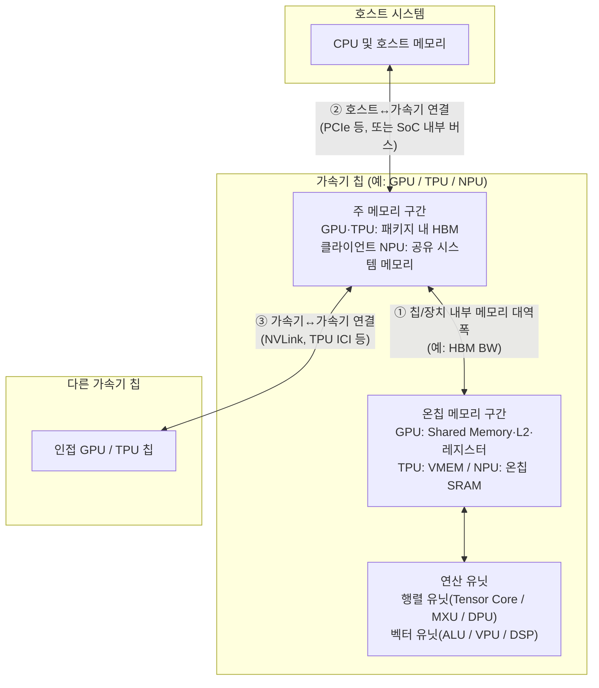
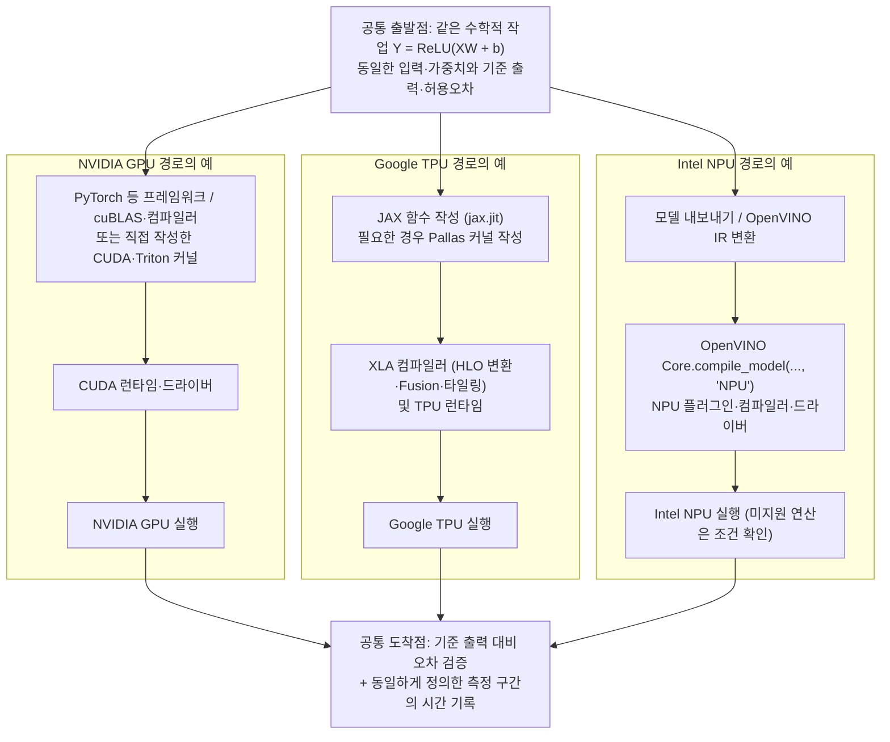
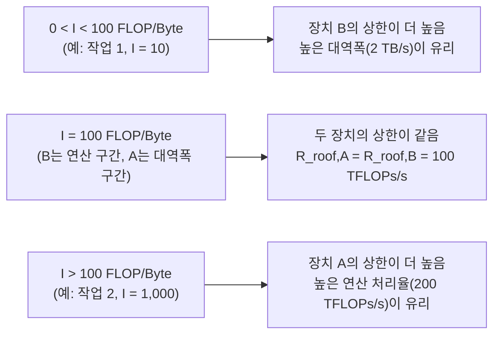
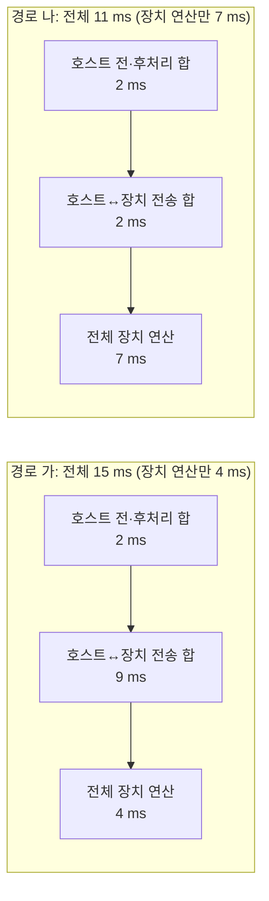
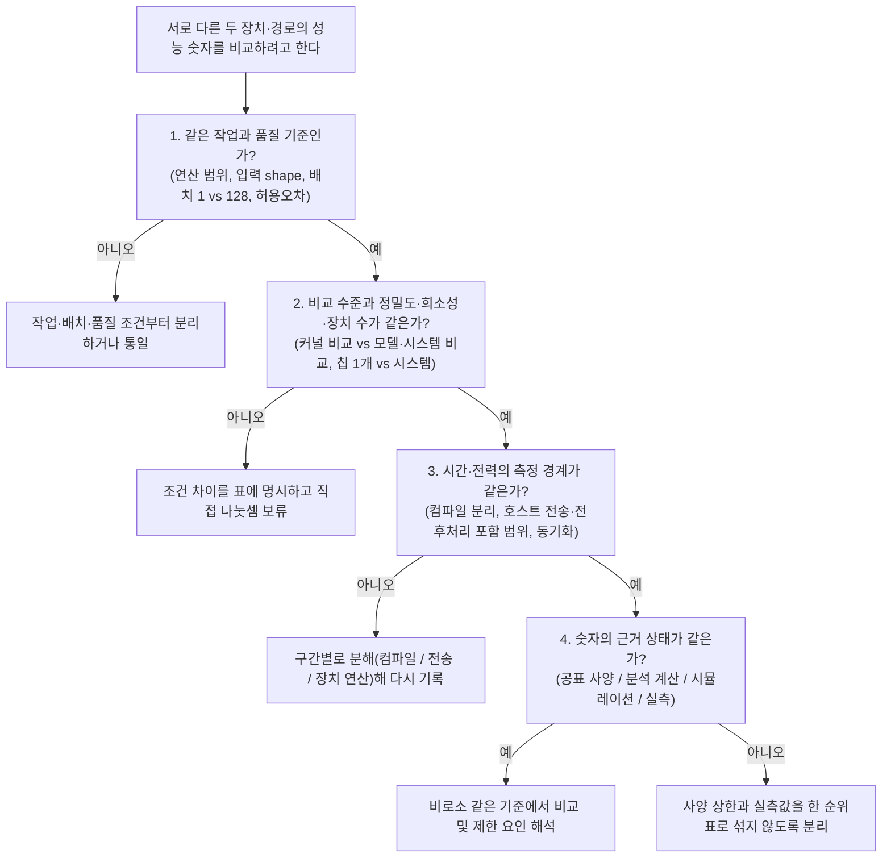

## xPU를 어떻게 비교할 것인가 — 사양표에서 실제 실행 조건까지

> **5주차 핵심 질문**
> 같은 AI 작업에 쓸 가속기를 비교하려면 어떤 조건부터 맞춰야 할까?

외부 자료 확인일: **2026-10-17** (무료 실습 환경 안내 기준일: **2026-10-08**, A100·TPU v5e 실제 장치 측정일: **2026-10-19**). 본문에서 인용한 실제 제품의 공표 사양은 공식 문서에서 확인한 값이며 계산 예제 1·2와 연습문제 1·2·3의 장치·시간·전력 수치는 비교 원리를 설명하기 위해 설정한 **교육용 가상 조건**이다. 6.3절과 11.3~11.4절의 `NVIDIA A100-SXM4-40GB` 및 `Google Cloud TPU v5 lite(v5e)` 수치는 공통 예제 코드를 실제 가속기에서 실행해 얻은 **실측 결과**다.

---

## 목차

1. [이번 주에 알아야 할 큰 그림](#1-이번-주에-알아야-할-큰-그림)
2. [공통 예제의 수학과 비교 조건](#2-공통-예제의-수학과-비교-조건)
3. [하드웨어 구조 — 계산과 데이터 이동은 누가 맡을까](#3-하드웨어-구조--계산과-데이터-이동은-누가-맡을까)
4. [성능표의 숫자 읽기 — 조건이 붙은 처리율과 대역폭](#4-성능표의-숫자-읽기--조건이-붙은-처리율과-대역폭)
5. [소프트웨어와 실행 경로 — 같은 모델이 가속기까지 내려가는 과정](#5-소프트웨어와-실행-경로--같은-모델이-가속기까지-내려가는-과정)
6. [공동 활동 — 같은 작업의 비교 조건표 만들기](#6-공동-활동--같은-작업의-비교-조건표-만들기)
7. [계산 예제 1 — 연산 성능이 더 큰 장치가 항상 빠를까](#7-계산-예제-1--연산-성능이-더-큰-장치가-항상-빠를까)
8. [계산 예제 2 — 장치 연산이 빠르면 전체 응답도 빠를까](#8-계산-예제-2--장치-연산이-빠르면-전체-응답도-빠를까)
9. [실제로 빠르다는 뜻 — 벤치마크, LLM 지표, 비용과 에너지](#9-실제로-빠르다는-뜻--벤치마크-llm-지표-비용과-에너지)
10. [장비 없이 참여하기 — 무료 실습 환경, 해석기, 시뮬레이터](#10-장비-없이-참여하기--무료-실습-환경-해석기-시뮬레이터)
11. [선택 활동 — Python으로 계산표 확인하고 실제 가속기에서 측정하기](#11-선택-활동--python으로-계산표-확인하고-실제-가속기에서-측정하기)
12. [자주 생기는 오해와 비교표 점검](#12-자주-생기는-오해와-비교표-점검)
13. [연습문제 3개](#13-연습문제-3개)
14. [해답과 해설](#14-해답과-해설)
15. [스터디에서 설명하고 함께 점검하기](#15-스터디에서-설명하고-함께-점검하기)
16. [읽을 자료와 검증 범위](#16-읽을-자료와-검증-범위)

---

## 1. 이번 주에 알아야 할 큰 그림

### 1.1 숫자 하나만으로는 가속기를 비교할 수 없다

가속기 소개 자료에는 흔히 `1,979 TFLOPs/s`, `197 TFLOPs/s`, `48 TOPS`처럼 눈에 잘 띄는 숫자 하나가 먼저 등장한다. 하지만 지난 3·4주차에 살펴본 시간 모델과 Roofline을 떠올리면 연산 처리율 숫자 하나만으로 실제 작업의 빠르기를 판단할 수 없다는 점이 분명해진다.

1. 사양표의 연산 처리율(`P`)은 **특정 연산 종류·정밀도·희소성(sparsity)·집계 단위(칩 1개 또는 시스템 전체)**가 맞을 때만 적용할 수 있는 이론 상한이다.
2. 설령 같은 정밀도의 연산을 수행하더라도, 작업의 산술 강도(`I = F / Q`)가 낮으면 연산 처리율이 아니라 **메모리 대역폭(`BW`)**이 성능을 제한한다.
3. 모델이 가속기 메모리에 들어가지 않거나, 프레임워크와 컴파일러가 일부 연산을 다른 장치로 넘기거나, 호스트↔장치 전송과 초기 컴파일 시간이 길면 **사용자가 체감하는 전체 응답 시간**은 장치 내부 연산 시간과 전혀 다른 결과를 낸다.

| 비교 단계 | 먼저 던져야 할 질문 | 이번 주에 맞출 기준 |
|---|---|---|
| 비교 대상 정의 | 칩 1개인가, 서버·Pod인가, 노트북 내장 NPU인가? | 제품명·세대·형태·장치 수·사용 목적(학습/추론) |
| 하드웨어 구조 | 행렬곱·벡터 연산·제어와 데이터 이동을 누가 맡는가? | 연산 유닛, 온칩/오프칩 메모리, 3가지 이동 구간 |
| 공표 사양 해석 | 사양표의 FLOPs/s·TOPS와 Byte/s는 어떤 조건의 값인가? | 연산 종류·입력/누산 정밀도·희소성·단위(GB vs GiB) |
| 소프트웨어 경로 | 같은 수학적 모델이 어떤 컴파일러·런타임을 거치는가? | 프레임워크·컴파일러·커널 경로·지원 연산·분할 실행 |
| 측정과 평가 | 어디서부터 어디까지의 시간·전력·비용을 재었는가? | 전송·컴파일 포함 여부, 배치, 품질 기준, 작업당 에너지 |


이 그림은 가속기를 비교할 때 거치는 점검 순서다. 앞 단계의 조건이 어긋난 상태에서 마지막 단계의 실행시간이나 사양 숫자만 나란히 놓으면 잘못된 순위를 얻게 된다.

### 1.2 먼저 “무엇의 비교인가”를 정한다

이 교안에서 사용하는 **xPU**라는 말은 GPU, Google TPU, 여러 제조사의 NPU 등 다양한 AI 가속기를 묶어 부르는 편의상의 표현이다. xPU라는 이름의 단일 표준 규격이 따로 존재하지 않으며 모든 GPU나 모든 NPU가 동일한 구조를 공유하지도 않는다. 비교를 시작하려면 먼저 **비교 수준**부터 정해야 한다.

| 비교 수준 | 먼저 고정할 조건 | 얻을 수 있는 결론 | 주의할 점 |
|---|---|---|---|
| **공표 사양 비교** | 제품·형태(SXM/PCIe 등)·칩 수·연산 종류·정밀도·희소성 | 해당 조건의 이론 연산 상한과 메모리 자원 규모 | 이론 상한일 뿐 실제 모델 실행 가능성이나 속도를 보장하지 않음 |
| **커널·연산 비교** | 수학적 연산·입력/가중치 shape·입력/계산/누산/출력 자료형·허용오차·측정 구간 | 동일 연산 조건에서 특정 커널 구현이 달성하는 성능 | 정밀도나 연산 범위를 바꾼 결과를 같은 표에 섞지 않음 |
| **모델 수준 비교** | 대상 모델·가중치·입력 데이터셋·품질(정확도) 목표·배치 크기 | 품질 목표를 만족하는 하드웨어+소프트웨어 조합의 모델 실행 성능 | 양자화·변환을 허용했다면 칩 구조만의 차이가 아니라 전체 실행 구성의 차이로 해석함 |
| **서비스·제품 비교** | 요청 도착 패턴·동시성·지연시간 목표(SLA)·품질·전력·비용·배치 환경 | 데이터센터 서빙이나 온디바이스 실행 등 실제 목적에 적합한지 | 클라우드 서버용 가속기와 노트북 내장 NPU를 사용 맥락 없이 단순 순위화하지 않음 |

특히 **정밀도를 고정한 커널 비교**와 **양자화·그래프 변환을 허용하되 같은 품질 목표를 만족시키는 모델·시스템 비교**는 서로 다른 질문에 답한다. 예를 들어 한 장치는 BF16으로 실행하고 다른 장치는 INT8 양자화 모델을 실행해 같은 정확도 기준을 통과했다면 이는 유효한 시스템 수준 비교가 될 수 있다. 그러나 그때의 속도 차이를 “칩 자체의 연산 유닛이 몇 배 빠르다”거나 “동일 정밀도 커널이 몇 배 빠르다”고 해석해서는 안 된다. [MLPerf Inference Rules](https://github.com/mlcommons/inference_policies/blob/master/inference_rules.adoc) 역시 평가 대상을 칩 단독이 아니라 하드웨어와 소프트웨어를 결합한 시스템(SUT, System Under Test)으로 정의한다.

### 1.3 이번 주의 성공 기준

1. 비교하려는 대상의 **제품·세대·장치 수·실행 환경**과 **비교 수준(공표 사양 / 커널 / 모델 / 서비스)**을 구분해 적을 수 있는가?
2. NVIDIA GPU, Google TPU, Intel Core Ultra NPU 사례에서 **행렬 연산·벡터 연산·제어·온칩 메모리**의 역할과 세 가지 데이터 이동 구간을 구분할 수 있는가?
3. 사양표의 `FLOPs/s`·`TOPS`·`GB/s`·`GiB/s` 옆에 **연산 종류, 입력·누산 정밀도, dense/sparse 조건, 집계 단위**를 붙여 읽을 수 있는가?
4. 같은 수학적 작업(`Y = ReLU(XW + b)`)이 **GPU(CUDA·Triton), TPU(JAX·XLA·Pallas), NPU(OpenVINO)**에서 어떤 소프트웨어 단계를 거쳐 실행되는지 설명할 수 있는가?
5. 작업의 산술 강도, 호스트↔장치 전송과 컴파일 포함 여부, 메모리 상주 용량, 평균 전력과 유효 처리량의 관계에 따라 **왜 유리한 장치가 달라지는지** 계산으로 보일 수 있는가?
6. 조사·실습 결과에 **문헌 확인 / 분석 계산 / CPU 동작 확인 / 시뮬레이션 / 실제 장치 측정**과 **미공개·미확인·미측정** 상태를 명확히 구분해 남길 수 있는가?

---

## 2. 공통 예제의 수학과 비교 조건

### 2.1 추론 예제 `Y = ReLU(XW + b)`의 텐서와 shape

이번 주 공동 활동과 설명 전체에서 기준점으로 삼을 작업은 선형 계층 뒤에 ReLU 활성화를 붙인 추론 연산이다.

$$
Y = \operatorname{ReLU}(XW + b), \qquad \operatorname{ReLU}(z) = \max(0, z)
$$

먼저 입력 128개를 한 묶음(batch)으로 처리하는 경우(`M = 128`)를 살펴보고 이어서 입력 1개만 즉시 처리하는 경우(`M = 1`)와 비교한다. 가중치 `W`와 편향 `b`는 학습이 끝난 고정 값이다.

| 텐서 | 역할 | 배치 128 (`M = 128`) shape | 배치 1 (`M = 1`) shape | 원소 개수 (`M = 128` / `M = 1`) |
|---|---|---|---|---|
| `X` | 입력 행렬 | `[128, 1024]` | `[1, 1024]` | `131,072` / `1,024` |
| `W` | 가중치 행렬 | `[1024, 1024]` | `[1024, 1024]` | `1,048,576` / `1,048,576` |
| `b` | 편향 벡터 (행마다 브로드캐스트) | `[1024]` | `[1024]` | `1,024` / `1,024` |
| `Y` | 출력 행렬 | `[128, 1024]` | `[1, 1024]` | `131,072` / `1,024` |

각 출력 원소 $Y_{ij}$ ($0 \le i < M$, $0 \le j < 1024$)는 다음과 같이 계산된다.

$$
Z_{ij} = \sum_{k=0}^{1023} X_{ik} W_{kj} + b_j, \qquad Y_{ij} = \max(0, Z_{ij})
$$

이 식에는 성격이 다른 세 가지 연산이 들어 있다.
- `XW`: `M × 1024` 출력에 대해 길이 `K = 1024`의 내적을 수행하는 **행렬곱(GEMM / Matmul)**
- `+ b`: 행렬곱 결과의 각 열 $j$마다 $b_j$를 더하는 **원소별(elementwise) 브로드캐스트 덧셈**
- `ReLU(...)`: 각 원소를 0과 비교해 큰 값을 택하는 **원소별 비선형 활성화**

### 2.2 배치 128과 배치 1에서 계산량과 데이터 재사용이 달라지는 이유

4주차와 같은 관례로 행렬곱 `XW`의 곱셈-덧셈 1회(FMA)를 `2 FLOPs`로 세면 행렬곱 연산량 `F_matmul`은 `2MNK`다. 여기에 편향 덧셈 `MN`번과 ReLU 비교·선택 `MN`번이 뒤따른다.

$$
F_{\mathrm{matmul}} = 2 \times M \times 1024 \times 1024 = 2{,}097{,}152 \times M \ \mathrm{FLOPs}
$$

이제 `X`, `W`, `b`가 이미 가속기 메모리에 놓여 있고 세 연산(`Matmul + bias + ReLU`)이 하나로 결합(fusion)되어 중간 텐서 `Z`를 주 메모리에 썼다가 다시 읽지 않는 이상적인 경우를 생각해보자. 입력 `X`, `W`, `b`를 한 번씩 읽고 최종 출력 `Y`만 한 번 쓸 때 필요한 총 원소 수와 바이트 수는 아래 표와 같다.

| 비교 항목 | 배치 128 (`M = 128`) | 배치 1 (`M = 1`) | 배율 변화 (`128` 대비 `1`) |
|---|---:|---:|---|
| 행렬곱 연산량 `F_matmul` | `268,435,456 FLOPs` (약 `268.44 MFLOPs`) | `2,097,152 FLOPs` (약 `2.10 MFLOPs`) | 계산량이 **1/128**로 감소 |
| 편향 덧셈 / ReLU 원소 수 | 각 `131,072`회 | 각 `1,024`회 | 계산량이 **1/128**로 감소 |
| 최소 이동 원소 수 합 (`X+W+b+Y`) | `1,311,744`개 | `1,051,648`개 | 이동 원소 수는 약 **0.80배**로만 감소 |
| 최소 이동 바이트 (2 Byte/원소, BF16/FP16 가정) | `2,623,488 Byte` (약 `2.50 MiB`) | `2,103,296 Byte` (약 `2.01 MiB`) | 가중치 `W`(`2 MiB`)가 대부분을 차지 |
| 최소 이동 바이트 (4 Byte/원소, FP32 가정) | `5,246,976 Byte` (약 `5.00 MiB`) | `4,206,592 Byte` (약 `4.01 MiB`) | 가중치 `W`(`4 MiB`)가 대부분을 차지 |
| `F_matmul / Q_min` (2 Byte/원소 기준) | 약 **`102.32 FLOP/Byte`** | 약 **`1.00 FLOP/Byte`** | 산술 강도가 약 **1/102**로 하락 |
| `F_matmul / Q_min` (4 Byte/원소 기준) | 약 **`51.16 FLOP/Byte`** | 약 **`0.50 FLOP/Byte`** | 산술 강도가 약 **1/102**로 하락 |

왜 배치 크기를 128에서 1로 줄이면 계산량은 128분의 1이 되는데 최소 이동 바이트는 거의 줄지 않을까? 가중치 행렬 `W`의 원소 `1,048,576`개는 입력이 1개든 128개든 모두 읽어야 하기 때문이다.
- **배치 128 (`M = 128`)**: 가중치 `W`의 각 원소를 읽어 128개 입력 행에 재사용하므로 산술 강도가 높다. 연산 처리율(`P`)이 높은 가속기가 유리해지기 쉽다.
- **배치 1 (`M = 1`)**: 사실상 벡터-행렬 곱(GEMV)이 되어 `W`의 원소 하나를 읽을 때마다 곱셈-덧셈 한 번만 수행한다. 산술 강도가 `0.5~1.0 FLOP/Byte` 수준으로 낮아지므로 최대 처리율(`P`) 수치보다 **메모리 대역폭, 캐시 재사용, 커널 시작 및 전송 지연**이 훨씬 중요해진다.

이 한 가지 사실만 보더라도 “배치 크기를 명시하지 않은 추론 속도 비교”가 왜 위험한지 알 수 있다.

### 2.3 기호와 단위

| 기호 | 뜻 | 단위 |
|---|---|---|
| F | 수행하는 연산량 | FLOPs (정수 연산 포함 시 OPs) |
| Q | 정한 메모리 구간에서 읽고 쓴 총 데이터량(누적 이동량) | Byte |
| P | 해당 연산·정밀도에 적용 가능한 최대 처리율 | FLOPs/s (또는 OPs/s, TOPS) |
| BW | 정한 메모리 구간의 대역폭 | Byte/s |
| I | 정한 메모리 구간 기준 산술 강도 `F/Q` | FLOP/Byte (또는 OP/Byte) |
| R | 실제로 달성한 연산 처리율 | FLOPs/s |
| `R_roof` | 모델에서 계산한 성능 상한 `min(P, BW × I)` | FLOPs/s |
| `I_ridge` | 두 상한이 만나는 분기점 `P/BW` | FLOP/Byte |
| `T_compute`, `T_memory`, `T_ideal` | 연산 시간 `F/P`, 메모리 시간 `Q/BW`, 이상적 시간 `max(F/P, Q/BW)` | s 또는 ms |

FLOPs는 연산 횟수, FLOPs/s는 초당 처리율이다. 단위는 `1 GB = 10⁹ Byte`, `1 TB = 10¹² Byte`, `1 KiB = 1024 Byte`, `1 MiB = 1024² Byte`, `1 GiB = 1024³ Byte = 1,073,741,824 Byte`다. 사양표마다 십진 단위(`GB/s`, `TB/s`)와 이진 단위(`GiB/s`)가 다르게 쓰이므로 비교 전에 반드시 같은 단위로 맞춘다.

---

## 3. 하드웨어 구조 — 계산과 데이터 이동은 누가 맡을까

### 3.1 행렬 연산, 벡터 연산, 실행 제어의 분담

우리의 공통 예제 `Y = ReLU(XW + b)`를 실행하려면 ① 행렬곱 `XW`를 빠르게 처리할 장치, ② `+ b`와 `ReLU` 같은 원소별·벡터 연산을 처리할 장치, ③ 데이터를 온칩 메모리에 가져오고 순서를 조율할 제어 및 메모리 장치가 필요하다. NVIDIA GPU, Google TPU, Intel Core Ultra 200V NPU는 이 역할을 서로 다른 구성 단위로 나눈다.

| 비교 관점 | NVIDIA GPU ([Scaling Book 12장](https://jax-ml.github.io/scaling-book/gpus/)) | Google TPU ([Scaling Book 2장](https://jax-ml.github.io/scaling-book/tpus/#what-is-a-tpu)) | Intel Core Ultra 200V NPU ([200V 데이터시트 9장](https://cdrdv2-public.intel.com/829568/829568-004.pdf)) |
|---|---|---|---|
| **칩의 주요 연산 블록** | 수십~백여 개의 **SM**(Streaming Multiprocessor) | 칩당 1~2개의 큰 **TensorCore** | 복수의 **Neural Compute Engine**(연산 타일) |
| **행렬곱·누산 중심 유닛** | 각 SM 내부의 **Tensor Core** | TensorCore 내부의 **MXU**(Matrix Multiply Unit, 시스톨릭 배열) | 타일 내부의 **DPU**(Data Processing Unit, MAC 배열) |
| **벡터·원소별 연산 유닛** | 각 SM 내부의 일반 연산 파이프(CUDA Core / ALU, SFU) | TensorCore 내부의 **VPU**(Vector Processing Unit)와 **XLU**(전치·치환) | 타일 내부의 **SHAVE DSP**(벡터·활성화 등 프로그램 가능 연산) |
| **온칩 저장 공간** | 레지스터 파일, **Shared Memory / L1 캐시**, 칩 전체 **L2 캐시** | **VMEM**(Vector Memory), **SMEM**(Scalar Memory), 레지스터 | 타일 근접 온칩 **SRAM(CMX)**과 버퍼 |
| **큰 외부 메모리** | 패키지 내 **HBM** (데이터센터 GPU 기준) | 패키지 내 **HBM** | 프로세서 패키지의 **시스템 메모리(LPDDR5x)** 공유 |
| **실행 제어와 데이터 이동** | SM의 warp 스케줄러, 캐시 계층, 비동기 복사/TMA | 스칼라 유닛과 컴파일러(XLA)가 계획한 **DMA**·명령 스트림 | 실행 스케줄러·제어 유닛과 **DMA 엔진**이 시스템 메모리↔SRAM 이동 수행 |

[Scaling Book 12장(GPUs vs. TPUs at the chip level)](https://jax-ml.github.io/scaling-book/gpus/#gpus-vs-tpus-at-the-chip-level)이 강조하듯, GPU는 많은 SM이 각자 warp 스케줄러와 작은 온칩 메모리·캐시를 갖고 분기·동적 접근까지 유연하게 처리하는 구조다. 반면 TPU는 소수의 거대한 TensorCore 안에 큰 시스톨릭 배열(MXU)과 소프트웨어(컴파일러)가 직접 관리하는 스크래치패드 메모리(VMEM)를 두고 예측 가능한 행렬·벡터 파이프라인을 밀어 넣는 데 집중한다.

한편 노트북·클라이언트 SoC에 들어가는 **Intel Core Ultra 200V(코드명 Lunar Lake) NPU**는 CPU·내장 GPU와 함께 한 프로세서 패키지에 통합되어 있으며 별도의 HBM 대신 시스템 메모리를 DMA로 읽고 타일 내부의 SRAM에 올려 DPU(행렬·합성곱 MAC)와 DSP(비선형 활성화·보조 연산)로 처리한다. 이는 200V 세대 클라이언트 NPU의 사례이며 데이터센터용 NPU나 다른 제조사(예: Qualcomm Hexagon NPU)의 세부 구조와는 또 다르다.

### 3.2 이름은 비슷해도 단위가 다른 구성 요소

사양서나 아키텍처 문서를 읽을 때 가장 먼저 주의할 점은 **비슷한 이름이 전혀 다른 계층의 부품을 가리킨다**는 사실이다.

1. **GPU의 `Tensor Core` vs TPU의 `TensorCore`**
   - NVIDIA GPU의 **Tensor Core**는 한 SM 안에 여러 개 들어가는 **작은 행렬 곱셈-누산 실행 유닛**이다. H100 한 칩에는 수백 개의 Tensor Core가 분산되어 있다.
   - Google TPU의 **TensorCore**는 MXU(행렬 유닛), VPU(벡터 유닛), XLU, VMEM(벡터 메모리), 스칼라 유닛을 하나로 묶은 **칩 수준의 거대한 코어 블록**이다. 예를 들어 [TPU v5e 문서](https://docs.cloud.google.com/tpu/docs/v5e)에서 v5e 칩 1개는 TensorCore 1개를 가지며 그 TensorCore 안에 128×128 MXU 4개가 들어 있다.
2. **하드웨어 관리 캐시 vs 컴파일러 관리 스크래치패드(VMEM / SRAM)**
   - GPU의 L1/L2 캐시는 하드웨어가 접근 패턴에 따라 데이터를 유지하거나 교체하며 커널 작성자가 명시적으로 제어할 때는 Shared Memory를 함께 사용한다.
   - TPU의 VMEM이나 NPU의 온칩 SRAM은 컴파일러와 DMA가 “어느 타일을 언제 가져와 어디에 덮어쓸지”를 미리 스케줄링하는 스크래치패드 성격이 강하다.

### 3.3 세 가지 데이터 이동 구간 구분하기

구조 그림이나 사양표를 볼 때는 데이터가 움직이는 **세 가지 물리적 구간**을 반드시 분리해서 표시해야 한다.



이 그림은 세 이동 구간의 위치만 구분한 개념도이며 칩 내부의 코어 개수나 실제 배선 폭을 비례해 그린 배선도가 아니다. 클라이언트 SoC의 내장 NPU에서는 호스트 메모리와 장치 주 메모리가 같은 물리적 LPDDR 메모리를 공유하더라도, CPU 영역에서 준비한 버퍼를 NPU DMA가 온칩 SRAM으로 읽어오는 경로와 대역폭 제약은 여전히 존재한다.

- **① 장치 주 메모리 ↔ 온칩 메모리 대역폭**: 3·4주차의 Roofline에서 `BW`로 놓았던 구간이다(예: H100의 HBM 대역폭 `3.35 TB/s`, TPU v5e의 HBM 대역폭 `800 GiB/s`).
- **② 호스트 ↔ 가속기 대역폭**: 입력 텐서를 CPU에서 가속기로 보내고 결과를 받아올 때 지나는 구간이다(예: PCIe). 계산 예제 2에서 보듯, 한 번의 추론에서 이 구간을 오가는 시간이 장치 연산 시간보다 길어질 수 있다.
- **③ 가속기 ↔ 가속기 연결 대역폭**: 여러 칩에 모델이나 배치를 나누어 실행할 때 지나는 구간이다(예: NVIDIA NVLink, Google TPU Inter-Chip Interconnect). 단일 칩 HBM 대역폭과 단위는 같은 `GB/s`·`TB/s`여도 서로 대체할 수 없다.

---

## 4. 성능표의 숫자 읽기 — 조건이 붙은 처리율과 대역폭

### 4.1 세 가지 실제 사양표 나란히 읽기

실제 공식 사양표에서 데이터센터용 GPU, 데이터센터용 TPU, 노트북용 프로세서 내장 NPU의 숫자가 어떻게 적혀 있는지 살펴보자. 세 제품은 배치되는 환경과 전력 규모가 전혀 다르므로 **아래 표는 성능 순위를 매기기 위한 표가 아니라 각 숫자의 전제 조건을 읽는 훈련용 예시**다.

| 사례와 공식 출처 | 공표 연산 처리율 예시 | 메모리 용량·대역폭 항목 | 사양표를 읽을 때 반드시 확인할 점 |
|---|---|---|---|
| **[NVIDIA H100 SXM](https://www.nvidia.com/en-us/data-center/h100/)**<br/>(데이터센터 GPU, SXM 폼팩터) | BFLOAT16 Tensor Core: **`1,979 TFLOPs/s`**<br/>FP32(일반): `67 TFLOPs/s` | GPU 메모리: **`80 GB`**<br/>메모리 대역폭: **`3.35 TB/s`** | `1,979 TFLOPs/s`에는 **With sparsity(희소성 적용)** 각주가 붙어 있다. 일반적인 dense BF16 행렬곱 상한으로 그대로 옮겨 적지 않는다. 또한 SXM과 PCIe 모델의 수치가 다르다. |
| **[Google Cloud TPU v5e](https://docs.cloud.google.com/tpu/docs/v5e)**<br/>(데이터센터 추론·학습용 TPU, **칩 1개 기준**) | BF16: **`197 TFLOPs/s`**<br/>INT8: **`393 TOPS`** | HBM 용량: **`16 GB`**<br/>HBM 대역폭: **`800 GiB/s`** | 문서에 **칩 1개(1 chip)** 값과 **Pod 최대(256 chips)** 값(`BF16 50.4 PFLOPS`)이 함께 실려 있으므로 집계 단위를 구분해야 한다. 대역폭 단위는 이진 `GiB/s`다. |
| **[Intel Core Ultra 9 288V NPU](https://www.intel.com/content/www/us/en/products/sku/240961/intel-core-ultra-9-processor-288v-12m-cache-up-to-5-10-ghz/specifications.html)**<br/>(클라이언트 SoC 내장 NPU) | NPU Peak TOPS (Int8): **`48 TOPS`**<br/>플랫폼 전체(Overall): `120 TOPS` | 시스템 최대 메모리: **`32 GB`** (LPDDR5x-8533 패키지 온 메모리) | `120 TOPS`는 CPU+GPU+NPU를 합산한 플랫폼 수치이므로 NPU 단독 성능(`48 TOPS`)과 구분한다. 해당 제품 사양표에는 NPU 전용 메모리 대역폭이 별도 항목으로 공표되어 있지 않다(**사양표 미기재**). |

### 4.2 연산 처리율 뒤에 숨은 다섯 가지 조건

사양표에서 `FLOPs/s`나 `TOPS`를 가져올 때는 숫자 옆에 아래 다섯 가지 꼬리표를 함께 적어야 한다.

1. **연산 유닛의 종류 (행렬 유닛 vs 일반 벡터·스칼라 유닛)**
   - H100 SXM 사양표에서 Tensor Core를 쓰는 BF16/FP16 수치는 수천 TFLOPs/s 단위지만 Tensor Core가 아닌 일반 FP32 연산은 `67 TFLOPs/s`다. 우리의 공통 예제 `Y = ReLU(XW + b)`에서 `XW`는 행렬 유닛을 쓸 수 있지만 `ReLU`나 일반 원소별 연산에 행렬 유닛의 피크 성능(최대 처리율)을 대입해서는 안 된다.
2. **입력 정밀도와 누산(accumulation) 정밀도**
   - `BF16`, `FP16`, `FP8`, `INT8`은 원소당 비트 수와 표현 범위가 다르다. 또한 입력은 `FP16`이나 `BF16`으로 받더라도 중간 합(누산값)은 `FP32`로 유지하는지, `FP16`으로 유지하는지에 따라 수치 오차와 지원 명령이 달라진다.
3. **희소성(Sparsity) 가정 여부**
   - NVIDIA H100 사양표의 `1,979 TFLOPs/s` 옆에는 구조적 희소성(2:4 structured sparsity, 4개 중 2개가 0인 패턴)을 활용했을 때의 값이라는 각주가 붙어 있다. 희소 조건을 사용하지 않는 일반(dense) 행렬곱에서는 그 절반이 기준이 된다. 반면 Intel 288V 사양표에는 `Sparsity Support: Yes`라는 기능 항목과 `NPU Peak TOPS (Int8): 48`이 적혀 있으나, 그 두 줄만으로 48 TOPS가 dense 기준인지 sparse 기준인지 단정하지 않고 문서에서 확인된 범위만 기록한다.
4. **칩 1개인가, 보드·호스트·Pod 전체인가**
   - Cloud TPU v5e 문서는 칩 1개 사양 외에도 VM 형태(`ct5lp-hightpu-1t`, `4t`, `8t`)와 최대 256칩 Pod 사양을 함께 제시한다. Intel 288V 사양표도 `NPU Peak TOPS (Int8): 48`과 `Overall Peak TOPS (Int8): 120`(CPU 5 + GPU 67 + NPU 48)을 나란히 적는다. 비교표의 단위를 “칩 1개”로 잡았는지 “단일 호스트/노트북 안의 특정 가속기”로 잡았는지 먼저 통일해야 한다.
5. **부동소수점(`FLOPs/s`)과 정수(`TOPS`)의 구분**
   - H100의 희소 BF16 수치(`1,979 TFLOPs/s`)를 288V NPU의 INT8 수치(`48 TOPS`)로 단순 나눗셈하여 “약 41배 빠르다”고 말하는 것은 자료형, 희소성, 전력·배치 환경을 모두 무시한 계산이므로 의미가 없다.

### 4.3 메모리 용량, 대역폭 구간, 이진·십진 단위 변환

메모리 항목에서도 단위를 맞추는 계산이 필수다. 예를 들어 H100 SXM의 메모리 대역폭은 십진 단위인 **`3.35 TB/s`**(`3,350 GB/s`)로 표기되어 있고 TPU v5e의 HBM 대역폭은 이진 단위인 **`800 GiB/s`**로 표기되어 있다. `800 GiB/s`를 십진 `GB/s`와 `TB/s`로 변환해보자.

$$
\begin{aligned}
800\ \mathrm{GiB/s}
&= 800 \times 2^{30}\ \mathrm{Byte/s} \\
&= 800 \times 1{,}073{,}741{,}824\ \mathrm{Byte/s} \\
&= 858{,}993{,}459{,}200\ \mathrm{Byte/s} \\
&\approx 858.99\ \mathrm{GB/s} \approx 0.859\ \mathrm{TB/s}
\end{aligned}
$$

만약 `GiB/s`와 `GB/s`를 구분하지 않고 `800`을 그대로 `800 GB/s`로 넣으면 약 `7.4%`의 오차가 처음부터 발생한다. 또한 같은 H100 사양표 안에서도 HBM 대역폭(`3.35 TB/s`), NVLink 대역폭(`900 GB/s`), PCIe Gen5 대역폭(`128 GB/s`)이 모두 함께 적혀 있으므로 **산술 강도 `I = F / Q`를 계산한 메모리 경계와 똑같은 구간의 대역폭**을 가져와야 한다.

---

## 5. 소프트웨어와 실행 경로 — 같은 모델이 가속기까지 내려가는 과정

### 5.1 세 가속기의 대표적인 실행 경로

같은 수학적 연산 `Y = ReLU(XW + b)`를 작성하더라도, 실제 가속기 위에서 명령어가 실행되기까지는 각 플랫폼의 프레임워크, 그래프 컴파일러, 커널 라이브러리, 런타임·드라이버를 거친다.



이 그림은 각 장치에서 자주 쓰이는 대표적인 소프트웨어 경로를 보여준다. 실제 단계는 선택한 프레임워크와 백엔드에 따라 달라질 수 있으며 JAX·XLA·Pallas가 TPU에만 쓰인다거나 Triton이 NVIDIA GPU에만 고정된다는 뜻은 아니다([CUDA Programming Model](https://docs.nvidia.com/cuda/cuda-programming-guide/01-introduction/programming-model.html), [JAX JIT](https://docs.jax.dev/en/latest/jit-compilation.html#jit-compiling-a-function), [Pallas](https://docs.jax.dev/en/latest/pallas/index.html), [Triton](https://triton-lang.org/main/index.html), [OpenVINO NPU Device](https://docs.openvino.ai/2026/openvino-workflow/running-inference/inference-devices-and-modes/npu-device.html)).

### 5.2 프레임워크 호출과 직접 커널 작성, 최초 컴파일과 반복 실행

가속기를 다루는 방법은 크게 두 층위로 나뉜다.

| 접근 방식 | 개발자가 지정하는 것 | 컴파일러·런타임이 맡는 것 | 비교할 때 확인할 점 |
|---|---|---|---|
| **프레임워크·모델 컴파일러 경로**<br/>(예: `torch.compile`, `jax.jit`, `OpenVINO compile_model`) | 수학적 연산 그래프(`XW + b`, `ReLU`), 입력 텐서 shape·자료형 | 연산 결합(fusion), 타일 크기 선택, 메모리 배치, 라이브러리 커널 호출 | 같은 Python 식이어도 백엔드마다 생성되는 커널 수와 중간 메모리 왕복이 다름 |
| **직접 커널 작성 경로**<br/>(예: CUDA C++, Triton, JAX Pallas) | 블록·타일 분할(`BM, BN, BK`), 온칩 메모리 로드/저장, 누산 루프 | 지정된 커널을 타깃 기계어·명령 스트림으로 번역 및 스케줄링 | 6주차 이후 실습처럼 타일 크기와 메모리 이동을 직접 통제할 때 사용 |

또한 [JAX의 JIT 컴파일 문서](https://docs.jax.dev/en/latest/jit-compilation.html#jit-compiling-a-function)와 [OpenVINO NPU 문서](https://docs.openvino.ai/2026/openvino-workflow/running-inference/inference-devices-and-modes/npu-device.html)에서 공통으로 강조하듯, **최초 실행(또는 `compile_model` 단계)**에는 그래프 추적, 컴파일러 최적화, 장치용 바이너리 생성 시간이 포함된다. 비교표에는 반드시 **① 최초 컴파일·준비 시간**과 **② 워밍업(준비 실행) 이후의 반복 실행 시간**을 분리해 적어야 한다.

### 5.3 NPU 지원 조건을 문서로 확인할 때 주의할 점

클라이언트 NPU처럼 특정 추론 작업에 초점을 맞춘 가속기는 지원 조건을 문서에서 더 세밀하게 확인해야 한다. [OpenVINO 2026 NPU Device 문서](https://docs.openvino.ai/2026/openvino-workflow/running-inference/inference-devices-and-modes/npu-device.html)와 [Heterogeneous Execution 문서](https://docs.openvino.ai/2026/openvino-workflow/running-inference/inference-devices-and-modes/hetero-execution.html)를 기준으로 다음 세 가지를 구분한다.

1. **모델의 입력·표현 자료형 vs 하드웨어의 실제 계산 정밀도**
   - OpenVINO NPU 문서는 추론 시 지원하는 모델 자료형으로 `F16`, `F32`, `I8`, `U8` 등을 나열하면서도, **NPU 하드웨어가 부동소수점 연산을 네이티브로 실행하는 정밀도는 `FP16`**이라고 명시한다. 즉 모델 입력이나 중간 표현에 `F32`를 넣을 수 있다고 해서 곧 하드웨어가 내부에서 네이티브 `FP32` 연산 유닛으로 계산하는 것은 아니다.
2. **정적(static) shape vs 동적(dynamic) shape**
   - NPU 컴파일러는 전통적으로 입력 크기가 고정된 정적 shape 모델을 기준으로 메모리와 DMA를 계획한다. OpenVINO 2026 문서는 제한된 형태의 동적 shape 지원이 **preview 기능**으로 제공되며 프로세서 세대·드라이버 버전·모델 구조·연산 종류에 제약이 있음을 설명한다. 비교표에는 막연히 “동적 shape 가능/불가능”이라고 적지 않고 테스트한 shape(`[128, 1024]`, `[1, 1024]`)를 정적으로 각각 컴파일했는지 동적 범위로 컴파일했는지와 소프트웨어 버전을 함께 적는다.
3. **단일 장치 실행(`"NPU"`) vs 다중 장치 분할 실행(`"HETERO:NPU,CPU"`)**
   - 모델 안에 NPU가 지원하지 않는 연산이 섞여 있을 때 일부 서브그래프를 CPU 등 다른 장치로 넘기는 `HETERO` 실행 모드가 있다. 그러나 OpenVINO 문서는 NPU의 `HETERO` 모드가 일부 지원 모델에 한정되며 모든 임의의 미지원 연산에 대해 자동 폴백(fallback)을 보장하지 않는다고 밝힌다. 만약 일부 연산이 CPU에서 실행되었다면 그 시간은 “NPU 단독 실행”이 아니라 “NPU+CPU 분할 실행 및 데이터 이동”을 측정한 결과다.

---

## 6. 공동 활동 — 같은 작업의 비교 조건표 만들기

### 6.1 `Y = ReLU(XW + b)` 비교 조건표의 11개 필수 항목

스터디에서 각자 한 제품(예: H100 SXM, Cloud TPU v5e, Core Ultra 9 288V NPU, 혹은 무료 실습 환경에서 실제 배정받은 T4 GPU 등)을 맡아 공통 작업 `Y = ReLU(XW + b)`의 비교 조건표를 채운다. 문서 조사만으로도 이 표를 완성할 수 있다.

| 번호 | 비교 항목 | 모든 참가자가 공통으로 고정할 기준 | 맡은 장치별로 조사·기록할 내용 |
|---:|---|---|---|
| 1 | **작업·입력** | `Y = ReLU(XW + b)`, `W:[1024,1024]`, `b:[1024]`, 추론 | 해당 연산과 입력 크기의 지원 여부, 필요한 모델·그래프 변환 |
| 2 | **정확도** | 기준 출력(예: FP32/FP64 참조 계산)과 허용오차 범위 | 실제 출력의 오차 통과 여부, 실행 전이면 `미검증`으로 기록 |
| 3 | **정밀도** | 커널 비교인지, 품질 목표 중심의 모델 비교인지 명시 | 입력·가중치·내부 계산·누산·출력 자료형, 양자화·희소성 사용 여부 |
| 4 | **배치** | `X:[128, 1024]`(배치 128)와 `X:[1, 1024]`(배치 1)를 분리 | 각 배치의 지연시간(`ms/batch`)과 처리량(`samples/s`) |
| 5 | **장치 단위** | 칩 1개 기준인지 호스트·시스템 기준인지 통일 | 정확한 제품명·세대·폼팩터·사용한 칩 수·호스트 사양 |
| 6 | **소프트웨어** | 실행 경로와 버전을 재현 가능하게 기록 | 프레임워크·컴파일러·런타임·드라이버·플러그인 버전 |
| 7 | **메모리** | 입력·가중치·출력·작업 공간의 필요 용량 범위 | 가용 메모리 용량, 데이터 상주 위치, 호스트↔장치 복사 포함 여부 |
| 8 | **실행 분할** | `Matmul + bias + ReLU` 전체 수학적 작업을 포함 | 커널 결합(fusion) 여부, 실행된 커널 수, CPU 등 타 장치로 넘어간 구간 |
| 9 | **시간 경계** | 최초 컴파일·준비 실행과 반복 실행 측정을 분리 | 비동기 실행 동기화 방법, 반복 횟수, 평균·중앙값·분포 |
| 10 | **비용·전력** | 비교가 필요한 경우 동일한 측정 범위와 품질·지연 조건 | TDP/평균 소비 전력(W)/요금의 근거와 확인 시점 |
| 11 | **증거 상태** | 모든 수치와 설명에 근거 종류를 함께 표기 | `문서 확인` / `분석 계산` / `CPU 동작 확인` / `시뮬레이션` / `실측` / `미확인` |

### 6.2 세 장치에 대해 문헌 기준으로 채워본 예시

아래 표는 실제 장치를 실행하지 않고 공식 문서만으로 세 제품의 조건표를 어떻게 채우는지 보여주는 예시다.

| 비교 항목 | NVIDIA H100 SXM (문헌 조사 예) | Google Cloud TPU v5e (문헌 조사 예) | Intel Core Ultra 9 288V NPU (문헌 조사 예) |
|---|---|---|---|
| **비교 단위와 환경** | 데이터센터 GPU 칩 1개 (SXM) | 클라우드 TPU v5e 칩 1개 (`ct5lp-hightpu-1t`) | 클라이언트 노트북 SoC 내장 NPU 1개 |
| **실행 소프트웨어 경로** | PyTorch / cuBLAS 또는 Triton·CUDA 커널 | JAX (`jax.jit`) → XLA (또는 Pallas 커널) | OpenVINO 2026 `compile_model(model, "NPU")` |
| **입력·계산 정밀도 조건** | FP32 또는 BF16/FP16 Tensor Core 선택 가능 | BF16 (`197 TFLOPs/s`) 또는 INT8 (`393 TOPS`) 중심 | 모델 입력 `F32/F16/I8` 가능, 부동소수점 하드웨어 계산은 `FP16`, 정수는 `INT8`(`48 TOPS`) |
| **메모리 용량과 대역폭** | HBM `80 GB`, `3.35 TB/s` (문서 확인) | HBM `16 GB`, `800 GiB/s` (`≈ 858.99 GB/s`, 문서 확인) | 시스템 메모리 최대 `32 GB` 공유, NPU 전용 대역폭은 **사양표 미기재(미공개/미확인)** |
| **`Y = ReLU(XW + b)` 상주 가능성** | 배치 128 기준 수 MiB 수준이므로 `80 GB` 내 충분 | 배치 128 기준 수 MiB 수준이므로 `16 GB` 내 충분 | 수 MiB 수준이므로 메모리 내 충분하나 컴파일·SRAM 분할은 런타임 확인 필요 |
| **배치 128 vs 배치 1 실행 방식** | 동적/정적 모두 실행 가능, 배치에 따라 최적 커널·타일 달라짐 | 정적 shape별 XLA 컴파일 권장(shape 변경 시 재컴파일 주의) | 정적 shape `[128,1024]`, `[1,1024]` 별도 컴파일 권장(동적 shape는 제한적 preview) |
| **실제 실행시간과 정확도** | **아직 미측정** (실제 H100 실행 안 함) | **아직 미측정** (문헌 단계) → 6.3·11.3절에서 실측 | **아직 미측정** (실제 288V NPU 실행 안 함) |

### 6.3 실제 배정된 A100과 TPU v5 lite(v5e)로 채운 실측 조건표

이번에는 10.1절의 원칙(“사양 조사용 H100 대신 실제 런타임에 배정된 장치명을 조회해 기록한다”)에 따라 실제 원격 환경에서 배정받은 **`NVIDIA A100-SXM4-40GB`** 1개와 **`Google Cloud TPU v5 lite`(`TPU v5e`)** 1개에서 6.1절의 11개 항목을 실측으로 채운 결과를 비교해보자(상세 로그와 수치는 11.3~11.4절 수록).

| 번호 | 비교 항목 | NVIDIA A100-SXM4-40GB (실측) | Google Cloud TPU v5 lite / v5e (실측) |
|---:|---|---|---|
| 1 | **작업·입력** | `Y = ReLU(XW + b)`, `W:[1024,1024]`, `b:[1024]`, 추론 | `Y = ReLU(XW + b)`, `W:[1024,1024]`, `b:[1024]`, 추론 |
| 2 | **정확도** | CPU `FP64` 기준 대비 최대 절대 오차: `FP32` `1.97e-06`, `BF16` `2.93e-02` (**통과**) | CPU `FP64` 기준 대비 최대 절대 오차: `FP32` `6.99e-07`, `BF16` `2.69e-02` (**통과**) |
| 3 | **정밀도** | 순수 `FP32`(`allow_tf32=False`) 및 `BF16` dense 커널 비교 | `FP32`(`Precision.HIGHEST`) 및 `BF16`(`Precision.DEFAULT`) dense 비교 |
| 4 | **배치별 순수 장치 시간** | **BF16 Eager**: `M=128` `0.0625 ms` (`4.297 TF/s`), `M=1` `0.0604 ms` (`0.035 TF/s`)<br/>**BF16 compile**: `M=128` `0.1352 ms`, `M=1` `0.1393 ms` | **BF16 `jax.jit`**: `M=128` `0.1619 ms` (`1.658 TF/s`), `M=1` `0.1299 ms` (`0.016 TF/s`)<br/>**BF16 Eager**: `M=128` `0.4913 ms`, `M=1` `0.4401 ms` |
| 5 | **장치 단위** | `NVIDIA A100-SXM4-40GB` 칩 1개 (`SM 108개`) | `TPU v5 lite` (`Cloud TPU v5e`) 칩 1개 (`id=0`) |
| 6 | **소프트웨어** | `PyTorch 2.11.0+cu130`, `CUDA 13.0` (`Eager` vs `torch.compile`) | `JAX 0.7.2`, `backend=tpu` (`Eager` vs `jax.jit` XLA) |
| 7 | **메모리** | 장치 가용 메모리 `42.41 GB` (`39.49 GiB`), HBM 상주 vs 호스트 복사 분리 측정 | TPU HBM `16 GB` (`800 GiB/s` 사양), HBM 상주 vs 호스트 복사 분리 측정 |
| 8 | **실행 분할** | 가속기 단독 실행 (`Eager`는 개별 커널, `torch.compile`은 결합 커널 생성) | 가속기 단독 실행 (`Eager`는 개별 디스패치, `jax.jit`는 XLA Fusion 결합) |
| 9 | **시간 경계** | 워밍업 50회 후 반복 500회 중앙값 (`CUDA Event` / `synchronize`), 최초 1회·순수장치·전송포함 분리 | 워밍업 50회 후 반복 500회 중앙값 (`block_until_ready`), 최초 1회·순수장치·전송포함 분리 |
| 10 | **비용·전력** | **아직 미측정** (전력계·클라우드 과금 미측정) | **아직 미측정** (전력계·클라우드 과금 미측정) |
| 11 | **증거 상태** | 1~9번 **실측 (2026-10-19)**, 10번 **미측정** | 1~9번 **실측 (2026-10-19)**, 10번 **미측정** |

### 6.4 미확인 조건의 표기법과 결론 보류 문장

공식 사양표나 문서에서 값을 찾지 못했을 때 어림짐작으로 숫자를 채워 넣으면 비교표 전체의 신뢰도가 무너진다. 빈칸은 왜 비어 있는지에 따라 세 가지로 나누어 적는다.

- **미공개**: 제조사의 공식 사양표와 공개 데이터시트에 해당 항목이 발표되지 않은 경우 (예: Core Ultra 9 288V 제품 사양표의 NPU 단독 메모리 대역폭)
- **이번 조사에서 미확인**: 공개 문서 어딘가에 있을 수 있으나 이번 조사 범위의 문서·절에서는 아직 확인하지 못한 경우
- **아직 미측정**: 사양과 문서는 확인했으나 실제 장비에서 해당 작업의 정확도·지연시간·전력을 측정하지 않은 경우

조건표를 작성한 뒤에는 스터디원끼리 아래 문장을 채워 읽어보며 현재 내릴 수 있는 결론의 한계를 분명히 한다.

> **결론 요약 템플릿**
> “이 구성은 `Y = ReLU(XW + b)`(배치 `___`) 작업을 `___` 정밀도·품질 조건에서 실행하기 위한 후보이다. 확인한 근거는 `___`(문서 확인 / 계산 추정 / 실측)이며 `___` 항목은 아직 미확인(또는 미측정)이어서 최종 속도 순위 결론은 보류한다.”

---

## 7. 계산 예제 1 — 연산 성능이 더 큰 장치가 항상 빠를까

### 7.1 가상 장치 A·B와 두 작업의 조건

사양표의 연산 처리율(`P`)이 두 배 높은 장치가 언제나 두 배 빠른지 확인하기 위해, 두 대의 **교육용 가상 장치 A와 B**를 비교해보자. 이 두 장치는 특정 상용 GPU·TPU·NPU의 실제 수치가 아니다.

| 가상 장치 | 연산 처리율 `P` | HBM 대역폭 `BW` | 메모리 용량 | 분기점 `I_ridge = P / BW` |
|---|---:|---:|---:|---:|
| **가상 장치 A** | `200 TFLOPs/s` (`200 × 10¹² FLOPs/s`) | `1 TB/s` (`1 × 10¹² Byte/s`) | `16 GB` | `200 FLOP/Byte` |
| **가상 장치 B** | `100 TFLOPs/s` (`100 × 10¹² FLOPs/s`) | `2 TB/s` (`2 × 10¹² Byte/s`) | `32 GB` | `50 FLOP/Byte` |

계산에 적용하는 공통 가정과 제외 비용은 다음과 같다.
- **동일한 연산 조건**: 두 장치 모두 비교 대상 작업의 BF16 dense 연산과 동일한 품질·오차 기준을 지원하며 FMA는 `2 FLOPs`로 센다.
- **메모리 상주 조건**: 두 작업 모두 입력·가중치·출력·중간값·작업 공간을 합친 **동시 상주 용량이 `8 GB`**다. 덕분에 A(`16 GB`)와 B(`32 GB`) 모두 데이터를 장치 메모리에 온전히 올려두고 실행할 수 있다.
- **이상적 Roofline 가정**: 입력은 이미 장치 HBM에 놓여 있고 연산과 HBM 데이터 이동은 충분히 겹치며(`T_ideal = max(F/P, Q/BW)`), 시작 비용·컴파일·호스트 전송 비용은 제외한다. 단위는 십진 `GB = 10⁹ Byte`, `TB = 10¹² Byte`다.

비교할 두 가상 작업의 연산량 `F`와 누적 HBM 이동량 `Q`는 이미 집계되어 있다고 하자.

| 가상 작업 | 총 연산량 `F` | 누적 HBM 이동량 `Q` | 산술 강도 `I = F / Q` | 대응하는 상황의 예 |
|---|---:|---:|---:|---|
| **작업 1 (계산이 적은 작업)** | `10¹² FLOPs` | `100 GB` (`10¹¹ Byte`) | **`10 FLOP/Byte`** | 작은 배치의 추론이나 데이터 재사용이 적은 연산 |
| **작업 2 (계산이 많은 작업)** | `10¹⁴ FLOPs` | `100 GB` (`10¹¹ Byte`) | **`1,000 FLOP/Byte`** | 큰 배치의 행렬곱처럼 온칩 데이터 재사용이 충분한 연산 |

### 7.2 산술 강도에 따라 뒤집히는 우열

3·4주차의 시간 식과 성능 상한 식을 그대로 적용한다.

$$
T_{\mathrm{compute}} = \frac{F}{P}, \qquad
T_{\mathrm{memory}} = \frac{Q}{BW}, \qquad
T_{\mathrm{ideal}} = \max(T_{\mathrm{compute}}, T_{\mathrm{memory}}), \qquad
R_{\mathrm{roof}} = \min(P, BW \times I)
$$

먼저 **작업 1 (`F = 10¹² FLOPs`, `Q = 100 GB`, `I = 10 FLOP/Byte`)**을 두 장치에서 계산해보자.

- **장치 A (`P = 200 TFLOPs/s`, `BW = 1 TB/s`)**:
  $$
  T_{\mathrm{compute, A}} = \frac{10^{12}}{200 \times 10^{12}} = 0.005\ \mathrm{s} = 5\ \mathrm{ms}, \qquad
  T_{\mathrm{memory, A}} = \frac{100 \times 10^9}{1 \times 10^{12}} = 0.1\ \mathrm{s} = 100\ \mathrm{ms}
  $$
  $$
  T_{\mathrm{ideal, A}} = \max(5\ \mathrm{ms}, 100\ \mathrm{ms}) = \mathbf{100\ \mathrm{ms}}, \qquad
  R_{\mathrm{roof, A}} = \min(200, 1 \times 10) = \mathbf{10\ \mathrm{TFLOPs/s}}
  $$
- **장치 B (`P = 100 TFLOPs/s`, `BW = 2 TB/s`)**:
  $$
  T_{\mathrm{compute, B}} = \frac{10^{12}}{100 \times 10^{12}} = 0.01\ \mathrm{s} = 10\ \mathrm{ms}, \qquad
  T_{\mathrm{memory, B}} = \frac{100 \times 10^9}{2 \times 10^{12}} = 0.05\ \mathrm{s} = 50\ \mathrm{ms}
  $$
  $$
  T_{\mathrm{ideal, B}} = \max(10\ \mathrm{ms}, 50\ \mathrm{ms}) = \mathbf{50\ \mathrm{ms}}, \qquad
  R_{\mathrm{roof, B}} = \min(100, 2 \times 10) = \mathbf{20\ \mathrm{TFLOPs/s}}
  $$

이번에는 **작업 2 (`F = 10¹⁴ FLOPs`, `Q = 100 GB`, `I = 1,000 FLOP/Byte`)**를 계산해보자.

- **장치 A (`P = 200 TFLOPs/s`, `BW = 1 TB/s`)**:
  $$
  T_{\mathrm{compute, A}} = \frac{10^{14}}{200 \times 10^{12}} = 0.5\ \mathrm{s} = 500\ \mathrm{ms}, \qquad
  T_{\mathrm{memory, A}} = \frac{100 \times 10^9}{1 \times 10^{12}} = 100\ \mathrm{ms}
  $$
  $$
  T_{\mathrm{ideal, A}} = \max(500\ \mathrm{ms}, 100\ \mathrm{ms}) = \mathbf{500\ \mathrm{ms}}, \qquad
  R_{\mathrm{roof, A}} = \min(200, 1 \times 1000) = \mathbf{200\ \mathrm{TFLOPs/s}}
  $$
- **장치 B (`P = 100 TFLOPs/s`, `BW = 2 TB/s`)**:
  $$
  T_{\mathrm{compute, B}} = \frac{10^{14}}{100 \times 10^{12}} = 1.0\ \mathrm{s} = 1{,}000\ \mathrm{ms}, \qquad
  T_{\mathrm{memory, B}} = \frac{100 \times 10^9}{2 \times 10^{12}} = 50\ \mathrm{ms}
  $$
  $$
  T_{\mathrm{ideal, B}} = \max(1{,}000\ \mathrm{ms}, 50\ \mathrm{ms}) = \mathbf{1{,}000\ \mathrm{ms}}, \qquad
  R_{\mathrm{roof, B}} = \min(100, 2 \times 1000) = \mathbf{100\ \mathrm{TFLOPs/s}}
  $$

| 작업과 산술 강도 | 가상 장치 | 연산 시간 `F / P` | 메모리 시간 `Q / BW` | 이상적 시간 `T_ideal` | 성능 상한 `R_roof` | 제한 자원과 유리한 쪽 |
|---|---|---:|---:|---:|---:|---|
| **작업 1** (`I = 10 FLOP/Byte`) | A | `5 ms` | `100 ms` | **`100 ms`** | `10 TFLOPs/s` | 둘 다 대역폭 구간 → **대역폭이 2배인 B가 2배 빠름** (`50 ms` vs `100 ms`) |
| **작업 1** (`I = 10 FLOP/Byte`) | B | `10 ms` | `50 ms` | **`50 ms`** | `20 TFLOPs/s` | ↑ |
| **작업 2** (`I = 1,000 FLOP/Byte`) | A | `500 ms` | `100 ms` | **`500 ms`** | `200 TFLOPs/s` | 둘 다 연산 구간 → **연산 처리율이 2배인 A가 2배 빠름** (`500 ms` vs `1,000 ms`) |
| **작업 2** (`I = 1,000 FLOP/Byte`) | B | `1,000 ms` | `50 ms` | **`1,000 ms`** | `100 TFLOPs/s` | ↑ |

연산 처리율 숫자가 두 배 큰 A(`200 TFLOPs/s`)는 작업 2에서는 B보다 2배 빠르지만 산술 강도가 낮은 작업 1에서는 오히려 B(`100 TFLOPs/s`, `2 TB/s`)보다 2배 느리다. 그래서 **어떤 작업을 실행할지 정하지 않은 채 “장치 A가 장치 B보다 우수하다”고 말할 수 없다.**

### 7.3 각 장치의 분기점과 두 장치의 상한이 같아지는 지점

여기서 흔히 혼동하는 두 값을 정확히 구분해두자.

1. **각 장치 내부의 분기점(Ridge point, `I_ridge = P / BW`)**
   - 장치 A 내부에서 대역폭 상한과 연산 상한이 만나는 산술 강도는 `I_ridge,A = P_A / BW_A = 200 / 1 = 200 FLOP/Byte`다.
   - 장치 B 내부에서 대역폭 상한과 연산 상한이 만나는 산술 강도는 `I_ridge,B = P_B / BW_B = 100 / 2 = 50 FLOP/Byte`다.
2. **두 장치 A와 B의 성능 상한이 같아지는 산술 강도**
   - 두 장치의 `R_roof(I)`를 구간별로 비교하면 다음과 같다.
     - `0 < I ≤ 50`: A는 `1 × I`, B는 `2 × I`이므로 항상 **B의 상한이 2배 높다.**
     - `50 < I < 200`: B는 이미 연산 상한 `100 TFLOPs/s`에 도달해 평평해지고 A는 여전히 대역폭 선 `1 × I TFLOPs/s`를 따라 올라간다.
     - 따라서 **`I = 100 FLOP/Byte`**일 때 A의 대역폭 상한(`1 × 100 = 100 TFLOPs/s`)과 B의 연산 상한(`100 TFLOPs/s`)이 정확히 같아진다.
     - `I > 100`: A의 상한이 `100 TFLOPs/s`를 넘어 `I = 200`에서 `200 TFLOPs/s`까지 올라가므로 **A가 더 유리하다.**



또한 이 예제에서 누적 이동량 `Q = 100 GB`인데 A의 메모리 용량이 `16 GB`인 것은 전혀 모순이 아니다. 3·4주차에서 확인했듯, **저장 용량(`16 GB` 중 동시 상주 `8 GB`)**은 한 시점에 메모리에 두어야 하는 저장 공간의 크기이고 **누적 이동량(`Q = 100 GB`)**은 작업이 끝날 때까지 같은 버퍼나 타일을 여러 번 읽고 쓴 총 데이터량이기 때문이다. 다만 실제 제품 비교에서는 두 장치의 온칩 메모리 크기와 컴파일러 타일링 방식이 달라 같은 작업이라도 `Q` 자체가 달라질 수 있으므로 실제 측정 시에는 “두 장치의 `Q`가 같다”는 가정부터 다시 점검해야 한다.

---

## 8. 계산 예제 2 — 장치 연산이 빠르면 전체 응답도 빠를까

### 8.1 가상 실행 경로 가·나의 측정 구간 분해

이번에는 가속기 내부의 연산 시간만 빨라졌을 때 사용자가 결과를 받기까지의 전체 시간도 항상 빨라지는지 확인해보자. 동일한 입력 배치에 대해 `Y = ReLU(XW + b)` 전체를 실행하는 두 **가상 실행 경로 ‘가’와 ‘나’**를 비교한다.

계산 조건과 가정은 다음과 같다.
- 두 경로 모두 동일한 입력에 대해 기준 출력 대비 동일한 허용오차·품질 조건을 만족한다.
- “전체 장치 연산” 시간은 커널 하나가 아니라 `Matmul + bias + ReLU` 전체가 가속기 위에서 실행되는 시간이다.
- 초기 컴파일은 이미 끝난 정상 상태(steady state)이며 아래의 세 단계(호스트 전·후처리, 호스트↔장치 전송, 장치 연산)는 서로 겹치지 않고 순차적으로 진행된다고 가정한다.

| 측정 구간 | 경로 가 | 경로 나 | 구간별 비교 |
|---|---:|---:|---|
| 전체 장치 연산 (`Matmul + bias + ReLU`) | `4 ms` | `7 ms` | 장치 연산만 보면 **경로 가**가 `3 ms` 빠름 |
| 필요한 호스트↔장치 전송 합 (입력 복사 + 출력 복사) | `9 ms` | `2 ms` | 전송 구간에서는 **경로 나**가 `7 ms` 빠름 |
| 호스트 전·후처리 합 | `2 ms` | `2 ms` | 두 경로가 같음 |
| **전체 한 배치 처리 시간 (End-to-End)** | **`15 ms`** | **`11 ms`** | 전체 응답 시간은 **경로 나**가 `4 ms` 빠름 |



이 도식은 각 단계의 시간을 합산하는 구성만 나타내며 상자의 가로 폭은 실제 시간 길이에 비례하지 않는다.

만약 누군가 장치 프로파일러로 잰 **장치 연산 시간(`4 ms` vs `7 ms`)**만 보고하거나, 더 나아가 한쪽에서는 장치 연산 시간(`4 ms`)을 가져오고 다른 쪽에서는 전송까지 포함한 전체 시간(`11 ms`)을 가져와 비교한다면 어떨까? 측정 경계를 맞추지 않으면 실제 사용자 응답이 더 빠른 경로(‘나’, `11 ms`)가 오히려 느린 것처럼 보이거나, 왜 ‘나’가 전체 구간에서 이기는지 설명할 수 없게 된다. 반대로 여러 계층을 연달아 실행해 데이터가 장치 메모리에 계속 머무르거나 전송과 연산을 비동기 스트림으로 겹치는 상황이라면 그때는 또 그 조건에 맞춰 다시 측정해야 한다.

### 8.2 초기 컴파일 시간을 포함한 최초 1회 실행과 반복 실행

여기에 초기 컴파일 시간 조건을 추가해보자.
- **경로 가**의 초기 컴파일 시간: `30 s` (`30,000 ms`)
- **경로 나**의 초기 컴파일 시간: `5 s` (`5,000 ms`)

이제 프로세스를 시작해 **맨 처음 한 배치를 실행해 결과를 받기까지 걸리는 시간**과, 컴파일이 끝난 뒤 **반복 실행할 때 한 배치당 걸리는 시간**을 나누어 적으면 다음과 같다.

$$
\begin{aligned}
\text{경로 가 최초 1회 시간} &= 30\ \mathrm{s} + 0.015\ \mathrm{s} = \mathbf{30.015\ \mathrm{s}} \\
\text{경로 나 최초 1회 시간} &= 5\ \mathrm{s} + 0.011\ \mathrm{s} = \mathbf{5.011\ \mathrm{s}}
\end{aligned}
$$

| 측정 시나리오 | 경로 가 | 경로 나 | 어떤 의사결정에 필요한가? |
|---|---:|---:|---|
| **컴파일 포함 최초 1회 실행 시간** | **`30.015 s`** | **`5.011 s`** | 프로그램을 켜서 한두 번 실행하고 끝내는 배치 스크립트, 앱 초기 구동 지연(Cold start), 입력 shape가 자주 바뀌어 재컴파일이 일어나는 환경 |
| **준비 완료 후 반복 실행 시간 (1 배치당)** | **`15 ms`** | **`11 ms`** | 서버나 백그라운드 프로세스를 미리 띄워 두고 수천~수백만 번의 요청을 계속 처리하는 상시 추론 서비스(Warm steady state) |

실제 프레임워크마다 컴파일이 일어나는 시점도 다르다. 예를 들어 OpenVINO는 `compile_model()`을 호출할 때 컴파일을 수행하고 [JAX의 `jax.jit`](https://docs.jax.dev/en/latest/jit-compilation.html#jit-compiling-a-function)는 함수를 **첫 번째 입력(또는 새로운 shape·dtype의 입력)으로 호출하는 순간** 추적과 XLA 컴파일을 함께 수행한다. 이 때문에 첫 번째 호출 시간을 그대로 반복 추론 지연시간으로 적지 않도록 항상 워밍업 호출과 비동기 완료 대기(`block_until_ready()`, `torch.cuda.synchronize()` 등)를 분리해 기록한다.

---

## 9. 실제로 빠르다는 뜻 — 벤치마크, LLM 지표, 비용과 에너지

### 9.1 MLPerf Inference가 함께 기록하는 조건들

공개 벤치마크인 [MLPerf Inference: Datacenter](https://mlcommons.org/benchmarks/inference-datacenter/)와 [MLPerf Inference Rules](https://github.com/mlcommons/inference_policies/blob/master/inference_rules.adoc)는 서로 다른 하드웨어와 소프트웨어 구성을 공정하게 비교하기 위해 결과 숫자 옆에 반드시 다음과 같은 조건을 함께 기록하도록 요구한다.

| 확인 항목 | 구분해야 할 내용 | 비교표를 읽을 때 주의할 점 |
|---|---|---|
| **Scenarios (시나리오)** | **Offline** vs **Server** | **Offline**은 모든 입력을 한꺼번에 준비해 전체 완료 처리량(`samples/s`, `tokens/s`)만 최대화한다. **Server**는 요청이 시간에 따라 도착하는 상황에서 정해진 지연시간(latency constraint) 목표를 지키면서 달성한 처리량을 측정한다. 두 시나리오의 숫자는 직접 비교할 수 없다. |
| **Divisions (평가 부문)** | **Closed** vs **Open** | **Closed**는 참조 모델과 수학적으로 동등한 연산·정해진 양자화/교정 규칙과 정확도 목표(예: 참조 정확도의 99% 또는 99.9%)를 엄격히 요구한다. 단, Closed 부문이라도 모든 장치가 똑같은 내부 커널이나 똑같은 부동소수점 정밀도를 쓴다는 뜻은 아니다. |
| **System規模 (장치 수)** | 단일 가속기 vs 다중 가속기·다중 노드 | 8개 가속기 시스템의 총 처리량을 8로 나눈 값은 가속기당 **단순 평균 처리량**일 뿐이다. 통신·분할 비용 또는 반대로 큰 배치 효과가 섞여 있으므로 이를 “단일 가속기 1개의 실측 성능”으로 바꿔 적지 않는다. |
| **품질과 제출 상태** | 품질 통과 / 품질 미달 / 미지원 / 미제출 / 미측정 | 어떤 장치의 결과가 표에 없다고 해서 속도가 `0`인 것은 아니다. 아직 측정하지 않았는지(`미측정`), 소프트웨어가 해당 연산을 지원하지 않는지(`미지원`), 양자화 후 정확도 기준을 통과하지 못했는지(`품질 미달`)를 구분한다. |

### 9.2 LLM 추론으로 확장할 때 구분할 세 지표

만약 비교 대상 작업을 작은 행렬곱에서 거대언어모델(LLM) 서빙으로 확장한다면 “빠르다”는 말은 세 가지 서로 다른 지표로 갈라진다([NVIDIA NIM Benchmarking Metrics](https://docs.nvidia.com/nim/benchmarking/llm/latest/metrics.html) 참고).

| 지표 | 정의와 단위 | 답하려는 질문 | 주로 영향을 받는 구간 |
|---|---|---|---|
| **TTFT** (Time to First Token) | 요청을 보낸 시점부터 **첫 번째 출력 토큰**이 도착할 때까지 걸린 시간 (`ms` 또는 `s`) | 사용자가 질문하고 첫 글자가 화면에 뜨기까지 얼마나 기다리는가? | 요청 대기열(queue) + 프롬프트 전체를 한꺼번에 처리하는 **Prefill 단계**(행렬곱 비중이 큼) + 네트워크·전처리 |
| **첫 토큰 이후 토큰 간 지연** (ITL / TPOT) | 첫 출력 토큰 이후 다음 출력 토큰이 생성될 때마다 걸리는 시간 간격 (`ms/token`) | 답변이 출력되는 동안 글자가 얼마나 매끄럽게 이어지는가? | 이전 토큰을 바탕으로 다음 토큰 하나씩을 생성하는 **Decode 단계**(가중치와 KV 캐시 읽기가 지배적, 배치 1에 가까울수록 대역폭이 제한 요인) |
| **시스템 전체 출력 토큰 처리량** (Output Token Throughput) | 동시에 처리 중인 모든 요청을 합쳐 단위 시간당 생성한 총 출력 토큰 수 (`tokens/s`) | 서버 1대가 많은 사용자의 요청을 전체적으로 얼마나 많이 처리하는가? | 동시 요청 수(concurrency), 연속 배칭(continuous batching), 메모리 용량(동시 유지 가능한 KV 캐시 크기) |

동시 요청 수를 크게 늘려 배치를 키우면 가중치 재사용이 늘어 **시스템 전체 `output tokens/s`는 올라가지만**, 각 사용자가 겪는 **TTFT와 토큰 간 지연은 오히려 길어질 수 있다.** 또한 TTFT에는 측정 경계에 따라 대기 시간과 토크나이저·네트워크 구간이 포함되므로 이를 단일 행렬곱 커널의 실행시간과 직접 비교하지 않는다.

### 9.3 비용과 에너지의 비교 식 — 시간당 요금과 평균 전력의 함정

클라우드 대여 요금이나 장치의 소비 전력까지 비교 범위를 넓힐 때도 **단위 시간당 값**과 **완료한 작업 1개당 값**을 구분해야 한다.

$$
\text{유효 작업당 비용} = \frac{\text{같은 측정 범위의 총비용}}{\text{품질과 지연 조건을 만족하며 완료한 유효 작업 수}}
$$

$$
\text{유효 작업당 에너지}\ (\mathrm{J/작업}) = \frac{\text{같은 측정 구간의 총에너지}\ (\mathrm{J})}{\text{완료한 유효 작업 수}} = \frac{\text{평균 전력}\ (\mathrm{W} = \mathrm{J/s})}{\text{유효 처리량}\ (\mathrm{작업/s})}
$$

여기서 두 번째 등식(`평균 전력 / 유효 처리량`)은 **전력과 처리량을 동일한 작업 부하와 동일한 시간 구간에서 함께 측정했을 때** 성립한다.
- 시간당 대여 요금(`$/hour`)이 절반인 장치라도, 같은 품질·지연 조건에서 시간당 처리하는 작업 수가 4분의 1이라면 **작업당 비용은 오히려 2배 비싸진다.** 또한 클라우드 요금은 리전, 약정 여부, 호스트 CPU·메모리 포함 범위, 확인 날짜에 따라 달라지므로 반드시 조사 시점과 구성을 함께 남긴다.
- 사양표에 적힌 최대 설계 전력(**TDP**)은 장치가 특정 작업에서 실제로 소비하는 **평균 전력(W)**과 다르며 시스템 전체의 벽면 전력(wall power)과 칩 단독 전력도 범위가 다르다. 순간 소비 전력(W)이 낮더라도 처리 속도가 훨씬 느리면 작업 하나를 끝내는 데 드는 에너지(`J/request`)는 더 커질 수 있다(연습문제 3에서 직접 계산한다).

---

## 10. 장비 없이 참여하기 — 무료 실습 환경, 해석기, 시뮬레이터

### 10.1 무료로 실제 장치를 이용하는 경로와 주의점

스터디 구성원 모두가 H100, TPU, 최신 AI PC를 직접 보유할 필요는 없다. 이번 주의 핵심 활동인 **비교 조건표 작성과 Roofline 분석 계산은 CPU만으로 100% 수행할 수 있으며**, 실제 장치 실행을 해보고 싶은 경우에는 아래 무료 원격 환경을 선택적으로 활용할 수 있다(2026-10-08 공식 안내 확인 기준).

| 이용할 곳 | 접근 가능한 자원 | 시작 방법과 조건 | 비교표에 기록할 때 주의할 점 |
|---|---|---|---|
| **[Google Colab](https://colab.research.google.com/)** | 원격 GPU · TPU 런타임 | 새 노트북 → **런타임 → 런타임 유형 변경**에서 GPU 또는 TPU 선택 ([공식 FAQ](https://research.google.com/colaboratory/faq.html)) | 무료 런타임은 시기·가용성에 따라 배정되는 모델(예: T4 등)이 달라진다. **사양 조사용 H100 대신 실제 배정된 장치명을 조회해 기록**한다. |
| **[Kaggle Notebooks](https://www.kaggle.com/code)** | 원격 GPU · TPU 노트북 | 새 노트북 → **Settings → Accelerator**에서 선택 ([공식 안내](https://www.kaggle.com/docs/notebooks)) | 계정에 표시되는 본인 인증 조건, 주간 잔여 할당량, 실제 연결된 장치 목록을 확인한다. 오래된 문서의 예시 세대를 그대로 옮겨 적지 않는다. |
| **[Intel AI PC Cloud](https://www.intel.com/content/www/us/en/developer/topic-technology/ai-pc/download-get-started.html)** | 원격 Core Ultra AI PC (내장 NPU 포함) | [Intel Cloud Services](https://cloud.intel.com/)에서 **회사·대학 이메일**로 신청 후 승인·재고에 따라 배정 ([신청 안내](https://www.intel.com/content/www/us/en/developer/articles/guide/ai-pc-cloud-quick-user-guide.html)) | 당일 즉시 접속이나 특정 288V 모델 배정이 보장되지 않는다. 배정받은 후 실제 프로세서 모델과 OpenVINO NPU 노출 여부를 확인한다. |
| **[Qualcomm AI Hub Workbench](https://workbench.aihub.qualcomm.com/)** | 실제 Qualcomm 기기의 원격 모델 실행·프로파일링 | 계정 생성 후 Python 클라이언트로 모델을 컴파일해 원격 추론·프로파일 작업 제출 ([공식 FAQ](https://workbench.aihub.qualcomm.com/docs/hub/faq.html)) | Intel NPU를 대신 재는 것이 아니라 **비교 대상을 해당 Qualcomm 기기의 NPU로 바꾸어 조사하는 경로**다. 작업 대기·업로드 시간과 보고서 내 장치 실행 시간을 구분한다. |

실제 원격 환경에 연결했을 때는 다음 네 단계를 차례대로 확인한다.
1. 런타임에서 **실제 배정된 장치명과 개수**를 조회한다(예: `nvidia-smi`, `jax.devices()`, OpenVINO `core.available_devices`).
2. 텐서와 연산이 실제로 CPU가 아니라 해당 가속기에 배치되어 실행되었는지 확인한다.
3. `Y = ReLU(XW + b)`의 출력값이 CPU 기준 계산과 허용오차 안에서 일치하는지 먼저 검증한다.
4. 최초 실행(컴파일·초기화 포함)과 준비 실행 후 반복 구간의 시간을 분리해 기록한다.

### 10.2 해석기와 시뮬레이터는 무엇을 대신할 수 있을까?

장비가 없을 때 CPU에서 실행할 수 있는 도구들은 각각 **대신할 수 있는 범위와 절대 대신할 수 없는 범위**가 뚜렷하다.

| 방법과 도구 | CPU에서 확인할 수 있는 것 | 결과의 정확한 의미 | 하지 말아야 할 오해 |
|---|---|---|---|
| **분석적 시간 모델 계산**<br/>(11절의 Python 코드) | 가상 또는 공표 사양(`P`, `BW`)과 `F`, `Q`를 대입한 이상적 시간·상한 계산 | **Roofline 모델의 이상적 하한 추정** | 실제 커널이 그 시간에 실행되었다거나 하드웨어를 시뮬레이션했다고 쓰지 않음 |
| **[Triton interpreter](https://triton-lang.org/main/programming-guide/chapter-3/debugging.html#using-the-interpreter)** | `TRITON_INTERPRET=1` 환경에서 CPU로 커널의 인덱스·마스크·출력값 확인 | **커널 코드의 논리·동작 디버깅** | GPU 병렬 실행이나 메모리 성능을 재현하지 않으며 CPU 해석 시간을 GPU 속도로 적지 않음 |
| **[Pallas `interpret=True`](https://docs.jax.dev/en/latest/_autosummary/jax.experimental.pallas.pallas_call.html)** | `pallas_call(..., interpret=True)`로 GPU·TPU 없이 CPU에서 커널 동작 확인 | **커널 코드의 논리·동작 디버깅** | CPU에서 걸린 실행시간을 TPU나 GPU의 실행시간으로 해석하지 않음 |
| **[SCALE-Sim](https://github.com/scalesim-project/SCALE-Sim)** | 설정한 시스톨릭 배열 크기·온칩 SRAM·데이터 흐름에 대한 GEMM 사이클과 메모리 접근량 추정 | **가정한 아키텍처 파라미터의 구조 시뮬레이션** | 특정 상용 NPU 전체나 임의의 프레임워크 모델을 그대로 실측한 결과로 적지 않음 (`CALC` 모드와 대역폭 제약을 반영하는 `USER` 모드도 구분) |

마찬가지로 CPU에서 OpenVINO의 타깃 장치를 `"CPU"`로 두고 실행한 시간은 어디까지나 **CPU 실행 결과**일 뿐이며 `"NPU"`를 시뮬레이션한 결과가 아니다.

---

## 11. 선택 활동 — Python으로 계산표 확인하고 실제 가속기에서 측정하기

### 11.1 가속기 없이 실행하는 검산 코드

아래 코드는 Python 표준 라이브러리만 사용한다. GPU·TPU·NPU를 실행하지 않고 2절의 공통 예제(`Y = ReLU(XW + b)` 배치 128과 1), 4절의 TPU v5e 단위 변환, 7·8절의 계산 예제 1·2, 13절의 연습문제 3 수치를 식으로 계산한다.

```python
# 손계산 및 분석 모델 검산용 코드 (Python 표준 라이브러리만 사용)
# 실제 GPU·TPU·NPU를 실행하거나 벤치마크하지 않는다.
from math import isclose

# 1. 4절: TPU v5e HBM 대역폭 단위 변환 (800 GiB/s -> Byte/s, GB/s, TB/s)
gib_per_s = 800
bytes_per_s = gib_per_s * (2**30)
assert bytes_per_s == 858_993_459_200
print(
    f"[단위 변환] {gib_per_s} GiB/s = {bytes_per_s:,} Byte/s "
    f"= {bytes_per_s / 1e9:.2f} GB/s = {bytes_per_s / 1e12:.3f} TB/s"
)

# 2. 2절: 공통 예제 Y = ReLU(XW + b)의 연산량과 최소 데이터 이동량 비교
K, N = 1024, 1024
for M in (128, 1):
    f_matmul = 2 * M * N * K
    elems = (M * K) + (K * N) + N + (M * N)  # X, W, b, Y를 각 1회 읽고 쓴다고 가정
    q_bf16 = elems * 2
    q_fp32 = elems * 4
    print(
        f"[공통 예제 M={M:3d}] F_matmul={f_matmul:,} FLOPs, "
        f"Q_min(2B)={q_bf16:,} Byte (I={f_matmul / q_bf16:.2f} FLOP/B), "
        f"Q_min(4B)={q_fp32:,} Byte (I={f_matmul / q_fp32:.2f} FLOP/B)"
    )

# 3. 7절: 계산 예제 1 — 가상 장치 A와 B의 작업별 이상적 시간
devices = {
    "A": (200e12, 1e12),  # (P: FLOPs/s, BW: Byte/s)
    "B": (100e12, 2e12),
}
workloads = {
    "계산이 적은 작업": (1e12, 100e9),   # (F: FLOPs, Q: Byte)
    "계산이 많은 작업": (1e14, 100e9),
}
for work, (flops, moved_bytes) in workloads.items():
    intensity = flops / moved_bytes
    for name, (compute_rate, bandwidth) in devices.items():
        compute_ms = flops / compute_rate * 1000
        memory_ms = moved_bytes / bandwidth * 1000
        estimate_ms = max(compute_ms, memory_ms)
        roof_tflops = min(compute_rate, bandwidth * intensity) / 1e12
        assert isclose(flops / (roof_tflops * 1e12) * 1000, estimate_ms)
        print(
            f"[예제 1] {work} | 장치 {name} (I={intensity:.0f}): "
            f"연산 {compute_ms:.1f} ms, 메모리 {memory_ms:.1f} ms "
            f"-> 이상적 시간: {estimate_ms:.1f} ms (상한 {roof_tflops:.0f} TFLOPs/s)"
        )

# 4. 8절: 계산 예제 2 — 측정 구간과 초기 컴파일 포함 시간
for label, t_dev_ms, t_xfer_ms, t_host_ms, t_compile_s in [
    ("경로 가", 4, 9, 2, 30),
    ("경로 나", 7, 2, 2, 5),
]:
    batch_ms = t_dev_ms + t_xfer_ms + t_host_ms
    first_run_s = t_compile_s + batch_ms / 1000
    print(f"[예제 2] {label}: 1배치 전체={batch_ms} ms, 컴파일 포함 최초 1회={first_run_s:.3f} s")

# 5. 13~14절: 연습문제 3 — 요청당 에너지
for sys_name, power_w, throughput_rps in [("가", 400, 100), ("나", 250, 50)]:
    energy_per_req = power_w / throughput_rps
    print(f"[문제 3] 시스템 {sys_name}: {power_w} W / {throughput_rps} req/s = {energy_per_req:.1f} J/request")
```

### 11.2 계산으로 얻은 값

```text
[단위 변환] 800 GiB/s = 858,993,459,200 Byte/s = 858.99 GB/s = 0.859 TB/s
[공통 예제 M=128] F_matmul=268,435,456 FLOPs, Q_min(2B)=2,623,488 Byte (I=102.32 FLOP/B), Q_min(4B)=5,246,976 Byte (I=51.16 FLOP/B)
[공통 예제 M=  1] F_matmul=2,097,152 FLOPs, Q_min(2B)=2,103,296 Byte (I=1.00 FLOP/B), Q_min(4B)=4,206,592 Byte (I=0.50 FLOP/B)
[예제 1] 계산이 적은 작업 | 장치 A (I=10): 연산 5.0 ms, 메모리 100.0 ms -> 이상적 시간: 100.0 ms (상한 10 TFLOPs/s)
[예제 1] 계산이 적은 작업 | 장치 B (I=10): 연산 10.0 ms, 메모리 50.0 ms -> 이상적 시간: 50.0 ms (상한 20 TFLOPs/s)
[예제 1] 계산이 많은 작업 | 장치 A (I=1000): 연산 500.0 ms, 메모리 100.0 ms -> 이상적 시간: 500.0 ms (상한 200 TFLOPs/s)
[예제 1] 계산이 많은 작업 | 장치 B (I=1000): 연산 1000.0 ms, 메모리 50.0 ms -> 이상적 시간: 1000.0 ms (상한 100 TFLOPs/s)
[예제 2] 경로 가: 1배치 전체=15 ms, 컴파일 포함 최초 1회=30.015 s
[예제 2] 경로 나: 1배치 전체=11 ms, 컴파일 포함 최초 1회=5.011 s
[문제 3] 시스템 가: 400 W / 100 req/s = 4.0 J/request
[문제 3] 시스템 나: 250 W / 50 req/s = 5.0 J/request
```

위 숫자는 가상 조건과 공표 사양을 대입한 계산 결과이며 실행시간을 측정한 로그가 아니다.

### 11.3 실제 가속기 측정 실험 — NVIDIA A100-SXM4-40GB와 Google TPU v5 lite(v5e)

이번에는 2절의 공통 예제 `Y = ReLU(XW + b)`(`W:[1024, 1024]`, `b:[1024]`, `M = 128` 및 `M = 1`)를 실제 GPU와 TPU 런타임에서 실행해 측정한 결과를 살펴보자. 실험 스크립트는 작업 폴더의 [`exp_week5_gpu_h100.py`](./exp_week5_gpu_h100.py)와 [`exp_week5_tpu_jax.py`](./exp_week5_tpu_jax.py)이며 두 스크립트 모두 다음 네 가지 조건을 동일하게 맞췄다.

1. **기준 출력 대비 수치 오차 검증**: CPU에서 64비트 배정밀도 실수(`float64`)로 계산한 `Y_ref`와 가속기 출력의 최대 절대 오차(`max_abs_err`)를 먼저 비교한다.
2. **내부 계산 정밀도 통제**: GPU에서 `FP32`를 측정할 때 내부적으로 가수부 10비트인 `TF32` Tensor Core로 낮춰 계산하지 않도록 `torch.backends.cuda.matmul.allow_tf32 = False`로 고정했다. TPU에서도 `FP32`는 `jax.lax.Precision.HIGHEST`, `BF16`은 `jax.lax.Precision.DEFAULT`로 구분해 지정했다.
3. **비동기 완료 동기화**: GPU는 `torch.cuda.Event`와 `torch.cuda.synchronize()`를 호출하고 TPU는 `.block_until_ready()`를 호출해 장치 연산이 끝난 시점까지 정확히 대기한 뒤 시간을 기록했다.
4. **세 가지 측정 경계 분리**: ① 컴파일·초기화를 포함한 **최초 1회 실행 시간(`최초1회(ms)`)**, ② 워밍업 50회 후 텐서가 가속기 HBM에 상주한 상태에서 500회 반복 측정한 **순수 장치 연산 시간 중앙값(`순수장치(ms)`)**, ③ 매 실행마다 입력 `X`를 호스트(CPU)에서 가속기로 복사하고 출력 `Y`를 다시 호스트로 가져오는 **전송 포함 전체 시간 중앙값(`전송포함(ms)`)**을 분리해 측정했다.

#### (1) GPU 실측 결과: `NVIDIA A100-SXM4-40GB` (`PyTorch 2.11.0+cu130`, `CUDA 13.0`)

런타임에서 조회한 실제 배정 장치는 `NVIDIA A100-SXM4-40GB`(칩 1개, SM `108개`, 메모리 총용량 `42.41 GB` / `39.49 GiB`)다.

```text
[1단계] GPU 하드웨어 및 소프트웨어 환경 확인
- PyTorch 버전          : 2.11.0+cu130
- CUDA 런타임 버전      : 13.0
- 감지된 GPU 개수       : 1개
- 사용 중인 GPU 모델명  : NVIDIA A100-SXM4-40GB
- SM(Streaming Multiprocessor) 개수 : 108개
- GPU 메모리 총용량     : 42.41 GB (39.49 GiB)
```

| 실행 경로 | 정밀도 | 배치(`M`) | 산술 강도(`I`) | 최초 1회(`ms`) | 순수 장치(`ms`) | 전송 포함(`ms`) | 실측 처리율 | 유효 대역폭 | 최대 절대 오차 |
|---|---|---:|---:|---:|---:|---:|---:|---:|---|
| **PyTorch Eager** | `FP32` | `128` | `51.16 FLOP/B` | `235.921` | `0.0696` | `0.3587` | `3.855 TFLOPs/s` | `75.4 GB/s` | `1.97e-06` (통과) |
| **PyTorch Eager** | `FP32` | `1` | `0.50 FLOP/B` | `15.122` | `0.0788` | `0.1413` | `0.027 TFLOPs/s` | `53.4 GB/s` | `3.71e-07` (통과) |
| **torch.compile** | `FP32` | `128` | `51.16 FLOP/B` | `4,394.837` | `0.1464` | `0.4458` | `1.833 TFLOPs/s` | `35.8 GB/s` | `1.97e-06` (통과) |
| **torch.compile** | `FP32` | `1` | `0.50 FLOP/B` | `757.705` | `0.1592` | `0.2469` | `0.013 TFLOPs/s` | `26.4 GB/s` | `3.71e-07` (통과) |
| **PyTorch Eager** | `BF16` | `128` | `102.32 FLOP/B` | `178.124` | `0.0625` | `0.2410` | `4.297 TFLOPs/s` | `42.0 GB/s` | `2.93e-02` (통과) |
| **PyTorch Eager** | `BF16` | `1` | `1.00 FLOP/B` | `27.303` | `0.0604` | `0.1220` | `0.035 TFLOPs/s` | `34.8 GB/s` | `1.63e-02` (통과) |
| **torch.compile** | `BF16` | `128` | `102.32 FLOP/B` | `430.402` | `0.1352` | `0.3330` | `1.986 TFLOPs/s` | `19.4 GB/s` | `2.93e-02` (통과) |
| **torch.compile** | `BF16` | `1` | `1.00 FLOP/B` | `425.909` | `0.1393` | `0.2281` | `0.015 TFLOPs/s` | `15.1 GB/s` | `1.63e-02` (통과) |

#### (2) TPU 실측 결과: `Google Cloud TPU v5 lite`(`TPU v5e`, 칩 1개, `JAX 0.7.2`)

런타임에서 조회한 장치는 `TPU v5 lite`(칩 1개, `id=0`)다. Google Cloud TPU 런타임에서 `TPU v5 lite`는 공표 사양표의 **`Cloud TPU v5e`**를 가리킨다.

```text
[1단계] TPU(또는 JAX 가속기) 하드웨어 및 소프트웨어 환경 확인
- JAX 버전              : 0.7.2
- 기본 백엔드 플랫폼    : tpu
- 감지된 가속기 칩 개수 : 1개
  [0] device_kind=TPU v5 lite, platform=tpu, id=0
```

| 실행 경로 | 정밀도 | 배치(`M`) | 산술 강도(`I`) | 최초 1회(`ms`) | 순수 장치(`ms`) | 전송 포함(`ms`) | 실측 처리율 | 유효 대역폭 | 최대 절대 오차 |
|---|---|---:|---:|---:|---:|---:|---:|---:|---|
| **JAX Eager** | `FP32` | `128` | `51.16 FLOP/B` | `909.203` | `0.4714` | `0.7069` | `0.569 TFLOPs/s` | `11.1 GB/s` | `6.79e-07` (통과) |
| **JAX Eager** | `FP32` | `1` | `0.50 FLOP/B` | `188.684` | `0.4426` | `0.6821` | `0.005 TFLOPs/s` | `9.5 GB/s` | `6.99e-07` (통과) |
| **jax.jit (XLA)** | `FP32` | `128` | `51.16 FLOP/B` | `836.696` | `0.1374` | `0.5148` | `1.954 TFLOPs/s` | `38.2 GB/s` | `6.79e-07` (통과) |
| **jax.jit (XLA)** | `FP32` | `1` | `0.50 FLOP/B` | `165.463` | `0.1425` | `0.3875` | `0.015 TFLOPs/s` | `29.5 GB/s` | `6.99e-07` (통과) |
| **JAX Eager** | `BF16` | `128` | `102.32 FLOP/B` | `198.995` | `0.4913` | `0.7207` | `0.546 TFLOPs/s` | `5.3 GB/s` | `2.69e-02` (통과) |
| **JAX Eager** | `BF16` | `1` | `1.00 FLOP/B` | `169.134` | `0.4401` | `0.6947` | `0.005 TFLOPs/s` | `4.8 GB/s` | `1.38e-02` (통과) |
| **jax.jit (XLA)** | `BF16` | `128` | `102.32 FLOP/B` | `189.531` | `0.1619` | `0.4488` | `1.658 TFLOPs/s` | `16.2 GB/s` | `2.31e-02` (통과) |
| **jax.jit (XLA)** | `BF16` | `1` | `1.00 FLOP/B` | `151.892` | `0.1299` | `0.3543` | `0.016 TFLOPs/s` | `16.2 GB/s` | `1.38e-02` (통과) |

### 11.4 두 가속기 실측 결과 비교와 다섯 가지 해석

위 실측 표에는 이번 주 교안의 핵심 주제가 그대로 드러나 있다.

1. **배치 128(`M = 128`)에서 배치 1(`M = 1`)로 줄여도 실행 시간은 1/128로 줄지 않는다 (2.2절 실증)**
   - 행렬곱 연산량 `F_matmul`은 `M = 128`(`268.44 MFLOPs`)에서 `M = 1`(`2.10 MFLOPs`)로 정확히 **128분의 1**이 된다.
   - 그러나 순수 장치 연산 시간은 `A100 BF16 Eager`에서 `0.0625 ms → 0.0604 ms`(약 `0.97배`), `TPU v5 lite BF16 jax.jit`에서 `0.1619 ms → 0.1299 ms`(약 `0.80배`)로 거의 줄지 않았다. 그 결과 `M = 1`의 실측 연산 처리율은 A100에서 `0.035 TFLOPs/s`, TPU에서 `0.016 TFLOPs/s`로 `M = 128` 대비 **100분의 1 이하**로 떨어졌다.
   - 특히 `TPU v5 lite BF16 jax.jit`에서 `M = 1`과 `M = 128`의 실행 시간 비율(`0.1299 / 0.1619 ≈ 0.802`)은 2.2절에서 계산한 최소 이동 바이트 `Q_min` 감소 비율(`2,103,296 / 2,623,488 ≈ 0.802`)과 일치하며 유효 대역폭도 두 배치 모두 `16.2 GB/s`로 같게 나타났다. 가중치 행렬 `W:[1024, 1024]`를 매번 읽는 비용과 커널 호출 지연이 작은 배치의 시간을 지배하기 때문이다.
2. **가속기 연산 시간보다 호스트↔장치 전송 시간이 더 길어질 수 있다 (8.1절 계산 예제 2 실증)**
   - `A100 BF16 Eager (M = 128)`에서 순수 장치 연산 시간은 **`0.0625 ms`**지만 매 배치 입출력을 CPU와 주고받으면 전체 시간이 **`0.2410 ms`**로 늘어난다. 전송 구간에 걸린 시간(약 `0.1785 ms`)이 장치 연산 시간의 **약 2.86배**다.
   - `TPU v5 lite BF16 jax.jit (M = 128)`에서도 순수 장치 연산 시간은 **`0.1619 ms`**인 반면 호스트↔장치 전송을 포함한 전체 시간은 **`0.4488 ms`**로 약 **2.77배** 길다. 측정 경계(데이터가 HBM에 상주하는지, 매번 호스트에서 복사하는지)를 통일하지 않고 두 숫자를 섞어 비교하면 완전히 잘못된 결론을 내리게 된다.
3. **최초 1회 실행(컴파일·초기화 포함)과 반복 실행 시간은 수천 배 이상 차이 난다 (5.2절·8.2절 실증)**
   - `A100 torch.compile (FP32, M = 128)`의 최초 1회 실행 시간은 **`4,394.837 ms`(약 `4.39 s`)**지만 컴파일이 끝난 뒤 순수 장치 반복 시간은 **`0.1464 ms`**로 약 **30,000배** 차이 난다.
   - `TPU jax.jit (FP32, M = 128)` 역시 최초 1회 실행 시간은 **`836.696 ms`**지만 반복 실행 시간은 **`0.1374 ms`**로 약 **6,090배** 차이 난다.
4. **프레임워크 기본 실행(Eager)과 컴파일러 경로(`jax.jit` / `torch.compile`)의 효과는 플랫폼과 작업 크기에 따라 다르다**
   - **TPU(`JAX Eager` vs `jax.jit`)**: `JAX Eager`에서는 `dot`, `+ b`, `relu`가 개별 연산으로 디스패치되어 `BF16, M = 128` 기준 `0.4913 ms`가 걸렸으나 `jax.jit`로 XLA Fusion을 적용하자 **`0.1619 ms`로 약 3.03배 빨라졌다**(실행 시간 `67.0%` 감소).
   - **GPU(`PyTorch Eager` vs `torch.compile`)**: 반대로 `A100`에서는 `PyTorch Eager`(`0.0625 ms`)보다 `torch.compile` 기본 모드(`0.1352 ms`)가 약 `0.073 ms` 더 길게 측정되었다. `1024 × 1024` 단일 계층은 순수 GPU 커널 실행 시간이 약 `60 μs`에 불과한 아주 작은 작업이어서 `torch.compile(mode="default")`의 Python Dynamo 가드 확인 및 래퍼 디스패치 오버헤드가 커널 결합(Fusion)으로 줄어든 메모리 왕복 시간보다 더 크게 작용했기 때문이다. 이처럼 작은 단일 연산에서는 컴파일러 래퍼의 고정 시작 비용이나 CUDA Graph(`mode="reduce-overhead"`) 적용 여부까지 함께 확인해야 한다.
5. **입력 자료형과 하드웨어 내부 정밀도 통제, 수치 오차 검증의 확인 (4.2절·6.1절 실증)**
   - GPU 실행 시 출력된 `TensorFloat32 tensor cores for float32 matrix multiplication available but not enabled` 경고는 코드에서 `allow_tf32 = False`로 설정해 `FP32` 입력이 내부에서 `TF32`(가수부 10비트)로 자동 변환되지 않도록 막았음을 보여준다.
   - CPU `FP64` 기준 출력 대비 최대 절대 오차는 `FP32`(가수부 23비트)에서 `3.71e-07 ~ 1.97e-06`, `BF16`(가수부 7비트)에서 `1.38e-02 ~ 2.93e-02`로 나타나 두 가속기 모두 각 자료형의 정밀도 범위 안에서 동일한 수학적 결과를 계산했음이 검증되었다.

---

## 12. 자주 생기는 오해와 비교표 점검

### 12.1 같은 단어가 다른 양이나 조건을 가리킬 때

| 오해 | 확인할 내용 |
|---|---|
| GPU·TPU·NPU는 고정된 세 등급이므로 NPU는 원래 모두 같은 구조다 | xPU는 편의상 묶어 부르는 표현일 뿐이며 제조사·제품·세대마다 구조와 목표 환경이 다르다. |
| GPU의 Tensor Core와 TPU의 TensorCore는 같은 크기의 부품이다 | GPU Tensor Core는 SM 내부의 행렬 연산 유닛이고 TPU TensorCore는 MXU·VPU·VMEM을 품은 큰 코어 블록이다. |
| 사양표의 `400 TOPS` 장치는 `200 TFLOPs/s` 장치보다 항상 2배 빠르다 | 정밀도(INT8 vs BF16), 희소성(sparse vs dense), 집계 단위, 그리고 작업의 산술 강도와 메모리 대역폭을 먼저 맞춰야 한다. |
| 인텔 288V 사양표에 `120 TOPS`라고 적혀 있으니 NPU 성능이 120 TOPS다 | `120 TOPS`는 CPU+GPU+NPU 플랫폼 합산 수치이며 NPU 단독 최대 성능 수치는 `48 TOPS (Int8)`다. |
| TPU v5e의 `800 GiB/s`는 `0.800 TB/s`다 | `GiB`는 $2^{30}$ Byte 기준이므로 십진 단위로 바꾸면 약 `858.99 GB/s`(`0.859 TB/s`)다. |
| 누적 이동량 `Q`가 `100 GB`이면 메모리 용량 `16 GB`인 장치에서는 실행할 수 없다 | 저장 용량(동시에 유지하는 저장 공간 크기)과 누적 이동량(반복해서 읽고 쓴 총 데이터량)은 다른 양이다. |
| A의 분기점(`200`)과 B의 분기점(`50`) 사이에서는 두 장치의 성능이 같다 | 분기점은 각 장치 내부의 경계일 뿐이며 두 장치의 상한이 같아지는 지점은 별도로 풀어야 한다(예제 1에서는 `I = 100`). |
| 프레임워크에 `F32` 입력을 넣었으니 하드웨어도 내부에서 `FP32`로 계산했다 | 런타임·컴파일러가 내부에서 `FP16`, `BF16`, `TF32` 등으로 변환해 실행할 수 있으므로 내부 계산 정밀도 설정을 확인해야 한다. |
| 장치 내부 커널 시간만 더 짧으면 사용자 응답 시간도 무조건 더 짧다 | 호스트↔장치 전송, 전·후처리, 초기 컴파일 또는 CPU 폴백 구간이 더 길면 전체 시간은 역전될 수 있다. |
| `torch.compile` 등 컴파일러를 켜면 행렬 크기가 아무리 작아도 무조건 Eager보다 빠르다 | 수십 마이크로초(`0.06 ms`) 만에 끝나는 작은 단일 계층에서는 런타임 가드·디스패치 시작 비용이 커널 결합 이득보다 클 수 있다(11.3절 A100 실측 참고). |
| 8개 가속기 서버의 처리량을 8로 나누면 가속기 1개의 단독 실측 성능이다 | 다중 장치의 단순 평균에는 통신 오버헤드와 배치 구성 차이가 섞여 있어 단일 장치 실측값을 대신할 수 없다. |
| TDP나 평균 전력(W)이 더 낮은 시스템이 작업당 에너지(J)도 무조건 더 적게 쓴다 | 처리량이 더 크게 줄어들면 `평균 전력(W) / 처리량(req/s)`으로 구한 요청당 에너지(`J/request`)는 오히려 커질 수 있다. |
| CPU에서 OpenVINO나 Triton 해석기를 돌려 걸린 시간으로 NPU·GPU 속도를 비교할 수 있다 | CPU 실행이나 해석기 모드는 동작 확인용이며 가속기의 병렬 하드웨어 시간을 재현하지 않는다. |

### 12.2 서로 다른 숫자를 모았을 때 점검하는 순서

스터디원들이 각자 조사하거나 측정한 숫자를 가져왔을 때, 속도 순위를 매기기 전에 아래 흐름도로 조건이 맞는지 먼저 점검한다.



---

## 13. 연습문제 3개

5주차 참고자료의 연습문제 3개를 스스로 풀어보며 이번 주의 비교 원칙을 점검해보자. 모든 문제는 원자료의 **가상 조건**을 사용한다.

### 문제 1. 수치 두 개로 순위를 정할 수 있을까?

가상 광고에 **“장치 X: INT8 sparse 400 TOPS”**, **“장치 Y: BF16 dense 200 TFLOPs/s”**라고 쓰여 있다.
1. 이 두 숫자만으로 “장치 X가 같은 모델 추론에서 장치 Y보다 두 배 빠르다”고 결론 내릴 수 있는가?
2. 공정한 비교를 시작하기 위해 추가로 확인하고 맞춰야 할 조건을 **다섯 가지 이상** 항목별로 적어보자.
3. 만약 장치 X는 INT8을 쓰고 장치 Y는 BF16을 쓰는 상태로 두 시스템을 비교하고 싶다면 어떤 기준을 맞춰 무엇을 비교해야 할까?

### 문제 2. 모델이 메모리에 들어가지 않으면?

7절 계산 예제 1의 가상 장치 A(`P = 200 TFLOPs/s`, `BW = 1 TB/s`, 가용 메모리 최대 `16 GB`)와 가상 장치 B(`P = 100 TFLOPs/s`, `BW = 2 TB/s`, 가용 메모리 `32 GB`)에서 새로운 작업을 실행하려고 한다. 이 새 작업은 입력·가중치·출력·중간값·작업 공간의 **필수 동시 상주량이 `24 GB`**다. B에는 시스템 예약 공간을 제외하고도 `24 GB` 이상이 남아 있고 A의 가용 용량은 최대 `16 GB`다.
1. 분할이나 오프로딩 없이 **한 장치의 메모리에 상주시킨다**는 조건에서, 연산 처리율 `P`가 더 높다는 이유로 A를 선택할 수 있는가?
2. 그래도 A를 사용해 이 작업을 실행하려면 어떤 방법을 써야 하며 그때 7절에서 썼던 단순 시간 모델 `max(F/P, Q/BW)`에서 무엇을 새로 검토해야 하는지 설명해보자.

### 문제 3. 전력이 낮으면 작업당 에너지도 낮을까?

두 가상 시스템 ‘가’와 ‘나’가 동일한 모델 품질과 지연시간(SLA) 요구를 만족한다고 하자. 동일한 부하 생성 정책으로 측정했으며 평균 전력은 같은 범위의 전체 시스템 평균값이고 유효 처리량도 같은 측정 기간에 정상 완료한 요청 수로 구했다.

| 가상 시스템 | 평균 소비 전력 (`W = J/s`) | 유효 처리량 (`requests/s`) |
|---|---:|---:|
| **시스템 가** | `400 W` | `100 requests/s` |
| **시스템 나** | `250 W` | `50 requests/s` |

1. 각 시스템이 유효 요청 1개를 처리하는 데 소비한 **요청당 에너지(`J/request`)**를 계산하자.
2. “시스템 나가 평균 소비 전력이 낮으므로 요청당 에너지도 더 적게 든다”는 주장이 맞는지 검토하고 결과가 달라질 수 있는 추가 조건을 설명해보자.

### 공통 풀이 틀

```text
1. 비교하려는 두 대상과 비교 수준(사양 / 커널 / 모델 / 시스템):
2. 고정된 공통 조건(작업, 배치, 품질, 지연시간 목표):
3. 서로 다른 조건(정밀도, 희소성, 메모리 용량·대역폭, 전력·처리량):
4. 단순 비례 계산이나 기존 식을 그대로 쓸 수 없는 이유:
5. 새로 계산한 수치 또는 추가로 확인해야 할 측정 항목:
```

---

## 14. 해답과 해설

### 14.1 문제 1 — 연산·정밀도·희소성·시스템 조건 분리하기

1. **결론 내릴 수 없다.** 두 수치가 전제하는 연산 조건이 완전히 달라 `400`과 `200`이라는 숫자만 떼어 내어 나눌 수 없다.
2. **비교를 시작하기 위해 추가로 확인해야 할 조건**:
   - **작업과 품질 기준**: 어떤 모델과 입력 크기에서 어떤 정확도·허용오차 기준을 만족해야 하는가?
   - **자료형과 정밀도**: `INT8` 정수 연산과 `BF16` 부동소수점 연산은 다르다. 대상 모델을 `INT8`로 양자화했을 때도 목표 품질을 통과하는지, 누산 정밀도는 무엇인지 확인해야 한다.
   - **희소성(Sparsity) 조건**: 장치 X의 `400 TOPS`는 `sparse` 조건이다. 실제 모델 가중치가 X가 요구하는 구조적 희소 패턴을 만족하는지, 희소화 후 품질이 유지되는지, dense 조건의 처리율은 얼마인지 확인해야 한다.
   - **연산 종류와 집계 단위**: 곱셈과 덧셈을 각각 1회로 세었는지(FMA = 2 OPs), 행렬 유닛만의 수치인지, 칩 1개 기준인지 여러 칩을 묶은 시스템 기준인지 확인해야 한다.
   - **메모리 용량과 대역폭**: 모델과 중간 데이터가 메모리에 들어가는지, 해당 작업의 산술 강도에서 연산 처리율과 메모리 대역폭 중 어느 쪽이 제한 자원인지 확인해야 한다(예제 1처럼 대역폭에 따라 순서가 뒤집힐 수 있다).
   - **소프트웨어 지원과 측정 경계**: 모델의 모든 연산이 해당 가속기에서 지원·컴파일되는지, 배치 크기와 지연시간·전송 구간을 맞춘 실제 실행 결과는 어떠한지 확인해야 한다.
3. **서로 다른 정밀도(INT8 vs BF16)를 허용하는 비교 방법**:
   - 이때는 동일 정밀도 커널 비교가 아니라 **동일한 모델 품질 목표(예: 검증 데이터셋 정확도 기준)를 만족하는 시스템 수준 비교**로 정의한다. 그리고 광고된 원시 `TOPS / TFLOPs/s` 비율이 아니라, 품질 통과를 검증한 뒤 같은 측정 경계에서 잰 **실제 지연시간(`ms`)이나 처리량(`samples/s`)**을 비교한다.

### 14.2 문제 2 — 상주 가능성 확인과 분할·오프로딩 시 바뀌는 시간 모델

1. **단일 장치 상주 조건에서는 A를 선택할 수 없다.** 작업의 필수 동시 상주량(`24 GB`)이 A의 최대 가용 메모리 용량(`16 GB`)을 초과하므로 분할이나 오프로딩 없이는 A에서 실행 자체가 불가능하다(Out of Memory). 연산 처리율 `P`는 작업이 메모리에 올라가 실행될 수 있을 때만 의미가 있다.
2. **A를 사용하기 위해 필요한 방법과 시간 모델의 변화**:
   - **실행 방법 변경**: ① 가중치나 중간 활성화를 호스트 메모리(CPU RAM)에 두고 필요할 때마다 가져오는 **오프로딩(offloading)**, ② 여러 대의 A 장치에 모델이나 텐서를 나누어 올리는 **다중 장치 분할(model/tensor parallelism)**, 또는 ③ 품질 기준이 허용한다면 가중치·활성화의 **정밀도를 낮춰(양자화) 동시 상주 용량을 16 GB 이하로 줄이는 방법**을 검토해야 한다.
   - **시간 모델에서 다시 계산해야 할 항목**: 종전의 단일 장치 HBM 기준 식 `max(F/P, Q/BW)`에 예전 `F`와 `Q`를 그대로 대입할 수 없다.
     - 오프로딩을 쓰면 HBM 대역폭보다 훨씬 느린 **호스트↔장치 전송 시간(`Q_host / BW_pcie`)**이 추가된다.
     - 다중 장치 분할을 쓰면 **장치 간 통신 시간(AllReduce, AllGather 등)**과 분할된 조각 크기에 따른 연산 효율 변화가 추가된다.
     - 재계산(recomputation)이나 분할 실행을 쓰면 **총 연산량 `F`와 HBM 누적 이동량 `Q`, 커널 실행 순서** 자체가 달라진다.
   - 한편 B(`32 GB`)는 용량 조건을 통과하지만 B를 최종 선택하기 전에도 해당 연산·정밀도 지원 여부와 실제 실행 시간을 함께 확인해야 한다.

### 14.3 문제 3 — 평균 전력과 요청당 에너지 계산

1. **요청당 에너지 계산**:
   전력 `1 W`는 `1 J/s`(초당 1줄의 에너지)이므로 같은 측정 구간에서 구한 평균 전력을 유효 처리량으로 나누면 요청 1개당 에너지를 얻는다.

   $$
   \text{시스템 가:}\quad \frac{400\ \mathrm{J/s}}{100\ \mathrm{requests/s}} = \mathbf{4\ \mathrm{J/request}}
   $$

   $$
   \text{시스템 나:}\quad \frac{250\ \mathrm{J/s}}{50\ \mathrm{requests/s}} = \mathbf{5\ \mathrm{J/request}}
   $$

2. **주장 검토와 해석**:
   - “시스템 나의 평균 전력이 낮으므로 요청당 에너지도 낮다”는 주장은 **이 측정 조건에서 틀렸다.** 시스템 나의 순간 평균 전력(`250 W`)은 시스템 가(`400 W`)의 `62.5%`로 낮지만 같은 시간에 처리하는 유효 요청 수가 절반(`50` vs `100 requests/s`)이어서 요청 하나를 끝내는 데 드는 에너지는 시스템 가(`4 J/request`)가 시스템 나(`5 J/request`)보다 **20% 더 적다.**
   - **결과가 달라질 수 있는 조건**: 만약 요청이 아주 드물게 도착해 두 시스템 모두 초당 10개의 요청만 처리하는 낮은 부하(low utilization) 상황이라면 유휴 전력(idle power)이 큰 시스템이 불리해질 수 있다. 또한 지연시간 목표나 배치 구성이 바뀌거나, 전기 요금 외에 장비 감가상각·클라우드 시간당 대여료를 합산한 총비용을 계산할 때는 비용 범위를 별도로 정의해 다시 계산해야 한다.

---

## 15. 스터디에서 설명하고 함께 점검하기

### 15.1 다섯 가지 질문을 공통 예제 `Y = ReLU(XW + b)`로 연결하기

모임에서 각자 정리한 내용을 발표할 때는 아래 다섯 가지 질문을 공통 예제에 연결해 설명해보자.

| 순서 | 스터디 세부 질문 | 공통 예제 `Y = ReLU(XW + b)`에 연결해 설명할 내용 | 남길 결과물 |
|---:|---|---|---|
| **①** | **무엇을 비교할 것인가** | 내가 고른 대상은 칩 1개인가 시스템인가? 정밀도를 고정한 커널 비교인가, 품질을 맞춘 모델 비교인가? | 비교 대상 정의와 비교 수준 선언 |
| **②** | **하드웨어 구조** | `XW`(행렬곱)와 `+ b`, `ReLU`(원소별 연산)는 각각 어느 유닛에서 실행되고 데이터는 어느 메모리를 지나는가? | 연산 유닛·메모리·3개 이동 구간을 표시한 그림 |
| **③** | **성능표의 숫자** | 맡은 장치 사양표의 `FLOPs/s`·`TOPS`와 대역폭 수치는 어떤 정밀도·희소성·단위(GB vs GiB) 조건인가? | 조건 각주가 붙은 사양 요약표 |
| **④** | **프로그래밍과 실행 경로** | 프레임워크·컴파일러(`CUDA/Triton`, `JAX/XLA/Pallas`, `OpenVINO`)를 거치며 어떤 변환과 컴파일이 일어나는가? | 실행 경로 다이어그램과 지원 제약 정리 |
| **⑤** | **실제로 빠르다는 뜻** | 배치 128과 배치 1, 전송·컴파일 포함 여부, 전력·처리량에 따라 왜 유리한 장치가 달라지는가? | 11개 항목 비교 조건표와 계산 검산 결과 |

### 15.2 모임에서 조건표를 교차 검토하는 순서

각자 작성한 비교 조건표를 서로 바꾸어 읽으면서 아래 7개 질문을 하나씩 확인한다.

1. **제품·세대·장치 수·사용 목적**이 모호한 범주 이름(“그냥 GPU”, “그냥 NPU”)이 아니라 구체적인 모델명과 개수로 적혀 있는가?
2. **공표 사양, 분석 계산 추정, CPU 동작 확인, 시뮬레이션, 실제 장치 측정**이 섞이지 않고 근거 상태가 표시되어 있는가?
3. **메모리 용량(동시 상주 Byte), 누적 이동량(`Q`), 구간별 대역폭(HBM vs PCIe vs NVLink/ICI)**과 이진·십진 단위(`GiB` vs `GB`)를 정확히 구분했는가?
4. **모델 입력 자료형**과 하드웨어가 실제로 계산·누산하는 **내부 정밀도**, 그리고 **dense/sparse 조건**을 구분했는가?
5. 해당 장치에서 **지원하는 연산·입력 shape 제약·컴파일 단계·타 장치 분할 실행(`HETERO` 등) 여부**를 확인했는가?
6. 배치 1과 배치 128을 분리하고 **지연시간(`ms/batch`), 처리량(`samples/s`), 품질 검증, 측정 경계(전송·컴파일 포함 여부)**를 맞추었는가?
7. 문서에서 찾지 못한 값이나 아직 재지 않은 값을 추측으로 메우지 않고 **`미공개 / 이번 조사에서 미확인 / 아직 미측정`**으로 명시했는가?

### 15.3 토론 질문

- 왜 `Y = ReLU(XW + b)`에서 배치 크기를 128에서 1로 줄이면 행렬곱 연산량은 128분의 1이 되는데 최소 메모리 이동량은 약 0.8배로만 줄어들까? 이 변화는 가상 장치 A와 B 중 어느 쪽에 유리하게 작용할까?
- 가상 장치 A의 분기점은 `200 FLOP/Byte`이고 B의 분기점은 `50 FLOP/Byte`인데, 두 장치의 성능 상한이 같아지는 지점은 왜 `50`도 `200`도 아닌 `100 FLOP/Byte`일까?
- OpenVINO NPU에 `F32` 모델을 넣어 실행에 성공했다면 이를 “NPU의 FP32 연산 성능을 측정했다”고 보고해도 될까?
- 최초 컴파일에 30초가 걸리고 배치당 15 ms가 걸리는 경로와, 최초 컴파일에 5초가 걸리고 배치당 20 ms가 걸리는 경로가 있다면 언제 첫 번째 경로가 더 유리해질까? (힌트: 몇 배치 이상 반복 실행해야 총시간이 역전되는가?)
- 서버 전체의 초당 출력 토큰 수(`output tokens/s`)를 최대로 높이는 설정이 개별 사용자의 체감 응답 속도(`TTFT`, 토큰 간 지연)에는 왜 불리할 수 있을까?

### 15.4 용어 사전

| 용어 | 이번 주에 필요한 뜻 |
|---|---|
| xPU | GPU, TPU, NPU 등 여러 종류의 프로세서·가속기를 묶어 부르는 편의상의 통칭 |
| Arithmetic Intensity | 특정 메모리 구간의 이동 Byte당 연산량 `F/Q` |
| Roofline | 산술 강도별로 대역폭·연산 처리율의 성능 상한을 나타내는 모델 |
| Ridge point | 한 장치 안에서 두 상한이 만나는 산술 강도 `I_ridge = P/BW` |
| Throughput | 단위 시간에 처리하는 양. 연산은 `FLOPs/s`·`TOPS`, 서비스는 `samples/s`·`tokens/s`·`requests/s` |
| SM | NVIDIA GPU를 구성하는 핵심 연산 블록. 내부에 Tensor Core, 일반 연산 장치, warp 스케줄러, 레지스터, Shared Memory/L1을 포함하는 단위 |
| GPU Tensor Core / TPU TensorCore | GPU의 Tensor Core는 SM 안의 행렬 곱셈-누산 유닛이고 TPU의 TensorCore는 MXU·VPU·VMEM 등을 포함하는 칩 수준의 큰 코어 블록 |
| MXU / VPU / VMEM | Google TPU TensorCore 내부의 행렬 곱셈 유닛(MXU), 벡터 연산 유닛(VPU), 온칩 벡터 메모리(VMEM) |
| DPU / SHAVE DSP | Intel Core Ultra 200V NPU 타일 내부의 행렬·합성곱 MAC 연산 유닛(DPU)과 벡터·비선형 연산용 DSP |
| TOPS | 초당 $10^{12}$회의 연산 처리율. 주로 INT8 등 정수 연산 처리율을 표기할 때 쓰는 단위 |
| Structured Sparsity | 가중치의 일정 비율(예: 4개 중 2개)이 0인 구조적 희소 패턴을 활용해 유효 연산 처리율을 높이는 방식 |
| XLA | JAX·PyTorch/XLA 등의 연산 그래프(HLO)를 받아 Fusion·메모리 계획·타깃 코드 생성을 수행하는 컴파일러 |
| OpenVINO HETERO | 하나의 모델을 NPU와 CPU 등 여러 장치에 서브그래프 단위로 나누어 실행하는 모드 |
| SUT | MLPerf 등에서 하드웨어 가속기, 호스트 시스템, 드라이버, 프레임워크·컴파일러를 모두 묶어 평가하는 대상 시스템 |
| TTFT | LLM 추론에서 요청을 보낸 뒤 첫 번째 출력 토큰을 받기까지 걸리는 시간 |
| TDP vs 작업당 에너지 | TDP는 열 설계 전력 지표(W)이고 작업당 에너지(`J/request`)는 실제 작업 1개를 완료하는 데 소비한 에너지 |

### 15.5 마지막으로 기억할 관계

```text
사양표의 큰 숫자 하나(FLOPs/s, TOPS)만 본다
    → 정밀도·희소성·칩 수·메모리 구간이 다르면 잘못된 비교가 된다
    → 먼저 비교할 작업, 배치, 품질 기준, 비교 수준부터 고정한다

같은 작업과 정밀도로 맞춘 뒤 하드웨어를 본다
    → 산술 강도가 낮으면(예: 작은 배치) 대역폭 BW가 큰 장치가 유리할 수 있다
    → 산술 강도가 높으면(예: 큰 배치 행렬곱) 연산 처리율 P가 큰 장치가 유리할 수 있다
    → 동시 상주 용량이 가용 메모리를 넘으면 분할·오프로딩 비용까지 시간 모델을 다시 세운다

실제 실행 경로와 측정 경계를 함께 본다
    → 컴파일 시간, 호스트↔장치 전송, 전·후처리, 타 장치 분할 실행을 분리해 기록한다
    → 전력(W)과 요금($/h)도 유효 처리량으로 나누어 작업당 에너지·비용으로 비교한다
```

다음 주차에는 이 비교 틀 가운데 **GPU 커널 경로(Triton)**로 직접 들어가, 우리가 작성한 커널 코드가 실제로 어떤 데이터 이동과 실행 시간을 만드는지 확인한다.

---

## 16. 읽을 자료와 검증 범위

### 16.1 공통 읽기

| 자료 | 읽을 범위 | 확인할 질문 |
|---|---|---|
| [Scaling Book 12장: How to Think About GPUs](https://jax-ml.github.io/scaling-book/gpus/#gpus-vs-tpus-at-the-chip-level) | **GPUs vs. TPUs at the chip level** (필요시 앞의 **What Is a GPU? / Memory** 도식 함께 확인) | GPU의 다수 SM·캐시·warp 제어와 TPU의 MXU·VPU·VMEM 구조는 무엇이 다른가? (문서 속 과거 가격 정보는 현재 가격으로 쓰지 않는다.) |
| [OpenVINO 2026: NPU Device](https://docs.openvino.ai/2026/openvino-workflow/running-inference/inference-devices-and-modes/npu-device.html) | 도입부 컴파일 예와 **Supported Inference Data Types / Dynamic Shapes / Limitations** | 모델 입력 자료형과 하드웨어 실행 정밀도(FP16), 동적 shape 제약은 어떻게 연결되는가? |
| [MLPerf Inference: Datacenter](https://mlcommons.org/benchmarks/inference-datacenter/) | **Scenarios & Metrics / Divisions / Submission Information** | 성능 숫자 옆에 시나리오(Offline/Server), 부문(Closed/Open), 장치 수와 소프트웨어를 왜 함께 기록하는가? |

### 16.2 주제별 선택 자료

| 주제 | 자료와 읽을 절 | 연결할 내용 |
|---|---|---|
| **TPU 구조와 사양** | [Scaling Book 2장: What Is a TPU?](https://jax-ml.github.io/scaling-book/tpus/#what-is-a-tpu), [Google Cloud TPU v5e 문서](https://docs.cloud.google.com/tpu/docs/v5e)의 **System architecture / VM types** | MXU·VPU·VMEM 역할과 칩 1개·호스트·Pod 단위 수치 구분 |
| **GPU 사양과 실행 모델** | [NVIDIA H100 사양표](https://www.nvidia.com/en-us/data-center/h100/)의 **SXM 열과 희소성 각주**, [CUDA Programming Model](https://docs.nvidia.com/cuda/cuda-programming-guide/01-introduction/programming-model.html)의 **Heterogeneous Systems / GPU Hardware Model** | Tensor Core 희소성 각주, HBM·NVLink·PCIe 구분, 호스트와 디바이스 커널의 관계 |
| **Intel NPU 사양과 구조** | [Intel Core Ultra 9 288V 사양](https://www.intel.com/content/www/us/en/products/sku/240961/intel-core-ultra-9-processor-288v-12m-cache-up-to-5-10-ghz/specifications.html), [Core Ultra 200V 데이터시트 Rev.004](https://cdrdv2-public.intel.com/829568/829568-004.pdf) 9.0~9.1.2절(인쇄 69~71쪽) | NPU 단독 `48 TOPS`와 플랫폼 전체 `120 TOPS` 구분, DPU·DSP·SRAM·DMA 구조 |
| **컴파일·커널·분할 실행** | [JAX JIT](https://docs.jax.dev/en/latest/jit-compilation.html#jit-compiling-a-function), [Pallas 소개](https://docs.jax.dev/en/latest/pallas/index.html), [Triton 소개](https://triton-lang.org/main/index.html), [OpenVINO Heterogeneous Execution](https://docs.openvino.ai/2026/openvino-workflow/running-inference/inference-devices-and-modes/hetero-execution.html) | 최초 JIT 컴파일과 반복 실행의 분리, 커널 언어의 위치, `HETERO` 분할 실행 조건 |
| **벤치마크 규칙·LLM 지표** | [MLPerf Inference Rules](https://github.com/mlcommons/inference_policies/blob/master/inference_rules.adoc)의 **Scenarios / Equivalence**, [NVIDIA NIM Benchmarking Metrics](https://docs.nvidia.com/nim/benchmarking/llm/latest/metrics.html) | 품질 동등성·양자화 규칙, TTFT·토큰 간 지연·전체 출력 토큰 처리량 구분 |
| **무료 실습·시뮬레이터** | [Colab FAQ](https://research.google.com/colaboratory/faq.html), [Kaggle Notebooks Docs](https://www.kaggle.com/docs/notebooks), [Intel AI PC Cloud Guide](https://www.intel.com/content/www/us/en/developer/articles/guide/ai-pc-cloud-quick-user-guide.html), [Qualcomm AI Hub FAQ](https://workbench.aihub.qualcomm.com/docs/hub/faq.html), [Triton Debugging](https://triton-lang.org/main/programming-guide/chapter-3/debugging.html#using-the-interpreter), [SCALE-Sim](https://github.com/scalesim-project/SCALE-Sim) | 장비 없이 CPU·무료 클라우드·해석기·시뮬레이터로 참여하는 방법과 각 도구의 한계 |

### 16.3 이 교안의 원자료와 확인한 범위

- [5주차 안내](<./[5주차 안내] xPU를 어떻게 비교할 것인가.md>)의 핵심 질문, 5개 조사 주제, 공통 활동(`Y = ReLU(XW + b)` 배치 128·1 비교 조건표), 무료 실습 안내와 완료 기준을 본문 전체 흐름에 반영했다.
- [5주차 참고자료](<./[5주차 참고자료] xPU 비교 기준과 계산 예제.md>)의 실제 사양 읽기 사례 3개, 실행 경로 도식, 비교 조건표 11개 항목, 계산 예제 2개, 연습문제 3개와 해답을 빠짐없이 포함하고 단계별 설명을 확장했다.
- 외부 공식 자료(Scaling Book 2·12장, OpenVINO 2026 NPU 및 HETERO 문서, MLPerf Inference Datacenter, Cloud TPU v5e 문서, NVIDIA H100 사양 페이지, CUDA Programming Model, JAX JIT 문서, NVIDIA NIM LLM Metrics)를 **2026-10-17**에 열람해 본문 설명과 대조했다.
- TPU v5e 대역폭 단위 변환(`800 GiB/s ≈ 858.99 GB/s`), 공통 예제 `Y = ReLU(XW + b)`의 배치 128·1 연산량과 최소 이동 바이트·산술 강도, 계산 예제 1·2, 연습문제 3의 모든 수치를 로컬 Python 3 실행으로 독립 검산해 11.2절의 출력과 일치함을 확인했다.
- **2026-10-19**에 [`exp_week5_gpu_h100.py`](./exp_week5_gpu_h100.py)와 [`exp_week5_tpu_jax.py`](./exp_week5_tpu_jax.py)를 사용해 **`NVIDIA A100-SXM4-40GB`**(`PyTorch 2.11.0+cu130`, `CUDA 13.0`)와 **`Google Cloud TPU v5 lite`(`TPU v5e`, 칩 1개, `JAX 0.7.2`)**에서 공통 예제 `Y = ReLU(XW + b)`(`M = 128` 및 `M = 1`, `FP32` 및 `BF16`, 기본 실행 vs 컴파일러 경로, 최초 1회·순수 장치·전송 포함 구간)를 실제로 실행해 정확도와 구간별 실행시간을 측정하고 6.3절과 11.3~11.4절에 기록했다. 반면 `NVIDIA H100 SXM`, `Intel Core Ultra 9 288V NPU`의 실제 실행 및 두 장치의 전력·과금 측정은 수행하지 않았으며 본문에서도 공표 사양·분석 계산·실측·미측정 상태를 구분해 기술했다.
