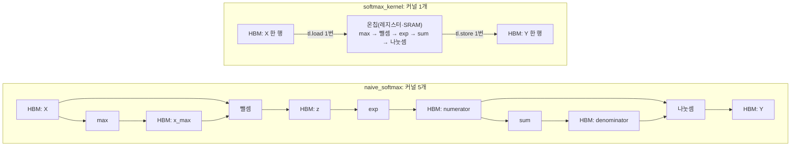

# 6주차 정리: Python에서 Triton 커널로

Triton 커널은 스레드 하나가 아니라 프로그램 인스턴스 하나가 데이터 블록 하나를 맡는다. 이번 주는 공식 튜토리얼의 Vector Add(1차원)와 Fused Softmax(2차원 행 단위)를 따라가면서, 블록 인덱싱과 마스크가 메모리 접근 범위를 어떻게 정하는지, 여러 연산을 한 커널로 묶으면 HBM 이동량이 얼마나 줄어드는지를 손으로 세고 RTX 5090에서 직접 재 보았다.

## 개념 정리

### 메모리 접근 정렬 (memory coalescing)

GPU는 메모리 명령을 스레드 하나씩이 아니라 워프(32개 스레드) 단위로 실행한다. 워프가 load 명령 하나를 실행하면 하드웨어가 32개 스레드의 주소를 모은다. 그리고 그 주소가 걸친 32 B 단위(섹터)만큼 메모리에서 가져온다. 이웃한 스레드가 이웃한 주소를 읽으면 요청 몇 개로 끝나고, 가져온 바이트를 모두 쓴다. 이것이 정렬된(coalesced) 접근이다.

```
메모리: FP32 한 칸 = 4 B, 섹터 하나 = 8칸 = 32 B (워프 32개 스레드 중 앞부분만 그림)

① 연속: 스레드 t가 x[t]를 읽음
섹터    │ 0                       │ 1                       │ 2 ...
원소    │ 0  1  2  3  4  5  6  7  │ 8  9  10 11 12 13 14 15 │
스레드  │ t0 t1 t2 t3 t4 t5 t6 t7 │ t8 t9 t10 ...           │
        → 워프 전체가 섹터 4개. 가져온 칸을 모두 쓴다

② 간격 2: 스레드 t가 x[2t]를 읽음
섹터    │ 0                       │ 1                       │ 2 ...
원소    │ 0  1  2  3  4  5  6  7  │ 8  9  10 11 12 13 14 15 │
스레드  │ t0 ·  t1 ·  t2 ·  t3 ·  │ t4 ·  t5 ·  t6 ·  t7 ·  │
        → 워프 전체가 섹터 8개. 절반(·)은 가져왔지만 버린다

③ 간격 8: 스레드 t가 x[8t]를 읽음
섹터    │ 0                       │ 1                       │ 2 ...
원소    │ 0  1  2  3  4  5  6  7  │ 8  9  10 11 12 13 14 15 │
스레드  │ t0 ·  ·  ·  ·  ·  ·  ·  │ t1 ·  ·  ·  ·  ·  ·  ·  │
        → 워프 전체가 섹터 32개. 8칸 중 1칸만 쓴다
```

| 워프 32개 스레드의 FP32 접근 | 건드리는 32 B 섹터 | 가져온 바이트 중 실제로 쓰는 비율 |
|---|---|---|
| 연속 (`x[i]`) | 4개 (128 B) | 100% |
| 간격 2 (`x[2i]`) | 8개 | 50% |
| 간격 4 (`x[4i]`) | 16개 | 25% |
| 간격 8 이상 (`x[8i]`, 열 방향 접근 등) | 32개 | 12.5% |

간격이 벌어지면 같은 양의 데이터를 쓰는데도 메모리에서 가져오는 바이트가 최대 8배까지 늘어난다. memory-bound 커널에서는 그만큼 느려진다.

### Shared Memory 뱅크 충돌 (bank conflict)

Shared Memory는 4 B 폭의 뱅크 32개로 나뉘고, 주소 a는 뱅크 (a ÷ 4) mod 32에 있다. 워프의 스레드들이 같은 뱅크의 서로 다른 주소를 건드리면 그 수만큼 나눠 처리한다(n-way 충돌).

```
FP32 타일 tile[32][32]: 한 행 = 128 B = 뱅크 0~31 한 바퀴

          뱅크 0    뱅크 1    ...  뱅크 31
행 0      [0][0]    [0][1]    ...  [0][31]
행 1      [1][0]    [1][1]    ...  [1][31]
...
행 31     [31][0]   [31][1]   ...  [31][31]

① 행 읽기 tile[r][t]: 스레드 t → 뱅크 t → 1번에 처리
② 열 읽기 tile[t][c]: 모든 스레드 → 뱅크 c → 32번에 처리 (32-way 충돌)
③ 패딩 tile[32][33]: 뱅크 = (t + c) mod 32 → 흩어짐
④ 스위즐: (r, c)를 열 c XOR r 자리에 저장 → 흩어짐, 낭비 없음
```

matmul처럼 행으로 읽어 올리고 열로 읽는 커널에서 ②가 생긴다.

## 실험 조건

| 항목 | 값 |
|---|---|
| GPU | NVIDIA GeForce RTX 5090 (SM 170개, GDDR7 1792 GB/s, L2 96 MB, 블록당 Shared Memory 최대 101,376 B) |
| 소프트웨어 | 드라이버 595.99.02, PyTorch 2.9.0+cu130 (CUDA 13.0), Triton 3.5.0, Nsight Compute (CUDA 13.0) |
| 코드 | Triton `release/3.5.x` 튜토리얼 `01-vector-add.py`, `02-fused-softmax.py`의 커널을 그대로 사용 |
| 입력 | Softmax: FP32 [1823, 781] (정확도), [4096, 1024] (공통 예제), [65536, 1024] (L2보다 큰 경우). Vector Add: FP32 길이 98,432 ~ 2²⁸ |
| BLOCK_SIZE | Vector Add 1024 (`num_warps` 4), Softmax `next_power_of_2(N)` = 1024 (`num_warps` 8) |
| 측정 범위 | `triton.testing.do_bench`의 중앙값. GPU 이벤트 사이 시간이고, 매 반복 전에 L2를 비운다(5절) |
| CPU 해석기 | 인덱싱·마스크 확인에만 `TRITON_INTERPRET=1` 사용 |

## 1. 블록 단위 프로그래밍 모델: 스레드가 아니라 블록으로 생각하기

| | CUDA | Triton |
|---|---|---|
| 프로그래머가 쓰는 단위 | 스레드 하나 (스칼라 프로그램) | 프로그램 인스턴스 하나 (블록 프로그램) |
| 내 위치 | `blockIdx.x * blockDim.x + threadIdx.x` → 원소 1개 | `tl.program_id(0) * BLOCK_SIZE + tl.arange(0, BLOCK_SIZE)` → 원소 `BLOCK_SIZE`개 |
| 블록 안 스레드 배치 | 프로그래머가 `blockDim`으로 정함 | 컴파일러가 정함 (프로그래머는 `num_warps`로 워프 수만 정함) |
| 메모리 접근 패턴: 정렬(coalescing), 벡터 로드, 뱅크 충돌 회피(스위즐) | 프로그래머가 인덱스를 잘 짜고 패딩·스위즐을 직접 넣음 | 컴파일러가 레이아웃(`#blocked`, `#swizzled_shared`)을 골라 처리 |
| Shared Memory 할당, 동기화 | 프로그래머가 `__shared__`, `__syncthreads()` | 컴파일러가 처리 |

같은 Vector Add를 비교하면 CUDA 커널 본문은 `if (i < n) z[i] = x[i] + y[i];`처럼 원소 하나를 다룬다. Triton 커널 본문은 `x = tl.load(x_ptr + offsets, mask=mask)`처럼 원소 묶음(블록) 하나를 다룬다. 블록 안의 원소를 어떤 스레드가 맡을지는 Triton 컴파일러가 정한다.

**길이 N = 10, BLOCK_SIZE = 4일 때.** `grid = (triton.cdiv(10, 4), ) = (3, )`이므로 프로그램 인스턴스 3개가 뜬다.

```
원소 인덱스   0  1  2  3 | 4  5  6  7 | 8  9  10 11
             ──────────── ──────────── ────────────
pid          0            1            2
mask         T  T  T  T   T  T  T  T   T  T  F  F
                                            └─┴─ 범위 밖: 읽지도 쓰지도 않음
```

CPU 해석기에서 커널 안에 `print`를 넣어 찍어 본 offsets와 mask도 그림과 같았다.

**스레드 배치는 누가 정하나.** Vector Add를 BLOCK_SIZE = 1024로 컴파일한 뒤 TTGIR과 PTX를 열어 보면, 프로그래머가 쓰지 않은 배치를 컴파일러가 정해 둔 것이 보인다.

```
#blocked = #ttg.blocked<{sizePerThread = [4], threadsPerWarp = [32], warpsPerCTA = [4], order = [0]}>
PTX: ld.global.v4.b32 × 4, st.global.v4.b32 × 2
```

스레드 하나가 연속한 원소 4개(16 B)를 맡고, 32개 스레드가 한 워프, 4개 워프가 한 블록이다. 128개 스레드가 512개 원소를 덮으니, 원소 1024개짜리 블록은 스레드마다 두 번에 나눠 맡는다. 이웃한 스레드가 이웃한 16 B를 읽으므로 접근이 정렬되고, 128비트 벡터 로드(`v4`)로 나간다.

**Triton에서 정렬은 누가 맡나.** 컴파일러는 포인터 블록에서 메모리가 연속인 방향을 찾아 이웃 스레드에 이웃 원소를 배정하고 벡터 로드를 고른다. 하지만 `x_ptr + offsets * 8`처럼 포인터 자체가 띄엄띄엄이면 고칠 수 없어 스칼라 로드(`ld.global.b32`)로 나간다. 어느 축을 연속으로 읽을지는 여전히 프로그래머 몫이다. Softmax는 행 방향이 연속이라 한 행을 `row_start_ptr + tl.arange(0, BLOCK_SIZE)`로 읽으면 정렬된다.

**뱅크 충돌은 누가 맡나.** 컴파일러다. 작은 matmul 커널(`tl.dot`, FP16, 타일 128 × 128 × 32)의 TTGIR을 보면, 코드에 없는 Shared Memory 타일에 스위즐 레이아웃이 붙어 있다.

```
#shared  = #ttg.swizzled_shared<{vec = 8, perPhase = 2, maxPhase = 4, order = [1, 0]}>   ← A 타일 [128, 32]
#shared1 = #ttg.swizzled_shared<{vec = 8, perPhase = 1, maxPhase = 8, order = [1, 0]}>   ← B 타일 [32, 128]
PTX: cp.async × 24, ldmatrix × 16, mma.sync × 64
```

FP16 8개(16 B, `vec`) 덩어리의 열 위치를 행 번호에 따라 XOR로 섞는다(개념 정리의 ④). `perPhase`는 몇 행마다 패턴이 바뀌는지, `maxPhase`는 패턴 수다. Nsight Compute로 잰 Shared Memory 뱅크 충돌 수는 0이었다.

## 2. 포인터 연산과 마스킹: 크기가 나누어떨어지지 않으면

튜토리얼 01의 Vector Add 코드로 시작한다. 이 절에서 보는 것은 주석에 ①~④로 표시한 부분이다.

```python
@triton.jit
def add_kernel(x_ptr, y_ptr, output_ptr,    # ① 텐서를 넘겼는데 이름이 _ptr: 무엇을 받나
               n_elements,                  # ② 길이를 따로 받는 이유
               BLOCK_SIZE: tl.constexpr):   # ④ 왜 constexpr인가
    pid = tl.program_id(axis=0)
    block_start = pid * BLOCK_SIZE
    offsets = block_start + tl.arange(0, BLOCK_SIZE)   # ③ 포인터 블록 만들기
    mask = offsets < n_elements                         # ③ 범위 밖 막기
    x = tl.load(x_ptr + offsets, mask=mask)
    y = tl.load(y_ptr + offsets, mask=mask)
    output = x + y
    tl.store(output_ptr + offsets, output, mask=mask)

def add(x: torch.Tensor, y: torch.Tensor):
    output = torch.empty_like(x)
    n_elements = output.numel()
    grid = lambda meta: (triton.cdiv(n_elements, meta['BLOCK_SIZE']), )
    add_kernel[grid](x, y, output, n_elements, BLOCK_SIZE=1024)   # Python 쪽 호출: 텐서를 그대로 넘긴다
    return output
```

**① 커널이 받는 것.** 호출하는 쪽은 텐서를 그대로 넘기는데 커널 쪽 인자 이름은 `x_ptr`다. Triton이 인자를 종류별로 바꿔서 넘기기 때문이다.

| Python 인자 | 커널이 받는 것 | 컴파일된 코드(TTIR)에 적힌 타입 |
|---|---|---|
| `x` (`torch.Tensor`, FP32) | 첫 원소의 GPU 메모리 주소 하나 (`x.data_ptr()`) | `!tt.ptr<f32>`: FP32를 가리키는 포인터 |
| `n_elements` (Python `int`) | 32비트 정수 | `i32` |
| `BLOCK_SIZE=1024` (`tl.constexpr`) | 실행할 때는 넘어가지 않는다. 컴파일할 때 코드에 1024가 박혀 들어간다 | 인자 목록에 없음 |

텐서의 모양(shape), stride, 길이는 넘어가지 않는다. 커널이 아는 것은 "FP32 배열이 이 주소에서 시작한다"뿐이다.

**② 길이를 따로 받는 이유.** 포인터만으로는 배열이 어디서 끝나는지 모른다. 그래서 길이는 `n_elements`로 따로 넘기고, 2차원이면 행 간격도 `stride`로 따로 넘긴다(4절).

Triton은 인자를 넘기면서 포인터 주소와 정수 인자가 16의 배수인지도 확인하고, 그렇다면 컴파일러에 표시를 붙인다. 이 표시는 TTIR에서 `def add_kernel(...)` 줄에 해당하는 부분에 보인다.

```
x_ptr: !tt.ptr<f32> {tt.divisibility = 16}   ← 주소가 16의 배수
n_elements: i32 {tt.divisibility = 16}       ← n_elements = 98432 (16의 배수)일 때
n_elements: i32                              ← n_elements = 10일 때: 표시 없음
```

이 표시가 성능을 바꾼다. 스레드 하나가 원소 4개(16 B)를 명령 하나로 읽으려면(`v4` 로드) 그 4개가 마스크에 반쯤 잘리지 않아야 한다. `n_elements`가 16의 배수이면 4개 묶음과 텐서 끝의 경계가 항상 맞아서 묶음 단위로 읽으면 된다. 그렇지 않으면 원소 하나씩 마스크를 따져 읽는다. 같은 Vector Add 커널(BLOCK_SIZE = 1024)의 PTX를 길이만 바꿔 비교했다.

| `n_elements` | 16으로 나눈 나머지 | PTX 로드 | 스레드당 로드 명령 수 |
|---|---|---|---|
| 98,432 | 0 | `ld.global.v4.b32` (16 B씩) | 4 |
| 98,430 | 14 | `ld.global.b32` (4 B씩) | 16 |
| 10 | 10 | `ld.global.b32` (4 B씩) | 16 |

길이가 2만 달라도 다른 커널이 컴파일되고 로드 명령이 4배가 된다.

**③ 포인터 블록과 마스크.** 1절의 N = 10, BLOCK_SIZE = 4 예에서 마지막 프로그램(pid = 2)이 하는 일을 한 줄씩 풀면 이렇다. 주소는 예시 값이다.

```
x_ptr                         = 0x7f000000                       (x[0]의 주소)
offsets = 2 * 4 + arange(0,4) = [8, 9, 10, 11]                   (정수 벡터)
x_ptr + offsets               = [0x7f000020, 0x7f000024,
                                 0x7f000028, 0x7f00002c]         (주소 벡터, 4 B씩 증가)
mask = offsets < 10           = [T, T, F, F]
tl.load(x_ptr + offsets, mask=mask)
                              = [x[8], x[9], ?, ?]               (F 칸은 메모리를 읽지 않음)
```

- 포인터에 정수 벡터를 더하면 주소 벡터(포인터 블록)가 된다. 더하는 단위는 원소 하나라서 FP32에서 `x_ptr + 1`은 4 B 뒤다.
- `tl.load`와 `tl.store`는 마스크가 `F`인 칸에 접근하지 않는다. 마스크가 없으면 텐서 밖 `x[10]`, `x[11]` 자리를 읽고 써서 다른 텐서를 덮어쓰거나 illegal memory access가 난다.

**④ BLOCK_SIZE가 컴파일 시점 상수여야 하는 이유.** Triton에서 블록은 레지스터에 올리는 배열이다. 컴파일러는 `tl.arange(0, BLOCK_SIZE)`의 길이를 알아야 배열을 스레드에 나누고(1절의 스레드당 4개, 128개 스레드, 2번 반복) 레지스터 수와 벡터 로드 횟수를 정할 수 있다. 그래서 `tl.constexpr`로 받아 값을 코드에 박아 넣는다. 빼고 부르면 다음 오류가 난다.

```
CompilationError: arange's arguments must be of type tl.constexpr
```

대신 BLOCK_SIZE 값마다 커널이 따로 컴파일된다.

## 3. 커널 결합과 HBM 왕복: 왜 덧셈보다 Softmax에서 차이가 커지나

`x + y`는 이동량이 이미 최소(3N 원소)라 묶을 연산이 없고, Triton으로 짜도 PyTorch와 속도가 같다(5절). Softmax는 다섯 단계로 나뉘어 단계마다 중간 텐서를 HBM에 썼다가 다시 읽으므로 결합으로 없앨 왕복이 많다.

**naive_softmax의 단계별 HBM 이동 (원소 수, X는 [M, N])**

| 단계 | 연산 | 읽기 | 쓰기 |
|---|---|---|---|
| 1 | `x_max = x.max(dim=1)[0]` | MN | M |
| 2 | `z = x - x_max[:, None]` | MN + M | MN |
| 3 | `numerator = torch.exp(z)` | MN | MN |
| 4 | `denominator = numerator.sum(dim=1)` | MN | M |
| 5 | `numerator / denominator[:, None]` | MN + M | MN |
| 합계 | 커널 5개 | 5MN + 2M | 3MN + 2M |
| **결합 커널** | `softmax_kernel` 1개 | **MN** | **MN** |

naive는 합계 8MN + 4M(근사 8MN), 결합 커널은 2MN이다. X를 한 번 더 읽는 것(MN), 중간 텐서 z와 numerator를 쓰고(2MN) 다시 읽는 것(3MN)을 합한 6MN이 사라진다.



### 공통 예제 손 계산: M = 4096, N = 1024, FP32, 가상 하드웨어

가정은 연산 성능 20 × 10¹² FLOP/s, HBM 대역폭 1 × 10¹² B/s이고, 커널 사이 캐시 적중은 없다. FLOP은 원소당 max 비교, 뺄셈, exp, 합, 나눗셈을 1회씩 쳐서 5MN으로 셌다.

| 항목 | naive_softmax | 결합 커널 |
|---|---|---|
| 이동 원소 수 | 8MN + 4M = 33,570,816 | 2MN = 8,388,608 |
| 이동량 Q | 134,283,264 B (≈ 134.3 MB) | 33,554,432 B (≈ 33.6 MB) |
| 연산량 F | 5MN = 20,971,520 FLOP | 같음 |
| 산술 강도 I = F/Q | 0.156 FLOP/B | 0.625 FLOP/B |
| 메모리 시간 Q ÷ 1 TB/s | 134.3 µs | 33.6 µs |
| 연산 시간 F ÷ 20 TFLOP/s | 1.05 µs | 1.05 µs |
| 이론 시간 (둘 중 큰 값) | 134.3 µs | 33.6 µs |
| 속도 향상 | 1 | **4.0배** |

- 가상 하드웨어의 꺾이는 점(ridge point)은 20 ÷ 1 = 20 FLOP/B다. 두 경로 모두 I가 20보다 훨씬 작아서 메모리가 시간을 정한다. 결합은 F를 그대로 두고 Q를 1/4로 줄여 I를 4배로 올린다.
- 한 행을 온칩에 올리는 데 필요한 크기는 1024 × 4 B = 4 KiB다. RTX 5090에서 컴파일된 `softmax_kernel`의 Shared Memory 사용량은 4128 B였다.
- 튜토리얼 벤치마크는 실효 대역폭을 `2 × M × N × 4 B ÷ 시간`으로 계산한다. 분자는 실제로 옮긴 양이 아니라 Softmax에 꼭 필요한 이동량(X 한 번 읽기, Y 한 번 쓰기)이다. 모든 경로에 같은 분자를 쓰므로 GB/s가 곧 같은 일을 얼마나 빨리 끝냈는지가 된다.

## 4. 행 단위 리덕션과 패딩값: 한 행을 블록 하나에 안전하게 담으려면

**행의 시작 주소.** 행 r의 시작은 `input_ptr + r * input_row_stride`다. 연속 텐서에서는 stride가 N이지만 잘라 낸 뷰에서는 다를 수 있어서 따로 넘긴다. 여기에 `tl.arange(0, BLOCK_SIZE)`를 더하면 한 행의 포인터 블록이 된다.

**BLOCK_SIZE = next_power_of_2(N)인 이유.** 이 커널은 한 행 전체를 블록 하나에 담아 `tl.max`, `tl.sum`을 구하므로 BLOCK_SIZE가 N 이상이어야 한다. `tl.arange`의 길이는 2의 거듭제곱이어야 해서 N 이상인 가장 작은 2의 거듭제곱을 고른다. N = 781이면 1024이고, 뒤쪽 243칸은 마스크로 막는다.

**빈칸을 0이 아니라 -inf로 채우는 이유.** 막힌 칸에는 `other` 값이 들어가고, 그 값이 `tl.max`와 `tl.sum`에 그대로 참여한다. 길이 781, 원소가 모두 음수(−6 ~ −1)인 행 하나를 BLOCK_SIZE = 1024로 읽어 비교했다.

| `other` | `tl.max` | `tl.sum(tl.exp(row - max))` | softmax 행 합 | `torch.softmax`와 최대 오차 |
|---|---|---|---|---|
| `-inf` | −1.0062 (참값과 같음) | 159.8928 (참값과 같음) | 1.0000 | 1.4 × 10⁻⁹ |
| `0.0` | **0.0000** | **301.4589** | **0.1939** | 5.0 × 10⁻³ |

0으로 채우면 빈칸 243개가 가장 큰 값이 되어 max가 0이 되고, 빈칸마다 exp(0) = 1이 합에 더해진다. 실제 exp 합 58.46에 243이 더해져 301.46이 되고, 행의 합이 0.19가 된다. −inf는 max에 영향이 없고 exp(−inf) = 0이라 합에도 영향이 없다. 리덕션마다 항등원을 넣으면 된다(max는 −inf, sum은 0).

**N이 커지면 생기는 제약.** 한 행이 통째로 온칩에 있어야 하므로 행이 길수록 레지스터와 Shared Memory를 많이 쓴다. 입력 크기를 약 268 MB로 고정하고 N만 늘려 보았다.

| N | BLOCK_SIZE | 스레드당 레지스터 | Shared Memory | SM당 동시 프로그램 | Triton GB/s | `torch.softmax` GB/s |
|---|---|---|---|---|---|---|
| 1,024 | 1,024 | 27 | 4,128 B | 9 | 1425 | 1505 |
| 4,096 | 4,096 | 36 | 16,416 B | 6 | 1439 | 1524 |
| 16,384 | 16,384 | 101 | 65,568 B | 1 | 1439 | 1507 |
| 32,768 | 32,768 | – | 필요 131,104 B > 한도 101,376 B | – | **컴파일 실패** | 1500 |
| 65,536 | 65,536 | – | – | – | 컴파일 실패 | 1186 |

N = 16,384까지는 SM당 동시 프로그램 수가 9 → 1로 줄어도 대역폭을 유지했다. N = 32,768에서는 한 행(128 KiB)이 Shared Memory 한도를 넘어 `OutOfResources: shared memory`로 컴파일이 실패했다. 그보다 긴 행은 아래의 online softmax처럼 조각내 읽어야 한다.

튜토리얼 래퍼는 행마다 프로그램을 띄우지 않고 SM 수 × 동시 프로그램 수만큼만 띄운다(N = 1024에서 170 × 9 = 1530개). 각 프로그램은 `tl.range(row_start, n_rows, row_step)`로 여러 행을 차례로 처리한다. 9는 레지스터 한도에서 나온 값이다(65,536 ÷ (27 × 32 × 8) = 9.5).

**행이 안 들어갈 때: online softmax.** y_i = exp(x_i − m) / d를 쓰려면 행 전체의 최댓값 m과 합 d를 먼저 알아야 하므로, 행이 온칩에 안 들어가면 X를 여러 번 읽어야 한다. online softmax는 조각을 읽을 때마다 최댓값이 바뀐 만큼 지금까지의 합을 보정해(`d = d · exp(m − m_new) + Σ exp(x − m_new)`) max와 합을 한 패스에 구한다.

| 방식 | 조건 | X 읽기 횟수 | 이동량 (캐시 적중 없을 때, 원소 수) |
|---|---|---|---|
| 튜토리얼 커널 | 행이 온칩에 들어감 | 1 | 2MN |
| 3패스 (max → 합 → 정규화) | 행이 안 들어감 | 3 | 4MN |
| online softmax (max·합 → 정규화) | 행이 안 들어감 | 2 | 3MN |

최종 m과 d가 나와야 y_i를 쓸 수 있으므로 정규화 패스는 남는다. FlashAttention이 한 번에 끝나는 것은 softmax 결과를 바로 V와 곱해 누산하고 마지막에 누산 결과만 d로 나누기 때문이다. 행이 온칩에 들어가는 경우에는 online 방식으로 바꿔도 이동량은 2MN 그대로다.

## 5. 정확도 검증과 벤치마크: 무엇을 확인하고 어느 시간을 재나

**Python 함수가 끝나도 GPU는 아직 계산 중이다.** 커널 실행은 비동기라 Python은 실행 명령을 큐에 넣고 바로 돌아온다. 그래서 시간은 GPU 이벤트나 동기화 뒤에 재야 한다. M = 65536 Softmax에서 쟀다.

```python
t0 = time.perf_counter()
softmax(x)                  # 실행 명령만 큐에 넣고 돌아온다
t1 = time.perf_counter()    # t1 - t0 = 10.8 µs: 호출이 돌아온 시간
torch.cuda.synchronize()    # GPU가 끝날 때까지 기다린다
t2 = time.perf_counter()    # t2 - t0 = 374 µs: 계산이 끝난 시간
```

**첫 호출은 따로 뺀다.** 첫 호출은 JIT 컴파일 때문에 길다. 캐시 디렉터리를 비운 새 프로세스에서 아래 함수로 쟀다.

```python
def first_call_ms(fn):
    torch.cuda.synchronize()
    t0 = time.perf_counter()
    fn()                                # 첫 호출: 컴파일 + 실행
    torch.cuda.synchronize()
    return (time.perf_counter() - t0) * 1e3
```

| 경로 | 첫 호출 | 두 번째 호출 (동기화 포함) |
|---|---|---|
| Triton add | 285 ms | 0.07 ms |
| Triton softmax | 110 ms | 0.39 ms |
| `torch.compile(naive_softmax)` | 271 ms | 0.42 ms |

**`do_bench` 사용법.** 잴 함수를 인자 없는 함수로 감싸 넘기면 ms 단위 시간이 돌아온다.

```python
ms = triton.testing.do_bench(lambda: softmax(x))                         # 평균
ms = triton.testing.do_bench(lambda: softmax(x), return_mode="median")   # 이 글의 표
med, p20, p80 = triton.testing.do_bench(lambda: softmax(x), quantiles=[0.5, 0.2, 0.8])
```

| 인자 | 기본값 | 뜻 |
|---|---|---|
| `fn` | – | 잴 함수. 인자를 받지 않아야 해서 `lambda`로 감싼다 |
| `warmup` | 25 | 워밍업에 쓸 시간(ms). 횟수가 아니다 |
| `rep` | 100 | 측정에 쓸 시간(ms). 반복 횟수는 1회 시간으로 나눠 정한다 |
| `return_mode` | `"mean"` | `"min"`, `"max"`, `"mean"`, `"median"`, `"all"`(전체 리스트) |
| `quantiles` | `None` | 분위수 목록. 주면 `return_mode` 대신 이 값들을 돌려준다 |
| `grad_to_none` | `None` | backward를 잴 때 반복마다 `.grad`를 지울 텐서 목록 |

**`do_bench`가 하는 일.** Triton 3.5 소스에서 `grad_to_none`과 `quantiles` 처리를 빼고 줄이면 아래와 같다. docstring은 중앙값을 돌려준다고 하지만 기본값은 평균이고, 이 글의 표는 `return_mode="median"`으로 받은 값이다.

```python
def do_bench(fn, warmup=25, rep=100, return_mode="mean"):
    fn(); synchronize()                                   # 첫 호출(컴파일)을 먼저 끝낸다
    cache = get_empty_cache_for_benchmark()               # 256 MB 버퍼
    start.record()
    for _ in range(5):                                    # 5번 돌려 1회 시간을 추정
        clear_cache(cache); fn()
    end.record(); synchronize()
    estimate_ms = start.elapsed_time(end) / 5
    n_warmup = max(1, int(warmup / estimate_ms))          # 25 ms ÷ 1회 시간
    n_repeat = max(1, int(rep / estimate_ms))             # 100 ms ÷ 1회 시간
    for _ in range(n_warmup):
        fn()
    for i in range(n_repeat):
        clear_cache(cache)                                # 버퍼를 0으로 채워 L2 비우기 (이벤트 밖)
        starts[i].record(); fn(); ends[i].record()
    synchronize()
    times = [s.elapsed_time(e) for s, e in zip(starts, ends)]
    return summarize(times, return_mode)
```

**정확도부터 확인한다.** 1823 × 781처럼 2의 거듭제곱이 아닌 크기를 써야 행 끝의 마스크와 `other`가 실제로 쓰인다. 4096 × 1024처럼 딱 맞는 크기에서는 마스크가 틀려도 결과가 맞을 수 있다.

```python
x = torch.randn(1823, 781, device="cuda")
ref = torch.softmax(x.double(), dim=-1).float()   # FP64로 구한 참값
y = softmax(x)
torch.allclose(y, torch.softmax(x, dim=-1))        # 기본값 rtol=1e-5, atol=1e-8
(y - ref).abs().max()                              # 참값과 최대 절대 오차
```

naive_softmax, `torch.softmax`, Triton softmax, `torch.compile(naive_softmax)` 네 경로 모두 `allclose`가 True였고, FP64 참값과 최대 오차는 모두 7.5 × 10⁻⁹였다.

**실효 대역폭.** `GB/s = 필수 이동 Byte ÷ 실행 시간`이다. Softmax는 2MN × 4 B, Vector Add는 3N × 4 B다. 아래 표의 커널 수는 profiler에 잡힌 GPU 이벤트 수다.

```python
ms = triton.testing.do_bench(lambda: softmax(x), return_mode="median")
gbps = 2 * M * N * 4 * 1e-9 / (ms * 1e-3)          # 필수 이동 Byte ÷ 시간

with torch.profiler.profile(activities=[ProfilerActivity.CUDA]) as p:
    softmax(x); torch.cuda.synchronize()
kernels = [e.name for e in p.events() if e.device_type == DeviceType.CUDA]
```

### Softmax 실측 (FP32, `do_bench` 중앙값)

| 경로 | 커널 수 | [4096, 1024] 시간 | GB/s | [65536, 1024] 시간 | GB/s |
|---|---|---|---|---|---|
| naive_softmax | 5 | 36.9 µs | 910 | 1350 µs | 398 |
| `torch.softmax` | 1 (`softmax_warp_forward`) | 12.5 µs | 2675 | 340 µs | 1580 |
| Triton softmax (튜토리얼) | 1 (`softmax_kernel`) | **10.5 µs** | **3197** | 367 µs | 1463 |
| `torch.compile(naive_softmax)` | 1 (`triton_red_fused_div_exp_max_sub_sum_unsqueeze_0`) | 12.5 µs | 2675 | 352 µs | 1524 |

- `torch.compile`은 naive의 다섯 단계를 Triton 리덕션 커널 하나로 묶었고, 튜토리얼 커널과 속도가 비슷하다.
- naive → 결합 속도 향상은 [4096, 1024]에서 3.5배, [65536, 1024]에서 3.7배로 손 계산의 4.0배에 가깝다.
- [4096, 1024]에서 Triton의 3197 GB/s는 HBM 사양 1792 GB/s보다 크다. 이유는 6절에서 본다.

### Vector Add 실측 (FP32, `do_bench` 중앙값)

| N | 필수 이동량 | Triton | `x + y` | Triton GB/s | `x + y` GB/s |
|---|---|---|---|---|---|
| 98,432 | 1.18 MB | 3.8 µs | 4.4 µs | 308 | 271 |
| 2²⁰ | 12.6 MB | 10.0 µs | 10.5 µs | 1260 | 1199 |
| 2²⁴ | 201 MB | 131 µs | 131 µs | 1533 | 1539 |
| 2²⁸ | 3221 MB | 2051 µs | 2051 µs | 1571 | 1571 |

Vector Add는 Triton과 PyTorch가 같았다. 크기가 클 때 1571 GB/s(사양의 88%)이고, 작은 크기에서는 커널을 띄우는 고정 비용이 대부분이라 GB/s가 낮다.

## 6. 손 계산과 실측 비교: 커널 사이 캐시 적중이 없다는 가정

손 계산을 RTX 5090 사양(1792 GB/s)으로 다시 하면 이론 시간은 다음과 같다.

| 크기 | 경로 | 이론 시간 (Q ÷ 1792 GB/s) | 실측 | 실측 ÷ 이론 |
|---|---|---|---|---|
| [4096, 1024] (16.8 MB) | naive | 74.9 µs | 36.9 µs | **0.49** |
| | 결합 (Triton) | 18.7 µs | 10.5 µs | **0.56** |
| [65536, 1024] (268 MB) | naive | 1199 µs | 1350 µs | 1.13 |
| | 결합 (Triton) | 300 µs | 367 µs | 1.22 |
| | `torch.softmax` | 300 µs | 340 µs | 1.13 |

[4096, 1024]는 이론보다 빨랐다. 행렬 하나가 16.8 MB라 5090의 L2(96 MB)에 통째로 들어가서, "커널 사이 캐시 적중 없음" 가정이 맞지 않는다. Nsight Compute로 실제 DRAM 읽기·쓰기 바이트를 세어 확인했다.

| 조건 | 경로 | DRAM 읽기 | DRAM 쓰기 | 합 | 모델 (8MN+4M 또는 2MN) × 4 B |
|---|---|---|---|---|---|
| [4096, 1024], 커널마다 L2 비움 (`--cache-control all`) | naive 커널 5개 | 커널마다 16.8 MB | 0 MB | 84.1 MB | 134.3 MB |
| | 결합 | 16.8 MB | 0 MB | 16.8 MB | 33.6 MB |
| [4096, 1024], L2 그대로 (`--cache-control none`) | naive 커널 5개 | 0 MB | 26.1 MB | 26.1 MB | 134.3 MB |
| [65536, 1024], L2 그대로 | naive 커널 5개 | 1308 MB | 788 MB | **2096 MB** | 2149 MB |
| | 결합 | 269 MB | 270 MB | **538 MB** | 537 MB |

- **L2보다 큰 [65536, 1024]에서는 손 계산이 맞았다.** 실제 이동량은 naive가 모델의 98%, 결합 커널이 100%였다. 이동량 비율 3.9배, 시간 비율 3.7배다.
- **L2에 들어가는 [4096, 1024]에서는 L2를 비워도 쓰기가 HBM까지 가지 않는다.** 각 커널은 입력 16.8 MB만 DRAM에서 읽고, 출력은 write-back L2에 남긴 채 끝난다. Triton 결합 커널의 10.5 µs는 X를 한 번 읽는 시간(16.8 MB ÷ 1792 GB/s = 9.4 µs)에 가깝고, 그래서 실효 대역폭이 사양보다 큰 3197 GB/s로 나왔다.
- **그래도 naive는 3.5배 느렸다.** 첫 커널만 X를 DRAM에서 읽고 나머지 네 커널은 L2에서 읽고 쓴다. 이 크기에서 결합의 이득은 HBM 이동량이 아니라 L2 왕복과 커널 수에서 나온다.
- 실효 대역폭을 HBM 성능으로 읽으려면 입력이 L2보다 커야 한다. [65536, 1024]에서 Triton 커널은 사양의 82%, `torch.softmax`는 88%였다.

## 참고 자료

- [Triton Programming Guide 1장: Introduction](https://triton-lang.org/main/programming-guide/chapter-1/introduction.html#motivations) — Motivations의 CUDA / Triton 프로그래밍 모델 비교 코드, Challenges는 훑어봄
- [CUDA Programming Guide: Thread Blocks and Grids](https://docs.nvidia.com/cuda/cuda-programming-guide/01-introduction/programming-model.html#thread-blocks-and-grids)
- [Triton Tutorial 01: Vector Addition](https://triton-lang.org/main/getting-started/tutorials/01-vector-add.html#compute-kernel) — Compute Kernel, Benchmark
- [Triton Tutorial 02: Fused Softmax](https://triton-lang.org/main/getting-started/tutorials/02-fused-softmax.html#motivations) — Motivations, Compute Kernel, Unit Test, Benchmark
- 튜토리얼 소스: [`python/tutorials` (release/3.5.x)](https://github.com/triton-lang/triton/tree/release/3.5.x/python/tutorials)
- [Triton Semantics: Differences with NumPy](https://triton-lang.org/main/python-api/triton-semantics.html#differences-with-numpy)
- Triton API: [`triton.jit`](https://triton-lang.org/main/python-api/generated/triton.jit.html), [`tl.arange`](https://triton-lang.org/main/python-api/generated/triton.language.arange.html), [`tl.load`](https://triton-lang.org/main/python-api/generated/triton.language.load.html), [`tl.store`](https://triton-lang.org/main/python-api/generated/triton.language.store.html), [`triton.testing.do_bench`](https://triton-lang.org/main/python-api/generated/triton.testing.do_bench.html)
- [Triton 디버깅 가이드: CPU 해석기](https://triton-lang.org/main/programming-guide/chapter-3/debugging.html#using-the-interpreter)
- [Modern GPU Programming: Optimizing Memory-Bound Kernels](https://mlc.ai/modern-gpu-programming-for-mlsys/chapter_performance/index.html#optimizing-memory-bound-kernels) — 첫 설명
- [PyTorch: torch.compiler 개요](https://docs.pytorch.org/docs/stable/torch.compiler.html)
- [NVIDIA RTX Blackwell GPU Architecture 백서](https://images.nvidia.com/aem-dam/Solutions/geforce/blackwell/nvidia-rtx-blackwell-gpu-architecture.pdf) — RTX 5090 대역폭·L2 사양
