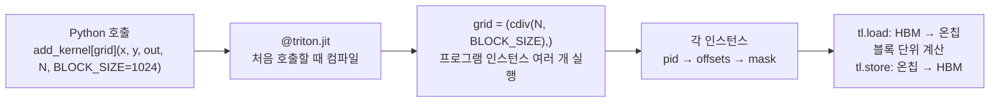
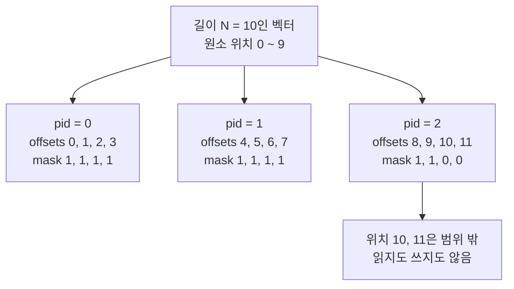
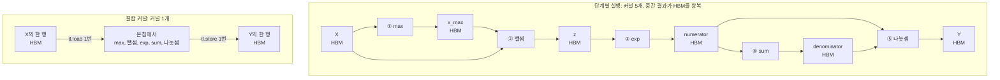
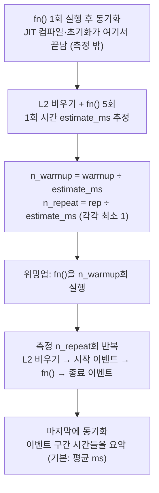
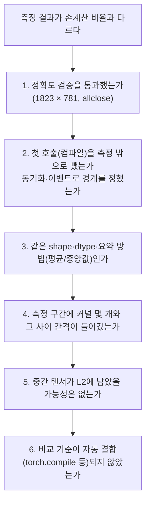

## Python에서 Triton 커널로 — 블록 단위로 읽고 한 번에 계산하기

> **6주차 핵심 질문**
> Python으로 작성한 Triton 커널은 데이터를 어떻게 블록 단위로 처리하며, 여러 연산을 한 커널로 묶으면 왜 빨라질까?

---

## 목차

1. [이번 주에 알아야 할 큰 그림](#1-이번-주에-알아야-할-큰-그림)
2. [공통 예제와 계산 조건](#2-공통-예제와-계산-조건)
3. [블록 단위 프로그래밍 모델 — 스레드가 아니라 블록으로 생각하기](#3-블록-단위-프로그래밍-모델--스레드가-아니라-블록으로-생각하기)
4. [포인터 연산과 마스킹 — 나누어떨어지지 않는 마지막 블록](#4-포인터-연산과-마스킹--나누어떨어지지-않는-마지막-블록)
5. [Vector Add는 왜 PyTorch와 속도가 비슷할까](#5-vector-add는-왜-pytorch와-속도가-비슷할까)
6. [커널 결합과 HBM 왕복 — Softmax에서 차이가 커지는 이유](#6-커널-결합과-hbm-왕복--softmax에서-차이가-커지는-이유)
7. [행 단위 리덕션과 패딩값 — 한 행을 블록 하나에 담기](#7-행-단위-리덕션과-패딩값--한-행을-블록-하나에-담기)
8. [공동 활동 — 블록 인덱싱과 Fused Softmax의 데이터 이동 비교](#8-공동-활동--블록-인덱싱과-fused-softmax의-데이터-이동-비교)
9. [정확도 검증과 벤치마크 — 무엇을 확인하고 어느 시간을 잴까](#9-정확도-검증과-벤치마크--무엇을-확인하고-어느-시간을-잴까)
10. [실습 참여 방법 — 무료 GPU와 CPU 해석기](#10-실습-참여-방법--무료-gpu와-cpu-해석기)
11. [선택 활동 — Python으로 계산표와 마스크 확인하기](#11-선택-활동--python으로-계산표와-마스크-확인하기)
12. [자주 생기는 오해와 측정 점검](#12-자주-생기는-오해와-측정-점검)
13. [연습문제 3개](#13-연습문제-3개)
14. [해답과 해설](#14-해답과-해설)
15. [스터디에서 설명하고 함께 점검하기](#15-스터디에서-설명하고-함께-점검하기)
16. [읽을 자료와 검증 범위](#16-읽을-자료와-검증-범위)

---

## 1. 이번 주에 알아야 할 큰 그림

### 1.1 손계산하던 이동량을 커널 코드에서 찾는다

3주차에는 Vector Add의 연산량 `F`와 HBM 이동량 `Q`를 세어 두 시간을 비교했다. 4주차에는 같은 `F`에서 `Q`를 줄이면 산술 강도 `I = F/Q`가 커지고 Roofline에서 성능 상한이 올라간다는 것을 확인했다. 5주차에는 같은 수학적 작업이 GPU·TPU·NPU에서 서로 다른 소프트웨어 경로를 거친다는 것과 측정 경계를 맞춰야 한다는 것을 살펴봤다.

이번 주에는 그 가운데 **GPU 커널 경로**로 들어가 실제 커널 코드를 읽는다. 손으로 세던 읽기·쓰기가 코드의 어느 줄에 있는지 찾고, 여러 연산을 한 커널로 묶었을 때 그 줄이 어떻게 줄어드는지 확인한다.

| 지난 주차의 개념 | 이번 주에 코드에서 찾을 곳 |
|---|---|
| HBM 읽기·쓰기 (3주차) | `tl.load`, `tl.store` |
| 커널 결합과 중간 텐서 (3·4주차) | `naive_softmax`의 다섯 줄과 `softmax_kernel` 하나 |
| 출력 타일과 블록 크기 (4주차) | `BLOCK_SIZE`, `tl.program_id`, `grid` |
| 타일 크기와 스레드 수의 구분 (4주차) | `BLOCK_SIZE`와 `num_warps` |
| 최초 1회 실행과 반복 실행, 측정 경계 (5주차) | `@triton.jit`의 첫 호출, `triton.testing.do_bench` |
| 근거 상태 표기 (5주차) | 손계산 / CPU 동작 확인 / 실측의 구분 |



이 도식은 Python 호출이 커널 실행으로 이어지는 순서만 나타낸다. 컴파일러 내부의 중간 표현과 단계는 7주차에서 다룬다.

### 1.2 이번 주의 범위

| 이번 주에 다루는 것 | 7주차로 넘기는 것 |
|---|---|
| 1차원 블록 인덱싱 (`pid`, `offsets`, `mask`) | 2차원 타일을 `tl.dot`으로 누적하는 Tiled MatMul |
| 포인터 블록과 마스킹, `tl.constexpr` | `TTIR → TTGIR → LLVM IR → PTX` 컴파일 과정 |
| 행 단위 리덕션(`tl.max`, `tl.sum`)과 패딩값 `other` | 자동 튜닝(`triton.autotune`)과 occupancy 계산 |
| 커널 결합 전후의 HBM 이동량 비교 | 프로파일러로 실제 HBM 트래픽 관찰 |
| 정확도 검증과 `do_bench` 측정, 유효 대역폭 | |

공통 과제는 튜토리얼 코드를 읽고 인덱싱·마스킹·HBM 이동량을 손으로 따라가는 것이다. GPU 실행은 선택 활동이며 장비가 없어도 이번 주의 목표를 모두 달성할 수 있다.

### 1.3 이번 주의 성공 기준

1. 길이 `N`과 `BLOCK_SIZE`가 주어지면 `grid` 크기와 각 `pid`의 `offsets`·`mask`를 표로 적을 수 있는가?
2. CUDA의 스레드 단위 코드와 Triton의 블록 단위 코드에서 개발자와 컴파일러가 각각 맡는 일을 구분할 수 있는가?
3. 포인터 블록 `x_ptr + offsets`의 의미와 `mask`·`other`의 역할, `BLOCK_SIZE`가 `tl.constexpr`여야 하는 이유를 설명할 수 있는가?
4. 단계별 Softmax와 결합 커널의 HBM 읽기·쓰기를 세고 이동량·산술 강도·이상적 시간을 비교할 수 있는가?
5. 빈자리를 `0`이 아니라 `-inf`로 채워야 하는 이유를 작은 숫자로 보일 수 있는가?
6. 최초 컴파일과 워밍업을 분리한 측정 방법과 튜토리얼식 유효 대역폭(`GB/s`)의 의미를 설명할 수 있는가?

---

## 2. 공통 예제와 계산 조건

### 2.1 1차원 예제 — Vector Add

$$
\mathrm{out}_i = x_i + y_i,\qquad 0 \le i < N
$$

| 텐서 | shape | 자료형 | 역할 |
|---|---|---|---|
| `x`, `y` | `[N]` | FP32 | 입력 |
| `out` | `[N]` | FP32 | 출력 |

3주차의 공통 예제와 같은 연산이다. 이번 주에는 이 연산을 `BLOCK_SIZE`개씩 나누어 맡기는 방법을 본다. 손으로 확인할 때는 `N = 10`, `BLOCK_SIZE = 4`를 쓴다.

### 2.2 2차원 예제 — 행 단위 Softmax

행렬 `X`의 shape를 `[M, N]`이라 하자. 각 행 `i`마다 독립적으로 Softmax를 계산한다.

$$
Y_{ij}=\frac{\exp\left(X_{ij}-m_i\right)}{\sum_{k=0}^{N-1}\exp\left(X_{ik}-m_i\right)},
\qquad m_i=\max_{0\le k<N}X_{ik}
$$

`m_i`를 빼도 결과는 같다. 분자와 분모에 같은 값 `exp(-m_i)`가 곱해지기 때문이다. 이렇게 빼 두면 `exp`에 들어가는 값이 0 이하가 되어 큰 입력에서 생기는 overflow를 막을 수 있다. 튜토리얼은 이를 수치적으로 안정화한(numerically stabilized) Softmax라고 부른다.

| 텐서 | shape | 자료형 | 역할 |
|---|---|---|---|
| `X` | `[M, N]` | FP32 | 입력 |
| `m` (`x_max`) | `[M]` | FP32 | 행별 최댓값 |
| 분모 (`denominator`) | `[M]` | FP32 | 행별 지수 합 |
| `Y` | `[M, N]` | FP32 | 출력 |

공동 활동의 계산 예제는 `M = 4096`, `N = 1024`다. 행렬 하나의 크기는 다음과 같다.

$$
4096 \times 1024 \times 4\ \mathrm{Byte} = 16{,}777{,}216\ \mathrm{Byte} \approx 16.78\ \mathrm{MB}
$$

정확도 확인에는 튜토리얼과 같은 `1823 × 781`을 쓴다. 행 수와 열 수가 모두 2의 거듭제곱이 아니어서 마스킹과 패딩이 실제로 동작하는지 확인할 수 있다.

### 2.3 기호와 단위

4·5주차의 기호를 그대로 쓴다.

| 기호 | 뜻 | 단위 |
|---|---|---|
| F | 수행하는 연산량 | FLOPs |
| Q | HBM에서 읽고 쓴 총 데이터량(누적 이동량) | Byte |
| P | 해당 FP32 연산에 적용 가능한 최대 처리율 | FLOPs/s |
| BW | HBM 대역폭 | Byte/s |
| I | HBM 기준 산술 강도 `F/Q` | FLOP/Byte |
| `R_roof` | 성능 상한 `min(P, BW × I)` | FLOPs/s |
| `T_compute`, `T_memory`, `T_ideal` | `F/P`, `Q/BW`, `max(F/P, Q/BW)` | s, ms, μs |

이번 주에 새로 쓰는 이름은 다음과 같다.

| 이름 | 뜻 |
|---|---|
| `BLOCK_SIZE` | 프로그램 인스턴스 하나가 한 번에 다루는 원소 수 |
| `grid` | 실행할 프로그램 인스턴스의 개수와 배치(1·2·3차원) |
| `pid` | `tl.program_id(axis)`가 돌려주는 현재 인스턴스의 번호 |
| `offsets` | 현재 인스턴스가 맡은 원소 위치들의 블록 |
| `mask` | 각 위치가 유효한 범위 안에 있는지 나타내는 참·거짓 블록 |
| `stride` | 다음 행으로 넘어가려면 포인터를 몇 원소만큼 옮겨야 하는지 |

단위는 `1 GB = 10⁹ Byte`, `1 KiB = 1024 Byte`, `1 μs = 10⁻⁶ s = 0.001 ms`다. 누적 이동량과 대역폭은 십진 단위로, 한 행이나 블록 같은 작은 버퍼는 이진 단위로 적는다.

### 2.4 공통 가상 하드웨어와 제외 항목

| 항목 | 이 교안의 가정 |
|---|---|
| 연산 성능 | `P = 20 × 10¹² FLOPs/s` (FP32) |
| HBM 대역폭 | `BW = 1 × 10¹² Byte/s` |
| 원소 크기 | FP32 1개 = 4 Byte |
| 입력·출력 위치 | 입력은 이미 장치 HBM에 있고 출력도 HBM에 남음 |
| 캐시 | 커널 사이의 캐시 적중 없음. 각 커널의 읽기·쓰기는 모두 HBM에 도달 |
| 결합 커널 | 한 행이 온칩에 들어가며 spill이 없음 |
| 실행 | 계산과 이동이 충분히 겹치고 병렬성이 충분함 |
| 제외 비용 | 컴파일, 커널 시작 비용, CPU↔GPU 복사, 메모리 할당 |

이 조건은 실제 제품의 사양이 아니라 계산을 위한 약속이다. 실제 GPU에서는 L2 캐시, 커널 시작 비용, 접근 효율 때문에 결과가 달라질 수 있으며 9·12절에서 그 차이를 읽는 방법을 다룬다.

---

## 3. 블록 단위 프로그래밍 모델 — 스레드가 아니라 블록으로 생각하기

### 3.1 CUDA는 스레드 하나의 일을 적는다

CUDA에서 커널을 시작하면 수많은 스레드가 같은 코드를 실행한다. 스레드는 thread block으로 묶이고 thread block은 grid로 묶인다. 각 스레드는 내장 변수로 자신의 위치를 알아내고 그 위치에 해당하는 데이터를 처리한다. [CUDA Programming Model의 Thread Blocks and Grids](https://docs.nvidia.com/cuda/cuda-programming-guide/01-introduction/programming-model.html#thread-blocks-and-grids)

```c
// 읽기용 CUDA 코드: 스레드 하나가 원소 하나를 맡는다
__global__ void add(const float* x, const float* y, float* out, int n) {
    int i = blockIdx.x * blockDim.x + threadIdx.x;   // 이 스레드의 전역 위치
    if (i < n) {                                      // 범위 밖 스레드는 아무것도 하지 않음
        out[i] = x[i] + y[i];
    }
}
// 호출: add<<<(n + 255) / 256, 256>>>(x, y, out, n);
```

이 코드는 비교를 위한 읽기용 코드이며 메모리 할당과 복사는 생략했다. 개발자는 **스칼라 하나**를 처리하는 코드를 쓰고 thread block 크기(여기서는 256)를 직접 정한다. Triton 문서는 이 방식을 **Scalar Program, Blocked Threads**라고 요약한다.

같은 thread block의 스레드는 32개씩 warp로 묶여 같은 명령을 함께 실행한다. 어떤 스레드가 어느 주소를 읽어야 인접한 주소를 한꺼번에 가져올 수 있는지(coalescing), Shared Memory를 언제 쓰고 동기화할지도 CUDA 개발자가 신경 써야 한다.

### 3.2 Triton은 블록 하나의 일을 적는다

Triton에서는 **프로그램 인스턴스** 하나가 원소 묶음 전체를 맡는다. 아래는 [Triton Tutorial 01](https://triton-lang.org/main/getting-started/tutorials/01-vector-add.html#compute-kernel)의 커널이다(주석은 한국어로 바꿨다).

```python
import triton
import triton.language as tl


@triton.jit
def add_kernel(x_ptr,                      # 첫 번째 입력의 시작 포인터
               y_ptr,                      # 두 번째 입력의 시작 포인터
               output_ptr,                 # 출력의 시작 포인터
               n_elements,                 # 벡터 길이
               BLOCK_SIZE: tl.constexpr):  # 인스턴스 하나가 맡을 원소 수
    pid = tl.program_id(axis=0)                     # 1차원 grid에서 내 번호
    block_start = pid * BLOCK_SIZE
    offsets = block_start + tl.arange(0, BLOCK_SIZE)
    mask = offsets < n_elements                     # 범위 밖 접근 방지
    x = tl.load(x_ptr + offsets, mask=mask)         # HBM → 온칩
    y = tl.load(y_ptr + offsets, mask=mask)
    output = x + y                                  # 블록 전체를 한 번에 더함
    tl.store(output_ptr + offsets, output, mask=mask)   # 온칩 → HBM
```

`x`, `y`, `output`은 스칼라가 아니라 길이 `BLOCK_SIZE`의 블록이다. `x + y` 한 줄이 원소 `BLOCK_SIZE`개의 덧셈을 나타낸다. Triton 문서는 이 방식을 **Blocked Program, Scalar Threads**라고 부른다. [Triton Programming Guide 1장 Motivations](https://triton-lang.org/main/programming-guide/chapter-1/introduction.html#motivations)

3주차 교안에서 맛보기로 본 커널은 `CHUNK`와 `positions`라는 이름을 썼고 `other=0.0`을 넣었다. 튜토리얼 커널에는 `other`가 없다. 범위 밖 위치는 `tl.store`에서도 마스킹되어 저장되지 않으므로 그 자리의 값이 무엇이든 결과에 영향을 주지 않기 때문이다. 이 차이는 7절의 Softmax에서 중요해진다.

### 3.3 개발자가 정하는 것과 컴파일러가 정하는 것

| 결정할 일 | CUDA (스칼라 프로그램) | Triton (블록 프로그램) |
|---|---|---|
| 한 실행 단위가 맡는 데이터 | 스레드 하나 → 원소 하나 | 프로그램 인스턴스 하나 → 원소 `BLOCK_SIZE`개 |
| 블록 안 스레드 수 | 개발자가 지정 (`<<<grid, 256>>>`) | `num_warps`로 힌트를 주고 배치는 컴파일러가 정함 |
| 블록 안 원소 ↔ 스레드 배치 | 개발자가 인덱스 식으로 작성 | 컴파일러가 결정 |
| 메모리 접근 정렬(coalescing)·벡터화 | 개발자가 접근 패턴을 설계 | 컴파일러가 자동 적용 |
| Shared Memory 할당과 동기화 | 개발자가 직접 작성 | 컴파일러가 필요할 때 삽입 |
| 전체 작업을 나누는 방식 | grid 크기와 인덱스 식 | `grid` 크기와 `pid`·`offsets` 식 |

Programming Guide 1장의 **Challenges** 절은 Triton 컴파일러가 블록 수준의 데이터 흐름 분석으로 coalescing, thread swizzling, prefetching, 벡터화, Shared Memory 할당·동기화, 비동기 복사 스케줄링 등을 자동으로 처리한다고 설명한다. 개발자는 **어느 블록을 어느 인스턴스가 맡는지**에 집중하고 블록 안의 세부 실행은 컴파일러에 맡긴다.

### 3.4 grid와 프로그램 인스턴스를 그림으로 보기

길이 `N`인 벡터를 `BLOCK_SIZE`씩 나누면 필요한 인스턴스 수는 올림 나눗셈으로 구한다.

$$
\mathrm{grid} = \left(\left\lceil \frac{N}{\mathrm{BLOCK\_SIZE}} \right\rceil,\right)
= (\texttt{triton.cdiv(N, BLOCK\_SIZE)},)
$$

`triton.cdiv(x, y)`는 `(x + y − 1) // y`로 구현되어 있다. `N = 10`, `BLOCK_SIZE = 4`이면 `grid = (3,)`이다.



세 인스턴스는 같은 코드를 실행하지만 `pid`가 달라 서로 다른 구간을 맡는다. 마지막 인스턴스만 범위 밖 위치를 포함한다. 그림의 상자 배치는 실행 순서를 뜻하지 않는다.

호출하는 쪽 코드는 다음과 같다.

```python
def add(x: torch.Tensor, y: torch.Tensor):
    output = torch.empty_like(x)                    # 출력 공간을 미리 할당
    n_elements = output.numel()
    grid = lambda meta: (triton.cdiv(n_elements, meta['BLOCK_SIZE']), )
    add_kernel[grid](x, y, output, n_elements, BLOCK_SIZE=1024)
    return output                                   # 이 시점에 커널은 아직 실행 중일 수 있음
```

`grid`를 함수로 넘기면 `BLOCK_SIZE` 같은 메타 매개변수 값에 따라 인스턴스 수를 계산할 수 있다. `add_kernel[grid](...)`처럼 대괄호로 grid를 지정하면 GPU에서 실행할 커널 호출이 된다. 마지막 주석은 9.1절에서 다시 다룬다.

### 3.5 인스턴스 사이에는 실행 순서가 보장되지 않는다

NVIDIA GPU에서 Triton 프로그램 인스턴스 하나는 CUDA thread block 하나로 실행된다. CUDA 문서는 thread block들이 어떤 순서로 SM에 배정될지 보장하지 않으며 한 block이 다른 block의 결과에 의존해서는 안 된다고 설명한다. 따라서 `pid = 2`가 `pid = 0`보다 먼저 끝날 수도 있다. Vector Add와 행 단위 Softmax는 인스턴스끼리 주고받을 데이터가 없으므로 이 성질이 문제가 되지 않는다.

### 3.6 `BLOCK_SIZE`와 스레드 수는 다르다

4주차에 128×128 출력 타일이 곧 스레드 16,384개라는 뜻은 아니라고 했다. 같은 구분이 여기에도 적용된다.

| 값 | 정하는 곳 | Tutorial 01의 값 |
|---|---|---|
| 인스턴스 하나가 맡는 원소 수 | `BLOCK_SIZE` | 1024 |
| 인스턴스 하나를 실행하는 warp 수 | `num_warps` (NVIDIA 백엔드 기본값 4) | 지정하지 않아 기본값 |
| 인스턴스 하나의 스레드 수 | `num_warps × 32` | 128 |

1024개 원소를 128개 스레드가 처리하므로 스레드 하나가 평균 8개 원소를 맡는다. 어떤 스레드가 어느 원소를 맡을지는 컴파일러가 정한다. 개발자가 `BLOCK_SIZE`를 바꿔도 스레드 수가 따라서 바뀌는 것은 아니다.

확인 질문: `N = 10`, `BLOCK_SIZE = 8`이면 `grid`는 얼마이고 마지막 인스턴스에서 마스킹되는 위치는 몇 개일까?

---

## 4. 포인터 연산과 마스킹 — 나누어떨어지지 않는 마지막 블록

### 4.1 `torch.Tensor`를 넘기면 커널은 무엇을 받을까?

`add_kernel[grid](x, y, output, ...)`에 PyTorch 텐서를 넘기면 커널은 텐서 객체를 받지 않는다. [`triton.jit`](https://triton-lang.org/main/python-api/generated/triton.jit.html) 문서에 따르면 `.data_ptr()` 메서드와 `.dtype` 속성이 있는 인자는 **첫 원소를 가리키는 포인터**로 바뀐다. 자료형 정보는 포인터의 원소 자료형(`*fp32` 등)으로 남는다.

| Python 쪽 인자 | 커널이 받는 것 | 커널이 모르는 것 |
|---|---|---|
| `x` (`torch.float32`, shape `[N]`) | FP32 원소를 가리키는 포인터 `x_ptr` | 길이 N, shape, stride |
| `n_elements` (Python 정수) | 정수 스칼라 | — |
| `BLOCK_SIZE=1024` | 컴파일 시점 상수 | — |

커널은 shape를 모르므로 길이를 `n_elements`로 따로 넘긴다. 2차원 텐서라면 행 길이와 stride도 넘겨야 한다(7.1절).

### 4.2 포인터 블록 만들기

```python
offsets = pid * BLOCK_SIZE + tl.arange(0, BLOCK_SIZE)   # 정수 블록, shape [BLOCK_SIZE]
x = tl.load(x_ptr + offsets, mask=mask)                 # 포인터 블록을 읽기
```

`tl.arange(0, BLOCK_SIZE)`는 `[0, 1, ..., BLOCK_SIZE−1]` 정수 블록이다. 여기에 시작 위치를 더한 `offsets`를 시작 포인터에 더하면 **포인터 블록**이 된다. 포인터에 정수를 더하면 C와 같이 **원소 단위**로 주소가 이동한다.

$$
\text{주소}(x\_ptr + k) = \text{시작 주소} + k \times 4\ \mathrm{Byte}\qquad(\text{FP32})
$$

`x_ptr + 1`은 1 Byte 뒤가 아니라 FP32 원소 하나, 즉 4 Byte 뒤를 가리킨다. `tl.load`가 포인터 블록을 받으면 같은 shape의 값 블록을 돌려준다. [`tl.load`](https://triton-lang.org/main/python-api/generated/triton.language.load.html)

### 4.3 마지막 블록에서는 무슨 일이 일어날까?

`N = 10`, `BLOCK_SIZE = 4`에서 각 인스턴스의 `offsets`와 `mask`는 다음과 같다.

| `pid` | `offsets` | `mask = offsets < 10` | 실제로 읽고 쓰는 원소 수 |
|---:|---|---|---:|
| 0 | `[0, 1, 2, 3]` | `[1, 1, 1, 1]` | 4 |
| 1 | `[4, 5, 6, 7]` | `[1, 1, 1, 1]` | 4 |
| 2 | `[8, 9, 10, 11]` | `[1, 1, 0, 0]` | 2 |

마지막 블록의 위치 10과 11은 배열 밖이다. `mask[idx]`가 거짓이면 `tl.load`는 그 주소를 읽지 않고 `tl.store`는 그 주소에 쓰지 않는다. [`tl.store`](https://triton-lang.org/main/python-api/generated/triton.language.store.html)

마스킹된 위치는 메모리에 접근하지 않으므로 논리적 이동량에도 들어가지 않는다. 이 예제의 Q는 `3 × 10 × 4 = 120 Byte`이며 `3 × 12 × 4 = 144 Byte`가 아니다.

### 4.4 mask를 빼면 무엇이 문제일까?

mask 없이 `tl.load(x_ptr + offsets)`를 쓰면 마지막 인스턴스가 배열 밖 주소를 읽는다. 그 메모리가 다른 텐서의 데이터일 수도 있고 접근 오류를 일으킬 수도 있다. `tl.store`에서 mask를 빼면 다른 텐서의 값을 덮어쓸 수 있어 더 위험하다. 결과가 우연히 맞아 보여도 범위 밖 접근은 오류다. NVIDIA GPU에서는 [Triton 디버깅 가이드](https://triton-lang.org/main/programming-guide/chapter-3/debugging.html#using-third-party-tools)가 소개하는 `compute-sanitizer`로 이런 접근을 점검할 수 있다.

**읽기와 쓰기 양쪽에 mask를 적용한다.** 길이가 `BLOCK_SIZE`의 배수인 입력으로만 시험하면 이 실수를 발견하지 못하므로 정확도 검증에 `98,432`나 `1823 × 781` 같은 크기를 쓴다.

### 4.5 `other` — 읽지 않은 자리에 둘 값

`tl.load(..., mask=mask, other=v)`는 mask가 거짓인 자리에 `v`를 채운 블록을 돌려준다. `other`를 생략하면 그 자리의 값은 **정의되지 않는다**(undefined). `0`이 들어온다고 가정하면 안 된다.

| 상황 | `other`가 필요한가 | 이유 |
|---|---|---|
| Vector Add | 필요 없음 | 빈자리의 계산 결과를 `tl.store`에서 저장하지 않음 |
| Softmax처럼 블록 전체를 리덕션 | 필요함 | 빈자리 값이 `max`·`sum` 결과에 섞여 들어감 |

리덕션에 섞일 값이라면 결과를 바꾸지 않는 값, 즉 그 연산의 항등원을 넣는다. 7.4절에서 숫자로 확인한다.

### 4.6 `BLOCK_SIZE`는 왜 `tl.constexpr`여야 할까?

튜토리얼 주석은 `BLOCK_SIZE`를 `constexpr`로 두는 이유를 "shape 값으로 쓰기 위해서"라고 적는다. `tl.arange(0, BLOCK_SIZE)`가 만드는 블록의 shape는 컴파일할 때 정해져야 한다. 컴파일러는 이 shape를 보고 레지스터 할당, 원소와 스레드의 배치, 벡터화된 메모리 명령을 정한다.

| 성질 | 내용 |
|---|---|
| 컴파일 시점에 값이 정해짐 | 같은 커널이라도 `BLOCK_SIZE` 값마다 따로 컴파일된다. 새 값으로 처음 호출하면 새 컴파일이 일어난다 |
| 2의 거듭제곱 | [`tl.arange`](https://triton-lang.org/main/python-api/generated/triton.language.arange.html) 문서는 `end`가 2의 거듭제곱이어야 한다고 적는다. Tutorial 02도 블록의 원소 수가 2의 거듭제곱이어야 한다는 제약을 밝힌다 |
| 블록 크기 상한 | 같은 문서에 따르면 `end − start`는 `TRITON_MAX_TENSOR_NUMEL = 1,048,576` 이하 |

`n_elements`는 실행할 때마다 바뀌어도 되는 일반 인자다. 바뀌는 것은 마지막 블록의 mask뿐이며 블록의 shape는 그대로다.

확인 질문: `BLOCK_SIZE=1000`으로 호출하면 어떤 일이 일어날까? 길이 1000짜리 구간을 처리하고 싶다면 어떻게 바꿔야 할까?

---

## 5. Vector Add는 왜 PyTorch와 속도가 비슷할까

### 5.1 같은 일을 하는 커널은 같은 이동량을 가진다

Vector Add는 입력 두 개를 읽고 출력 하나를 쓴다. 누가 구현하든 이 읽기와 쓰기는 피할 수 없다.

$$
F = N,\qquad Q = 12N\ \mathrm{Byte},\qquad I = \frac{1}{12} \approx 0.0833\ \mathrm{FLOP/Byte}
$$

예를 들어 `N = 16,777,216`이면 공통 가상 하드웨어에서 다음과 같다.

| 항목 | 값 |
|---|---:|
| F | 16,777,216 FLOPs |
| Q | 201,326,592 Byte |
| `T_compute = F/P` | 약 0.839 μs |
| `T_memory = Q/BW` | 약 201.327 μs |
| `T_ideal` | **약 201.327 μs** |

I가 분기점 20 FLOP/Byte보다 훨씬 작으므로 메모리 시간이 기준이다. PyTorch의 `x + y`도 이미 한 커널에서 입력 두 개를 읽고 출력 하나를 쓴다. Triton으로 다시 써도 Q가 줄지 않으므로 이상적 시간도 같다. Tutorial 01 문서에 실린 표에서도 크기 16,777,216에서 두 구현의 GB/s가 같게 기록되어 있다(문서 확인. 측정 GPU는 페이지에 적혀 있지 않다).

Tutorial 02의 Motivations 절도 원소별 덧셈 커널은 교육적 가치는 있지만 실제로는 큰 이득을 주지 않는다는 말로 시작한다.

### 5.2 결합할 연산이 생기면 줄일 이동량도 생긴다

Vector Add 뒤에 ReLU가 붙는다면 이야기가 달라진다. 3주차 계산 예제 2와 같은 구조다.

| 구현 | 커널 수 | HBM 읽기·쓰기 | Q |
|---|---:|---|---:|
| `z = x + y` 후 `relu(z)` | 2 | 덧셈: 읽기 2N·쓰기 N, ReLU: 읽기 N·쓰기 N | 20N Byte |
| 한 커널에서 `max(x + y, 0)` | 1 | 읽기 2N·쓰기 N | 12N Byte |

중간 텐서 `z`의 쓰기와 다시 읽기가 사라져 Q가 `20N → 12N`으로 줄어든다. **Triton으로 썼다는 사실이 아니라 중간 텐서의 HBM 왕복을 없앴다는 사실이 이득의 원인이다.** 다음 절의 Softmax는 이런 중간 텐서가 네 개나 있는 경우다.

---

## 6. 커널 결합과 HBM 왕복 — Softmax에서 차이가 커지는 이유

### 6.1 PyTorch 기본 연산으로 쓴 Softmax

[Tutorial 02의 Motivations](https://triton-lang.org/main/getting-started/tutorials/02-fused-softmax.html#motivations)는 다음 함수를 비교 기준으로 쓴다(주석은 튜토리얼의 집계를 한국어로 옮겼다).

```python
def naive_softmax(x):
    """PyTorch 기본 연산으로 행 단위 softmax를 계산한다."""
    # 읽기 MN 원소, 쓰기 M 원소
    x_max = x.max(dim=1)[0]
    # 읽기 MN + M 원소, 쓰기 MN 원소
    z = x - x_max[:, None]
    # 읽기 MN 원소, 쓰기 MN 원소
    numerator = torch.exp(z)
    # 읽기 MN 원소, 쓰기 M 원소
    denominator = numerator.sum(dim=1)
    # 읽기 MN + M 원소, 쓰기 MN 원소
    ret = numerator / denominator[:, None]
    # 합계: 읽기 5MN + 2M 원소, 쓰기 3MN + 2M 원소
    return ret
```

PyTorch를 그대로 실행하면(eager 모드) 각 줄이 대체로 별도의 GPU 커널이 된다. 한 줄이 끝날 때마다 결과 텐서는 HBM에 저장되고 다음 줄은 그것을 HBM에서 다시 읽는다.

### 6.2 단계별 읽기·쓰기를 세어 보자

| 단계 | 읽기 (원소) | 쓰기 (원소) | 무엇이 HBM에 남는가 |
|---|---|---|---|
| ① `x.max(dim=1)` | MN | M | 행별 최댓값 `x_max` |
| ② `x - x_max[:, None]` | MN + M | MN | 중간 텐서 `z` |
| ③ `torch.exp(z)` | MN | MN | 중간 텐서 `numerator` |
| ④ `numerator.sum(dim=1)` | MN | M | 행별 합계 `denominator` |
| ⑤ `numerator / denominator[:, None]` | MN + M | MN | 최종 출력 |
| **합계** | **5MN + 2M** | **3MN + 2M** | |

$$
Q_{\mathrm{naive}} = (8MN + 4M) \times 4\ \mathrm{Byte}
$$

`MN` 크기의 텐서가 HBM을 몇 번 지나가는지 세면 읽기 5번, 쓰기 3번이다. 길이 `M`인 벡터는 `N`이 클수록 비중이 작아지므로 근사할 때는 `8MN`으로 본다.

튜토리얼의 집계는 논리적 접근량이다. 실제 `x.max(dim=1)`은 최댓값과 함께 인덱스(int64)도 만들지만 길이 `M`의 벡터이므로 튜토리얼과 같이 무시한다. 브로드캐스트된 `x_max[:, None]`을 읽는 양도 `M`으로 센다.

### 6.3 결합 커널은 무엇을 HBM에 남기지 않는가

결합 커널은 한 행을 HBM에서 한 번 읽어 온칩에 둔 채 다섯 단계를 모두 마치고 결과만 HBM에 쓴다.



위쪽 경로에서 `HBM`이라고 적힌 상자는 모두 HBM에 쓰였다가 다시 읽히는 텐서다. 아래쪽 경로에서는 `x_max`, `z`, `numerator`, `denominator`가 HBM에 나타나지 않는다. 그림은 데이터가 머무는 위치만 나타내며 상자 크기는 텐서 크기에 비례하지 않는다. 온칩의 구체적 배치(레지스터, 행 전체 리덕션에 필요한 Shared Memory 사용 등)는 컴파일러가 정한다.

$$
Q_{\mathrm{fused}} = (MN + MN) \times 4\ \mathrm{Byte} = 2MN \times 4\ \mathrm{Byte}
$$

튜토리얼은 이 비율을 `(8MN + 4M) / 2MN`, 즉 이론적으로 약 4배의 속도 향상이 기대된다고 적는다.

### 6.4 F는 같고 Q가 줄어든다 — Roofline에서 보기

두 구현은 같은 계산을 한다. 원소별 비교·뺄셈·`exp`·덧셈·나눗셈을 각각 1회의 연산으로 세는 단순 관례를 쓰면 다음과 같다.

$$
F = \underbrace{M(N-1)}_{\max} + \underbrace{MN}_{\text{뺄셈}} + \underbrace{MN}_{\exp} + \underbrace{M(N-1)}_{\text{sum}} + \underbrace{MN}_{\text{나눗셈}} = 5MN - 2M
$$

`exp`는 실제로 여러 명령으로 구현되므로 이 관례는 하한에 가까운 집계다. 8.6절에서 보듯 `exp`를 수십 FLOPs로 세어도 결론은 바뀌지 않는다.

| 구현 | F | Q | I |
|---|---|---|---|
| 단계별 실행 | `5MN − 2M` | `4(8MN + 4M)` | 약 `5/32 ≈ 0.156` |
| 결합 커널 | `5MN − 2M` | `4 × 2MN` | 약 `5/8 ≈ 0.625` |

4주차 Tiling과 같은 방향의 변화다. **F를 유지한 채 중복된 HBM 이동을 없애 I를 높였다.** 다만 결합 커널의 I도 분기점 20 FLOP/Byte보다 훨씬 작다. 결합 후에도 Softmax는 대역폭 구간에 남아 있으며 Q를 줄인 만큼 메모리 시간이 줄어든다.

### 6.5 결합 이득이 성립하는 조건

| 조건 | 깨지면 생기는 일 |
|---|---|
| 한 행이 온칩에 들어간다 | 행이 너무 길면 블록을 온칩에 유지할 수 없어 spill이나 여러 번 읽기가 필요하다(7.6절) |
| 단계별 실행의 중간 텐서가 실제로 HBM까지 왕복한다 | 중간 텐서가 L2 캐시에 남으면 단계별 실행의 실제 HBM 트래픽이 손계산보다 작아진다 |
| 중간 텐서를 다른 곳에서 다시 쓰지 않는다 | 학습의 역전파처럼 중간값이 다시 필요하면 저장하거나 다시 계산해야 한다 |
| 비교 기준이 결합되지 않은 실행이다 | `torch.compile` 같은 컴파일러가 자동으로 결합하면 비교 기준 자체가 달라진다(9.7절) |

Tutorial 02는 이 커널이 PyTorch보다 빠른 경우를 **행이 GPU의 SRAM에 들어가는 행렬**로 한정한다. 결합의 이득은 이런 조건 위에서 성립한다.

---

## 7. 행 단위 리덕션과 패딩값 — 한 행을 블록 하나에 담기

### 7.1 2차원 행렬에서 행의 시작 주소 찾기

커널은 포인터만 받으므로 `i`번째 행의 시작 위치를 직접 계산한다.

```python
row_start_ptr = input_ptr + row_idx * input_row_stride
col_offsets = tl.arange(0, BLOCK_SIZE)
input_ptrs = row_start_ptr + col_offsets
```

`input_row_stride`는 Python 쪽에서 `x.stride(0)`으로 넘긴다. PyTorch의 stride도 원소 단위다.

| 텐서 | shape | `stride(0)` | `n_cols` |
|---|---|---:|---:|
| 연속 저장된 `torch.randn(4096, 1024)` | `[4096, 1024]` | 1024 | 1024 |
| `[4096, 1024]` 텐서의 앞 781열 슬라이스 `x[:, :781]` | `[4096, 781]` | 1024 | 781 |

두 번째 경우처럼 행 길이와 stride가 다를 수 있다. 그래서 커널은 `n_cols`와 `input_row_stride`를 따로 받는다. stride를 넘기지 않고 `row_idx * n_cols`로 계산하면 슬라이스된 텐서에서 엉뚱한 행을 읽는다.

### 7.2 왜 `BLOCK_SIZE = triton.next_power_of_2(N)`일까?

결합 커널은 한 행 전체를 블록 하나로 읽어야 `tl.max`와 `tl.sum`을 한 번에 구할 수 있다. 블록의 원소 수는 2의 거듭제곱이어야 하므로 래퍼 함수 `softmax`는 행 길이 이상인 가장 작은 2의 거듭제곱을 고른다.

| 행 길이 `N` | `BLOCK_SIZE` | 빈자리 수 | 블록의 논리적 크기 (FP32) |
|---:|---:|---:|---:|
| 1024 | 1024 | 0 | 4 KiB |
| 781 | 1024 | 243 | 4 KiB (유효 데이터 3,124 Byte) |

빈자리 243개는 `mask = col_offsets < n_cols`로 막는다. 빈자리를 읽지 않으므로 HBM 이동량에는 들어가지 않는다. 다만 리덕션에는 빈자리도 참여하므로 그 자리에 무엇을 둘지가 문제가 된다.

### 7.3 블록 안의 리덕션과 브로드캐스트

```python
row = tl.load(input_ptrs, mask=mask, other=-float('inf'))
row_minus_max = row - tl.max(row, axis=0)     # 스칼라를 블록 전체에 브로드캐스트
numerator = tl.exp(row_minus_max)
denominator = tl.sum(numerator, axis=0)
softmax_output = numerator / denominator
```

`tl.max(row, axis=0)`은 길이 `BLOCK_SIZE`의 블록을 스칼라 하나로 줄인다. `row - 스칼라`는 [Triton Semantics](https://triton-lang.org/main/python-api/triton-semantics.html#broadcasting)의 브로드캐스트 규칙에 따라 블록 전체에 적용된다. Triton은 대부분 NumPy의 의미를 따르지만 정수 나눗셈의 반올림 방향 등 몇 가지가 다르다. 같은 문서의 **Differences with NumPy** 절에서 확인할 수 있다.

튜토리얼 주석에 따르면 Triton의 `exp`는 빠르지만 근사 계산이다(CUDA의 `__expf`와 비슷). 그래서 9.2절의 정확도 검증은 완전 일치가 아니라 허용오차 비교(`torch.allclose`)를 쓴다.

### 7.4 빈자리를 `-inf`로 채우는 이유

작은 예로 행 `[-1, -2, -3]`(`N = 3`)을 `BLOCK_SIZE = 4`로 읽는다고 하자. 빈자리는 하나다.

| 단계 | `other = 0.0` | `other = -inf` |
|---|---|---|
| 읽은 블록 | `[-1, -2, -3, 0]` | `[-1, -2, -3, -inf]` |
| `tl.max` | **0** (틀림) | −1 |
| `exp(row − max)` | `[0.3679, 0.1353, 0.0498, 1]` | `[1, 0.3679, 0.1353, 0]` |
| `tl.sum` | 1.5530 | 1.5032 |
| 저장되는 출력 3개 | `[0.2369, 0.0871, 0.0321]` | `[0.6652, 0.2447, 0.0900]` |
| 출력의 합 | **0.3561** | 1.0000 |

`other = 0.0`에서는 두 곳이 틀어진다.

1. 행이 모두 음수이므로 빈자리의 0이 최댓값이 된다.
2. 빈자리의 `exp(0 − 0) = 1`이 분모에 더해진다.

`-inf`는 `max`의 항등원이다. 어떤 실수와 비교해도 최댓값을 바꾸지 않는다. 또 `exp(-inf − max) = 0`이 되어 `sum`의 항등원으로 바뀐다. **한 값이 두 리덕션 모두에서 결과를 바꾸지 않는다.**

양수만 있는 행이라면 `other = 0.0`이어도 최댓값은 맞지만 빈자리마다 `exp(0 − max)`가 분모에 더해져 결과가 여전히 틀린다(8.2절). 반대로 유효 원소가 하나도 없는 행에서는 `-inf − (-inf)`가 NaN이 되지만 이 커널은 `n_cols ≥ 1`이므로 그런 경우가 없다.

### 7.5 튜토리얼 커널의 실제 모습 — 여러 행을 도는 프로그램

지금까지는 이해하기 쉽게 "인스턴스 하나가 한 행을 맡는다"고 설명했다. 2026-10-24에 확인한 Tutorial 02의 `softmax_kernel`은 조금 다르다.

```python
@triton.jit
def softmax_kernel(output_ptr, input_ptr, input_row_stride, output_row_stride,
                   n_rows, n_cols, BLOCK_SIZE: tl.constexpr, num_stages: tl.constexpr):
    row_start = tl.program_id(0)
    row_step = tl.num_programs(0)
    for row_idx in tl.range(row_start, n_rows, row_step, num_stages=num_stages):
        row_start_ptr = input_ptr + row_idx * input_row_stride
        col_offsets = tl.arange(0, BLOCK_SIZE)
        input_ptrs = row_start_ptr + col_offsets
        mask = col_offsets < n_cols
        row = tl.load(input_ptrs, mask=mask, other=-float('inf'))
        row_minus_max = row - tl.max(row, axis=0)
        numerator = tl.exp(row_minus_max)
        denominator = tl.sum(numerator, axis=0)
        softmax_output = numerator / denominator
        output_row_start_ptr = output_ptr + row_idx * output_row_stride
        output_ptrs = output_row_start_ptr + col_offsets
        tl.store(output_ptrs, softmax_output, mask=mask)
```

래퍼 함수는 인스턴스 수를 `min(SM 수 × occupancy, n_rows)`로 정한다. 각 인스턴스는 자기 `pid`에서 시작해 전체 인스턴스 수만큼 건너뛰며 여러 행을 처리한다. 예를 들어 행이 10개이고 인스턴스가 4개라면 다음과 같다.

| `pid` | 처리하는 행 |
|---:|---|
| 0 | 0, 4, 8 |
| 1 | 1, 5, 9 |
| 2 | 2, 6 |
| 3 | 3, 7 |

어느 방식이든 각 행은 한 번 읽히고 한 번 쓰이므로 **HBM 이동량 Q는 같다.** 달라지는 것은 인스턴스를 몇 개 띄우는지, 다음 행을 미리 읽어 계산과 겹칠 수 있는지(`num_stages`의 소프트웨어 파이프라이닝) 같은 실행 효율이다. 래퍼 안의 레지스터·Shared Memory 기반 occupancy 계산과 `softmax_kernel.warmup(...)` 호출은 이번 주에 외우지 않아도 된다. 10절의 실습 코드는 이해를 돕기 위해 "인스턴스 하나가 한 행" 방식으로 단순화했다.

### 7.6 행이 아주 길어지면 어떤 제약이 생길까?

한 행을 블록 하나에 담는 방식은 `N`이 커질수록 부담이 커진다.

| `N` (FP32) | `BLOCK_SIZE` | 블록 하나의 논리적 크기 | `num_warps = 8`일 때 스레드당 원소 수 (블록 하나당) |
|---:|---:|---:|---:|
| 1,024 | 1,024 | 4 KiB | 4 |
| 32,768 | 32,768 | 128 KiB | 128 |
| 1,048,576 | 1,048,576 | 4 MiB | 4,096 |

`row`, `numerator`처럼 블록 크기의 값을 여러 개 동시에 유지해야 하므로 실제 필요한 저장 공간은 표의 값보다 크다. 레지스터에 담지 못한 값은 spill되어 장치 메모리 쪽의 local memory로 내려간다. 그러면 "중간값은 HBM에 가지 않는다"는 가정이 깨지고 Q가 늘어난다. 블록 원소 수의 상한(1,048,576)을 넘는 행은 블록 하나로 읽을 수조차 없다.

이때는 한 행을 여러 조각으로 나누어 처리해야 한다. 조각마다 최댓값과 합계를 어떻게 이어 붙일지, 그때 행을 HBM에서 몇 번 읽어야 하는지는 15.3절의 토론 질문으로 남긴다.

---

## 8. 공동 활동 — 블록 인덱싱과 Fused Softmax의 데이터 이동 비교

### 8.1 활동 1 — `N = 10`, `BLOCK_SIZE = 4`의 인덱싱

$$
\mathrm{grid} = (\texttt{triton.cdiv(10, 4)},) = (3,)
$$

| `pid` | `offsets = pid × 4 + [0, 1, 2, 3]` | `mask = offsets < 10` |
|---:|---|---|
| 0 | `[0, 1, 2, 3]` | `[T, T, T, T]` |
| 1 | `[4, 5, 6, 7]` | `[T, T, T, T]` |
| 2 | `[8, 9, 10, 11]` | `[T, T, F, F]` |

전체 12개 위치 가운데 2개가 마스킹된다. 위 표를 직접 그려 4.3절의 표와 대조해 보자.

### 8.2 활동 2 — `N = 781`을 `BLOCK_SIZE = 1024`로 읽을 때 `other`의 영향

`triton.next_power_of_2(781) = 1024`이므로 빈자리는 `1024 − 781 = 243`개다. 숫자를 단순하게 하려고 행의 원소가 모두 같은 두 경우를 본다. 원소가 모두 같으면 정답은 모든 위치에서 `1/781 ≈ 1.2804 × 10⁻³`이다.

**음수만 있는 행 (원소 781개가 모두 −2.0):**

| 값 | `other = 0.0` | `other = -inf` |
|---|---:|---:|
| `tl.max` | **0.0** | −2.0 |
| `tl.sum(tl.exp(row − max))` | `781e⁻² + 243 ≈ 348.6969` | `781 × e⁰ = 781` |
| 각 출력값 | `e⁻² / 348.6969 ≈ 3.8812 × 10⁻⁴` | `1.2804 × 10⁻³` |
| 저장된 781개 출력의 합 | **0.3031** | 1.0000 |

`other = 0.0`이면 최댓값이 0으로 바뀌고 분모에 빈자리 243개의 `exp(0) = 1`이 더해진다. 출력의 합이 1이 되지 않으므로 Softmax라고 부를 수 없다.

**양수만 있는 행 (원소 781개가 모두 +2.0):**

| 값 | `other = 0.0` | `other = -inf` |
|---|---:|---:|
| `tl.max` | 2.0 | 2.0 |
| `tl.sum(tl.exp(row − max))` | `781 + 243e⁻² ≈ 813.8865` | 781 |
| 각 출력값 | `1.2287 × 10⁻³` | `1.2804 × 10⁻³` |
| 저장된 781개 출력의 합 | **0.9596** | 1.0000 |

최댓값이 맞아도 합계가 오염된다. **`other = 0.0`의 문제는 음수 행의 최댓값에만 있지 않다.** 위 수치는 11절의 Python 코드로 검산했다.

### 8.3 활동 3의 조건

| 항목 | 값 |
|---|---|
| 입력 `X` | `M = 4096`, `N = 1024`, FP32, 이미 HBM에 있음 |
| 행렬 하나의 크기 | 16,777,216 Byte ≈ 16.78 MB |
| 가상 하드웨어 | `P = 20 × 10¹² FLOPs/s`, `BW = 1 × 10¹² Byte/s` |
| 캐시 | 커널 사이의 캐시 적중 없음 |
| 연산량 집계 | 원소별 연산 1회 = 1 FLOP (6.4절) |
| 제외 비용 | 커널 시작 비용, 컴파일, 출력 할당 |

비교할 두 경로는 다음과 같다.

- **결합 없는 단계별 실행 (`naive_softmax`):** 다섯 단계가 각각 HBM에서 읽고 결과를 HBM에 쓴다.
- **Triton 결합 커널 (`softmax_kernel`):** 각 행(1024원소, 4 KiB)을 한 번 읽고 온칩에서 계산을 마친 뒤 `Y`를 한 번 쓴다.

### 8.4 단계별 실행의 이동량과 시간

`MN = 4,194,304`, `M = 4096`이다.

| 단계 | 읽기 (원소) | 쓰기 (원소) | Q (Byte) | F | `T_compute` | `T_memory` |
|---|---:|---:|---:|---:|---:|---:|
| ① max | 4,194,304 | 4,096 | 16,793,600 | 4,190,208 | 0.210 μs | 16.794 μs |
| ② 뺄셈 | 4,198,400 | 4,194,304 | 33,570,816 | 4,194,304 | 0.210 μs | 33.571 μs |
| ③ exp | 4,194,304 | 4,194,304 | 33,554,432 | 4,194,304 | 0.210 μs | 33.554 μs |
| ④ sum | 4,194,304 | 4,096 | 16,793,600 | 4,190,208 | 0.210 μs | 16.794 μs |
| ⑤ 나눗셈 | 4,198,400 | 4,194,304 | 33,570,816 | 4,194,304 | 0.210 μs | 33.571 μs |
| **합계** | **20,979,712** | **12,591,104** | **134,283,264** | **20,963,328** | | |

읽기 합계는 `5MN + 2M`, 쓰기 합계는 `3MN + 2M`과 일치한다. 원소 수의 총합은 `8MN + 4M = 33,570,816`이다. 길이 `M` 벡터를 생략한 근사치 `8MN`으로는 33,554,432원소, 134,217,728 Byte다.

순차 실행하는 커널은 3주차에 정리한 대로 **커널마다 `max`를 먼저 구한 뒤 더한다.** 다섯 커널 모두 메모리 시간이 연산 시간보다 약 80~160배 길다.

$$
T_{\mathrm{naive}} = \sum_{k=1}^{5}\max\left(\frac{F_k}{P},\frac{Q_k}{BW}\right)
= 16.794 + 33.571 + 33.554 + 16.794 + 33.571 \approx 134.283\ \mu\mathrm{s}
$$

반올림한 값을 더하면 134.284가 나오지만 반올림 전 값의 합은 134.283 μs다.

### 8.5 결합 커널의 이동량과 한 행의 최소 크기

$$
Q_{\mathrm{fused}} = 2MN \times 4 = 33{,}554{,}432\ \mathrm{Byte}
$$

$$
T_{\mathrm{compute}} = \frac{20{,}963{,}328}{20\times10^{12}} \approx 1.048\ \mu\mathrm{s},\qquad
T_{\mathrm{memory}} = \frac{33{,}554{,}432}{10^{12}} \approx 33.554\ \mu\mathrm{s}
$$

한 행을 온칩에 올릴 때 필요한 최소 데이터 크기는 `N × 4 = 1024 × 4 = 4,096 Byte = 4 KiB`다. 이는 입력 한 행의 크기이며 계산 중에 함께 유지하는 다른 블록(`numerator` 등)이나 여러 행을 동시에 처리하는 인스턴스 수는 포함하지 않는다.

### 8.6 두 경로 비교

| 항목 | 단계별 실행 | 결합 커널 |
|---|---:|---:|
| 커널 수 | 5 | 1 |
| HBM 읽기·쓰기 원소 수 | `8MN + 4M` = 33,570,816 | `2MN` = 8,388,608 |
| Q | 134,283,264 Byte (≈ 134.28 MB) | 33,554,432 Byte (≈ 33.55 MB) |
| F | 20,963,328 | 20,963,328 |
| I | 약 0.1561 FLOP/Byte | 약 0.6248 FLOP/Byte |
| 이상적 시간 | **약 134.283 μs** (0.1343 ms) | **약 33.554 μs** (0.0336 ms) |

$$
\text{속도 배수} = \frac{134.283}{33.554} \approx 4.002,\qquad
\text{시간 감소율} = \frac{134.283 - 33.554}{134.283} \approx 75.01\%
$$

속도 배수와 시간 감소율은 다른 양이다. "4배 빠르다"와 "시간이 75% 줄었다"는 같은 결과를 다르게 표현한 것이며 "400% 감소"나 "75배" 같은 표현은 틀리다.

`exp` 한 번을 20 FLOPs로 세어도 결합 커널의 F는 약 1억 FLOPs, 연산 시간은 약 5 μs로 메모리 시간 33.554 μs보다 짧다. 연산량 집계 관례가 이 비교의 결론을 바꾸지 않는다.

### 8.7 튜토리얼 벤치마크의 분자는 왜 `2MN`일까?

Tutorial 02의 벤치마크는 측정한 시간을 다음 식으로 바꾼다.

```python
gbps = lambda ms: 2 * x.numel() * x.element_size() * 1e-9 / (ms * 1e-3)
```

$$
\text{유효 대역폭} = \frac{2 \times M \times N \times 4\ \mathrm{Byte}}{\text{측정 시간}}
$$

이 교안에서는 4·5주차와 같이 이 값을 **유효 대역폭**이라 부른다. 6주차 안내문의 "실효 대역폭"과 같은 값이다.

분자는 각 구현이 실제로 옮긴 바이트가 아니라 **이 작업에 꼭 필요한 최소 이동량**이다. 입력을 한 번 읽고 출력을 한 번 쓰는 양이며 결합 커널의 Q와 같다. 모든 구현에 같은 분자를 쓰므로 GB/s 값은 "같은 작업을 얼마나 빨리 끝냈는가"를 나타내는 정규화된 속도가 된다. GB/s가 두 배면 시간은 절반이다.

가상 하드웨어의 이상적 시간을 넣어 보면 이 값의 의미가 분명해진다.

| 구현 | 이상적 시간 | 튜토리얼식 유효 대역폭 | 모델에서 HBM이 실제로 처리한 속도 |
|---|---:|---:|---:|
| 단계별 실행 | 134.283 μs | 약 249.88 GB/s | 1,000 GB/s (134.28 MB ÷ 134.283 μs) |
| 결합 커널 | 33.554 μs | 1,000.00 GB/s | 1,000 GB/s |

단계별 실행도 모델 안에서는 HBM을 쉬지 않고 쓰고 있다. 그런데 필요 이상의 바이트를 옮기느라 시간이 네 배 걸리고 튜토리얼식 GB/s는 약 4분의 1로 나온다. **튜토리얼식 GB/s가 낮다고 HBM을 덜 쓴 것은 아니다.** 반대로 이 값을 HBM 사양으로 나누어 "HBM 활용률"이라고 부르지도 않는다(9.5절).

---

## 9. 정확도 검증과 벤치마크 — 무엇을 확인하고 어느 시간을 잴까

### 9.1 커널 호출이 반환되면 GPU 계산도 끝났을까?

아니다. Tutorial 01의 `add` 함수 주석은 `torch.cuda.synchronize()`를 호출하지 않았으므로 반환 시점에 커널이 아직 비동기로 실행 중이라고 적는다. 3주차 12.2절에서 본 것처럼 Python 함수가 돌아온 시각은 GPU 작업을 제출한 시각일 뿐이다.

| 측정 방법 | 잰 것 |
|---|---|
| 호출 앞뒤의 CPU 시계만 사용 | 커널을 제출하는 데 걸린 시간에 가까움 |
| 호출 후 동기화하고 CPU 시계로 측정 | 제출부터 완료까지 (호스트 쪽 지연 포함) |
| 같은 스트림의 GPU 이벤트 두 개 사이 | 장치에서 두 이벤트 사이에 흐른 시간 |

또 `@triton.jit` 커널을 **처음** 호출하면 컴파일이 함께 일어난다. 5주차에 `torch.compile`과 `jax.jit`의 최초 1회 실행이 반복 실행보다 수천 배 길었던 것과 같은 이유다. 첫 호출 시간을 반복 실행 시간으로 적지 않는다.

### 9.2 정확도를 먼저 확인한다

```python
torch.manual_seed(0)
x = torch.randn(1823, 781, device=DEVICE)
y_triton = softmax(x)
y_torch = torch.softmax(x, axis=1)
assert torch.allclose(y_triton, y_torch), (y_triton, y_torch)
```

`1823 × 781`을 쓰는 이유는 다음과 같다.

| 확인할 것 | 이 shape가 도움이 되는 이유 |
|---|---|
| 열 방향 mask와 `other` | 781은 2의 거듭제곱이 아니어서 매 행마다 빈자리 243개가 생김 |
| 행 방향 처리 | 1823행을 여러 인스턴스가 나누어 맡을 때 빠지거나 겹치는 행이 없는지 |
| stride 처리 | 출력 `y`의 stride와 입력 `x`의 stride를 따로 쓰는지 |

길이가 1024의 배수인 입력만 쓰면 mask를 빼먹은 커널도 통과할 수 있다. **빠른 커널보다 맞는 커널이 먼저다.** 정확도가 확인되지 않은 커널의 시간은 비교표에 넣지 않는다.

`torch.allclose`는 기본적으로 `|a − b| ≤ atol + rtol × |b|`(`rtol = 1e-5`, `atol = 1e-8`)를 모든 원소에서 확인한다. Triton의 근사 `exp`와 리덕션 순서 차이 때문에 비트 단위로 같지 않을 수 있으므로 `==` 대신 허용오차 비교를 쓴다. Tutorial 01의 Vector Add는 같은 덧셈을 하므로 최대 차이 0.0이 기록되어 있다.

### 9.3 `triton.testing.do_bench`가 하는 일

[`do_bench`](https://triton-lang.org/main/python-api/generated/triton.testing.do_bench.html)의 시그니처는 `do_bench(fn, warmup=25, rep=100, grad_to_none=None, quantiles=None, return_mode='mean')`다. **`warmup`과 `rep`의 단위는 횟수가 아니라 ms다.** 2026-10-24에 확인한 [main 브랜치 구현](https://github.com/triton-lang/triton/blob/main/python/triton/testing.py)은 다음 순서로 동작한다.



| 단계 | 의미 |
|---|---|
| 첫 `fn()`과 동기화 | 최초 1회 실행(컴파일 포함)을 측정에서 분리 |
| 시간 추정 | `fn()`이 짧으면 더 많이, 길면 더 적게 반복하도록 횟수를 정함 |
| L2 비우기 | NVIDIA 백엔드는 256 MB 버퍼를 0으로 채워 이전 실행의 입력이 L2에 남지 않게 함 |
| 이벤트 기록 | `fn()` 호출 하나마다 GPU 이벤트 두 개로 구간을 잼 |
| 요약 | 기본은 평균. `return_mode='median'` 또는 `quantiles=[0.5, 0.2, 0.8]`로 분포를 볼 수 있음 |

Tutorial 01은 `quantiles=[0.5, 0.2, 0.8]`로 중앙값과 20·80 백분위를, Tutorial 02는 기본값인 평균을 쓴다. 구현은 버전에 따라 바뀔 수 있으므로 설치한 Triton 버전의 문서를 다시 확인한다.

### 9.4 `do_bench`의 측정 경계에 무엇이 들어가는가

| 측정 구간에 포함 | 측정 구간 밖 |
|---|---|
| `fn()` 안에서 실행된 모든 GPU 커널 | 첫 호출의 JIT 컴파일 |
| 커널 사이에 GPU가 다음 작업을 기다린 간격 | L2 비우기 작업 |
| `fn()` 안의 출력 할당이 GPU 작업을 만들면 그 부분 | 입력 텐서 생성, 정확도 확인 |

`naive_softmax`의 `fn()` 하나에는 커널 다섯 개가 들어 있다. CPU가 다섯 커널을 차례로 제출하는 동안 GPU가 기다리는 간격이 생기면 그 간격도 측정된다. L2는 `fn()` 호출 사이에만 비워지므로 **`naive_softmax` 안의 다섯 커널 사이에서는 중간 텐서가 L2에 남을 수 있다.** 16.78 MB 크기의 중간 텐서가 L2에 일부 남는 GPU라면 실제 HBM 트래픽은 손계산의 134.28 MB보다 작을 수 있다.

### 9.5 유효 대역폭은 HBM 실측 대역폭이 아니다

튜토리얼식 GB/s의 분자는 논리적 최소 이동량이다. 실제 HBM에서 오간 바이트를 센 값이 아니며 분모도 커널 시작 간격 등을 포함한 이벤트 구간이다. 따라서 다음과 같이 해석한다.

| 해석 | 가능 여부 |
|---|---|
| 같은 shape에서 구현 A의 GB/s가 B의 두 배 → A의 시간이 B의 절반 | 가능 |
| 결합 커널의 GB/s가 HBM 사양에 가까움 → 대역폭을 잘 쓰는 쪽에 가깝다는 신호 | 조심스럽게 가능 |
| `naive_softmax`의 GB/s가 낮음 → HBM을 덜 썼다 | 불가 (더 많이 옮기느라 오래 걸렸을 수 있음) |
| 측정 GB/s ÷ 제품 HBM 사양 = HBM 활용률 | 불가 (실제 트래픽은 프로파일러로 따로 관찰) |

### 9.6 같은 단어 "warmup"이 가리키는 세 가지

| 표현 | 뜻 | 단위 |
|---|---|---|
| `do_bench(..., warmup=25)` | 측정 전에 `fn()`을 반복 실행하는 **시간** | ms |
| `softmax_kernel.warmup(...)` (Tutorial 02 래퍼) | 실행하지 않고 **미리 컴파일**해 레지스터·Shared Memory 사용량을 얻는 호출 | — |
| 5주차 실측의 "워밍업 50회" | 측정 전에 실행한 **횟수** | 회 |

이름이 같아도 의미가 다르다. 실험 기록에는 어떤 뜻의 워밍업을 얼마나 했는지 단위와 함께 적는다.

### 9.7 `torch.compile`과 비교할 때 주의할 점

[PyTorch `torch.compiler` 문서](https://docs.pytorch.org/docs/stable/torch.compiler.html)에 따르면 `torch.compile`의 기본 백엔드인 TorchInductor는 NVIDIA·AMD·Intel GPU에서 Triton을 핵심 구성 요소로 사용한다. `torch.compile(naive_softmax)`는 다섯 줄을 분석해 Triton 커널을 생성하며 이 과정에서 연산이 결합될 수 있다.

| 확인할 것 | 이유 |
|---|---|
| 첫 호출을 측정 밖에서 끝냈는가 | 그래프 캡처와 커널 생성 시간이 첫 호출에 들어감 (`do_bench`의 첫 `fn()`이 처리하지만 명시적으로 한 번 호출해 두면 확실함) |
| 생성된 커널이 몇 개인가 | 결합되었다면 비교 기준은 더 이상 "결합 없는 실행"이 아님 |
| 입력 shape가 바뀌었는가 | 새 shape에서 재컴파일이 일어날 수 있음 |
| 작은 입력인가 | 5주차 A100 실측처럼 작은 작업에서는 컴파일러 래퍼의 고정 비용이 결합 이득보다 클 수 있음 |

Tutorial 02 본문에는 `torch.jit.script`가 이런 결합을 자동으로 하려 한다는 설명과 "Torch JIT보다 4배 빠르다"는 문장이 남아 있지만 현재 벤치마크 코드가 비교하는 대상은 `naive_softmax`와 `torch.softmax`다. `torch.compile` 결과는 각자 실행해 추가로 비교한다.

---

## 10. 실습 참여 방법 — 무료 GPU와 CPU 해석기

### 10.1 GPU 런타임에서 실행할 실습 코드

5주차와 같이 [Google Colab](https://colab.research.google.com/) 또는 [Kaggle Notebooks](https://www.kaggle.com/code)의 무료 GPU 런타임을 쓸 수 있다. 필요한 환경은 CUDA GPU, PyTorch, Triton이다. 일반적으로 GPU용 PyTorch를 설치하면 Triton도 함께 설치되지만 런타임마다 다를 수 있으므로 `import triton`으로 먼저 확인한다.

> 이 코드는 공식 튜토리얼을 바탕으로 구성했다. **이 교안 작성 환경에는 GPU·PyTorch·Triton이 없어 실행하지 않았고 Python 문법 검사만 했다.** 아래에는 예상 출력을 싣지 않는다.

```python
# 선택 실습: CUDA GPU + PyTorch + Triton 필요 (예: Colab·Kaggle GPU 런타임)
import torch
import triton
import triton.language as tl

DEVICE = triton.runtime.driver.active.get_active_torch_device()


@triton.jit
def softmax_row_kernel(out_ptr, in_ptr, in_row_stride, out_row_stride, n_cols,
                       BLOCK_SIZE: tl.constexpr):
    row_idx = tl.program_id(0)                      # 프로그램 인스턴스 하나가 한 행을 맡는다
    col_offsets = tl.arange(0, BLOCK_SIZE)
    mask = col_offsets < n_cols
    in_ptrs = in_ptr + row_idx * in_row_stride + col_offsets
    row = tl.load(in_ptrs, mask=mask, other=-float("inf"))     # HBM에서 한 번 읽기
    row_minus_max = row - tl.max(row, axis=0)                  # 이후는 온칩에서 계산
    numerator = tl.exp(row_minus_max)
    denominator = tl.sum(numerator, axis=0)
    out_ptrs = out_ptr + row_idx * out_row_stride + col_offsets
    tl.store(out_ptrs, numerator / denominator, mask=mask)    # HBM에 한 번 쓰기


def triton_softmax(x):
    n_rows, n_cols = x.shape
    y = torch.empty_like(x)
    BLOCK_SIZE = triton.next_power_of_2(n_cols)
    softmax_row_kernel[(n_rows,)](y, x, x.stride(0), y.stride(0), n_cols,
                                  BLOCK_SIZE=BLOCK_SIZE, num_warps=8)
    return y


def naive_softmax(x):
    x_max = x.max(dim=1)[0]
    z = x - x_max[:, None]
    numerator = torch.exp(z)
    denominator = numerator.sum(dim=1)
    return numerator / denominator[:, None]


compiled_naive = torch.compile(naive_softmax)

# 0. 조건 기록
print("GPU     :", torch.cuda.get_device_name(DEVICE))
print("PyTorch :", torch.__version__)
print("Triton  :", triton.__version__)

# 1. 정확도 확인: 2의 거듭제곱이 아닌 shape
torch.manual_seed(0)
x = torch.randn(1823, 781, device=DEVICE, dtype=torch.float32)
ref = torch.softmax(x, dim=-1)
for name, fn in [("naive_softmax", naive_softmax),
                 ("triton_softmax", triton_softmax),
                 ("torch.compile(naive)", compiled_naive)]:
    print(f"[정확도] {name:22s} allclose={torch.allclose(fn(x), ref)}")

# 2. 실행시간과 유효 대역폭: M = 4096, N = 1024, FP32
M, N = 4096, 1024
x = torch.randn(M, N, device=DEVICE, dtype=torch.float32)
need_bytes = 2 * M * N * x.element_size()       # 튜토리얼과 같은 분자
candidates = {
    "naive_softmax": lambda: naive_softmax(x),
    "torch.softmax": lambda: torch.softmax(x, dim=-1),
    "triton_softmax": lambda: triton_softmax(x),
    "torch.compile(naive)": lambda: compiled_naive(x),
}
for name, fn in candidates.items():
    fn()
    torch.cuda.synchronize()                    # 최초 1회(컴파일 포함)를 측정 전에 끝낸다
    ms = triton.testing.do_bench(fn, warmup=25, rep=100, return_mode="median")
    gbps = need_bytes / (ms * 1e-3) / 1e9
    print(f"[측정] {name:22s} {ms:.4f} ms, 유효 대역폭 {gbps:.1f} GB/s")
```

코드에서 개념과 연결되는 부분은 다음과 같다.

| 코드 | 연결되는 개념 |
|---|---|
| `softmax_row_kernel[(n_rows,)]` | 인스턴스 하나가 한 행을 맡는 단순화 버전 (튜토리얼의 여러 행 순회 방식은 7.5절) |
| `other=-float("inf")` | 빈자리를 `max`의 항등원으로 채움 (7.4절) |
| `x.stride(0)`, `y.stride(0)` | 입력과 출력의 행 간격을 따로 전달 (7.1절) |
| `fn()` 후 `synchronize()` | 최초 1회 실행을 측정 밖에서 끝냄 (9.1절) |
| `return_mode="median"` | 평균 대신 중앙값으로 요약 |
| `need_bytes = 2 * M * N * 4` | 튜토리얼식 유효 대역폭의 분자 (8.7절) |

튜토리얼의 `softmax` 래퍼를 그대로 비교하고 싶다면 튜토리얼 코드를 복사해 `triton_softmax` 대신 넣는다. 두 커널의 HBM 이동량은 같지만 인스턴스 배치와 파이프라이닝이 달라 시간은 다를 수 있다.

### 10.2 실행했다면 함께 기록할 조건

| 항목 | 예시 | 기록하는 이유 |
|---|---|---|
| 실제 배정된 GPU 이름 | `torch.cuda.get_device_name()`의 출력 | 무료 런타임은 배정 장치가 바뀜. 사양 조사용 제품명을 대신 쓰지 않음 |
| PyTorch·Triton 버전 | `torch.__version__`, `triton.__version__` | `do_bench`와 튜토리얼 커널은 버전에 따라 달라짐 |
| 입력 shape·dtype | `[4096, 1024]`, FP32 | 이동량과 `BLOCK_SIZE`가 shape에 따라 달라짐 |
| `BLOCK_SIZE`, `num_warps` | 1024, 8 | 같은 커널도 설정에 따라 시간이 달라짐 |
| 측정 경계와 요약 방법 | `do_bench`, `warmup=25 ms`, `rep=100 ms`, 중앙값 | 평균·중앙값·최솟값은 서로 다른 수치 |
| 정확도 결과 | `allclose=True` | 정확도 미확인 결과를 비교표에서 분리 |
| 근거 상태 | 실측 (날짜) | 손계산·문서 수치와 섞지 않음 |

튜토리얼 문서의 그래프와 표는 문서를 만든 환경의 GPU에서 측정한 값이다. 내 실행 결과와 같은 표에 섞어 비교하지 않는다.

### 10.3 GPU가 없다면 — CPU 해석기로 동작 확인하기

[Triton 디버깅 가이드](https://triton-lang.org/main/programming-guide/chapter-3/debugging.html#using-the-interpreter)에 따르면 환경 변수 `TRITON_INTERPRET=1`을 설정하면 Triton 커널이 컴파일되지 않고 NumPy 연산으로 해석 실행된다. 해석기는 **프로그램 인스턴스를 하나씩 순차적으로** 실행하며 커널 안에서 Python `print`와 `pdb`를 쓸 수 있다.

> 아래 코드도 작성 환경에 Triton이 없어 실행하지 않았다(문법 검사만 수행).

```python
# CPU 동작 확인용: TRITON_INTERPRET=1 python check_mask.py
# 실행시간 비교에는 쓰지 않는다.
import torch
import triton
import triton.language as tl


@triton.jit
def double_kernel(x_ptr, out_ptr, n_elements, BLOCK_SIZE: tl.constexpr):
    pid = tl.program_id(axis=0)
    offsets = pid * BLOCK_SIZE + tl.arange(0, BLOCK_SIZE)
    mask = offsets < n_elements
    print("pid", pid, "offsets", offsets, "mask", mask)   # 해석기 모드에서 Python print 사용
    x = tl.load(x_ptr + offsets, mask=mask)
    tl.store(out_ptr + offsets, x * 2, mask=mask)


x = torch.arange(10, dtype=torch.float32)
out = torch.full_like(x, -1.0)
double_kernel[(triton.cdiv(10, 4),)](x, out, 10, BLOCK_SIZE=4)
print(out)
```

출력 텐서를 `-1.0`으로 채워 두었으므로 mask가 제대로 동작하면 10개 원소가 모두 두 배 값으로 바뀐다. 8.1절의 손계산 표와 `print` 결과를 비교해 보자.

| 해석기로 할 수 있는 것 | 해석기로 할 수 없는 것 |
|---|---|
| `pid`, `offsets`, `mask`, 중간 블록 값 확인 | GPU 병렬 실행이나 메모리 성능 재현 |
| 범위 밖 접근이나 잘못된 stride 찾기 | 실행시간·GB/s 비교 |
| 작은 입력으로 정답과 대조 | `bfloat16` 연산 (문서상 미지원. `float32`로 변환해야 함) |
| | `ptr = tl.load(ptr)`처럼 읽은 값을 다시 포인터로 쓰는 간접 접근 (문서상 미지원) |

5주차 10.2절에서 정리했듯 해석기 실행은 **CPU 동작 확인**이다. 해석기에서 걸린 시간을 GPU 속도로 적지 않는다.

---

## 11. 선택 활동 — Python으로 계산표와 마스크 확인하기

### 11.1 GPU 없이 실행하는 검산 코드

아래 코드는 Python 표준 라이브러리만 사용한다. Triton 커널을 실행하지 않고 8절의 인덱싱 표, 패딩값 비교, Softmax 이동량과 이상적 시간을 식으로 계산한다. `masked_row_softmax`는 커널의 `tl.load`·`tl.max`·`tl.exp`·`tl.sum`·`tl.store` 순서를 한 행에 대해 흉내 낸 것이다.

```python
# 손계산 검산용: GPU·PyTorch·Triton 없이 Python 표준 라이브러리만 사용한다.
# 실제 커널을 실행하거나 벤치마크하지 않는다.
import math

P = 20e12    # 가상 하드웨어의 FP32 연산 처리율 (FLOPs/s)
BW = 1e12    # 가상 하드웨어의 HBM 대역폭 (Byte/s)
FP32 = 4     # 원소당 Byte


def cdiv(a, b):
    return (a + b - 1) // b


def next_power_of_2(n):
    return 1 << (n - 1).bit_length()


# 1. 블록 인덱싱과 마스크: N = 10, BLOCK_SIZE = 4
N, BLOCK = 10, 4
grid = cdiv(N, BLOCK)
print(f"[인덱싱] grid = ({grid},)")
for pid in range(grid):
    offsets = [pid * BLOCK + i for i in range(BLOCK)]
    mask = [int(o < N) for o in offsets]
    print(f"  pid={pid}: offsets={offsets}, mask={mask}")


# 2. 패딩값 other에 따른 한 행 softmax 비교
def masked_row_softmax(row, block, other):
    padded = row + [other] * (block - len(row))      # tl.load(..., mask=mask, other=other)
    m = max(padded)                                   # tl.max(row, axis=0)
    num = [math.exp(v - m) for v in padded]           # tl.exp(row - max)
    den = sum(num)                                    # tl.sum(numerator, axis=0)
    return m, den, [num[j] / den for j in range(len(row))]   # tl.store(..., mask=mask)


n_cols = 781
block = next_power_of_2(n_cols)
print(f"[패딩] N={n_cols}, BLOCK_SIZE={block}, 빈자리={block - n_cols}")
for value in (-2.0, 2.0):
    for other in (0.0, -math.inf):
        m, den, out = masked_row_softmax([value] * n_cols, block, other)
        print(f"  원소 {value:+.1f}, other={other}: max={m}, sum={den:.4f}, "
              f"out[0]={out[0]:.4e}, 출력 합={sum(out):.4f}")
print(f"  정답 out[0] = 1/{n_cols} = {1 / n_cols:.4e}")

# 3. Softmax 단계별 실행과 결합 커널: M = 4096, N = 1024, FP32
M, N = 4096, 1024
MN = M * N
stages = [  # (단계, 읽기 원소, 쓰기 원소, 연산량)
    ("max", MN,     M,  M * (N - 1)),
    ("sub", MN + M, MN, MN),
    ("exp", MN,     MN, MN),
    ("sum", MN,     M,  M * (N - 1)),
    ("div", MN + M, MN, MN),
]
q_naive = f_naive = 0
t_naive = 0.0
for name, r, w, f in stages:
    q = (r + w) * FP32
    t = max(f / P, q / BW)          # 순차 커널: 커널별 max를 먼저 구한다
    q_naive, f_naive, t_naive = q_naive + q, f_naive + f, t_naive + t
    print(f"[단계별] {name}: Q={q:,} Byte, T_compute={f / P * 1e6:.3f} us, "
          f"T_memory={q / BW * 1e6:.3f} us")
assert q_naive == (8 * MN + 4 * M) * FP32

q_fused = 2 * MN * FP32
f_fused = f_naive                   # 같은 계산을 한다
t_fused = max(f_fused / P, q_fused / BW)
print(f"[합계] 단계별: Q={q_naive:,} Byte, I={f_naive / q_naive:.4f}, T={t_naive * 1e6:.3f} us")
print(f"[합계] 결합:   Q={q_fused:,} Byte, I={f_fused / q_fused:.4f}, T={t_fused * 1e6:.3f} us")
print(f"[비교] 속도 배수={t_naive / t_fused:.4f}, 시간 감소율={(t_naive - t_fused) / t_naive:.2%}")

need = 2 * MN * FP32                # 튜토리얼 벤치마크의 분자
for label, t in (("단계별", t_naive), ("결합", t_fused)):
    print(f"[유효 대역폭] {label}: {need / t / 1e9:.2f} GB/s")
```

### 11.2 계산으로 얻은 값

```text
[인덱싱] grid = (3,)
  pid=0: offsets=[0, 1, 2, 3], mask=[1, 1, 1, 1]
  pid=1: offsets=[4, 5, 6, 7], mask=[1, 1, 1, 1]
  pid=2: offsets=[8, 9, 10, 11], mask=[1, 1, 0, 0]
[패딩] N=781, BLOCK_SIZE=1024, 빈자리=243
  원소 -2.0, other=0.0: max=0.0, sum=348.6969, out[0]=3.8812e-04, 출력 합=0.3031
  원소 -2.0, other=-inf: max=-2.0, sum=781.0000, out[0]=1.2804e-03, 출력 합=1.0000
  원소 +2.0, other=0.0: max=2.0, sum=813.8865, out[0]=1.2287e-03, 출력 합=0.9596
  원소 +2.0, other=-inf: max=2.0, sum=781.0000, out[0]=1.2804e-03, 출력 합=1.0000
  정답 out[0] = 1/781 = 1.2804e-03
[단계별] max: Q=16,793,600 Byte, T_compute=0.210 us, T_memory=16.794 us
[단계별] sub: Q=33,570,816 Byte, T_compute=0.210 us, T_memory=33.571 us
[단계별] exp: Q=33,554,432 Byte, T_compute=0.210 us, T_memory=33.554 us
[단계별] sum: Q=16,793,600 Byte, T_compute=0.210 us, T_memory=16.794 us
[단계별] div: Q=33,570,816 Byte, T_compute=0.210 us, T_memory=33.571 us
[합계] 단계별: Q=134,283,264 Byte, I=0.1561, T=134.283 us
[합계] 결합:   Q=33,554,432 Byte, I=0.6248, T=33.554 us
[비교] 속도 배수=4.0020, 시간 감소율=75.01%
[유효 대역폭] 단계별: 249.88 GB/s
[유효 대역폭] 결합: 1000.00 GB/s
```

출력의 `us`는 μs다. 위 숫자는 가상 조건을 대입한 계산 결과이며 GPU 실행시간을 측정한 로그가 아니다.

### 11.3 하나의 조건만 바꾸어 관찰하기

| 바꿀 값 | 계산하기 전에 예상할 것 |
|---|---|
| `N`을 781로 | `BLOCK_SIZE`와 빈자리 수는? Q에 빈자리가 들어가는가? |
| `M`만 두 배 | 단계별·결합 Q와 속도 배수는 어떻게 될까? |
| FP32를 BF16(2 Byte)으로 | Q와 이상적 시간은? 속도 배수도 바뀔까? |
| BW만 두 배 | 두 경로의 시간과 속도 배수는? 결합 커널이 연산 상한에 닿을까? |
| `exp`를 20 FLOPs로 | 어느 단계에서든 `T_compute`가 `T_memory`를 넘을까? |

---

## 12. 자주 생기는 오해와 측정 점검

### 12.1 코드와 숫자를 읽을 때 생기는 오해

| 오해 | 확인할 내용 |
|---|---|
| Triton 프로그램 인스턴스 하나는 스레드 하나다 | 인스턴스 하나가 원소 블록을 맡고 `num_warps × 32`개 스레드로 실행된다 |
| `BLOCK_SIZE`가 스레드 수다 | `BLOCK_SIZE`는 원소 수이고 스레드 수는 `num_warps`로 정한다 |
| `grid`는 전체 스레드 수다 | `grid`는 프로그램 인스턴스 수다 |
| 인스턴스는 `pid` 순서대로 실행된다 | 실행 순서는 보장되지 않는다 |
| `x_ptr + 1`은 1 Byte 뒤 주소다 | 원소 하나 뒤다. FP32라면 4 Byte 뒤 |
| mask가 거짓인 자리는 0으로 읽힌다 | `other`를 주지 않으면 값이 정의되지 않는다 |
| mask는 `tl.load`에만 걸면 된다 | `tl.store`에도 걸어야 범위 밖 쓰기를 막는다 |
| 빈자리는 아무 값으로 채워도 된다 | 리덕션에 섞이면 그 연산의 항등원이어야 한다. `max`에는 `-inf` |
| `BLOCK_SIZE`는 아무 정수나 된다 | 컴파일 시점 상수이며 2의 거듭제곱이어야 한다 |
| 패딩한 빈자리도 HBM 이동량에 넣는다 | 마스킹된 위치는 읽지도 쓰지도 않으므로 논리적 Q에 넣지 않는다 |
| Triton으로 쓰면 무조건 빠르다 | Vector Add처럼 줄일 이동량이 없으면 PyTorch와 비슷하다 |
| 커널 결합은 FLOPs를 줄인다 | F는 같고 중간 텐서의 HBM 왕복이 사라져 Q가 줄어든다 |
| 결합 커널은 연산 상한에 도달한다 | I ≈ 0.625로 여전히 대역폭 구간이다 |
| 커널 호출이 반환되면 계산이 끝났다 | GPU 실행은 비동기다. 동기화나 이벤트로 경계를 정한다 |
| `do_bench(warmup=25)`는 25회 워밍업이다 | 25 ms 동안 반복한다 |
| 튜토리얼식 GB/s는 HBM 실측 대역폭이다 | 최소 이동량을 시간으로 나눈 정규화 속도다 |
| `softmax_kernel.warmup`은 측정 워밍업이다 | 미리 컴파일해 자원 사용량을 얻는 호출이다 |
| CPU 해석기에서 잰 시간으로 GPU 속도를 비교할 수 있다 | 해석기는 인스턴스를 순차 실행하는 동작 확인 도구다 |
| 튜토리얼 그래프 수치를 내 결과와 바로 비교할 수 있다 | 측정 GPU와 버전이 다르다 |

### 12.2 측정 결과가 손계산과 다를 때 점검하는 순서



손계산의 4배와 측정 비율이 다르다고 계산이 틀린 것은 아니다. 손계산은 캐시 적중 없음, 시작 비용 제외라는 조건 위의 이상적 하한이다. 위 순서로 어느 조건이 달라졌는지 찾는다.

---

## 13. 연습문제 3개

6주차에는 별도의 참고자료가 없어 이 교안에서 연습문제를 구성했다. 문제 1·2는 공통 활동의 연장이고 문제 3은 측정값 해석 연습이다. 가상 하드웨어는 `P = 20 × 10¹² FLOPs/s`, `BW = 1 × 10¹² Byte/s`이며 입력은 이미 HBM에 있다.

### 문제 1. 튜토리얼 크기의 블록 인덱싱

Tutorial 01의 정확도 확인은 길이 `n_elements = 98,432`인 FP32 벡터를 `BLOCK_SIZE = 1024`로 처리한다.

1. `grid` 크기를 구하자.
2. 마지막 인스턴스의 `pid`, `offsets` 범위, 유효 원소 수, 마스킹되는 위치 수를 구하자.
3. 전체 위치(`grid × BLOCK_SIZE`) 가운데 마스킹되는 비율을 구하자.
4. `BLOCK_SIZE = 512`로 바꾸면 1·2의 답은 어떻게 바뀌는가? 논리적 HBM 이동량 Q는 바뀌는가?
5. `BLOCK_SIZE = 1000`으로 바꾸면 어떤 일이 일어나는가?

### 문제 2. 2의 거듭제곱이 아닌 행렬의 Softmax 이동량

정확도 확인에 쓰는 `M = 1823`, `N = 781` FP32 행렬에 대해 답하자. 커널 사이의 캐시 적중은 없다.

1. 결합 커널의 `BLOCK_SIZE`, 행당 빈자리 수, 전체 빈자리 수를 구하자.
2. 단계별 실행과 결합 커널의 HBM 읽기·쓰기 원소 수와 Q를 구하자.
3. 가상 하드웨어에서 두 경로의 이상적 시간과 속도 배수를 구하자.
4. 누군가 결합 커널의 Q를 `2 × M × BLOCK_SIZE × 4 Byte`로 계산했다. 이 값은 정확한 Q보다 몇 % 큰가? 무엇을 잘못 셌는가?
5. 이 크기에서 실제 측정 비율이 손계산보다 4배에서 더 멀어질 수 있는 이유를 하나 들어 보자.

### 문제 3. 가상 측정값으로 유효 대역폭 해석하기

`M = 4096`, `N = 1024` FP32 Softmax를 가상 하드웨어에서 `do_bench`로 측정했더니 다음 값을 얻었다고 하자. **연습을 위한 가상 측정값이며 실제 GPU 결과가 아니다.**

| 구현 | 측정 시간 |
|---|---:|
| `naive_softmax` | 0.200 ms |
| Triton 결합 커널 | 0.050 ms |
| `torch.softmax` | 0.055 ms |

1. 튜토리얼식 유효 대역폭(`2MN × 4 Byte ÷ 시간`)을 세 구현에 대해 구하자.
2. `naive_softmax`가 손계산대로 134,283,264 Byte를 옮겼다면 HBM은 초당 몇 GB를 처리한 셈인가? 1의 값과 왜 다른가?
3. 각 구현의 측정 시간이 8.6절 이상적 시간의 몇 %인지 구하자(`torch.softmax`는 결합 커널과 같은 Q를 가정한다).
4. Triton 결합 커널은 `naive_softmax`보다 몇 배 빠른가? 시간 감소율은? `torch.softmax`와 비교하면?
5. "Triton 커널이 HBM을 671 GB/s로 쓰고 있다"고 결론 내릴 수 있는가?

### 공통 풀이 틀

```text
작업과 shape·dtype:
BLOCK_SIZE와 grid:
마스킹되는 위치:
커널별 읽기·쓰기 원소 수:
총 Q (빈자리 제외):
F와 I:
T_compute, T_memory, T_ideal (순차 커널은 커널별 max의 합):
속도 배수와 시간 감소율:
측정값이라면 측정 경계와 근거 상태:
실제 실행에서 따로 확인할 조건:
```

---

## 14. 해답과 해설

### 14.1 문제 1 — 블록 인덱싱

1. `98,432 ÷ 1024 = 96.125`이므로 올림하면 **`grid = (97,)`**이다.
2. 마지막 인스턴스는 **`pid = 96`**이다. `offsets`는 `96 × 1024 = 98,304`부터 **98,304 ~ 99,327**이다. 유효 원소는 `98,432 − 98,304 =` **128개**(98,304 ~ 98,431)이고 마스킹되는 위치는 `1024 − 128 =` **896개**다.
3. 전체 위치는 `97 × 1024 = 99,328`개이며 마스킹 비율은 `896 ÷ 99,328 ≈` **0.90%**다.
4. `BLOCK_SIZE = 512`이면 `98,432 ÷ 512 = 192.25`이므로 `grid = (193,)`이다. 마지막 `pid = 192`는 98,304부터 시작하며 유효 원소 128개, 마스킹 384개다. 논리적 Q는 **바뀌지 않는다.** 입력 두 개를 읽고 출력 하나를 쓰는 양은 `12 × 98,432 = 1,181,184 Byte`로 블록 크기와 무관하다. 인스턴스 수와 인스턴스당 작업량이 바뀌므로 실제 시간은 달라질 수 있다.
5. 1000은 2의 거듭제곱이 아니므로 `tl.arange(0, BLOCK_SIZE)`가 컴파일 단계에서 거부된다. 원소 1000개 단위로 나누고 싶다면 `BLOCK_SIZE = 1024`로 블록을 잡고 유효 범위를 mask로 1000개로 제한하는 식으로 바꾼다.

### 14.2 문제 2 — 2의 거듭제곱이 아닌 행렬

`MN = 1823 × 781 = 1,423,763`이다.

1. `triton.next_power_of_2(781) = 1024`이므로 행당 빈자리는 **243개**, 전체 빈자리는 `1823 × 243 =` **442,989개**다.
2. 이동량은 다음과 같다.

| 구현 | 읽기·쓰기 원소 수 | Q |
|---|---:|---:|
| 단계별 실행 | `8MN + 4M = 11,390,104 + 7,292 = 11,397,396` | **45,589,584 Byte** |
| 결합 커널 | `2MN = 2,847,526` | **11,390,104 Byte** |

3. `F = 5MN − 2M = 7,115,169`이므로 결합 커널의 연산 시간은 약 0.356 μs이고 단계별 실행의 커널마다 연산 시간은 0.1 μs 미만이다. 모든 커널이 대역폭 구간이므로 이상적 시간은 메모리 시간이다.

$$
T_{\mathrm{naive}} \approx 45.590\ \mu\mathrm{s},\qquad
T_{\mathrm{fused}} \approx 11.390\ \mu\mathrm{s},\qquad
\text{속도 배수} = \frac{11{,}397{,}396}{2{,}847{,}526} \approx 4.0026
$$

`N`이 1024보다 작아 길이 `M` 벡터의 비중이 조금 커졌기 때문에 배수가 8.6절의 4.0020보다 약간 크다.

4. `2 × 1823 × 1024 × 4 = 14,934,016 Byte`는 정확한 Q보다 **약 31.11%** 크다. 마스킹된 빈자리 442,989개를 읽기와 쓰기에 각각 넣은 결과다. 빈자리는 `tl.load`·`tl.store`가 접근하지 않으므로 Q에 넣지 않는다. 블록의 논리적 크기(온칩에서 다루는 원소 수)와 HBM 이동량을 구분해야 한다.
5. 예를 들어 다음 이유를 들 수 있다.
   - 이상적 시간이 수십 μs 수준이라 커널 시작 비용의 비중이 커진다. 단계별 실행은 커널 다섯 개를 시작하므로 이 비용을 다섯 번 낸다.
   - 행렬 하나가 약 5.7 MB로 작아 중간 텐서가 L2에 남기 쉽다. 그러면 단계별 실행의 실제 HBM 트래픽이 줄어든다.
   - 작은 작업에서는 GPU 전체를 채울 만큼 병렬성이 충분하지 않을 수 있다.

첫째 이유는 측정 비율을 4배보다 크게, 둘째 이유는 작게 만드는 방향이다. 실제 비율은 측정해야 알 수 있다.

### 14.3 문제 3 — 가상 측정값 해석

분자는 `2 × 4096 × 1024 × 4 = 33,554,432 Byte`다.

1. 튜토리얼식 유효 대역폭은 다음과 같다.

| 구현 | 측정 시간 | 유효 대역폭 |
|---|---:|---:|
| `naive_softmax` | 0.200 ms | 약 **167.77 GB/s** |
| Triton 결합 커널 | 0.050 ms | 약 **671.09 GB/s** |
| `torch.softmax` | 0.055 ms | 약 **610.08 GB/s** |

2. `134,283,264 Byte ÷ 0.200 ms ≈` **671.42 GB/s**다. 1의 167.77 GB/s는 필요한 최소 이동량만 분자에 넣은 값이고 2는 손계산한 실제 이동량을 넣은 값이다. 손계산 조건이 맞다면 `naive_softmax`도 HBM을 결합 커널과 비슷한 속도로 쓰고 있으며 **옮기는 양이 약 4배 많아서** 오래 걸린 것이다.
3. 이상적 시간 대비 비율은 `naive_softmax`가 `134.283 μs ÷ 200 μs ≈ 67.14%`, Triton 결합 커널이 `33.554 μs ÷ 50 μs ≈ 67.11%`, `torch.softmax`가 `33.554 μs ÷ 55 μs ≈ 61.01%`다. 이 차이만으로 원인 하나를 정할 수는 없다(4주차 13.2절).
4. Triton 결합 커널은 `naive_softmax`보다 `0.200 ÷ 0.050 =` **4.0배** 빠르고 시간 감소율은 **75%**다. `torch.softmax`와 비교하면 `0.055 ÷ 0.050 =` **1.1배** 빠르며 시간은 약 9.1% 짧다.
5. **결론 내릴 수 없다.** 671 GB/s는 논리적 최소 이동량을 이벤트 구간 시간으로 나눈 값이다. 실제 HBM 트래픽은 캐시 적중, 부분 섹터 접근, spill 등으로 이 분자와 다를 수 있고 분모에는 커널 시작 간격이 들어갈 수 있다. "같은 작업을 671 GB/s에 해당하는 속도로 끝냈다"까지만 말할 수 있으며 실제 HBM 트래픽은 프로파일러로 따로 관찰한다.

### 15.1 용어 사전

| 용어 | 이번 주에 필요한 뜻 |
|---|---|
| Program instance (프로그램 인스턴스) | 같은 Triton 커널 코드를 실행하는 단위 하나. 원소 블록 하나를 맡음 |
| Grid (실행 그리드) | 실행할 프로그램 인스턴스의 수와 배치. `(triton.cdiv(N, BLOCK_SIZE),)` 등 |
| `pid` | `tl.program_id(axis)`로 얻는 현재 인스턴스의 번호 |
| `BLOCK_SIZE` | 인스턴스 하나가 한 번에 다루는 원소 수. `tl.constexpr`이며 2의 거듭제곱 |
| `offsets` | 인스턴스가 맡은 원소 위치의 정수 블록 |
| Block of pointers (포인터 블록) | 시작 포인터에 `offsets`를 더해 만든 주소들의 블록. 원소 단위로 이동 |
| Mask | 각 위치를 읽고 쓸지 정하는 참·거짓 블록 |
| `other` | mask가 거짓인 자리에 채울 값. 생략하면 정의되지 않음 |
| `tl.constexpr` | 컴파일 시점에 값이 정해지는 인자. 값마다 따로 컴파일됨 |
| JIT 컴파일 | 커널을 처음 호출할 때 인자 조건에 맞춰 컴파일하는 방식 |
| Stride | 다음 행으로 가려면 포인터를 몇 원소 옮겨야 하는지 |
| Reduction (리덕션) | 블록을 `max`·`sum` 등으로 줄여 하나의 값으로 만드는 연산 |
| Kernel fusion (커널 결합) | 여러 연산을 한 커널에서 수행해 중간 텐서의 HBM 왕복을 없애는 것 |
| `num_warps` | 인스턴스 하나를 실행할 warp 수. 스레드 수는 `num_warps × 32` |
| Coalescing | 인접한 스레드의 메모리 접근을 묶어 효율적으로 처리하는 것. Triton에서는 컴파일러가 처리 |
| 유효 대역폭 | 정한 논리적 이동량을 측정 시간으로 나눈 값. HBM 실측 대역폭과 다를 수 있음 |
| `do_bench` | 첫 호출과 워밍업을 분리하고 L2를 비운 뒤 GPU 이벤트로 반복 측정하는 Triton 도구 |
| CPU 해석기 | `TRITON_INTERPRET=1`로 커널을 CPU에서 순차 실행해 동작을 확인하는 모드 |

### 15.2 마지막으로 기억할 관계

```text
Triton은 블록 단위로 생각한다
    → 인스턴스 하나가 BLOCK_SIZE개 원소를 맡고 grid = cdiv(N, BLOCK_SIZE)
    → pid로 구간을 정하고 offsets로 포인터 블록을 만든다
    → 마지막 블록은 mask로 막고 리덕션의 빈자리는 항등원(other)으로 채운다

결합할 연산이 있어야 이득이 있다
    → Vector Add 하나는 PyTorch와 Q가 같다
    → Softmax는 중간 텐서 네 개의 HBM 왕복을 없애 Q가 약 4분의 1이 된다
    → F는 같고 I가 커지지만 여전히 대역폭 구간이다

빠르다고 말하기 전에 맞는지와 무엇을 쟀는지 확인한다
    → 2의 거듭제곱이 아닌 shape로 정확도를 먼저 검증한다
    → 첫 호출(컴파일)과 워밍업을 분리하고 측정 경계를 적는다
    → 튜토리얼식 GB/s는 같은 작업을 끝낸 속도이며 HBM 활용률이 아니다
```

7주차에는 1차원 블록을 2차원 타일로 넓혀 4주차의 `BM`·`BN`·`BK`를 `tl.dot`으로 누적하는 Tiled MatMul을 작성한다. 이번 주에 `@triton.jit`의 첫 호출이라고만 부른 컴파일이 `TTIR → TTGIR → LLVM IR → PTX`로 어떻게 내려가는지도 이어서 살펴본다.

---

## 16. 읽을 자료와 검증 범위

### 16.1 공통 읽기

| 자료 | 읽을 범위 | 확인할 질문 |
|---|---|---|
| [Triton Programming Guide 1장: Introduction](https://triton-lang.org/main/programming-guide/chapter-1/introduction.html#motivations) | **Motivations**의 CUDA(Scalar Program, Blocked Threads)와 Triton(Blocked Program, Scalar Threads) 비교 코드. **Challenges**는 컴파일러가 맡는 일만 훑기 | 스레드가 스칼라 하나를 맡는 방식과 인스턴스가 블록을 맡는 방식은 무엇이 다른가? |
| [Triton Tutorial 01: Vector Addition](https://triton-lang.org/main/getting-started/tutorials/01-vector-add.html#compute-kernel) | **Compute Kernel**과 **Benchmark** 전체 | `tl.program_id`, `tl.arange`, `mask`, `tl.load`, `tl.store`, `grid`는 어떻게 연결되는가? |
| [Triton Tutorial 02: Fused Softmax](https://triton-lang.org/main/getting-started/tutorials/02-fused-softmax.html#motivations) | **Motivations**와 **Compute Kernel**의 `naive_softmax`, `softmax_kernel`. 래퍼의 occupancy 계산과 `warmup` 호출은 외우지 않아도 됨 | 단계별 실행은 HBM을 몇 번 왕복하며 한 행을 온칩에서 처리하면 무엇이 사라지는가? |

### 16.2 주제별 선택 자료

| 주제 | 자료와 읽을 절 | 연결할 내용 |
|---|---|---|
| CUDA 실행 모델 | [CUDA Programming Model](https://docs.nvidia.com/cuda/cuda-programming-guide/01-introduction/programming-model.html#thread-blocks-and-grids)의 **Thread Blocks and Grids / Warps and SIMT** | thread block·grid·warp와 block 사이 순서 보장 없음 |
| Triton API | [`triton.jit`](https://triton-lang.org/main/python-api/generated/triton.jit.html), [`tl.arange`](https://triton-lang.org/main/python-api/generated/triton.language.arange.html), [`tl.load`](https://triton-lang.org/main/python-api/generated/triton.language.load.html), [`tl.store`](https://triton-lang.org/main/python-api/generated/triton.language.store.html) | 텐서→포인터 변환, 2의 거듭제곱 제약과 원소 수 상한, `mask`·`other`의 의미 |
| 메모리 바운드 커널 최적화 | [Modern GPU Programming: Optimizing Memory-Bound Kernels](https://mlc.ai/modern-gpu-programming-for-mlsys/chapter_performance/index.html#optimizing-memory-bound-kernels)의 첫 설명 | 중간 텐서의 HBM 왕복을 결합으로 없애 산술 강도를 높이는 원리 |
| 배열 의미 | [Triton Semantics](https://triton-lang.org/main/python-api/triton-semantics.html#differences-with-numpy)의 **Broadcasting / Differences with NumPy** | 리덕션 결과의 브로드캐스트, NumPy와 다른 정수 나눗셈 |
| 벤치마크 | [`triton.testing.do_bench`](https://triton-lang.org/main/python-api/generated/triton.testing.do_bench.html), [`testing.py` 구현](https://github.com/triton-lang/triton/blob/main/python/triton/testing.py) | `warmup`·`rep`의 단위(ms), L2 비우기, 반환 통계 |
| 컴파일러 비교 | [PyTorch `torch.compiler` 개요](https://docs.pytorch.org/docs/stable/torch.compiler.html) | TorchDynamo·TorchInductor와 GPU 백엔드의 Triton 사용 |
| 디버깅 | [Triton Debugging](https://triton-lang.org/main/programming-guide/chapter-3/debugging.html#using-the-interpreter)의 **Using the Interpreter / Limitations / Using Third-party Tools** | CPU 해석기의 사용법과 제약, `compute-sanitizer` |
