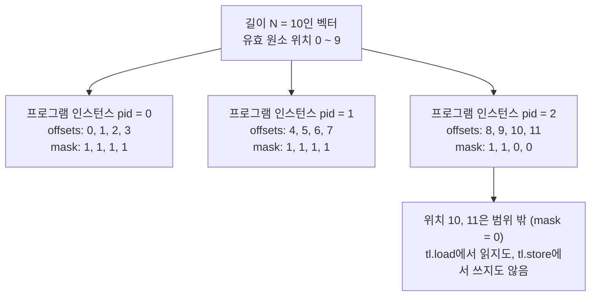
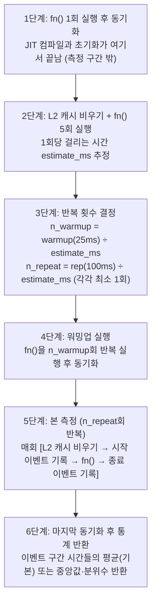
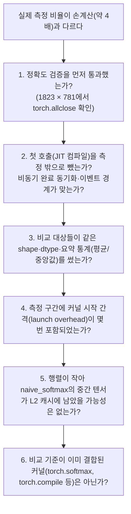

## Python에서 Triton 커널로 — 블록 단위로 읽고 한 번에 계산하기

> **6주차 핵심 질문**
> Python으로 작성한 Triton 커널은 데이터를 어떻게 블록 단위로 처리하며, 여러 연산을 한 커널로 묶으면 왜 빨라질까?

외부 자료 확인일: **2026-10-26** (Tesla T4 GPU 실제 장치 측정일: **2026-10-26**). 계산 예제와 연습문제의 하드웨어 수치(`P = 20 × 10¹² FLOPs/s`, `BW = 1 × 10¹² Byte/s`)는 3·4주차와 같은 **교육용 가상 조건**이다. 10.2절의 `NVIDIA Tesla T4` (`PyTorch 2.11.0+cu130`, `Triton 3.6.0`) 수치는 10.1절 실습 코드를 실제 GPU 런타임에서 실행해 얻은 **실측 결과**다.

---

## 목차

1. [이번 주에 알아야 할 큰 그림](#1-이번-주에-알아야-할-큰-그림)
2. [공통 예제와 계산 조건](#2-공통-예제와-계산-조건)
3. [블록 단위 프로그래밍 모델 — 스레드가 아니라 블록으로 생각하기](#3-블록-단위-프로그래밍-모델--스레드가-아니라-블록으로-생각하기)
4. [포인터 연산과 마스킹 — 나누어떨어지지 않는 마지막 블록](#4-포인터-연산과-마스킹--나누어떨어지지-않는-마지막-블록)
5. [Vector Add는 왜 PyTorch와 속도가 비슷할까](#5-vector-add는-왜-pytorch와-속도가-비슷할까)
6. [커널 결합과 HBM 왕복 — Softmax에서 차이가 커지는 이유](#6-커널-결합과-hbm-왕복--softmax에서-차이가-커지는-이유)
7. [행 단위 리덕션과 패딩값 — 한 행을 블록 하나에 담기](#7-행-단위-리덕션과-패딩값--한-행을-블록-하나에-담기)
8. [공동 활동 — 블록 인덱싱과 Fused Softmax의 데이터 이동 비교](#8-공동-활동--블록-인덱싱과-fused-softmax의-데이터-이동-비교)
9. [정확도 검증과 벤치마크 — 무엇을 확인하고 어느 시간을 잴까](#9-정확도-검증과-벤치마크--무엇을-확인하고-어느-시간을-잴까)
10. [실습 참여 방법 — 무료 GPU와 CPU 해석기](#10-실습-참여-방법--무료-gpu와-cpu-해석기)
11. [선택 활동 — Python으로 계산표와 마스크 확인하기](#11-선택-활동--python으로-계산표와-마스크-확인하기)
12. [자주 생기는 오해와 측정 점검](#12-자주-생기는-오해와-측정-점검)
13. [연습문제 3개](#13-연습문제-3개)
14. [해답과 해설](#14-해답과-해설)
15. [스터디에서 설명하고 함께 점검하기](#15-스터디에서-설명하고-함께-점검하기)
16. [읽을 자료와 검증 범위](#16-읽을-자료와-검증-범위)

---

## 1. 이번 주에 알아야 할 큰 그림

### 1.1 손계산하던 이동량을 커널 코드에서 찾는다

3주차에는 Vector Add의 연산량 `F`와 HBM 이동량 `Q`를 세어 두 시간을 비교했다. 4주차에는 같은 `F`에서 `Q`를 줄이면 산술 강도 `I = F/Q`가 커지고 Roofline에서 성능 상한이 올라간다는 것을 확인했다. 5주차에는 같은 수학적 작업이 GPU·TPU·NPU에서 서로 다른 소프트웨어 경로를 거친다는 것과 측정 경계를 맞춰야 한다는 것을 살펴봤다.

이번 주에는 그 가운데 **GPU 커널 경로**로 들어가 공식 Triton 튜토리얼 두 개([Tutorial 01: Vector Addition](https://triton-lang.org/main/getting-started/tutorials/01-vector-add.html), [Tutorial 02: Fused Softmax](https://triton-lang.org/main/getting-started/tutorials/02-fused-softmax.html))의 실제 코드를 읽는다. 손으로 세던 읽기·쓰기가 코드의 어느 줄에 있는지 찾고, 여러 연산을 한 커널로 묶었을 때 그 줄이 어떻게 줄어드는지 확인한다.

| 지난 주차의 개념 | 이번 주에 튜토리얼 코드에서 찾을 곳 |
|---|---|
| HBM 읽기·쓰기 (3주차) | `tl.load`, `tl.store` |
| 커널 결합과 중간 텐서 (3·4주차) | `naive_softmax`의 다섯 줄과 `softmax_kernel` 하나 |
| 출력 타일과 블록 크기 (4주차) | `BLOCK_SIZE`, `tl.program_id`, `grid` |
| 타일 크기와 스레드 수의 구분 (4주차) | `BLOCK_SIZE`와 `num_warps` |
| 최초 1회 실행과 반복 실행, 측정 경계 (5주차) | `@triton.jit`의 첫 호출, `triton.testing.do_bench` |
| 근거 상태 표기 (5주차) | 손계산 / CPU 동작 확인 / 실측의 구분 |

### 1.2 이번 주 공부의 5단계 학습 흐름

이 교안은 **1차원 `Vector Add`(Tutorial 01)에서 출발해 2차원 행 단위 `Fused Softmax`(Tutorial 02)로 나아가는 5단계 흐름**으로 구성되어 있다. 각 절을 읽을 때 지금 어느 단계에 있는지 아래 지도를 기준으로 따라가면 전체 맥락을 놓치지 않을 수 있다.


이 도식은 이번 주 교안의 학습 순서다. 단계별 핵심 질문과 살펴볼 실제 코드는 다음과 같다.

| 학습 단계 | 해당 절 | 살펴볼 공식 튜토리얼 코드 | 이 단계를 마치면 답할 수 있는 질문 |
|---|---|---|---|
| **Step 1. 1차원 블록 커널 익히기** | 3~4절 | **Tutorial 01**의 `add_kernel`, `add` 래퍼와 Programming Guide 1장 비교 코드 | 스레드가 아니라 블록(`BLOCK_SIZE`) 단위로 인덱싱하고 마지막 블록을 `mask`로 막는다는 것은 코드에서 어떻게 작성하는가? |
| **Step 2. 단일 연산의 속도 해석** | 5절 | **Tutorial 01**의 `x + y` 대비 이동량 집계 | 왜 단일 `Vector Add`는 Triton으로 직접 작성해도 PyTorch 기본 연산과 속도가 비슷할까? 언제 커널을 합쳐야 빨라지는가? |
| **Step 3. 커널 결합과 HBM 왕복 비교** | 6절 | **Tutorial 02**의 `naive_softmax` | 왜 덧셈과 달리 5단계로 이루어진 Softmax는 한 커널로 묶을 때 HBM 이동량(`Q`)이 약 4분의 1로 줄어드는가? |
| **Step 4. 2차원 행 단위 리덕션과 패딩** | 7절 | 이해용 1행 1프로그램 커널 → **Tutorial 02**의 `softmax_kernel`과 `softmax` 래퍼 전문 | 2차원 행렬에서 `stride`로 행을 찾고 `next_power_of_2`로 블록을 잡을 때 왜 빈자리를 `0`이 아닌 `-inf`로 채워야 하는가? |
| **Step 5. 손계산 정리·검증·벤치마크** | 8~11절 | **Tutorial 01·02**의 Unit Test(`allclose`)와 Benchmark(`perf_report`, `do_bench`) 전문 및 실습 스크립트 | 손계산 결과를 어떻게 정리하고, 비동기 GPU 실행에서 정확도와 유효 대역폭(`GB/s`)을 어떻게 검증·측정하는가? |

### 1.3 이번 주의 범위

| 이번 주에 다루는 것 | 7주차로 넘기는 것 |
|---|---|
| 1차원 블록 인덱싱 (`pid`, `offsets`, `mask`) | 2차원 타일을 `tl.dot`으로 누적하는 Tiled MatMul |
| 포인터 블록과 마스킹, `tl.constexpr` | `TTIR → TTGIR → LLVM IR → PTX` 컴파일 과정 |
| 행 단위 리덕션(`tl.max`, `tl.sum`)과 패딩값 `other` | 자동 튜닝(`triton.autotune`)과 본격적인 타일 스케줄링 |
| 커널 결합 전후의 HBM 이동량 비교 | 프로파일러로 실제 HBM 트래픽 관찰 |
| 정확도 검증과 `do_bench` 측정, 유효 대역폭 | |

공통 과제는 공식 튜토리얼 코드를 읽고 인덱싱·마스킹·HBM 이동량을 손으로 따라가는 것이다. GPU 실행은 선택 활동이며 장비가 없어도 이번 주의 목표를 모두 달성할 수 있다.

### 1.4 이번 주의 성공 기준

1. 길이 `N`과 `BLOCK_SIZE`가 주어지면 `grid` 크기와 각 `pid`의 `offsets`·`mask`를 표로 적을 수 있는가?
2. CUDA의 스레드 단위 코드와 Triton의 블록 단위 코드에서 개발자와 컴파일러가 각각 맡는 일을 구분할 수 있는가?
3. 포인터 블록 `x_ptr + offsets`의 의미와 `mask`·`other`의 역할, `BLOCK_SIZE`가 `tl.constexpr`여야 하는 이유를 설명할 수 있는가?
4. 단계별 Softmax와 결합 커널의 HBM 읽기·쓰기를 세고 이동량·산술 강도·이상적 시간을 비교할 수 있는가?
5. 빈자리를 `0`이 아니라 `-inf`로 채워야 하는 이유를 작은 숫자로 보일 수 있는가?
6. 최초 컴파일과 워밍업을 분리한 측정 방법과 튜토리얼식 유효 대역폭(`GB/s`)의 의미를 설명할 수 있는가?

---

## 2. 공통 예제와 계산 조건

본격적으로 튜토리얼 코드를 읽기 전에, 이번 주 내내 사용할 두 가지 수학적 예제(1차원 Vector Add와 2차원 행 단위 Softmax)의 텐서 규격, 기호, 가상 하드웨어 조건을 먼저 맞춘다.

### 2.1 첫 번째 예제 (Tutorial 01) — 1차원 Vector Add

$$
\mathrm{out}_i = x_i + y_i,\qquad 0 \le i < N
$$

| 텐서 | shape | 자료형 | 역할 |
|---|---|---|---|
| `x`, `y` | `[N]` | FP32 | 입력 |
| `out` | `[N]` | FP32 | 출력 |

3주차의 공통 예제와 같은 연산이다. 3~5절에서는 이 연산을 `BLOCK_SIZE`개씩 나누어 처리하는 Tutorial 01 코드를 읽는다.

- **손계산 확인용 작은 크기:** `N = 10`, `BLOCK_SIZE = 4` (나누어떨어지지 않는 마지막 블록의 `offsets`와 `mask` 확인)
- **Tutorial 01의 정확도 검증 크기:** `N = 98,432`, `BLOCK_SIZE = 1024`
- **성능 비교용 크기:** `N = 16,777,216` (`2²⁴`, FP32 벡터 하나당 약 67.11 MB)

### 2.2 두 번째 예제 (Tutorial 02) — 2차원 행 단위 Softmax

행렬 `X`의 shape를 `[M, N]`이라 하자. 각 행 `i`마다 독립적으로 Softmax를 계산한다.

$$
Y_{ij}=\frac{\exp\left(X_{ij}-m_i\right)}{\sum_{k=0}^{N-1}\exp\left(X_{ik}-m_i\right)},
\qquad m_i=\max_{0\le k<N}X_{ik}
$$

각 원소에서 그 행의 최댓값 `m_i`를 빼도 수학적 결과는 같다. 분자와 분모에 같은 값 `exp(-m_i)`가 곱해져 약분되기 때문이다. 이렇게 최댓값을 빼 두면 `exp`에 들어가는 값이 항상 `0` 이하가 되어 큰 입력에서 지수 함수가 무한대로 발산하는 현상(overflow)을 막을 수 있다. Tutorial 02는 이를 **수치적으로 안정화한(numerically stabilized) Softmax**라고 부른다.

| 텐서 | shape | 자료형 | 역할 |
|---|---|---|---|
| `X` | `[M, N]` | FP32 | 입력 행렬 |
| `m` (`x_max`) | `[M]` | FP32 | 행별 최댓값 |
| `z` (`row_minus_max`) | `[M, N]` | FP32 | 최댓값을 뺀 중간값 |
| `numerator` | `[M, N]` | FP32 | 지수(`exp`)를 취한 분자 |
| `denominator` | `[M]` | FP32 | 행별 지수 합(분모) |
| `Y` (`ret` / `softmax_output`) | `[M, N]` | FP32 | 최종 출력 행렬 |

6~9절에서 사용할 행렬 크기는 두 가지다.

- **공동 활동 및 벤치마크 비교 크기 (`M = 4096`, `N = 1024`):** 행렬 하나의 크기는 다음과 같다.

$$
4096 \times 1024 \times 4\ \mathrm{Byte} = 16{,}777{,}216\ \mathrm{Byte} \approx 16.78\ \mathrm{MB}
$$

- **Tutorial 02의 정확도 검증 크기 (`M = 1823`, `N = 781`):** 행 수와 열 수가 모두 2의 거듭제곱이 아니어서 마스킹과 패딩(`other = -inf`)이 실제로 올바르게 동작하는지 확인할 수 있다.

### 2.3 기호와 단위

4·5주차의 기호를 그대로 이어 쓰고, Triton 코드를 읽기 위한 변수 이름을 추가한다.

| 기호 | 뜻 | 단위 |
|---|---|---|
| `F` | 수행하는 연산량 | FLOPs |
| `Q` | HBM에서 읽고 쓴 총 데이터량(누적 이동량) | Byte |
| `P` | 해당 FP32 연산에 적용 가능한 최대 처리율 | FLOPs/s |
| `BW` | HBM 대역폭 | Byte/s |
| `I` | HBM 기준 산술 강도 `F/Q` | FLOP/Byte |
| `R_roof` | 성능 상한 `min(P, BW × I)` | FLOPs/s |
| `T_compute`, `T_memory`, `T_ideal` | `F/P`, `Q/BW`, `max(F/P, Q/BW)` | s, ms, μs |

이번 주 Triton 코드에서 반복해 만나는 핵심 이름은 다음과 같다.

| 이름 | 코드에서의 형태 | 뜻 |
|---|---|---|
| `BLOCK_SIZE` | `BLOCK_SIZE: tl.constexpr` | 프로그램 인스턴스 하나가 한 번에 다루는 원소 수 |
| `grid` | `(triton.cdiv(N, BLOCK_SIZE),)` | 실행할 프로그램 인스턴스의 개수와 배치(1·2·3차원 튜플) |
| `pid` | `tl.program_id(axis=0)` | 현재 실행 중인 프로그램 인스턴스의 번호 |
| `offsets` | `pid * BLOCK_SIZE + tl.arange(0, BLOCK_SIZE)` | 현재 인스턴스가 맡은 원소 위치들의 정수 블록 |
| `mask` | `offsets < n_elements` | 각 위치가 유효한 범위 안에 있는지 나타내는 참·거짓 블록 |
| `stride` | `x.stride(0)` | 2차원 이상의 텐서에서 다음 행으로 넘어가려면 포인터를 몇 원소만큼 옮겨야 하는지 |

단위는 `1 GB = 10⁹ Byte`, `1 KiB = 1024 Byte`, `1 μs = 10⁻⁶ s = 0.001 ms`다. 누적 이동량과 대역폭은 십진 단위로, 한 행이나 블록 같은 작은 버퍼는 이진 단위로 적는다.

### 2.4 공통 가상 하드웨어와 제외 항목

| 항목 | 이 교안의 가정 |
|---|---|
| 연산 성능 | `P = 20 × 10¹² FLOPs/s` (FP32, 분기점 `I_ridge = P/BW = 20 FLOP/Byte`) |
| HBM 대역폭 | `BW = 1 × 10¹² Byte/s` (`1,000 GB/s`) |
| 원소 크기 | FP32 1개 = 4 Byte |
| 입력·출력 위치 | 입력은 이미 장치 HBM에 있고 출력도 HBM에 남음 |
| 캐시 | 커널 사이의 캐시 적중 없음. 각 커널의 읽기·쓰기는 모두 HBM에 도달 |
| 결합 커널 | 한 행이 온칩에 들어가며 레지스터 spill이 없음 |
| 실행 | 계산과 이동이 충분히 겹치고 병렬성이 충분함 |
| 제외 비용 | 컴파일, 커널 시작 비용, CPU↔GPU 복사, 메모리 할당 |

이 조건은 실제 제품의 사양이 아니라 계산을 위한 약속이다. 실제 GPU에서는 L2 캐시, 커널 시작 비용, 접근 효율 때문에 결과가 달라질 수 있으며 9·12절에서 그 차이를 읽는 방법을 다룬다.

---

## 3. 블록 단위 프로그래밍 모델 — 스레드가 아니라 블록으로 생각하기

> **학습 흐름 Step 1 (전반부):** 여기서는 첫 번째 공식 자료인 **[Triton Programming Guide 1장](https://triton-lang.org/main/programming-guide/chapter-1/introduction.html#motivations)**과 **[Tutorial 01: Vector Addition](https://triton-lang.org/main/getting-started/tutorials/01-vector-add.html)**의 코드를 펴 놓고, CUDA처럼 "스레드 하나"의 일을 적는 방식과 Triton처럼 "원소 블록 하나"의 일을 적는 방식이 어떻게 다른지 살펴본다.

### 3.1 먼저 공식 Tutorial 01 (`01-vector-add.py`)의 전체 구조 보기

본문에서 "Tutorial 01"이라고 부르는 코드는 Triton 공식 문서의 첫 번째 튜토리얼인 `01-vector-add.py`다. 코드가 어떤 흐름으로 구성되어 있는지 먼저 전체 모습을 확인하자. 이 튜토리얼은 크게 **① 커널 함수(`add_kernel`)**와 **② 호출 래퍼 함수(`add`)**, 그리고 뒤이어 나오는 **③ 정확도 검증(Unit Test)**과 **④ 벤치마크(`benchmark`)**의 네 부분으로 이루어진다.

아래는 그중 핵심인 **① 커널 함수와 ② 호출 래퍼 함수의 공식 원문 코드**다(이해를 돕기 위해 원문 영문 주석을 한국어로 번역해 병기했다). ③ 정확도 검증과 ④ 벤치마크 코드는 9.2~9.3절에서 전문을 살펴본다.

```python
# 출처: Triton Tutorial 01 (01-vector-add.py) — Compute Kernel & Helper Function
import torch
import triton
import triton.language as tl

DEVICE = triton.runtime.driver.active.get_active_torch_device()


# ① 커널 정의: 프로그램 인스턴스 하나가 길이 BLOCK_SIZE의 원소 묶음을 처리한다
@triton.jit
def add_kernel(x_ptr,                      # 첫 번째 입력 벡터의 시작 포인터 (*Pointer* to first input vector)
               y_ptr,                      # 두 번째 입력 벡터의 시작 포인터 (*Pointer* to second input vector)
               output_ptr,                 # 출력 벡터의 시작 포인터 (*Pointer* to output vector)
               n_elements,                 # 벡터의 전체 원소 수 (Size of the vector)
               BLOCK_SIZE: tl.constexpr,   # 각 프로그램이 처리할 원소 수 (shape 값으로 쓰이므로 constexpr)
               ):
    # 서로 다른 데이터를 처리하는 여러 '프로그램(program)'이 실행된다.
    # 1차원 실행 그리드(axis=0)에서 현재 프로그램이 몇 번째인지 확인한다:
    pid = tl.program_id(axis=0)
    # 이 프로그램은 시작 위치에서 pid * BLOCK_SIZE만큼 떨어진 구간을 맡는다.
    # 예: 길이 256인 벡터를 BLOCK_SIZE=64로 나누면 4개의 프로그램이
    # 각각 [0:64], [64:128], [128:192], [192:256] 원소에 접근한다.
    block_start = pid * BLOCK_SIZE
    offsets = block_start + tl.arange(0, BLOCK_SIZE)
    # 입력 길이가 BLOCK_SIZE의 배수가 아닐 때 범위 밖 메모리 접근을 막는 마스크를 만든다:
    mask = offsets < n_elements
    # DRAM(HBM)에서 x와 y를 읽어 온칩에 올린다 (범위 밖 원소는 마스킹하여 읽지 않음):
    x = tl.load(x_ptr + offsets, mask=mask)
    y = tl.load(y_ptr + offsets, mask=mask)
    output = x + y
    # 계산 결과 x + y를 다시 DRAM(HBM)에 쓴다:
    tl.store(output_ptr + offsets, output, mask=mask)


# ② 호출 래퍼 함수: 출력 텐서를 할당하고 적절한 grid 크기로 커널을 실행 큐에 넣는다
def add(x: torch.Tensor, y: torch.Tensor):
    # 출력을 담을 텐서를 미리 할당한다.
    output = torch.empty_like(x)
    assert x.device == DEVICE and y.device == DEVICE and output.device == DEVICE
    n_elements = output.numel()
    # SPMD 실행 그리드(launch grid)는 병렬로 실행할 커널 인스턴스의 개수를 뜻한다.
    # 여기서는 블록 개수를 크기로 갖는 1차원 그리드를 사용한다:
    grid = lambda meta: (triton.cdiv(n_elements, meta['BLOCK_SIZE']), )
    # 참고:
    #  - 각 torch.Tensor 객체는 암묵적으로 첫 번째 원소를 가리키는 포인터로 변환된다.
    #  - @triton.jit 함수에 [grid]를 인덱싱하면 호출 가능한 GPU 커널이 된다.
    #  - 메타 매개변수(BLOCK_SIZE)는 키워드 인자로 넘긴다.
    add_kernel[grid](x, y, output, n_elements, BLOCK_SIZE=1024)
    # output 핸들을 반환하지만, torch.cuda.synchronize()를 호출하지 않았으므로
    # 이 시점에 커널은 아직 비동기(asynchronously)로 실행 중일 수 있다.
    return output
```

이 코드가 어떻게 동작하는지 이해하려면, 먼저 기존 GPU 프로그래밍(CUDA)과 Triton이 문제를 나누는 단위부터 비교해 보는 것이 가장 빠르다.

### 3.2 스칼라 프로그램(CUDA) vs 블록 프로그램(Triton)

[Triton Programming Guide 1장: Introduction](https://triton-lang.org/main/programming-guide/chapter-1/introduction.html#motivations)은 기존 GPU 프로그래밍 모델과 Triton의 차이를 다음과 같이 요약한다.

- **CUDA 프로그래밍 모델 (`Scalar Program, Blocked Threads`):** 스레드들을 묶어 thread block으로 관리하지만, 개발자가 작성하는 프로그램 코드 자체는 **개별 스레드 하나가 스칼라 원소 하나**를 어떻게 처리할지 기술한다.
- **Triton 프로그래밍 모델 (`Blocked Program, Scalar Threads`):** 개발자가 작성하는 프로그램 코드 자체가 **데이터 블록(타일) 하나**를 통째로 읽고 계산하고 쓰는 과정을 기술한다. 그 블록 안의 원소들을 개별 스칼라 스레드에 어떻게 나누어 맡길지는 컴파일러가 결정한다.

Programming Guide 1장의 **Motivations** 절은 행렬곱(`C = A @ B`)을 예로 들어 두 모델의 추상화 수준을 아래 의사코드로 대조한다.

```c
// [출처: Triton Programming Guide 1장 Motivations의 개념 비교 의사코드]

// (왼쪽) CUDA Programming Model: Scalar Program, Blocked Threads
// 각 병렬 실행 단위(스레드)가 스칼라 누산기 acc 하나와 원소 A[m, k], B[k, n]을 다룬다.
#pragma parallel
for (int m = 0; m < M; m++)
#pragma parallel
for (int n = 0; n < N; n++) {
  float acc = 0;
  for (int k = 0; k < K; k++)
    acc += A[m, k] * B[k, n];
  C[m, n] = acc;
}

// (오른쪽) Triton Programming Model: Blocked Program, Scalar Threads
// 각 병렬 실행 단위(프로그램 인스턴스)가 2차원 블록 acc[MB, NB]와 부분 행렬 블록을 다룬다.
#pragma parallel
for (int m = 0; m < M; m += MB)
#pragma parallel
for (int n = 0; n < N; n += NB) {
  float acc[MB, NB] = 0;
  for (int k = 0; k < K; k += KB)
    acc += A[m:m+MB, k:k+KB] @ B[k:k+KB, n:n+NB];
  C[m:m+MB, n:n+NB] = acc;
}
```

이 차이를 이번 주 첫 번째 예제인 **1차원 Vector Add**로 내려서 비교해 보자. CUDA에서 커널을 시작하면 수많은 스레드가 같은 코드를 실행한다. 스레드는 thread block으로 묶이고 thread block은 grid로 묶인다. 각 스레드는 내장 변수(`blockIdx.x`, `blockDim.x`, `threadIdx.x`)로 자신의 전역 위치를 알아내고 **그 위치의 원소 하나**를 더한다. ([CUDA Programming Model의 Thread Blocks and Grids](https://docs.nvidia.com/cuda/cuda-programming-guide/01-introduction/programming-model.html#thread-blocks-and-grids))

```c
// 비교용 CUDA Vector Add 커널: 스레드 하나가 스칼라 원소 하나(x[i] + y[i])를 맡는다
__global__ void add_cuda(const float* x, const float* y, float* out, int n) {
    int i = blockIdx.x * blockDim.x + threadIdx.x;   // 이 스레드 하나의 전역 원소 인덱스
    if (i < n) {                                      // 범위 밖 스레드는 아무것도 하지 않음
        out[i] = x[i] + y[i];
    }
}
// 호스트 호출 예시: add_cuda<<<(n + 255) / 256, 256>>>(x, y, out, n);
```

반면 3.1절에서 본 Triton의 `add_kernel`에는 `threadIdx.x`가 없다. 대신 `pid = tl.program_id(axis=0)`으로 **현재 블록(프로그램 인스턴스)의 번호**만 가져온 뒤, `tl.arange(0, BLOCK_SIZE)`를 더해 길이 `BLOCK_SIZE`짜리 인덱스 묶음 `offsets`를 한꺼번에 만든다. 따라서 `x`, `y`, `output`은 모두 스칼라가 아니라 **길이 `BLOCK_SIZE`인 1차원 블록**이며, `output = x + y` 한 줄이 원소 `BLOCK_SIZE`개의 덧셈을 나타낸다.

*(참고: 3주차 교안 10.2절에서 맛보기로 봤던 읽기용 커널은 `CHUNK`와 `positions`라는 변수명을 썼고 `other=0.0`을 넣었지만, 공식 Tutorial 01 커널은 `BLOCK_SIZE`와 `offsets`라는 이름을 쓰고 `other`를 생략한다. 범위 밖 위치는 `tl.store`에서도 마스킹되어 저장되지 않으므로 그 자리에 어떤 값이 들어 있든 출력에 영향을 주지 않기 때문이다.)*

### 3.3 개발자가 정하는 것과 컴파일러가 정하는 것

CUDA에서는 같은 thread block 안의 스레드들이 32개씩 warp로 묶여 명령을 함께 실행하므로, 어떤 스레드가 어느 주소를 읽어야 인접한 메모리를 한꺼번에 가져올 수 있는지(coalescing), Shared Memory를 언제 할당하고 동기화(`__syncthreads()`)할지를 개발자가 직접 챙겨야 한다. 반면 Triton에서는 역할 분담이 다음과 같이 바뀐다.

| 결정할 일 | CUDA (스칼라 프로그램) | Triton (블록 프로그램) |
|---|---|---|
| 한 실행 단위가 맡는 데이터 | 스레드 하나 → 원소 하나 | 프로그램 인스턴스 하나 → 원소 `BLOCK_SIZE`개 |
| 블록 안 스레드 수 | 개발자가 직접 지정 (`<<<grid, 256>>>`) | `num_warps`로 힌트를 주고 배치는 컴파일러가 정함 |
| 블록 안 원소 ↔ 스레드 배치 | 개발자가 `threadIdx` 인덱스 식으로 작성 | 컴파일러가 결정 |
| 메모리 접근 정렬(coalescing)·벡터화 | 개발자가 접근 패턴을 설계 | 컴파일러가 자동 적용 |
| Shared Memory 할당과 동기화 | 개발자가 직접 작성 | 컴파일러가 필요할 때 자동 삽입 |
| 전체 작업을 나누는 방식 | grid 크기와 스레드 인덱스 식 | `grid` 크기와 `pid`·`offsets` 식 |

Programming Guide 1장의 **Challenges** 절은 Triton 컴파일러가 블록 수준의 데이터 흐름 분석(block-level data-flow analysis)을 통해 메모리 병합 접근(automatic coalescing), thread swizzling, 프리페칭(pre-fetching), 자동 벡터화, Shared Memory 할당·동기화, 비동기 복사 스케줄링 등을 자동으로 수행한다고 설명한다. 즉, 개발자는 **"전체 텐서를 어떤 크기의 블록으로 나누어 어느 프로그램 인스턴스에 맡길까"**에 집중하고, 블록 내부의 스레드 수준 최적화는 컴파일러에 맡긴다.

### 3.4 `grid`와 프로그램 인스턴스를 그림으로 보기

3.1절의 래퍼 함수 `add(x, y)`에서 실행할 프로그램 인스턴스 수를 어떻게 계산했는지 다시 보자.

```python
grid = lambda meta: (triton.cdiv(n_elements, meta['BLOCK_SIZE']), )
add_kernel[grid](x, y, output, n_elements, BLOCK_SIZE=1024)
```

길이 `N`(`n_elements`)인 벡터를 `BLOCK_SIZE`씩 나누면 필요한 인스턴스 수는 올림 나눗셈(ceiling division)으로 구한다.

$$
\mathrm{grid} = \left(\left\lceil \frac{N}{\mathrm{BLOCK\_SIZE}} \right\rceil,\right)
= (\texttt{triton.cdiv(N, BLOCK\_SIZE)},)
$$

`triton.cdiv(x, y)`는 `(x + y − 1) // y`로 구현되어 있다. 손계산 예제인 `N = 10`, `BLOCK_SIZE = 4`를 대입하면 `triton.cdiv(10, 4) = (10 + 3) // 4 = 3`이므로 `grid = (3,)`이다.



세 인스턴스는 똑같은 `add_kernel` 코드를 실행하지만 `tl.program_id(axis=0)`이 돌려주는 `pid`가 `0`, `1`, `2`로 달라 서로 다른 구간을 맡는다. 마지막 인스턴스(`pid = 2`)만 범위 밖 위치(`10`, `11`)를 포함한다. 위 그림의 상자 배치는 맡은 데이터 구간을 나타낼 뿐 실행 순서를 뜻하지 않는다.

### 3.5 인스턴스 사이의 독립성과 `BLOCK_SIZE` vs 스레드 수의 구분

여기서 두 가지를 분명히 짚고 넘어가야 한다.

1. **프로그램 인스턴스 사이에는 실행 순서가 보장되지 않는다:**
   NVIDIA GPU에서 Triton 프로그램 인스턴스 하나는 CUDA thread block 하나로 실행된다. CUDA 실행 모델은 thread block들이 어떤 순서로 SM(Streaming Multiprocessor)에 배정될지 보장하지 않으며, 한 block이 다른 block의 결과에 의존해서는 안 된다고 규정한다. 따라서 `pid = 2`가 `pid = 0`보다 먼저 끝날 수도 있다. Vector Add와 행 단위 Softmax는 각 인스턴스가 맡은 구간이 서로 겹치지 않고 주고받을 데이터도 없으므로 어떤 순서로 실행되든 결과가 같다.
2. **`BLOCK_SIZE`는 원소 수이지 스레드 수가 아니다:**
   4주차에 `128 × 128` 출력 타일이 곧 스레드 16,384개를 뜻하지 않는다고 했던 구분이 여기에도 그대로 적용된다.

| 구분 항목 | 정하는 곳 | Tutorial 01 (`add_kernel`)의 값 |
|---|---|---|
| 인스턴스 하나가 맡는 **원소 수** | `BLOCK_SIZE` | `1024`개 원소 |
| 인스턴스 하나를 실행하는 **warp 수** | `num_warps` (NVIDIA 백엔드 기본값 `4`) | 따로 지정하지 않아 기본값 `4` |
| 인스턴스 하나를 실행하는 **스레드 수** | `num_warps × 32` | `4 × 32 = 128`개 스레드 |

Tutorial 01에서는 원소 `1024`개를 스레드 `128`개가 나누어 처리하므로 스레드 하나가 평균 `8`개 원소를 맡는다. 어떤 스레드가 어느 원소를 맡을지는 컴파일러가 정하며, 개발자가 `BLOCK_SIZE`를 `512`나 `2048`로 바꾼다고 해서 스레드 수가 자동으로 512개나 2048개로 바뀌는 것은 아니다.

---

## 4. 포인터 연산과 마스킹 — 나누어떨어지지 않는 마지막 블록

> **학습 흐름 Step 1 (후반부):** 3절에서 `add_kernel`과 `add`의 전체 구조를 보았다면, 이제 `add_kernel` 안의 다섯 줄(`pid` → `offsets` → `mask` → `tl.load` → `tl.store`)을 한 줄씩 확대해 포인터 블록이 어떻게 만들어지고 마지막 블록의 범위 밖 접근이 어떻게 차단되는지 확인한다.

### 4.1 `torch.Tensor`를 넘기면 커널은 무엇을 받을까?

`add_kernel[grid](x, y, output, n_elements, BLOCK_SIZE=1024)`를 호출할 때 Python 쪽에서는 PyTorch 텐서 `x`, `y`, `output`을 넘기지만, 커널의 매개변수 이름은 `x_ptr`, `y_ptr`, `output_ptr`이다. [`triton.jit`](https://triton-lang.org/main/python-api/generated/triton.jit.html) 문서와 Tutorial 01 주석에 따르면 `.data_ptr()` 메서드와 `.dtype` 속성이 있는 텐서 인자는 커널로 들어갈 때 **첫 번째 원소의 메모리 주소를 가리키는 포인터**로 자동 변환된다. 원소의 자료형 정보는 포인터 타입(`*fp32` 등)에 남는다.

| Python 호출 쪽 인자 | `@triton.jit` 커널이 받는 것 | 커널이 스스로 알 수 없는 것 |
|---|---|---|
| `x` (`torch.float32`, shape `[N]`) | 첫 원소를 가리키는 FP32 포인터 `x_ptr` | 텐서의 전체 길이 `N`, shape, stride |
| `n_elements` (Python 정수) | 32비트/64비트 정수 스칼라 | — |
| `BLOCK_SIZE=1024` | 컴파일 시점 상수 (`tl.constexpr`) | — |

커널은 시작 주소(`x_ptr`)만 받을 뿐 그 텐서가 몇 개짜리인지 모르기 때문에, 전체 길이 `n_elements`를 별도 인자로 넘겨야 한다. 7절에서 볼 2차원 행렬 커널에서 행 개수(`n_rows`), 열 개수(`n_cols`), 행 간격(`stride`)을 직접 인자로 넘기는 것도 같은 이유다.

### 4.2 `x_ptr + offsets`로 포인터 블록 만들기

`add_kernel`에서 읽을 주소들을 만드는 두 줄을 다시 보자.

```python
block_start = pid * BLOCK_SIZE                          # 스칼라 정수: 이 블록의 시작 인덱스
offsets = block_start + tl.arange(0, BLOCK_SIZE)        # 정수 블록 (shape: [BLOCK_SIZE])
x = tl.load(x_ptr + offsets, mask=mask)                 # 포인터 블록에서 값 블록 읽기
```

1. `tl.arange(0, BLOCK_SIZE)`는 `[0, 1, 2, ..., BLOCK_SIZE - 1]`을 담은 1차원 정수 블록을 만든다.
2. 여기에 스칼라 `block_start`를 더하면 브로드캐스트되어 현재 인스턴스가 담당할 원소 번호들의 블록 `offsets`가 된다.
3. 시작 포인터 `x_ptr`에 정수 블록 `offsets`를 더하면(`x_ptr + offsets`) 각 원소의 메모리 주소를 담은 **포인터 블록(block of pointers)**이 만들어진다. C 언어의 포인터 연산과 마찬가지로 포인터에 정수 `k`를 더하면 1 Byte가 아니라 **원소 크기(`sizeof(dtype)`) 단위**로 주소가 이동한다.

$$
\text{메모리 주소}(\texttt{x\_ptr} + k) = \text{시작 주소}(\texttt{x\_ptr}) + k \times 4\ \mathrm{Byte}\qquad(\text{FP32 기준})
$$

즉, `x_ptr + 1`은 1 Byte 뒤가 아니라 FP32 원소 하나 뒤인 **4 Byte 뒤 주소**를 가리킨다. [`tl.load`](https://triton-lang.org/main/python-api/generated/triton.language.load.html)에 이 포인터 블록을 넘기면 똑같은 shape(`[BLOCK_SIZE]`)의 데이터 블록 `x`를 HBM에서 읽어 온다.

### 4.3 마지막 블록에서는 무슨 일이 일어날까?

텐서 길이 `N`이 `BLOCK_SIZE`의 배수가 아닐 때 마지막 프로그램 인스턴스의 `offsets` 일부는 유효 범위 `[0, N - 1]`을 넘어간다.

먼저 작은 예제인 `N = 10`, `BLOCK_SIZE = 4`에서 세 인스턴스의 `offsets`와 `mask`를 표로 확인하자.

| `pid` | `block_start` | `offsets` | `mask = offsets < 10` | 실제로 읽고 쓰는 유효 원소 수 |
|---:|---:|---|---|---:|
| 0 | 0 | `[0, 1, 2, 3]` | `[True, True, True, True]` (`[1, 1, 1, 1]`) | 4 |
| 1 | 4 | `[4, 5, 6, 7]` | `[True, True, True, True]` (`[1, 1, 1, 1]`) | 4 |
| 2 | 8 | `[8, 9, 10, 11]` | `[True, True, False, False]` (`[1, 1, 0, 0]`) | 2 |

마지막 인스턴스(`pid = 2`)가 만든 오프셋 `10`과 `11`은 배열 밖이다. `mask`에서 해당 위치가 `False`(`0`)가 되면:
- `tl.load(x_ptr + offsets, mask=mask)`는 그 주소를 메모리에서 **읽지 않는다.**
- `tl.store(output_ptr + offsets, output, mask=mask)`는 그 주소에 결과를 **쓰지 않는다.** ([`tl.store`](https://triton-lang.org/main/python-api/generated/triton.language.store.html))

이번에는 Tutorial 01이 정확도 검증(Unit Test)에 실제로 사용하는 크기인 `n_elements = 98,432`, `BLOCK_SIZE = 1024`를 대입해 보자(13절 연습문제 1과 연결된다).
- `98,432 = 96 × 1024 + 128`이므로 `grid = (triton.cdiv(98432, 1024),) = (97,)`이다.
- 앞의 96개 인스턴스(`pid = 0 ~ 95`)는 모두 1024개 원소를 꽉 채워 처리한다(`mask`가 전부 `True`).
- 마지막 인스턴스(`pid = 96`)는 `98,304 ~ 99,327` 범위를 맡는데, 그중 앞의 **128개(`98,304 ~ 98,431`)만 `mask = True`**로 읽고 쓰며 나머지 **896개(`98,432 ~ 99,327`)는 `mask = False`**로 차단된다.

마스킹되어 차단된 위치는 HBM에 접근하지 않으므로 **논리적 데이터 이동량 `Q`에도 포함하지 않는다.** 따라서 `N = 10`일 때 Vector Add의 논리적 이동량은 `3 × 10 × 4 = 120 Byte`이지 블록 크기까지 합친 `3 × 12 × 4 = 144 Byte`가 아니다.

### 4.4 `mask`를 빼면 왜 위험할까, 그리고 `other`는 언제 쓸까?

만약 `mask` 없이 `tl.load(x_ptr + offsets)`를 호출하면 마지막 인스턴스가 배열 끝 너머의 주소를 읽는다. 그 주소에 다른 텐서의 데이터가 들어 있을 수도 있고, 할당되지 않은 영역이면 GPU 메모리 접근 오류(illegal memory access)로 프로그램이 중단된다. `tl.store`에서 `mask`를 빼면 다른 텐서의 메모리를 덮어써서 찾기 힘든 버그를 만들므로 더욱 위험하다.

따라서 **입력 길이가 `BLOCK_SIZE`의 배수가 아닐 가능성이 조금이라도 있다면 `tl.load`와 `tl.store` 양쪽 모두에 `mask`를 걸어야 한다.** 또한 커널을 테스트할 때도 `1024`의 배수인 크기만 넣으면 `mask`를 빠뜨린 버그를 잡아낼 수 없으므로, Tutorial 01은 일부러 `98,432`처럼 나누어떨어지지 않는 크기로 정확도를 시험한다. NVIDIA GPU에서는 [Triton 디버깅 가이드](https://triton-lang.org/main/programming-guide/chapter-3/debugging.html#using-third-party-tools)가 안내하는 `compute-sanitizer`로 범위 밖 메모리 접근을 검사할 수 있다.

한편 `tl.load(ptr, mask=mask, other=v)`에는 선택 인자인 `other`가 있다.
- `mask`가 `False`인 자리는 메모리에서 읽지 않는데, 온칩 블록(`x`, `y`)의 그 빈자리에 대신 채워 넣을 기본값이 `other`다.
- `other`를 생략하면 그 자리의 값은 **정의되지 않은 값(undefined)**이 된다(`0`이 자동으로 들어온다고 가정하면 안 된다).
- **Vector Add(`add_kernel`)에서 `other`를 생략해도 안전한 이유:** 원소별 덧셈은 각 위치끼리만 계산하므로 빈자리의 쓰레기값(`x[10] + y[10]`)이 옆자리(`output[8]`, `output[9]`)의 계산에 섞이지 않고, 마지막 `tl.store(..., mask=mask)`에서 빈자리는 저장하지 않고 버리기 때문이다.
- 반대로 블록 안의 원소들을 하나로 합치는 연산(최댓값, 합계 등)에서는 빈자리 값이 결과에 섞여 들어가므로 `other`를 반드시 지정해야 한다. 이 차이는 **7.3절의 Softmax**에서 구체적인 숫자로 확인한다.

### 4.5 `BLOCK_SIZE`는 왜 `tl.constexpr`이고 2의 거듭제곱이어야 할까?

3.1절의 `add_kernel` 선언부를 보면 `n_elements`는 일반 인자인데 `BLOCK_SIZE: tl.constexpr`에는 타입 표기가 붙어 있다.

```python
@triton.jit
def add_kernel(x_ptr, y_ptr, output_ptr, n_elements, BLOCK_SIZE: tl.constexpr):
    ...
```

Tutorial 01 주석은 그 이유를 "`BLOCK_SIZE`를 shape 값으로 쓰기 위해서(`so it can be used as a shape value`)"라고 명시한다. 커널 안의 `tl.arange(0, BLOCK_SIZE)`가 만드는 블록의 크기(shape)는 **컴파일 시점**에 확정되어야 한다. Triton 컴파일러는 이 크기를 알아야 레지스터를 몇 개 할당할지, 원소들을 스레드에 어떻게 나눌지, 벡터화된 메모리 명령을 어떻게 생성할지 결정할 수 있다.

| `BLOCK_SIZE`의 성질 | 의미와 주의할 점 |
|---|---|
| 컴파일 시점 상수 (`tl.constexpr`) | 같은 커널이라도 `BLOCK_SIZE=512`로 호출할 때와 `BLOCK_SIZE=1024`로 호출할 때 **각각 별도의 기계어 커널로 컴파일**된다. |
| 2의 거듭제곱 제약 | [`tl.arange(start, end)`](https://triton-lang.org/main/python-api/generated/triton.language.arange.html)의 길이(`end - start`)는 **반드시 2의 거듭제곱**(`128`, `256`, `512`, `1024` 등)이어야 한다. `BLOCK_SIZE=1000`을 넣으면 컴파일 오류가 발생한다. |
| 블록 원소 수 상한 | `tl.arange` 문서 기준 한 블록의 최대 원소 수는 `TRITON_MAX_TENSOR_NUMEL = 1,048,576` 이하로 제한된다. |

반면 `n_elements`는 일반 실행 시점 인자다. `n_elements`가 `98,432`에서 `100,000`으로 바뀌면 실행할 인스턴스 수(`grid`)와 마지막 블록의 `mask` 비교값만 바뀔 뿐 블록 자체의 shape(`[1024]`)는 그대로이므로 매번 새로 컴파일하지 않는다(단, 정렬 조건인 16의 배수 여부 등이 달라지면 특화 컴파일이 일어날 수 있다).

---

## 5. Vector Add는 왜 PyTorch와 속도가 비슷할까

> **학습 흐름 Step 2:** 지금까지 Tutorial 01의 `add_kernel`이 어떻게 동작하는지 살펴보았다. 그런데 Tutorial 01의 벤치마크를 돌려 보면 직접 작성한 Triton 커널이나 PyTorch 기본 덧셈(`x + y`)이나 속도가 거의 똑같다. 왜 그럴까? 3·4주차의 시간 모델과 산술 강도로 이유를 확인하고, 왜 다음 단계(Tutorial 02: Fused Softmax)가 필요한지 연결한다.

### 5.1 같은 일을 하는 단일 커널은 같은 HBM 이동량을 가진다

길이 `N`인 FP32 벡터 두 개(`x`, `y`)를 읽어 결과 하나(`out`)를 쓰는 Vector Add를 생각해 보자. PyTorch의 `x + y`로 실행하든 Triton의 `add_kernel`로 실행하든, HBM에서 `x`와 `y`를 한 번씩 읽고(`4N + 4N Byte`) `out`을 한 번 쓰는 일(`4N Byte`)은 피할 수 없다.

$$
F = N\ \mathrm{FLOPs},\qquad Q = 3N \times 4 = 12N\ \mathrm{Byte},\qquad I = \frac{F}{Q} = \frac{1}{12} \approx 0.0833\ \mathrm{FLOP/Byte}
$$

예를 들어 `N = 16,777,216`(`2²⁴`, Tutorial 01 벤치마크에 포함되는 크기이자 6절 Softmax의 `4096 × 1024` 원소 수와 같은 크기)일 때 공통 가상 하드웨어(`P = 20 TFLOPs/s`, `BW = 1 TB/s`)에서 계산해 보자.

| 항목 | PyTorch `x + y` | Triton `add(x, y)` |
|---|---:|---:|
| 수행 연산량 `F` | 16,777,216 FLOPs | 16,777,216 FLOPs |
| HBM 누적 이동량 `Q` (`12N`) | 201,326,592 Byte (≈ 201.33 MB) | 201,326,592 Byte (≈ 201.33 MB) |
| 산술 강도 `I = F/Q` | 약 0.0833 FLOP/Byte | 약 0.0833 FLOP/Byte |
| 연산 시간 `T_compute = F/P` | 약 0.839 μs | 약 0.839 μs |
| 메모리 시간 `T_memory = Q/BW` | 약 201.327 μs | 약 201.327 μs |
| 이상적 시간 `T_ideal` | **약 201.327 μs** | **약 201.327 μs** |

산술 강도 `I ≈ 0.0833`이 가상 하드웨어의 분기점(`20 FLOP/Byte`)보다 약 240배 작으므로, 실행시간은 전적으로 데이터를 HBM에서 실어 나르는 시간(`T_memory`)이 결정한다. PyTorch에 내장된 기본 덧셈 커널도 이미 한 번의 커널 실행으로 `12N Byte`만 옮기도록 잘 최적화되어 있다. 따라서 **단일 연산 하나를 Triton으로 다시 작성한다고 해서 `Q`가 줄어들지 않으며, 속도도 빨라지지 않는다.** 실제로 공식 Tutorial 01 문서의 벤치마크 결과표에서도 `size = 16,777,216`일 때 Triton(`1560.38 GB/s`)과 PyTorch(`1560.38 GB/s`)의 유효 대역폭이 똑같다.

### 5.2 결합할 연산이 생기면 줄일 이동량도 생긴다

그렇다면 직접 작성한 Triton 커널은 언제 위력을 발휘할까? Tutorial 02의 첫 문장은 이렇게 시작한다.

> *"원소별 덧셈을 위한 커스텀 GPU 커널은 교육적으로는 가치가 있지만 실전에서는 그다지 멀리 나아가지 못한다."*
> *(Custom GPU kernels for elementwise additions are educationally valuable but won't get you very far in practice.)*

연산이 하나가 아니라 **여러 개가 연달아 이어질 때** 이야기가 달라진다. 3주차 계산 예제 2에서 보았던 `Vector Add + ReLU`(`out = max(x + y, 0)`)를 떠올려 보자.

| 구현 방식 | 실행되는 커널 수 | HBM 읽기·쓰기 내역 | 총 이동량 `Q` |
|---|---:|---|---:|
| 분리 실행: `z = x + y` 후 `out = relu(z)` | 2개 | 덧셈(읽기 `2N`·쓰기 `N`) + ReLU(읽기 `N`·쓰기 `N`) | `20N Byte` |
| 결합 실행: 한 커널에서 `max(x + y, 0)` | 1개 | 읽기 `2N`·쓰기 `N` (`z`는 레지스터 안에서만 존재) | `12N Byte` |

두 연산을 한 커널로 묶으면 중간 텐서 `z`를 HBM에 썼다가 다시 읽어 오는 왕복(`8N Byte`)이 사라져 `Q`가 `20N → 12N`으로 줄어든다. **즉, "Triton을 썼기 때문"에 빨라지는 것이 아니라 "여러 연산을 한 커널로 결합(Kernel Fusion)해 중간 텐서의 HBM 왕복을 없앴기 때문"에 빨라지는 것이다.**

이제 이 원리가 가장 극적으로 나타나는 **Tutorial 02: Fused Softmax**로 넘어가자. `Vector Add + ReLU`에서는 중간 텐서가 `z` 하나뿐이었지만, Softmax에서는 중간 텐서가 네 개나 등장한다.

---

## 6. 커널 결합과 HBM 왕복 — Softmax에서 차이가 커지는 이유

> **학습 흐름 Step 3:** 이제 두 번째 공식 자료인 **[Tutorial 02: Fused Softmax](https://triton-lang.org/main/getting-started/tutorials/02-fused-softmax.html#motivations)**로 들어간다. 먼저 PyTorch 기본 연산 다섯 줄로 작성한 `naive_softmax` 코드를 보고, 각 줄이 실행될 때 HBM에서 데이터가 몇 번 왕복하는지 센 뒤, 이를 한 커널로 묶었을 때 `Q`와 산술 강도 `I`가 어떻게 바뀌는지 확인한다.

### 6.1 Tutorial 02 (`02-fused-softmax.py`)의 구성과 첫 번째 코드: `naive_softmax`

공식 Tutorial 02 코드는 다음 다섯 부분으로 이루어져 있다.
1. **비교 기준 함수 (`naive_softmax`):** PyTorch 기본 연산 다섯 줄로 작성한 행 단위 Softmax (6.1~6.2절)
2. **Triton 결합 커널 (`softmax_kernel`):** 한 행을 온칩에 올려 다섯 단계를 한 번에 처리하는 커널 (7.1~7.4절)
3. **호출 래퍼 함수 (`softmax`):** 디바이스 속성 조회, `BLOCK_SIZE` 결정, 사전 컴파일(`warmup`) 및 실행 (7.4절)
4. **정확도 검증 (Unit Test):** `1823 × 781` 행렬에서 `torch.allclose` 확인 (9.2절)
5. **벤치마크 (`benchmark`):** `M = 4096`에서 열 길이 `N`을 바꾸며 `GB/s` 비교 (8.7절, 9.3절)

먼저 [Tutorial 02의 Motivations 절](https://triton-lang.org/main/getting-started/tutorials/02-fused-softmax.html#motivations)에 실린 첫 번째 코드인 `naive_softmax` 원문을 보자(주석의 읽기·쓰기 원소 수 집계를 한국어로 함께 적었다).

```python
# 출처: Triton Tutorial 02 (02-fused-softmax.py) — Motivations
import torch
import triton
import triton.language as tl
from triton.runtime import driver

DEVICE = triton.runtime.driver.active.get_active_torch_device()


def naive_softmax(x):
    """PyTorch 기본 연산으로 입력 행렬 X (shape: [M, N])의 행 단위 softmax를 계산한다.
    오버플로(overflow)를 막기 위해 행별 최댓값을 먼저 뺀다. Softmax는 이 이동(shift)에 불변이다.
    """
    # ① 읽기: MN 원소 ; 쓰기: M 원소
    x_max = x.max(dim=1)[0]
    # ② 읽기: MN + M 원소 ; 쓰기: MN 원소
    z = x - x_max[:, None]
    # ③ 읽기: MN 원소 ; 쓰기: MN 원소
    numerator = torch.exp(z)
    # ④ 읽기: MN 원소 ; 쓰기: M 원소
    denominator = numerator.sum(dim=1)
    # ⑤ 읽기: MN + M 원소 ; 쓰기: MN 원소
    ret = numerator / denominator[:, None]
    # 합계: 총 읽기 5MN + 2M 원소 ; 총 쓰기 3MN + 2M 원소
    return ret
```

PyTorch 기본 실행 모드(eager mode)에서는 파이썬 코드 한 줄이 실행될 때마다 대체로 별도의 GPU 커널이 하나씩 시작된다. 앞 줄의 커널이 만든 결과 텐서는 HBM에 기록되고, 다음 줄의 커널은 그 텐서를 HBM에서 다시 읽어 와야 한다.

### 6.2 `naive_softmax`의 단계별 읽기·쓰기를 세어 보자

입력 `x`의 shape가 `[M, N]`일 때 다섯 줄이 각각 HBM에서 읽고 쓰는 원소 수를 표로 정리하면 다음과 같다.

| 단계 | 코드 줄 | HBM에서 읽는 원소 | HBM에 쓰는 원소 | 이 단계가 끝난 뒤 HBM에 새로 남는 텐서 |
|---|---|---|---|---|
| ① 최댓값 | `x_max = x.max(dim=1)[0]` | `x` (`MN`) | `x_max` (`M`) | 행별 최댓값 `x_max` (shape `[M]`) |
| ② 뺄셈 | `z = x - x_max[:, None]` | `x` (`MN`) + `x_max` (`M`) | `z` (`MN`) | 중간 텐서 `z` (shape `[M, N]`) |
| ③ 지수 | `numerator = torch.exp(z)` | `z` (`MN`) | `numerator` (`MN`) | 중간 텐서 `numerator` (shape `[M, N]`) |
| ④ 합계 | `denominator = numerator.sum(dim=1)` | `numerator` (`MN`) | `denominator` (`M`) | 행별 분모 `denominator` (shape `[M]`) |
| ⑤ 나눗셈 | `ret = numerator / denominator[:, None]` | `numerator` (`MN`) + `denominator` (`M`) | `ret` (`MN`) | 최종 출력 `ret` (shape `[M, N]`) |
| **합계** | **커널 5개 순차 실행** | **`5MN + 2M` 원소** | **`3MN + 2M` 원소** | **총 이동 원소 수: `8MN + 4M`** |

FP32(원소당 `4 Byte`) 기준으로 단계별 실행의 총 HBM 이동량 $Q_{\mathrm{naive}}$는 다음과 같다.

$$
Q_{\mathrm{naive}} = (8MN + 4M) \times 4\ \mathrm{Byte}
$$

크기가 `MN`인 행렬 단위로만 세어도 **읽기 5번(`x` 두 번, `z` 한 번, `numerator` 두 번), 쓰기 3번(`z`, `numerator`, `ret`)으로 총 8번**이나 HBM을 오간다. 길이 `M`인 벡터(`x_max`, `denominator`)는 열 길이 `N`이 클수록 전체에서 차지하는 비중이 아주 작아지므로, 근사할 때는 흔히 `8MN` 원소(`32MN Byte`)로 본다.

*(참고: 위 집계는 튜토리얼 주석과 동일한 논리적 접근량이다. 실제 PyTorch의 `x.max(dim=1)`은 최댓값 텐서 `[M]`과 함께 최댓값의 위치를 담은 `int64` 인덱스 텐서 `[M]`도 함께 만들지만, 길이 `M`인 벡터이므로 튜토리얼과 같이 생략한다. 브로드캐스트된 `x_max[:, None]`과 `denominator[:, None]`을 읽는 양도 논리적 원소 수인 `M`으로 센다.)*

### 6.3 결합 커널은 무엇을 HBM에 남기지 않는가

반면 7절에서 코드를 살펴볼 Triton 결합 커널(`softmax_kernel`)은 **입력 행렬 `X`의 한 행을 HBM에서 딱 한 번 읽어(`tl.load`) 온칩 메모리(레지스터·SRAM)에 올려 둔 채**, 최댓값 구하기 → 뺄셈 → 지수(`exp`) → 합계 구하기 → 나눗셈의 다섯 단계를 모두 온칩 안에서 끝내고 **최종 결과 `Y`의 한 행만 HBM에 딱 한 번 쓴다(`tl.store`).**

```mermaid
flowchart TB
    subgraph NAIVE["단계별 실행 (naive_softmax): 커널 5개, 중간 텐서 4개가 HBM을 왕복 (총 8MN + 4M 원소 이동)"]
        direction LR
        A0["입력 X<br/>(HBM)"] --> A1["① max"] --> A2["x_max<br/>(HBM)"]
        A2 --> A3["② 뺄셈"]
        A0 --> A3
        A3 --> A4["z<br/>(HBM)"] --> A5["③ exp"] --> A6["numerator<br/>(HBM)"]
        A6 --> A7["④ sum"] --> A8["denominator<br/>(HBM)"]
        A6 --> A9["⑤ 나눗셈"]
        A8 --> A9
        A9 --> A10["출력 Y<br/>(HBM)"]
    end
    subgraph FUSED["Triton 결합 커널 (softmax_kernel): 커널 1개, 중간 결과는 온칩에만 머묾 (총 2MN 원소 이동)"]
        direction LR
        B0["입력 X의 한 행<br/>(HBM)"] -->|"tl.load 1회"| B1["온칩(레지스터·SRAM) 내부에서 연속 처리<br/>① tl.max → ② 뺄셈 → ③ tl.exp → ④ tl.sum → ⑤ 나눗셈"]
        B1 -->|"tl.store 1회"| B2["출력 Y의 한 행<br/>(HBM)"]
    end
```



위쪽 경로에서 `(HBM)`이라고 적힌 중간 상자 네 개(`x_max`, `z`, `numerator`, `denominator`)가 아래쪽 결합 커널 경로에서는 HBM에 전혀 나타나지 않는다. 그림은 데이터가 머무는 계층만 비교한 것이며 상자 크기는 실제 바이트 수에 비례하지 않는다. 온칩 내부에서 어떤 값을 레지스터에 두고 리덕션 때 Shared Memory를 얼마나 쓸지는 Triton 컴파일러가 결정한다.

따라서 결합 커널의 논리적 HBM 이동량 $Q_{\mathrm{fused}}$는 입력 `X` 한 번 읽기(`MN`)와 출력 `Y` 한 번 쓰기(`MN`)뿐이다.

$$
Q_{\mathrm{fused}} = (MN + MN) \times 4\ \mathrm{Byte} = 2MN \times 4\ \mathrm{Byte}
$$

Tutorial 02는 두 경로의 이동량 비율을 다음과 같이 적어 **이론적으로 약 4배의 속도 향상**을 기대할 수 있다고 설명한다.

$$
\frac{Q_{\mathrm{naive}}}{Q_{\mathrm{fused}}} = \frac{8MN + 4M}{2MN} = 4 + \frac{2}{N} \approx 4
$$

*(주의: 공식 Tutorial 02 영문 본문에는 "Doing so would require reading and writing back only $MN$ bytes, so we could expect a theoretical speed-up of ~4x (i.e., $(8MN + 4M) / 2MN$)"라고 적혀 있는데, 앞 문장의 "$MN$ bytes"는 뒤의 수식 분모 `$2MN$`과 벤치마크 코드의 `2 * x.numel() * x.element_size()`에서 확인되듯 입력 읽기 `MN`원소와 출력 쓰기 `MN`원소를 합친 **`2MN` 원소(`2MN × sizeof(dtype)` Byte)**를 가리키는 원문 표현이다.)*

### 6.4 `F`는 같고 `Q`가 줄어든다 — Roofline에서 보기

두 구현이 수행하는 수학적 계산량 `F`는 똑같다. 원소별 비교·뺄셈·`exp`·덧셈·나눗셈을 각각 1회의 연산으로 세는 단순 관례를 쓰면 전체 행렬(`[M, N]`)에 대한 연산량 `F`는 다음과 같다.

$$
F = \underbrace{M(N-1)}_{\text{① max 비교}} + \underbrace{MN}_{\text{② 뺄셈}} + \underbrace{MN}_{\text{③ exp}} + \underbrace{M(N-1)}_{\text{④ sum 덧셈}} + \underbrace{MN}_{\text{⑤ 나눗셈}} = 5MN - 2M\ \mathrm{FLOPs}
$$

(`exp`는 하드웨어에서 여러 명령어로 처리되므로 이 관례는 하한에 가까운 집계다. 8.6절에서 확인하듯 `exp`를 20 FLOPs로 세어도 메모리 병목이라는 결론은 바뀌지 않는다.)

| 구현 방식 | 총 연산량 `F` | 총 HBM 이동량 `Q` (FP32) | 산술 강도 `I = F/Q` (`N`이 클 때 근사) |
|---|---|---|---|
| 단계별 실행 (`naive_softmax`) | `5MN − 2M` | `4 × (8MN + 4M)` Byte | 약 `5 / 32 ≈ 0.156 FLOP/Byte` |
| 결합 커널 (`softmax_kernel`) | `5MN − 2M` | `4 × 2MN` Byte | 약 `5 / 8 ≈ 0.625 FLOP/Byte` |

4주차에서 배운 Tiling과 똑같은 방향의 변화다. **연산량 `F`는 그대로 둔 채 중복된 HBM 이동량 `Q`를 약 4분의 1로 줄여 산술 강도 `I`를 4배 높였다.** 다만 결합 후의 산술 강도(`0.625 FLOP/Byte`)도 가상 하드웨어의 분기점(`20 FLOP/Byte`)보다는 여전히 훨씬 작다. 즉, 결합 후에도 Softmax는 **메모리 대역폭 병목(memory-bound) 구간**에 머물러 있으며, 바로 그렇기 때문에 `Q`를 4분의 1로 줄인 효과가 곧바로 이상적 실행시간을 4분의 1로 줄이는 결과로 이어진다!

### 6.5 결합 이득이 성립하는 4가지 조건

이 4배 차이가 언제나 무조건 나타나는 것은 아니다. 다음 네 가지 전제를 함께 기억해야 한다.

| 전제 조건 | 이 조건이 깨지면 생기는 일 |
|---|---|
| **① 한 행이 온칩(SRAM·레지스터)에 들어간다** | 행 길이 `N`이 너무 길어 온칩 용량을 넘으면 레지스터 spill이 발생하거나 행을 여러 번 나누어 읽어야 해서 `Q`가 다시 늘어난다 (7.5절). |
| **② 단계별 실행의 중간 텐서가 실제로 HBM까지 왕복한다** | 행렬 크기가 작아 중간 텐서(`16.78 MB` 등)가 GPU의 L2 캐시에 남아 재사용되면, 단계별 실행의 실제 HBM 트래픽이 손계산(`8MN`)보다 작아져 속도 배수가 4배보다 줄어들 수 있다 (9.4절). |
| **③ 중간 텐서를 커널 밖의 다른 곳에서 다시 쓰지 않는다** | 만약 다른 연산에서 중간 텐서 `z`나 `numerator` 자체를 별도로 읽어야 한다면 어차피 HBM에 저장해야 한다. |
| **④ 비교 기준이 결합되지 않은 실행(eager mode)이다** | `torch.compile(naive_softmax)`나 `torch.softmax`처럼 프레임워크·컴파일러가 이미 결합된 커널을 실행하면 비교 기준 자체의 `Q`도 `2MN`에 가까워진다 (9.7절). |

Tutorial 02가 서두에서 "이 튜토리얼의 결합 Softmax가 PyTorch보다 빠른 대상은 **각 행이 GPU의 SRAM에 들어가는 행렬**이다"라고 범위를 못 박은 이유가 바로 조건 ① 때문이다.

---

## 7. 행 단위 리덕션과 패딩값 — 한 행을 블록 하나에 담기

> **학습 흐름 Step 4:** 6절에서 *왜* 한 행을 온칩에 올려 한 번에 계산해야 하는지 확인했다. 이제 **Tutorial 02의 실제 커널(`softmax_kernel`)과 래퍼 함수(`softmax`) 코드**를 읽으며 *어떻게* 2차원 행렬의 한 행을 블록 하나에 안전하게 담고 리덕션(`tl.max`, `tl.sum`)을 수행하는지 단계별로 살펴본다.

### 7.1 단계별 코드 읽기 ① — 이해하기 쉬운 "1행 = 1 프로그램 인스턴스" 기본형부터 보기

공식 Tutorial 02의 `softmax_kernel` 원문에는 성능 최적화를 위해 **프로그램 인스턴스 하나가 `for` 루프(`tl.range`)를 돌며 여러 행을 처리하는 구조**가 들어 있다. 처음부터 이 루프와 파이프라이닝 인자(`num_stages`)까지 한꺼번에 보면 가장 중요한 **행 단위 주소 계산과 리덕션·패딩 원리**가 눈에 잘 들어오지 않는다.

그래서 먼저 **프로그램 인스턴스 하나(`pid = row_idx`)가 딱 한 행만 맡는 기본형 결합 커널(`softmax_row_kernel`)**의 완결된 코드를 보고 핵심 줄을 익힌 뒤, 이어지는 **7.4절에서 공식 Tutorial 02의 실제 원문 코드(`softmax_kernel` + `softmax` 래퍼) 전문**과 나란히 비교한다.

```python
# [단계 1: 기본형 결합 커널] 프로그램 인스턴스 하나(row_idx)가 행 하나를 처리하는 버전
# (10.1절 실습 코드의 softmax_row_kernel과 동일)
@triton.jit
def softmax_row_kernel(output_ptr, input_ptr,
                       input_row_stride, output_row_stride,
                       n_cols,
                       BLOCK_SIZE: tl.constexpr):
    # ① 내가 맡을 행 번호: 1차원 grid=(n_rows,)에서 내 프로그램 번호가 곧 행 인덱스다
    row_idx = tl.program_id(0)

    # ② 내가 맡은 행의 시작 주소와 열 오프셋 블록 만들기
    row_start_ptr = input_ptr + row_idx * input_row_stride
    col_offsets = tl.arange(0, BLOCK_SIZE)
    input_ptrs = row_start_ptr + col_offsets

    # ③ 마스킹과 패딩값(-inf)을 적용해 HBM에서 한 행을 온칩으로 한 번에 읽기
    mask = col_offsets < n_cols
    row = tl.load(input_ptrs, mask=mask, other=-float('inf'))

    # ④ 온칩에서 다섯 단계 계산 수행 (최댓값 → 뺄셈 → exp → 합계 → 나눗셈)
    row_minus_max = row - tl.max(row, axis=0)
    numerator = tl.exp(row_minus_max)
    denominator = tl.sum(numerator, axis=0)
    softmax_output = numerator / denominator

    # ⑤ 계산된 한 행을 HBM의 출력 위치에 한 번 쓰기
    output_row_start_ptr = output_ptr + row_idx * output_row_stride
    output_ptrs = output_row_start_ptr + col_offsets
    tl.store(output_ptrs, softmax_output, mask=mask)
```

위 코드의 ①~⑤ 단계에서 왜 주소를 저렇게 계산하고 왜 `other=-float('inf')`를 넣었는지 하나씩 뜯어보자.

### 7.2 2차원 행렬에서 행의 시작 주소 찾기 — 왜 `n_cols`와 `stride`를 따로 넘길까?

4.1절에서 보았듯 커널은 2차원 텐서 `X`의 첫 원소 포인터(`input_ptr`)만 받는다. 따라서 `row_idx`번째 행이 메모리 어디에서 시작하는지 직접 계산해야 한다.

```python
row_start_ptr = input_ptr + row_idx * input_row_stride
col_offsets = tl.arange(0, BLOCK_SIZE)
input_ptrs = row_start_ptr + col_offsets
```

여기서 `input_row_stride`는 Python 래퍼 쪽에서 `x.stride(0)`으로 넘긴 값이다. PyTorch의 `stride(0)`은 **"다음 행(0번 축의 다음 인덱스)으로 넘어가려면 메모리에서 몇 원소만큼 건너뛰어야 하는가"**를 나타낸다.

| 텐서 생성 방식 | 논리적 shape | `x.stride(0)` (`input_row_stride`) | 열 개수 `n_cols` |
|---|---|---:|---:|
| 연속으로 새로 만든 텐서 `x = torch.randn(4096, 1024)` | `[4096, 1024]` | `1024` | `1024` |
| 위 텐서에서 앞 781열만 잘라낸 슬라이스 `sub = x[:, :781]` | `[4096, 781]` | **`1024`** (원래 행 간격 유지) | **`781`** |

첫 번째 경우처럼 메모리에 빈틈없이 연속 저장된(contiguous) 행렬이라면 `input_row_stride`와 `n_cols`가 둘 다 `1024`로 같다. 하지만 두 번째 경우처럼 큰 행렬의 일부 열만 슬라이싱한 텐서라면, 한 행의 유효 원소 수(`n_cols`)는 `781`이지만 다음 행의 첫 원소는 여전히 `1024`원소 뒤에 놓여 있다. 만약 `stride`를 따로 받지 않고 `input_ptr + row_idx * n_cols`로 주소를 계산하면 두 번째 행부터는 엉뚱한 위치를 읽게 된다.

```text
슬라이스된 텐서 sub = x[:, :781]의 메모리 배치 (input_row_stride = 1024, n_cols = 781):
[ 0행 유효 데이터 (781개) | 건너뛰는 구간 (243개) ][ 1행 유효 데이터 (781개) | 건너뛰는 구간 (243개) ]...
^                                                  ^
input_ptr (0행 시작)                               input_ptr + 1 * 1024 (1행 시작)
```

그래서 2차원 커널에서는 **메모리에서 다음 행 시작점을 찾는 데는 `input_row_stride`를 쓰고, 그 행 안에서 몇 개의 원소만 유효한지(`mask = col_offsets < n_cols`) 판별하는 데는 `n_cols`를 쓴다.**

### 7.3 왜 `BLOCK_SIZE = triton.next_power_of_2(n_cols)`이고 빈자리는 `-inf`로 채울까?

#### (1) `BLOCK_SIZE = triton.next_power_of_2(n_cols)`로 잡는 이유
결합 커널이 HBM 왕복 없이 한 행의 최댓값(`tl.max`)과 지수 합계(`tl.sum`)를 구하려면 **한 행의 모든 원소가 하나의 블록(`row`) 안에 전부 들어와 있어야 한다.** 그런데 4.5절에서 확인했듯 Triton 블록의 원소 수(`BLOCK_SIZE`)는 반드시 **2의 거듭제곱**이어야 한다. 따라서 열 개수 `n_cols`가 주어지면 래퍼 함수는 `n_cols` 이상인 가장 작은 2의 거듭제곱을 `BLOCK_SIZE`로 고른다.

| 행 길이 `n_cols` (`N`) | `BLOCK_SIZE = triton.next_power_of_2(n_cols)` | 마스킹되는 빈자리 수 (`BLOCK_SIZE - n_cols`) | 블록 하나의 논리적 크기 (FP32) |
|---:|---:|---:|---:|
| `1024` | `1024` | `0`개 | `4 KiB` (`4,096 Byte`) |
| `781` | `1024` | `243`개 | `4 KiB` (유효 데이터는 `3,124 Byte`) |

`n_cols = 781`일 때 뒤쪽 243개 위치(`col_offsets = 781 ~ 1023`)는 `mask = col_offsets < n_cols`가 `False`가 되어 HBM에서 읽지 않는다.

#### (2) 블록 안의 리덕션과 브로드캐스트, 그리고 빈자리 값(`other`)의 문제
이제 커널의 ④번 계산 구간을 보자.

```python
row = tl.load(input_ptrs, mask=mask, other=-float('inf'))
row_minus_max = row - tl.max(row, axis=0)     # 길이 BLOCK_SIZE 블록 → 스칼라 최댓값 → 브로드캐스트 뺄셈
numerator = tl.exp(row_minus_max)
denominator = tl.sum(numerator, axis=0)       # 길이 BLOCK_SIZE 블록 → 스칼라 합계
softmax_output = numerator / denominator      # 브로드캐스트 나눗셈
```

- `tl.max(row, axis=0)`와 `tl.sum(numerator, axis=0)`은 길이 `BLOCK_SIZE`인 1차원 블록 전체를 스칼라 값 하나로 줄이는 **리덕션(reduction)** 연산이다.
- 이어서 `row - tl.max(...)`와 `numerator / denominator`를 계산할 때는 [Triton Semantics](https://triton-lang.org/main/python-api/triton-semantics.html#broadcasting)의 브로드캐스트 규칙에 따라 스칼라가 길이 `BLOCK_SIZE` 블록 전체에 자동으로 퍼져서 연산된다(Triton은 대부분 NumPy 브로드캐스트 규칙을 따르며, 정수 나눗셈 반올림 방향 등 몇 가지 차이점만 같은 문서의 **Differences with NumPy** 절에 정리되어 있다).
- 또한 Tutorial 02 주석이 밝히듯 Triton의 `tl.exp`는 빠른 근사 지수 연산(CUDA의 `__expf`에 해당)을 사용한다.

여기서 핵심 질문이 등장한다. **왜 Vector Add에서는 쓰지 않았던 `other=-float('inf')`가 Softmax의 `tl.load`에는 꼭 있어야 할까?**
`tl.max(row, axis=0)`와 `tl.sum(numerator, axis=0)`은 유효한 `n_cols`개 원소만 골라서 줄이는 것이 아니라 **빈자리까지 포함한 길이 `BLOCK_SIZE` 블록 전체**에 대해 최댓값과 합계를 구하기 때문이다!

작은 예로 길이가 `n_cols = 3`인 음수 행 `[-1.0, -2.0, -3.0]`을 `BLOCK_SIZE = 4`로 읽는다고 해 보자. 마지막 네 번째 자리는 마스킹된 빈자리다. 이 빈자리에 `other = 0.0`을 넣었을 때와 `other = -inf`를 넣었을 때를 손으로 비교해 보자.

| 계산 단계 | 빈자리에 `other = 0.0`을 넣은 경우 (오답) | 빈자리에 `other = -inf`를 넣은 경우 (정답) |
|---|---|---|
| ① `tl.load`가 만든 블록 `row` | `[-1, -2, -3, 0]` | `[-1, -2, -3, -inf]` |
| ② 최댓값 `tl.max(row, axis=0)` | **`0`** (빈자리의 `0`이 음수들을 이기고 최댓값이 됨!) | **`-1`** (유효 원소 중 최댓값 그대로 유지) |
| ③ `row_minus_max = row - max` | `[-1, -2, -3, 0]` | `[0, -1, -2, -inf]` |
| ④ `numerator = tl.exp(row_minus_max)` | `[e⁻¹ ≈ 0.3679, e⁻² ≈ 0.1353, e⁻³ ≈ 0.0498, e⁰ = 1]` | `[e⁰ = 1, e⁻¹ ≈ 0.3679, e⁻² ≈ 0.1353, e⁻ⁱⁿᶠ = 0]` |
| ⑤ 분모 `tl.sum(numerator, axis=0)` | `0.3679 + 0.1353 + 0.0498 + 1 =` **`1.5530`** | `1 + 0.3679 + 0.1353 + 0 =` **`1.5032`** |
| ⑥ `tl.store`로 저장되는 앞 3개 출력 | `[0.2369, 0.0871, 0.0321]` | `[0.6652, 0.2447, 0.0900]` |
| **저장된 3개 확률의 합** | **`0.3561` (확률 합이 1이 안 됨!)** | **`1.0000` (정확한 Softmax)** |

`other = 0.0`을 넣으면 두 번이나 값이 오염된다.
1. 유효 원소가 모두 음수일 때 빈자리의 `0.0`이 엉뚱하게 최댓값(`tl.max`) 자리를 차지한다.
2. 설령 유효 원소에 양수가 있어 최댓값이 맞더라도, 지수를 취하면 빈자리의 `exp(0 - max)`가 `0`이 아닌 양수가 되어 분모 합계(`tl.sum`)에 더해진다(8.2절에서 양수 행 숫자로 한 번 더 확인한다).

반면 **`-inf`(음의 무한대)는 최댓값 연산(`max`)의 항등원**이다. 어떤 실수 `a`와 비교해도 `max(a, -inf) = a`이므로 최댓값을 절대 바꾸지 않는다. 게다가 지수 함수를 통과하는 순간 **`exp(-inf - max) = exp(-inf) = 0.0`으로 바뀌어 덧셈 연산(`sum`)의 항등원**이 된다! 따라서 `-inf` 하나만 넣어 주면 `tl.max`와 `tl.sum` 두 번의 리덕션에서 모두 빈자리가 투명 인간처럼 완벽히 무시된다. (단, 유효 원소가 하나도 없는 `n_cols = 0`인 행에서는 `-inf - (-inf)`가 `NaN`이 되지만 유효한 2차원 행렬은 `n_cols ≥ 1`이므로 문제가 되지 않는다.)

### 7.4 단계별 코드 읽기 ② — 공식 Tutorial 02의 실제 `softmax_kernel`과 `softmax` 래퍼 전문

7.1~7.3절에서 한 행을 처리하는 원리를 모두 이해했다면, 이제 [공식 Tutorial 02의 Compute Kernel 절](https://triton-lang.org/main/getting-started/tutorials/02-fused-softmax.html#compute-kernel)에 실린 **실제 `softmax_kernel`과 호출 래퍼 함수 `softmax(x)`의 전체 코드**를 그대로 읽어 보자.

```python
# 출처: Triton Tutorial 02 (02-fused-softmax.py) — Compute Kernel & Helper Function 전문
@triton.jit
def softmax_kernel(output_ptr, input_ptr, input_row_stride, output_row_stride, n_rows, n_cols,
                   BLOCK_SIZE: tl.constexpr, num_stages: tl.constexpr):
    # 현재 프로그램 인스턴스가 시작할 행 번호(row_start)와 한 번에 건너뛸 간격(row_step)
    row_start = tl.program_id(0)
    row_step = tl.num_programs(0)
    for row_idx in tl.range(row_start, n_rows, row_step, num_stages=num_stages):
        # ── [여기부터 아래 12줄은 7.1절의 softmax_row_kernel 본문과 완전히 동일하다] ──
        # stride는 1행을 전진하기 위해 포인터를 얼마나 증가시켜야 하는지 나타낸다
        row_start_ptr = input_ptr + row_idx * input_row_stride
        # BLOCK_SIZE는 n_cols보다 크거나 같은 가장 작은 2의 거듭제곱이므로 한 행이 한 블록에 들어간다
        col_offsets = tl.arange(0, BLOCK_SIZE)
        input_ptrs = row_start_ptr + col_offsets
        # BLOCK_SIZE가 n_cols보다 클 수 있으므로 마스크를 사용해 한 행을 SRAM(온칩)으로 읽는다
        mask = col_offsets < n_cols
        row = tl.load(input_ptrs, mask=mask, other=-float('inf'))
        # 수치 안정성을 위해 최댓값을 뺀다
        row_minus_max = row - tl.max(row, axis=0)
        # 참고: Triton의 exp는 빠르지만 근사 계산이다 (CUDA의 __expf에 해당)
        numerator = tl.exp(row_minus_max)
        denominator = tl.sum(numerator, axis=0)
        softmax_output = numerator / denominator
        # 결과를 다시 DRAM(HBM)에 쓴다
        output_row_start_ptr = output_ptr + row_idx * output_row_stride
        output_ptrs = output_row_start_ptr + col_offsets
        tl.store(output_ptrs, softmax_output, mask=mask)


# 드라이버에서 현재 GPU의 하드웨어 속성(SM 개수, 레지스터 수, Shared Memory 크기 등)을 조회한다
properties = driver.active.utils.get_device_properties(DEVICE.index)
NUM_SM = properties["multiprocessor_count"]
NUM_REGS = properties["max_num_regs"]
SIZE_SMEM = properties["max_shared_mem"]
WARP_SIZE = properties["warpSize"]
target = triton.runtime.driver.active.get_current_target()
kernels = {}


def softmax(x):
    n_rows, n_cols = x.shape

    # 각 루프 반복의 블록 크기는 x의 열 개수(n_cols) 이상인 가장 작은 2의 거듭제곱이다
    BLOCK_SIZE = triton.next_power_of_2(n_cols)

    # num_warps를 늘려 한 행을 더 많은 스레드에 분산시킬 수 있다 (다음 튜토리얼에서 auto-tune을 다룸)
    num_warps = 8

    # 소프트웨어 파이프라이닝(software pipelining) 단계 수
    num_stages = 4 if SIZE_SMEM > 200000 else 2

    # 출력 텐서 할당
    y = torch.empty_like(x)

    # 커널을 미리 컴파일(warmup)해 레지스터·Shared Memory 사용량을 얻고 occupancy를 계산한다
    kernel = softmax_kernel.warmup(y, x, x.stride(0), y.stride(0), n_rows, n_cols, BLOCK_SIZE=BLOCK_SIZE,
                                   num_stages=num_stages, num_warps=num_warps, grid=(1, ))
    kernel._init_handles()
    n_regs = kernel.n_regs
    size_smem = kernel.metadata.shared
    if is_hip():
        NUM_GPRS = NUM_REGS
        if is_cdna():
            NUM_GPRS = NUM_REGS * 2
        MAX_NUM_THREADS = properties["max_threads_per_sm"]
        max_num_waves = MAX_NUM_THREADS // WARP_SIZE
        occupancy = min(NUM_GPRS // WARP_SIZE // n_regs, max_num_waves) // num_warps
    else:
        occupancy = NUM_REGS // (n_regs * WARP_SIZE * num_warps)
    occupancy = min(occupancy, SIZE_SMEM // size_smem)
    num_programs = NUM_SM * occupancy

    num_programs = min(num_programs, n_rows)

    # 계산된 개수(num_programs)만큼 상주 프로그램(persistent programs)을 실행한다
    kernel[(num_programs, 1, 1)](y, x, x.stride(0), y.stride(0), n_rows, n_cols, BLOCK_SIZE, num_stages)
    return y
```

7.1절의 기본형(`softmax_row_kernel`)과 공식 Tutorial 02의 코드(`softmax_kernel` + `softmax`)를 비교하면 다음 두 가지를 명확히 이해할 수 있다.

1. **행 하나를 읽고 계산하고 쓰는 내부 12줄은 완전히 똑같다:**
   `for row_idx in tl.range(...):` 안쪽의 코드는 우리가 7.1~7.3절에서 분석한 코드 그대로다.
2. **달라진 점은 "전체 `n_rows`개의 행을 프로그램 인스턴스들에 어떻게 나누어 주는가"뿐이다:**
   - **7.1절 기본형(`grid = (n_rows,)`):** 행이 `4096`개면 프로그램 인스턴스도 `4096`개를 만들어 각자 한 행만 처리하고 끝난다.
   - **공식 Tutorial 02(`grid = (num_programs, 1, 1)`):** GPU의 모든 SM에 동시에 올라가 실행될 수 있는 만큼만 인스턴스(`num_programs = min(NUM_SM * occupancy, n_rows)`)를 띄운 뒤, 각 인스턴스가 자기 번호(`row_start = tl.program_id(0)`)부터 시작해 전체 인스턴스 수(`row_step = tl.num_programs(0)`)만큼 건너뛰며 여러 행을 반복 처리한다.

예를 들어 전체 행이 `n_rows = 10`개이고 띄운 프로그램 인스턴스가 `num_programs = 4`개라면 각 인스턴스는 다음과 같이 행을 나누어 맡는다.

| `pid` (`row_start`) | `tl.range(pid, 10, 4)`가 차례로 처리하는 `row_idx` |
|---:|---|
| `0` | `0`행 → `4`행 → `8`행 |
| `1` | `1`행 → `5`행 → `9`행 |
| `2` | `2`행 → `6`행 |
| `3` | `3`행 → `7`행 |

| 코드 요소 | 공식 Tutorial 02에서 하는 역할 | 이번 주에 알아 둘 수준 |
|---|---|---|
| `tl.range(..., num_stages=num_stages)` | 한 인스턴스가 여러 행을 순회할 때, 현재 행을 계산하는 동안 다음 행의 `tl.load`를 미리 시작(소프트웨어 파이프라이닝)할 수 있게 함 | 개념만 이해 (HBM 총 이동량 `Q`는 기본형과 동일하게 `2MN`) |
| `softmax_kernel.warmup(...)` | GPU에서 실제로 데이터를 실행하지 않고 **미리 컴파일만 수행**하여 스레드당 레지스터 수(`n_regs`)와 Shared Memory 사용량(`size_smem`)을 알아냄 | 9.6절의 벤치마크 워밍업(`do_bench(warmup=25)`)과 이름만 같고 다른 기능임을 구분 |
| `occupancy`와 `num_programs` 계산 | SM 하나에 동시에 몇 개의 프로그램 인스턴스가 상주할 수 있는지 계산해 전체 GPU를 채울 인스턴스 수를 정함 | 공식을 외울 필요 없음 (7주차 이후 autotune과 연결) |

중요한 결론은 **7.1절의 기본형이든 7.4절의 공식 튜토리얼 커널이든 모든 행은 HBM에서 딱 한 번 읽히고 한 번 쓰이므로 논리적 HBM 이동량 `Q = 2MN × 4 Byte`는 똑같다**는 점이다. 인스턴스를 몇 개 띄워 루프를 돌릴지는 커널 스케줄링과 파이프라이닝 효율을 높이는 기법이다.

### 7.5 행이 아주 길어지면 어떤 제약이 생길까?

한 행 전체를 `BLOCK_SIZE` 하나에 담아 온칩에서 리덕션하는 방식은 열 길이 `N`(`n_cols`)이 커질수록 온칩 메모리 부담이 급격히 커진다.

| 행 길이 `N` (FP32) | `BLOCK_SIZE` | 블록 하나의 논리적 크기 (`4 × BLOCK_SIZE`) | `num_warps = 8` (256 스레드)일 때 스레드 1개당 담당 원소 수 |
|---:|---:|---:|---:|
| `1,024` | `1,024` | `4 KiB` | `4`개 |
| `32,768` | `32,768` | `128 KiB` | `128`개 |
| `1,048,576` | `1,048,576` | `4 MiB` | `4,096`개 |

커널 안에서는 입력 블록 `row`뿐 아니라 `numerator` 등 같은 크기의 블록을 동시에 유지해야 하고 리덕션에도 온칩 공간이 쓰이므로 실제 필요한 공간은 표의 값보다 더 크다.
1. 행이 길어져 SM의 레지스터와 Shared Memory 용량을 초과하면, 레지스터에 다 담지 못한 값들이 장치 메모리(HBM) 영역인 local memory로 밀려나는 **레지스터 스필(register spill)**이 발생한다. 그러면 "중간값은 HBM에 가지 않는다"는 결합 커널의 핵심 가정이 깨지고 `Q`가 다시 늘어난다.
2. 아울러 4.5절에서 본 것처럼 `BLOCK_SIZE`가 Triton의 블록 최대 원소 수 상한(`TRITON_MAX_TENSOR_NUMEL = 1,048,576`)을 넘으면 아예 단일 블록으로 컴파일할 수 없다.

이런 긴 행을 처리하려면 한 행을 여러 블록 조각(tile)으로 나누어 루프를 돌면서 최댓값과 지수 합계를 누적(online softmax 등)해야 한다. 그때 행을 HBM에서 몇 번 읽어야 하는지는 15.3절의 토론 질문에서 함께 생각해 본다.

---

## 8. 공동 활동 — 블록 인덱싱과 Fused Softmax의 데이터 이동 비교

> **학습 흐름 Step 5 (첫 번째):** 3~7절에서 Tutorial 01과 Tutorial 02의 코드와 원리를 모두 살펴보았다. 이제 [6주차 안내]의 **4번 '함께 해볼 내용'**에 제시된 세 가지 손계산 과제를 차례대로 풀어 보며 앞에서 배운 내용을 내 손으로 직접 확인하고 정리한다. (이 절의 모든 수치는 11절의 Python 검산 코드로 다시 확인할 수 있다.)

### 8.1 활동 1 — `N = 10`, `BLOCK_SIZE = 4`의 1차원 블록 인덱싱과 마스크 표

4.3절에서 살펴본 1차원 Vector Add(`N = 10`, `BLOCK_SIZE = 4`)의 인덱싱을 손계산 표로 완성한다.

$$
\mathrm{grid} = (\texttt{triton.cdiv(10, 4)},) = \left(\left\lceil \frac{10}{4} \right\rceil,\right) = (3,)
$$

| `pid` | `offsets = pid × 4 + [0, 1, 2, 3]` | `mask = offsets < 10` | 비고 |
|---:|---|---|---|
| `0` | `[0, 1, 2, 3]` | `[T, T, T, T]` (`[1, 1, 1, 1]`) | 4개 위치 모두 유효 |
| `1` | `[4, 5, 6, 7]` | `[T, T, T, T]` (`[1, 1, 1, 1]`) | 4개 위치 모두 유효 |
| `2` | `[8, 9, 10, 11]` | `[T, T, F, F]` (`[1, 1, 0, 0]`) | 위치 `10`, `11`은 마스킹되어 접근하지 않음 |

전체 `3 × 4 = 12`개 슬롯 가운데 마지막 블록의 `2`개 위치가 마스킹되며, 실제로 HBM에서 읽고 쓰는 유효 원소는 각 텐서당 `10`개다.

### 8.2 활동 2 — `N = 781`을 `BLOCK_SIZE = 1024`로 읽을 때 `other`의 영향

7.3절에서는 길이 3짜리 미니 예제로 원리를 보았다. 이제 실제 Tutorial 02의 정확도 검증 열 길이인 `N = 781`을 `BLOCK_SIZE = triton.next_power_of_2(781) = 1024`로 읽을 때를 계산해 보자. 마스킹되는 빈자리는 `1024 - 781 = 243`개다.

손계산을 간단하게 하기 위해 한 행의 유효 원소 781개가 모두 같은 값으로 채워진 두 경우(모두 `-2.0`인 음수 행, 모두 `+2.0`인 양수 행)를 비교한다. 원소 781개가 모두 같으므로 올바른 Softmax라면 모든 유효 위치의 출력값은 똑같이 `1 / 781 ≈ 1.2804 × 10⁻³`이 되어야 하고 781개 출력의 합은 `1.0000`이어야 한다.

#### (1) 음수만 있는 행 (유효 원소 781개가 모두 `-2.0`)

| 계산 항목 | `other = 0.0` (잘못된 패딩) | `other = -inf` (올바른 패딩) |
|---|---:|---:|
| `tl.max(row, axis=0)` | **`0.0`** (빈자리 243개의 `0.0`이 최댓값이 됨) | **`-2.0`** |
| 유효 원소(781개)의 `exp(row - max)` | 각각 `exp(-2.0 - 0.0) = e⁻² ≈ 0.1353` | 각각 `exp(-2.0 - (-2.0)) = e⁰ = 1.0` |
| 빈자리(243개)의 `exp(row - max)` | 각각 `exp(0.0 - 0.0) = e⁰ = 1.0` | 각각 `exp(-inf - (-2.0)) = 0.0` |
| 분모 `tl.sum(numerator, axis=0)` | `781 × e⁻² + 243 × 1 ≈` **`348.6969`** | `781 × 1 + 243 × 0 =` **`781.0000`** |
| 유효 위치 하나의 출력값 | `e⁻² / 348.6969 ≈` **`3.8812 × 10⁻⁴`** | `1 / 781 ≈` **`1.2804 × 10⁻³`** |
| **저장된 781개 출력의 총합** | **`0.3031` (약 70%가 빈자리 몫으로 사라짐!)** | **`1.0000`** |

#### (2) 양수만 있는 행 (유효 원소 781개가 모두 `+2.0`)

| 계산 항목 | `other = 0.0` (잘못된 패딩) | `other = -inf` (올바른 패딩) |
|---|---:|---:|
| `tl.max(row, axis=0)` | `2.0` (최댓값 자체는 왜곡되지 않음) | `2.0` |
| 유효 원소(781개)의 `exp(row - max)` | 각각 `exp(2.0 - 2.0) = 1.0` | 각각 `exp(2.0 - 2.0) = 1.0` |
| 빈자리(243개)의 `exp(row - max)` | 각각 `exp(0.0 - 2.0) = e⁻² ≈ 0.1353` (**0이 아님!**) | 각각 `exp(-inf - 2.0) = 0.0` |
| 분모 `tl.sum(numerator, axis=0)` | `781 × 1 + 243 × e⁻² ≈` **`813.8865`** | **`781.0000`** |
| 유효 위치 하나의 출력값 | `1 / 813.8865 ≈` **`1.2287 × 10⁻³`** | `1 / 781 ≈` **`1.2804 × 10⁻³`** |
| **저장된 781개 출력의 총합** | **`0.9596` (분모가 부풀려져 합이 1보다 작음!)** | **`1.0000`** |

이 계산을 통해 **`other = 0.0`의 문제가 단순히 "음수 행에서 최댓값이 틀리는 것"에만 있지 않다**는 사실을 분명히 확인할 수 있다. 양수만 있는 행에서도 빈자리의 `exp(0 - max) = e⁻ᵐᵃˣ`가 `0`이 아니기 때문에 빈자리 개수(`243`개)만큼 분모 합계(`tl.sum`)를 오염시킨다. 오직 `other = -inf`만이 `max`에서도 무시되고 `exp(-inf) = 0`이 되어 `sum`에서도 완전히 사라진다.

### 8.3 활동 3의 계산 조건 (`M = 4096`, `N = 1024`)

이제 `M = 4096`, `N = 1024`인 FP32 2차원 행렬 `X`에 대해 단계별 실행(`naive_softmax`)과 결합 커널(`softmax_kernel`)을 정량 비교한다.

| 항목 | 적용 조건 |
|---|---|
| 입력 `X`와 출력 `Y` | `M = 4096`, `N = 1024`, FP32 (원소당 `4 Byte`), 이미 HBM에 상주 |
| 행렬 1개의 원소 수 `MN`과 크기 | `MN = 4,194,304`개, `4,194,304 × 4 = 16,777,216 Byte ≈ 16.78 MB` |
| 가상 하드웨어 사양 | `P = 20 × 10¹² FLOPs/s`, `BW = 1 × 10¹² Byte/s` (`1,000 GB/s`) |
| 캐시 및 온칩 가정 | 커널 간 HBM 캐시 적중 없음. 결합 커널은 한 행이 온칩에 들어가며 spill 없음 |
| 연산량 집계 관례 | 원소별 비교·뺄셈·`exp`·덧셈·나눗셈 각 1회 = `1 FLOP` (6.4절) |
| 제외 비용 | 커널 시작 비용, JIT 컴파일, 출력 메모리 할당 |

### 8.4 단계별 실행(`naive_softmax`)의 이동량과 이상적 시간

`MN = 4,194,304`, `M = 4,096`을 6.2절의 다섯 단계에 대입하면 다음과 같다.

| 단계 | 읽기 (원소) | 쓰기 (원소) | 이동량 `Q_k` (Byte) | 연산량 `F_k` (FLOPs) | `T_compute = F_k/P` | `T_memory = Q_k/BW` |
|---|---:|---:|---:|---:|---:|---:|
| ① `max` | 4,194,304 | 4,096 | 16,793,600 | 4,190,208 | 0.210 μs | 16.794 μs |
| ② 뺄셈 | 4,198,400 | 4,194,304 | 33,570,816 | 4,194,304 | 0.210 μs | 33.571 μs |
| ③ `exp` | 4,194,304 | 4,194,304 | 33,554,432 | 4,194,304 | 0.210 μs | 33.554 μs |
| ④ `sum` | 4,194,304 | 4,096 | 16,793,600 | 4,190,208 | 0.210 μs | 16.794 μs |
| ⑤ 나눗셈 | 4,198,400 | 4,194,304 | 33,570,816 | 4,194,304 | 0.210 μs | 33.571 μs |
| **합계** | **20,979,712** | **12,591,104** | **134,283,264** | **20,963,328** | | |

- **원소 수 합계 검산:**
  - 읽기 합계: `5MN + 2M = 5(4,194,304) + 2(4,096) = 20,979,712`원소
  - 쓰기 합계: `3MN + 2M = 3(4,194,304) + 2(4,096) = 12,591,104`원소
  - 총 이동 원소 수: `8MN + 4M = 33,570,816`원소 → 총 바이트 `Q_naive = 33,570,816 × 4 = 134,283,264 Byte ≈ 134.28 MB`
  - (길이 `M` 벡터를 생략한 근사치 `8MN`으로 세면 `33,554,432`원소, `134,217,728 Byte ≈ 134.22 MB`다.)
- **순차 커널의 이상적 시간:**
  3주차에서 정리한 대로 순차 실행되는 커널들은 **각 커널의 `max(T_compute, T_memory)`를 먼저 구한 뒤 더한다.** 다섯 커널 모두 `T_memory`가 `T_compute`보다 약 80~160배 크므로 각 커널의 이상적 시간은 곧 메모리 시간이다.

$$
T_{\mathrm{naive}} = \sum_{k=1}^{5}\max\left(\frac{F_k}{P},\frac{Q_k}{BW}\right)
= \frac{134{,}283{,}264\ \mathrm{Byte}}{10^{12}\ \mathrm{Byte/s}} \approx 134.283\ \mu\mathrm{s}
$$

(표에 반올림해 적은 다섯 숫자를 그대로 더하면 `134.284 μs`가 되지만, 반올림 전 정확한 합은 `134.283264 μs ≈ 134.283 μs`다.)

### 8.5 결합 커널(`softmax_kernel`)의 이동량과 온칩 한 행의 최소 크기

결합 커널은 각 행을 HBM에서 한 번 읽고(`MN`) 결과 행을 한 번 쓴다(`MN`).

$$
Q_{\mathrm{fused}} = 2MN \times 4\ \mathrm{Byte} = 2 \times 4{,}194{,}304 \times 4 = 33{,}554{,}432\ \mathrm{Byte} \approx 33.55\ \mathrm{MB}
$$

$$
T_{\mathrm{compute}} = \frac{20{,}963{,}328}{20\times10^{12}} \approx 1.048\ \mu\mathrm{s},\qquad
T_{\mathrm{memory}} = \frac{33{,}554{,}432}{10^{12}} \approx 33.554\ \mu\mathrm{s}
$$

$$
T_{\mathrm{fused}} = \max(1.048\ \mu\mathrm{s},\ 33.554\ \mu\mathrm{s}) \approx 33.554\ \mu\mathrm{s}
$$

한편 한 행을 온칩에 올릴 때 **입력 행 하나가 차지하는 최소 데이터 크기**는 다음과 같다.

$$
N \times 4\ \mathrm{Byte} = 1024 \times 4\ \mathrm{Byte} = 4{,}096\ \mathrm{Byte} = 4\ \mathrm{KiB}
$$

이는 입력 행 블록 `row` 하나만의 크기이며, 계산 중에 동시에 살아 있는 블록(`numerator` 등)이나 한 SM에서 동시에 실행되는 여러 프로그램 인스턴스의 총합은 별도로 고려해야 한다.

### 8.6 두 경로 종합 비교표

| 비교 항목 | 단계별 실행 (`naive_softmax`) | Triton 결합 커널 (`softmax_kernel`) |
|---|---:|---:|
| 실행되는 커널 수 | 5개 | 1개 |
| HBM 읽기·쓰기 원소 수 | `8MN + 4M = 33,570,816`개 (근사 `8MN = 33,554,432`개) | `2MN = 8,388,608`개 |
| 총 HBM 이동량 `Q` | **134,283,264 Byte** (≈ 134.28 MB) | **33,554,432 Byte** (≈ 33.55 MB) |
| 총 연산량 `F` | 20,963,328 FLOPs | 20,963,328 FLOPs |
| 산술 강도 `I = F/Q` | 약 **0.1561 FLOP/Byte** | 약 **0.6248 FLOP/Byte** |
| 이상적 실행시간 `T_ideal` | **약 134.283 μs** (0.1343 ms) | **약 33.554 μs** (0.0336 ms) |

$$
\text{이론적 속도 향상 배수} = \frac{T_{\mathrm{naive}}}{T_{\mathrm{fused}}} = \frac{134{,}283{,}264}{33{,}554{,}432} \approx \mathbf{4.002\text{배}}\ (\text{근사치 } 8MN \text{ 기준 } \mathbf{4.000\text{배}})
$$

$$
\text{시간 감소율} = \frac{T_{\mathrm{naive}} - T_{\mathrm{fused}}}{T_{\mathrm{naive}}} \approx \mathbf{75.01\%}
$$

4·5주차와 마찬가지로 **속도 배수(`4.002배`)**와 **시간 감소율(`75.01%`)**을 정확히 구분해 적는다("시간이 400% 감소했다"거나 "75배 빨라졌다"고 쓰지 않는다). 또한 만약 `exp` 연산 1회를 1 FLOP이 아니라 20 FLOPs로 세더라도 결합 커널의 총 연산량 `F`는 약 `1.006 × 10⁸ FLOPs`, 연산 시간 `T_compute`는 약 `5.03 μs`로 여전히 메모리 시간 `33.554 μs`보다 훨씬 짧다. 따라서 `exp` 집계 관례는 결론을 바꾸지 않는다.

### 8.7 튜토리얼 벤치마크 코드의 분자는 왜 `8MN`이 아니라 `2MN`일까?

Tutorial 02의 벤치마크 함수(9.3절에서 전문 확인)는 측정된 커널 실행시간 `ms`(밀리초)를 다음 한 줄로 환산해 `GB/s` 그래프를 그린다.

```python
gbps = lambda ms: 2 * x.numel() * x.element_size() * 1e-9 / (ms * 1e-3)
```

$$
\text{튜토리얼식 유효 대역폭 (GB/s)} = \frac{2 \times M \times N \times 4\ \mathrm{Byte}}{\text{측정 시간 (s)} \times 10^9}
$$

이 교안에서는 4·5주차와 용어를 통일해 이 값을 **유효 대역폭**(6주차 안내문의 "실효 대역폭")이라 부른다.

왜 `naive_softmax`를 측정할 때도 분자에 `8MN`이 아니라 `2MN`을 똑같이 넣을까?
- 분자 `2 × M × N × 4 Byte`는 각 구현이 실제로 옮긴 바이트 수가 아니라 **"크기 `[M, N]`인 행렬의 Softmax라는 작업을 끝내기 위해 이론적으로 꼭 필요한 최소 데이터 이동량(입력 1회 읽기 + 출력 1회 쓰기)"**이기 때문이다.
- 모든 비교 대상(`triton`, `torch`, `naive_softmax`)에 **똑같은 분자(`2MN × 4 Byte`)**를 고정해 놓고 측정 시간으로 나누면, 이 `GB/s` 값은 **"같은 작업을 얼마나 짧은 시간에 끝냈는가"를 나타내는 정규화된 처리 속도**가 된다. 즉, 같은 shape에서 A의 `GB/s`가 B의 4배라는 말은 곧 A의 실행시간이 B의 4분의 1이라는 뜻이다.

가상 하드웨어에서 구한 두 경로의 이상적 시간을 이 식에 넣어 보면 그 의미가 한눈에 드러난다.

| 구현 방식 | 가상 하드웨어 이상적 시간 | 튜토리얼식 유효 대역폭 (`2MN × 4 Byte ÷ 시간`) | 모델 안에서 HBM이 실제로 일한 속도 (`실제 Q ÷ 시간`) |
|---|---:|---:|---:|
| 단계별 실행 (`naive_softmax`) | 134.283 μs | **약 249.88 GB/s** | `1,000 GB/s` (`134.28 MB ÷ 134.283 μs`) |
| 결합 커널 (`softmax_kernel`) | 33.554 μs | **1,000.00 GB/s** | `1,000 GB/s` (`33.55 MB ÷ 33.554 μs`) |

이상적 모델 안에서 `naive_softmax`도 매 순간 HBM 대역폭 `1,000 GB/s`를 100% 꽉 채워 쓰고 있다. 단지 불필요한 중간 텐서를 네 번이나 더 읽고 쓰느라 총 이동량이 4배(`134.28 MB`)로 불어났고, 그 때문에 시간이 4배 걸려 **튜토리얼식 유효 대역폭이 약 4분의 1(`249.88 GB/s`)로 찍히는 것**이다. 따라서 "`naive_softmax`의 유효 대역폭이 낮으니 HBM이 놀고 있다"고 해석하면 안 된다.

---

## 9. 정확도 검증과 벤치마크 — 무엇을 확인하고 어느 시간을 잴까

> **학습 흐름 Step 5 (두 번째):** 이제 **Tutorial 01과 Tutorial 02의 후반부(Unit Test와 Benchmark 절) 실제 코드 전문**을 읽으며, 왜 비동기 GPU 실행에서 첫 호출을 분리해야 하는지, 왜 2의 거듭제곱이 아닌 크기로 정확도를 먼저 검증하는지, 그리고 `triton.testing.do_bench`가 내부에서 어떻게 시간을 재는지 살펴본다.

### 9.1 커널 호출이 반환되면 GPU 계산도 끝났을까?

아니다. 3.1절에서 본 Tutorial 01의 `add` 래퍼 함수 마지막 주석은 이렇게 경고한다.

```python
add_kernel[grid](x, y, output, n_elements, BLOCK_SIZE=1024)
# output 핸들을 반환하지만, torch.cuda.synchronize()를 호출하지 않았으므로
# 이 시점에 커널은 아직 비동기(asynchronously)로 실행 중일 수 있다.
return output
```

3주차 12.2절에서 정리했듯 Python 함수가 반환된 시각은 CPU가 GPU 작업 큐(stream)에 커널 실행 명령을 **제출(enqueue)**한 시각일 뿐이다.

| 시간 측정 방식 | 실제로 재게 되는 것 |
|---|---|
| 동기화 없이 호출 앞뒤의 CPU 시계(`time.perf_counter`)만 측정 | 커널을 GPU 큐에 제출하는 데 걸린 호스트 시간 (실제 계산 시간보다 훨씬 짧음) |
| 호출 전후에 `torch.cuda.synchronize()`를 넣고 CPU 시계로 측정 | 커널 제출부터 GPU 완료까지의 시간 (호스트 측 호출·대기 지연 포함) |
| 같은 GPU 스트림의 시작·종료 이벤트(`torch.cuda.Event`) 두 개 사이 | GPU 장치에서 두 이벤트 사이에 흐른 시간 (`do_bench`가 사용하는 방식) |

여기에 더해 `@triton.jit` 커널을 **맨 처음 호출할 때는 JIT 컴파일 시간**이 함께 들어간다. 5주차에 `torch.compile`과 `jax.jit`의 최초 1회 실행시간이 반복 실행시간보다 수천 배 길었던 것과 똑같은 현상이다. 따라서 반복 실행 성능을 비교할 때는 반드시 첫 호출(컴파일 및 초기화)이 끝난 뒤에 측정해야 한다.

### 9.2 공식 튜토리얼의 정확도 검증(Unit Test) 코드 읽기

벤치마크로 시간을 재기 전에 커널이 올바른 값을 계산하는지부터 확인해야 한다. Tutorial 01과 Tutorial 02의 **Unit Test 실제 코드**를 나란히 보자.

```python
# [출처 1: Triton Tutorial 01 (01-vector-add.py) — Unit Test 전문]
torch.manual_seed(0)
size = 98432
x = torch.rand(size, device=DEVICE)
y = torch.rand(size, device=DEVICE)
output_torch = x + y
output_triton = add(x, y)
print(output_torch)
print(output_triton)
print(f'The maximum difference between torch and triton is '
      f'{torch.max(torch.abs(output_torch - output_triton))}')
# 공식 문서 출력: The maximum difference between torch and triton is 0.0
```

```python
# [출처 2: Triton Tutorial 02 (02-fused-softmax.py) — Unit Test 전문]
torch.manual_seed(0)
x = torch.randn(1823, 781, device=DEVICE)
y_triton = softmax(x)
y_torch = torch.softmax(x, axis=1)
assert torch.allclose(y_triton, y_torch), (y_triton, y_torch)
```

두 튜토리얼이 검증용 입력 크기로 `98,432`와 `1823 × 781`을 고른 이유와 비교 방식의 차이는 다음과 같다.

| 점검 항목 | Tutorial 01 (`size = 98,432`) | Tutorial 02 (`1823 × 781`) |
|---|---|---|
| **왜 2의 거듭제곱이 아닌 크기를 쓰는가?** | `98,432 = 96 × 1024 + 128`이어서 마지막 97번째 블록(`pid = 96`)에 896개의 범위 밖 위치가 생김 → **`mask = offsets < n_elements`가 제대로 동작하는지 검증** | 열 길이 `781`이 `BLOCK_SIZE = 1024`보다 작아 매 행마다 243개의 빈자리가 생기고, 행 개수 `1823`도 나누어떨어지지 않음 → **열 방향 `mask`, 패딩값 `other=-inf`, 여러 행 순회와 `stride` 처리를 동시에 검증** |
| **왜 비교 함수가 다른가?** | 같은 IEEE 754 FP32 덧셈을 수행하므로 비트 단위로 결과가 같아 최대 오차 `0.0`이 나옴 | Triton의 빠른 근사 `tl.exp`와 블록 리덕션 덧셈 순서 차이 때문에 미세한 부동소수점 오차가 생길 수 있으므로 허용오차 비교인 **`torch.allclose`**(`|a - b| ≤ atol + rtol × |b|`, 기본 `rtol=1e-5`, `atol=1e-8`)를 사용함 |

만약 `1024`나 `4096 × 1024`처럼 딱 나누어떨어지는 입력으로만 시험하면, `mask`나 `other=-float('inf')`를 빼먹은 잘못된 커널도 테스트를 통과해 버린다. **빠른 커널보다 맞는 커널이 먼저다.** 정확도 검증을 통과하지 않은 커널의 실행시간은 비교표에 넣지 않는다.

### 9.3 공식 튜토리얼의 벤치마크(Benchmark) 코드와 `do_bench` 읽기

정확도를 확인한 뒤에는 `triton.testing.perf_report`와 `triton.testing.do_bench`로 크기를 바꾸어 가며 성능을 측정한다. 먼저 **Tutorial 01과 Tutorial 02의 실제 Benchmark 코드 전문**을 확인하자.

```python
# [출처 1: Triton Tutorial 01 (01-vector-add.py) — Benchmark 전문]
@triton.testing.perf_report(
    triton.testing.Benchmark(
        x_names=['size'],                                     # 그래프 가로축(x축)으로 쓸 인자 이름
        x_vals=[2**i for i in range(12, 28, 1)],              # 시험할 벡터 길이: 2^12 (4,096) ~ 2^27 (134,217,728)
        x_log=True,                                           # 가로축을 로그 스케일로 표시
        line_arg='provider',                                  # 그래프에서 서로 다른 선(line)을 구분할 인자 이름
        line_vals=['triton', 'torch'],                        # 비교할 대상 값
        line_names=['Triton', 'Torch'],                       # 범례에 표시할 이름
        styles=[('blue', '-'), ('green', '-')],               # 선 색상과 스타일
        ylabel='GB/s',                                        # 세로축(y축) 라벨
        plot_name='vector-add-performance',                   # 그래프 제목 및 파일 저장 이름
        args={},                                              # 고정할 추가 인자
    ))
def benchmark(size, provider):
    x = torch.rand(size, device=DEVICE, dtype=torch.float32)
    y = torch.rand(size, device=DEVICE, dtype=torch.float32)
    quantiles = [0.5, 0.2, 0.8]
    if provider == 'torch':
        ms, min_ms, max_ms = triton.testing.do_bench(lambda: x + y, quantiles=quantiles)
    if provider == 'triton':
        ms, min_ms, max_ms = triton.testing.do_bench(lambda: add(x, y), quantiles=quantiles)
    # Vector Add는 입력 2개 읽기 + 출력 1개 쓰기이므로 분자에 3 * N * 4 Byte를 쓴다
    gbps = lambda ms: 3 * x.numel() * x.element_size() * 1e-9 / (ms * 1e-3)
    return gbps(ms), gbps(max_ms), gbps(min_ms)


benchmark.run(print_data=True, show_plots=True)
```

```python
# [출처 2: Triton Tutorial 02 (02-fused-softmax.py) — Benchmark 전문]
@triton.testing.perf_report(
    triton.testing.Benchmark(
        x_names=['N'],                                        # 가로축: 행렬의 열 개수 N
        x_vals=[128 * i for i in range(2, 100)],              # 시험할 열 개수: 256, 384, ..., 12,672
        line_arg='provider',                                  # 비교할 구현 구분 인자
        line_vals=['triton', 'torch', 'naive_softmax'],       # 세 가지 경로 비교
        line_names=["Triton", "Torch", "Naive Softmax"],      # 범례 이름
        styles=[('blue', '-'), ('green', '-'), ('red', '-')], # 선 스타일
        ylabel="GB/s",                                        # 세로축: 유효 대역폭 (GB/s)
        plot_name="softmax-performance",                      # 그래프 이름
        args={'M': 4096},                                     # 행 개수는 M = 4096으로 고정
    ))
def benchmark(M, N, provider):
    x = torch.randn(M, N, device=DEVICE, dtype=torch.float32)
    if provider == 'torch':
        ms = triton.testing.do_bench(lambda: torch.softmax(x, axis=-1))
    if provider == 'triton':
        ms = triton.testing.do_bench(lambda: softmax(x))
    if provider == 'naive_softmax':
        ms = triton.testing.do_bench(lambda: naive_softmax(x))
    # Softmax는 입력 1개 읽기 + 출력 1개 쓰기가 최소 이동량이므로 분자에 2 * MN * 4 Byte를 쓴다
    gbps = lambda ms: 2 * x.numel() * x.element_size() * 1e-9 / (ms * 1e-3)
    return gbps(ms)


benchmark.run(show_plots=True, print_data=True)
```

두 벤치마크 코드의 핵심에 있는 [`triton.testing.do_bench`](https://triton-lang.org/main/python-api/generated/triton.testing.do_bench.html)의 시그니처는 `do_bench(fn, warmup=25, rep=100, grad_to_none=None, quantiles=None, return_mode='mean')`이다. 여기서 가장 주의할 점은 **`warmup=25`와 `rep=100`의 단위가 실행 횟수(번)가 아니라 시간(ms, 밀리초)**이라는 것이다.

[Triton GitHub `python/triton/testing.py` 구현](https://github.com/triton-lang/triton/blob/main/python/triton/testing.py)을 확인하면 `do_bench`는 내부에서 다음 6단계로 시간을 측정한다.



| `do_bench` 내부 단계 | 왜 이렇게 동작하는가 |
|---|---|
| **첫 `fn()` 1회 실행 후 동기화** | `@triton.jit`의 최초 컴파일 시간을 본 측정에서 자동으로 분리한다. |
| **시간 추정 후 횟수 자동 결정** | 커널이 0.05 ms로 짧으면 약 2,000번(`100 ÷ 0.05`) 반복하고, 10 ms로 길면 10번만 반복해 전체 벤치마크 시간을 일정하게 맞춘다. |
| **매 반복 전 L2 캐시 비우기** | NVIDIA 백엔드 기준 `256 MB`짜리 별도 버퍼를 `0`으로 덮어써서, 직전 `fn()` 호출에서 읽었던 입력 텐서가 L2 캐시에 남아 다음 측정 시간을 인위적으로 줄이는 현상을 막는다. |
| **GPU 이벤트 기록과 통계 요약** | 각 반복마다 `fn()` 앞뒤에 GPU 타이밍 이벤트를 찍어 순수 장치 구간을 재고, 기본값은 평균(`mean`), Tutorial 01처럼 `quantiles=[0.5, 0.2, 0.8]`을 주면 중앙값(`0.5`)과 하위·상위 분위수를 돌려준다(단, 시간을 역수인 `gbps`에 넣으면 최소 시간 `min_ms`가 최대 `gbps`가 된다). |

### 9.4 `do_bench`의 측정 경계에 무엇이 들어가고 무엇이 빠지는가

`do_bench`가 아무리 정교해도 `fn()` 안에 무엇을 넣었는지에 따라 측정 경계가 정해진다.

| `do_bench(fn)` 측정 구간에 **포함되는 것** | 측정 구간 **밖에 있는 것** |
|---|---|
| `fn()` 안에서 실행된 모든 GPU 커널의 실행시간 | 첫 1회 호출 때 일어난 JIT 컴파일 시간 |
| `fn()` 안에 여러 커널이 있을 때 커널 사이에서 GPU가 기다린 간격 | 매 반복 시작 전에 `do_bench`가 수행하는 256 MB L2 캐시 비우기 작업 |
| `fn()` 안의 출력 텐서 할당(`torch.empty_like(x)`)이 GPU 작업을 유발하면 그 시간 | 벤치마크 함수 바깥이나 `do_bench` 호출 전에 만든 입력 텐서 `x`, `y` 생성 시간 |

여기서 **`naive_softmax`를 측정할 때 생기는 두 가지 중요한 현상**을 이해할 수 있다.
1. **커널 시작 간격 포함:** `naive_softmax(x)`는 한 번의 `fn()` 호출 안에서 다섯 개의 커널을 연달아 실행한다. CPU가 다섯 커널을 차례로 제출하는 동안 GPU가 다음 커널을 기다리는 빈틈(launch overhead)이 생기면 그 시간도 시작 이벤트와 종료 이벤트 사이에 포함된다.
2. **한 번의 `fn()` 내부에서는 L2 캐시가 비워지지 않음:** `do_bench`는 `fn()`과 다음 `fn()` **사이**에만 L2 캐시를 비운다. 따라서 `naive_softmax(x)` 한 번이 실행되는 동안 다섯 커널 사이에서 주고받는 중간 텐서(`M = 4096, N = 1024`일 때 하나당 `16.78 MB`)는 GPU의 L2 캐시 용량이 크다면 일부가 L2에 남아 다음 커널에서 바로 읽힐 수 있다! 이것이 실제 GPU 측정에서 `naive_softmax`와 Triton 결합 커널의 속도 배수가 손계산(약 4배)보다 작게(예: 공식 문서 그래프의 `N = 1024`에서 `1035.03 ÷ 352.34 ≈ 2.94배`) 나올 수 있는 핵심 이유 가운데 하나다.

### 9.5 유효 대역폭은 HBM 실측 대역폭이 아니다

8.7절과 9.4절을 종합하면, 튜토리얼 벤치마크가 출력하는 `GB/s`를 읽을 때 무엇을 말할 수 있고 무엇을 말할 수 없는지 명확해진다.

| 측정된 `GB/s`를 보고 내리는 해석 | 타당성 | 이유 |
|---|---|---|
| 같은 입력 shape에서 구현 A의 `GB/s`가 B의 2배다 → **A의 실행시간이 B의 절반이다** | **가능** | 분자(`2MN × 4 Byte`)가 똑같으므로 `GB/s` 비율은 곧 실행시간의 역수 비율이다. |
| 결합 커널의 `GB/s`가 GPU의 공표 HBM 대역폭 사양에 가깝다 → **대역폭 상한 근처까지 효율적으로 실행되고 있다는 신호다** | **조심스럽게 가능** | 결합 커널의 논리적 이동량이 분자(`2MN × 4 Byte`)와 같기 때문이다. |
| `naive_softmax`의 `GB/s`가 낮다 → **HBM 대역폭을 조금만 쓰고 놀았다** | **불가** | 실제로는 HBM을 쉼 없이 쓰면서 4배 많은 데이터를 옮기느라 시간이 오래 걸렸을 수 있다 (8.7절). |
| `측정된 GB/s ÷ 제품 HBM 사양 = 실제 HBM 대역폭 활용률(%)`이다 | **불가** | 캐시 적중이나 레지스터 spill 때문에 실제 HBM을 오간 바이트 수는 분자와 다를 수 있다. 실제 HBM 트래픽은 프로파일러(Nsight Compute 등)로 따로 측정해야 한다. |

### 9.6 같은 단어 "warmup"이 가리키는 세 가지 구분하기

이번 주 자료에는 `warmup`이라는 단어가 세 군데에서 서로 다른 뜻으로 등장한다. 실험 기록을 남길 때 혼동하지 않도록 구분해 두자.

| 코드·문서의 표현 | 실제 의미 | 단위 |
|---|---|---|
| `triton.testing.do_bench(fn, warmup=25)` | 본 측정 전에 GPU 클럭과 캐시 상태를 안정시키기 위해 `fn()`을 반복 실행하는 **예열 시간** | **ms (밀리초)** |
| `softmax_kernel.warmup(...)` (7.4절 Tutorial 02 래퍼) | 커널을 실제로 실행하지 않고 **미리 컴파일만 해 두어** 레지스터(`n_regs`)와 Shared Memory 사용량을 조회하는 메서드 | — (컴파일 호출) |
| 5주차 실측 스크립트의 `WARMUP = 50` | 본 측정 전에 루프를 돌며 실행한 **예열 횟수** | **회 (iterations)** |

### 9.7 `torch.compile`과 비교할 때 확인할 점

[PyTorch `torch.compiler` 공식 문서](https://docs.pytorch.org/docs/stable/torch.compiler.html)에 따르면 `torch.compile`의 기본 백엔드인 TorchInductor는 NVIDIA·AMD·Intel GPU에서 **Triton을 코드 생성의 핵심 백엔드로 사용**한다. 따라서 `compiled_naive = torch.compile(naive_softmax)`를 실행하면 TorchInductor가 다섯 줄의 파이썬 코드를 분석해 자동으로 결합된(fused) Triton 커널을 만들어 낼 수 있다.

| `torch.compile` 비교 시 확인할 것 | 이유 |
|---|---|
| **첫 호출을 측정 밖에서 끝냈는가?** | 그래프 캡처(TorchDynamo)와 Triton 커널 생성·컴파일 시간이 첫 호출에 집중된다. `do_bench` 호출 전에 명시적으로 한 번 실행하고 `torch.cuda.synchronize()`를 호출해 두면 안전하다. |
| **비교 기준의 의미가 어떻게 바뀌었는가?** | `torch.compile(naive_softmax)`가 커널 결합에 성공했다면, 이는 더 이상 "결합 없는 5단계 실행"이 아니라 **"컴파일러가 자동 생성한 결합 커널 vs 사람이 직접 작성한 결합 커널"**의 비교가 된다. |
| **왜 공식 Tutorial 02 본문에는 "Torch JIT보다 4배 빠르다"고 적혀 있을까?** | Tutorial 02 본문 마지막의 *"Triton is 4x faster than the Torch JIT"*라는 문장은 과거 `torch.jit.script`를 비교하던 시절의 설명이 본문에 남아 있는 것이며, 현재 벤치마크 코드(`line_vals=['triton', 'torch', 'naive_softmax']`)가 실제로 그리는 빨간 선은 `naive_softmax`다. |

---

## 10. 실습 참여 방법 — 무료 GPU와 CPU 해석기

> **학습 흐름 Step 5 (세 번째):** 이제 직접 코드를 돌려 보고 싶은 학습자를 위한 실행 가이드와 실제 GPU 측정 결과다. **10.1절**에는 무료 GPU(Colab·Kaggle)에서 바로 복사해 실행할 수 있는 **완결된 실습 스크립트(7.1절의 단순화 커널과 7.4절의 공식 튜토리얼 커널을 모두 포함)**를 수록했고, **10.2절**에는 이 스크립트를 `NVIDIA Tesla T4`에서 실제로 실행한 결과와 해석을 정리했으며, **10.3절**에는 GPU 없이 CPU에서 인덱싱과 마스크를 눈으로 확인하는 방법을 담았다.

### 10.1 GPU 런타임에서 실행할 완결형 실습 코드

5주차와 같이 [Google Colab](https://colab.research.google.com/) 또는 [Kaggle Notebooks](https://www.kaggle.com/code)의 무료 GPU 런타임을 쓸 수 있다. 필요한 환경은 CUDA GPU, PyTorch, Triton이다(보통 GPU용 PyTorch에 Triton이 함께 설치되어 있다).

> **검증 범위 안내:** 아래 코드는 **2026-10-26에 `NVIDIA Tesla T4` (`PyTorch 2.11.0+cu130`, `Triton 3.6.0`) 환경에서 실제로 실행해 정확도와 구간별 실행시간을 검증**했다(실측 결과는 10.2절에 수록). 각자 다른 GPU 런타임에서 실행할 때도 10.2절의 양식에 맞춰 측정 조건을 함께 기록한다.

별도로 튜토리얼 사이트에서 코드를 찾아 복사할 필요가 없도록, 아래 스크립트 하나에 비교할 다섯 가지 경로를 모두 담았다.
1. `naive_softmax`: PyTorch 기본 연산 5단계 (6.1절)
2. `torch.softmax`: PyTorch 내장 C++/CUDA 커널
3. `triton_softmax_simple`: 1행 = 1 프로그램 인스턴스 기본형 커널 (7.1절 `softmax_row_kernel`)
4. `triton_softmax_tutorial`: 공식 Tutorial 02의 상주 루프 커널과 래퍼 (7.4절 `softmax_kernel` + `softmax`)
5. `torch.compile(naive_softmax)`: PyTorch 컴파일러 자동 결합 경로 (9.7절)

```python
# 선택 실습: CUDA GPU + PyTorch + Triton 환경 필요 (예: Google Colab / Kaggle GPU 런타임)
import torch
import triton
import triton.language as tl
from triton.runtime import driver

DEVICE = triton.runtime.driver.active.get_active_torch_device()


# ── [1] PyTorch 기본 연산 5단계 (naive_softmax, 6.1절) ──
def naive_softmax(x):
    x_max = x.max(dim=1)[0]
    z = x - x_max[:, None]
    numerator = torch.exp(z)
    denominator = numerator.sum(dim=1)
    return numerator / denominator[:, None]


# ── [2] 이해용 기본형 Triton 커널: 인스턴스 1개가 행 1개를 담당 (7.1절) ──
@triton.jit
def softmax_row_kernel(out_ptr, in_ptr, in_row_stride, out_row_stride, n_cols,
                       BLOCK_SIZE: tl.constexpr):
    row_idx = tl.program_id(0)
    col_offsets = tl.arange(0, BLOCK_SIZE)
    mask = col_offsets < n_cols
    in_ptrs = in_ptr + row_idx * in_row_stride + col_offsets
    row = tl.load(in_ptrs, mask=mask, other=-float("inf"))
    row_minus_max = row - tl.max(row, axis=0)
    numerator = tl.exp(row_minus_max)
    denominator = tl.sum(numerator, axis=0)
    out_ptrs = out_ptr + row_idx * out_row_stride + col_offsets
    tl.store(out_ptrs, numerator / denominator, mask=mask)


def triton_softmax_simple(x):
    n_rows, n_cols = x.shape
    y = torch.empty_like(x)
    BLOCK_SIZE = triton.next_power_of_2(n_cols)
    softmax_row_kernel[(n_rows,)](y, x, x.stride(0), y.stride(0), n_cols,
                                  BLOCK_SIZE=BLOCK_SIZE, num_warps=8)
    return y


# ── [3] 공식 Tutorial 02 커널과 래퍼: 인스턴스가 여러 행을 순회 (7.4절) ──
@triton.jit
def softmax_kernel(output_ptr, input_ptr, input_row_stride, output_row_stride, n_rows, n_cols,
                   BLOCK_SIZE: tl.constexpr, num_stages: tl.constexpr):
    row_start = tl.program_id(0)
    row_step = tl.num_programs(0)
    for row_idx in tl.range(row_start, n_rows, row_step, num_stages=num_stages):
        row_start_ptr = input_ptr + row_idx * input_row_stride
        col_offsets = tl.arange(0, BLOCK_SIZE)
        input_ptrs = row_start_ptr + col_offsets
        mask = col_offsets < n_cols
        row = tl.load(input_ptrs, mask=mask, other=-float("inf"))
        row_minus_max = row - tl.max(row, axis=0)
        numerator = tl.exp(row_minus_max)
        denominator = tl.sum(numerator, axis=0)
        softmax_output = numerator / denominator
        output_row_start_ptr = output_ptr + row_idx * output_row_stride
        output_ptrs = output_row_start_ptr + col_offsets
        tl.store(output_ptrs, softmax_output, mask=mask)


properties = driver.active.utils.get_device_properties(DEVICE.index)
NUM_SM = properties["multiprocessor_count"]
NUM_REGS = properties["max_num_regs"]
SIZE_SMEM = properties["max_shared_mem"]
WARP_SIZE = properties["warpSize"]


def is_hip():
    return triton.runtime.driver.active.get_current_target().backend == "hip"


def is_cdna():
    return is_hip() and triton.runtime.driver.active.get_current_target().arch in (
        "gfx940", "gfx941", "gfx942", "gfx90a"
    )


def triton_softmax_tutorial(x):
    n_rows, n_cols = x.shape
    BLOCK_SIZE = triton.next_power_of_2(n_cols)
    num_warps = 8
    num_stages = 4 if SIZE_SMEM > 200000 else 2
    y = torch.empty_like(x)
    kernel = softmax_kernel.warmup(y, x, x.stride(0), y.stride(0), n_rows, n_cols,
                                   BLOCK_SIZE=BLOCK_SIZE, num_stages=num_stages,
                                   num_warps=num_warps, grid=(1,))
    kernel._init_handles()
    n_regs = kernel.n_regs
    size_smem = kernel.metadata.shared
    if is_hip():
        NUM_GPRS = NUM_REGS * (2 if is_cdna() else 1)
        max_num_waves = properties["max_threads_per_sm"] // WARP_SIZE
        occupancy = min(NUM_GPRS // WARP_SIZE // n_regs, max_num_waves) // num_warps
    else:
        occupancy = NUM_REGS // (n_regs * WARP_SIZE * num_warps)
    occupancy = min(occupancy, SIZE_SMEM // size_smem) if size_smem > 0 else occupancy
    num_programs = min(NUM_SM * occupancy, n_rows)
    kernel[(num_programs, 1, 1)](y, x, x.stride(0), y.stride(0), n_rows, n_cols,
                                 BLOCK_SIZE, num_stages)
    return y


compiled_naive = torch.compile(naive_softmax)

# 0. 실행 환경 조건 기록
print("GPU     :", torch.cuda.get_device_name(DEVICE))
print("PyTorch :", torch.__version__)
print("Triton  :", triton.__version__)

# 1. 정확도 확인: 2의 거듭제곱이 아닌 shape (1823 × 781)
torch.manual_seed(0)
x_test = torch.randn(1823, 781, device=DEVICE, dtype=torch.float32)
ref = torch.softmax(x_test, dim=-1)
for name, fn in [
    ("naive_softmax", naive_softmax),
    ("triton_softmax_simple", triton_softmax_simple),
    ("triton_softmax_tutorial", triton_softmax_tutorial),
    ("torch.compile(naive)", compiled_naive),
]:
    out = fn(x_test)
    print(f"[정확도] {name:24s} allclose={torch.allclose(out, ref)}")

# 2. 실행시간과 유효 대역폭 측정: M = 4096, N = 1024, FP32
M, N = 4096, 1024
x = torch.randn(M, N, device=DEVICE, dtype=torch.float32)
need_bytes = 2 * M * N * x.element_size()       # 튜토리얼과 같은 분자 (2MN × 4 Byte)
candidates = {
    "naive_softmax": lambda: naive_softmax(x),
    "torch.softmax": lambda: torch.softmax(x, dim=-1),
    "triton_softmax_simple": lambda: triton_softmax_simple(x),
    "triton_softmax_tutorial": lambda: triton_softmax_tutorial(x),
    "torch.compile(naive)": lambda: compiled_naive(x),
}
for name, fn in candidates.items():
    fn()
    torch.cuda.synchronize()                    # 최초 1회(컴파일 포함)를 측정 밖에서 끝낸다
    ms = triton.testing.do_bench(fn, warmup=25, rep=100, return_mode="median")
    gbps = need_bytes / (ms * 1e-3) / 1e9
    print(f"[측정] {name:24s} {ms:.4f} ms, 유효 대역폭 {gbps:.1f} GB/s")
```

### 10.2 Tesla T4 실측 결과와 기록할 조건

10.1절의 코드를 `NVIDIA Tesla T4` 환경(측정일: **2026-10-26**, 근거 상태: **실제 장치 측정**)에서 실행한 실제 출력은 다음과 같다.

```text
GPU     : Tesla T4
PyTorch : 2.11.0+cu130
Triton  : 3.6.0
[정확도] naive_softmax            allclose=True
[정확도] triton_softmax_simple    allclose=True
[정확도] triton_softmax_tutorial  allclose=True
[정확도] torch.compile(naive)     allclose=True
[측정] naive_softmax            0.6328 ms, 유효 대역폭 53.0 GB/s
[측정] torch.softmax            0.1577 ms, 유효 대역폭 212.8 GB/s
[측정] triton_softmax_simple    0.1375 ms, 유효 대역폭 244.0 GB/s
[측정] triton_softmax_tutorial  0.1536 ms, 유효 대역폭 218.5 GB/s
[측정] torch.compile(naive)     0.1474 ms, 유효 대역폭 227.6 GB/s
```

측정된 다섯 경로의 실행시간(중앙값)과 튜토리얼식 유효 대역폭(`need_bytes = 2 × 4096 × 1024 × 4 = 33,554,432 Byte` 기준), 그리고 `naive_softmax` 대비 속도 향상 배수·시간 감소율을 표로 정리하면 다음과 같다.

| 구현 경로 (`M = 4096, N = 1024`, FP32) | 정확도 (`1823 × 781`) | 측정 시간 (중앙값) | 튜토리얼식 유효 대역폭 | `naive_softmax` 대비 속도 배수 | `naive_softmax` 대비 시간 감소율 |
|---|---|---:|---:|---:|---:|
| `naive_softmax` (PyTorch 5단계 기본 실행) | `allclose=True` | `0.6328 ms` | `53.0 GB/s` | `1.00배` (기준) | `0.0%` |
| `torch.softmax` (PyTorch 내장 커널) | 기준값 (`ref`) | `0.1577 ms` | `212.8 GB/s` | **`4.01배`** | `75.1%` |
| `triton_softmax_simple` (7.1절 1행 1인스턴스) | `allclose=True` | **`0.1375 ms`** | **`244.0 GB/s`** | **`4.60배`** | **`78.3%`** |
| `triton_softmax_tutorial` (7.4절 상주 루프) | `allclose=True` | `0.1536 ms` | `218.5 GB/s` | **`4.12배`** | `75.7%` |
| `torch.compile(naive)` (TorchInductor 결합) | `allclose=True` | `0.1474 ms` | `227.6 GB/s` | **`4.29배`** | `76.7%` |

이 실측 결과에서 앞서 배운 개념과 연결되는 네 가지 사실을 확인할 수 있다.

1. **비정형 크기(`1823 × 781`) 정확도 검증 통과:**
   열 길이 `781`이 2의 거듭제곱(`1024`)이 아니어서 매 행마다 243개의 빈자리가 생기는 입력에서 네 경로 모두 `torch.allclose(..., ref) == True`를 통과했다. 열 방향 `mask`, 패딩값 `other=-float('inf')`, 행 간격 `stride` 처리가 모두 올바르게 동작함을 뜻한다.
2. **단계별 실행(`naive_softmax`) 대비 약 `4.01 ~ 4.60배` 속도 향상 (8.6~8.7절 손계산과 일치):**
   `naive_softmax`(`0.6328 ms`, `53.0 GB/s`)에 비해 결합된 네 경로는 `0.1375 ~ 0.1577 ms`(`212.8 ~ 244.0 GB/s`)로 실행시간이 **`75.1% ~ 78.3%` 줄어들며 약 `4.01 ~ 4.60배` 빨라졌다.** 이는 8.6절에서 HBM 이동량 비율(`(8MN + 4M) / 2MN ≈ 4.002배`)로 예측한 이론적 배수와 매우 잘 들어맞는다. 또한 `naive_softmax`가 손계산 이동량(`134,283,264 Byte`)을 실제로 옮겼다고 두고 장치 메모리 처리 속도를 계산하면 `134.283 MB ÷ 0.6328 ms ≈ 212.2 GB/s`가 되어, 결합 커널들의 유효 대역폭(`212.8 ~ 244.0 GB/s`)과 거의 같다. 즉, `naive_softmax`도 메모리를 비슷한 속도로 바쁘게 썼지만 옮긴 바이트 수가 4배 많고 커널을 5번 시작하는 간격이 더해져 4배 이상 오래 걸린 것이다.
3. **`torch.compile(naive)`의 자동 커널 결합 확인 (9.7절):**
   다섯 줄짜리 `naive_softmax` 파이썬 함수를 한 줄도 고치지 않고 `torch.compile`만 적용해도 시간이 `0.6328 ms → 0.1474 ms`(`227.6 GB/s`, **`4.29배` 향상**)로 단축되었다. TorchInductor 백엔드가 다섯 연산을 분석해 중간 텐서의 HBM 왕복이 없는 결합 Triton 커널을 자동 생성했음을 실측으로 보여준다.
4. **1행 1인스턴스 기본형(`0.1375 ms`) vs 공식 튜토리얼 상주 루프(`0.1536 ms`):**
   두 Triton 커널은 논리적 HBM 이동량(`2MN`)이 같지만, `Tesla T4`에서 `4096 × 1024` 행렬을 실행했을 때는 오히려 단순한 1행 1인스턴스 버전(`triton_softmax_simple`, `244.0 GB/s`)이 상주 루프 버전(`triton_softmax_tutorial`, `218.5 GB/s`)보다 약 `11.7%` 더 빨랐다. 7.4절의 상주 루프와 소프트웨어 파이프라이닝(`num_stages`)은 레지스터·Shared Memory 점유와 루프 제어 비용을 수반하므로, 대상 GPU의 SM 자원 크기와 입력 shape에 따라 단순한 그리드 배치가 더 유리할 수 있음을 보여준다.

각자 자신의 환경에서 실습을 실행했다면 아래 표와 같이 조건을 함께 기록한다.

| 기록 항목 | 이번 실측 기록 (`Tesla T4`) | 함께 적어야 하는 이유 |
|---|---|---|
| 실제 배정된 GPU 이름 | `Tesla T4` (`torch.cuda.get_device_name()` 출력) | 무료 런타임은 실행할 때마다 배정 장치가 달라질 수 있음 |
| PyTorch·Triton 버전 | `PyTorch 2.11.0+cu130`, `Triton 3.6.0` | 버전에 따라 `do_bench`와 컴파일러 코드 생성이 달라짐 |
| 입력 shape·dtype | 검증 `[1823, 781]`, 측정 `[4096, 1024]`, `FP32` | 이동량과 `BLOCK_SIZE`가 shape와 자료형에 따라 정해짐 |
| `BLOCK_SIZE`, `num_warps` | `1024`, `8` | 같은 커널도 블록 설정에 따라 실행시간이 달라짐 |
| 측정 경계와 요약 통계 | 첫 1회 동기화 분리 후 `do_bench`(`warmup=25 ms`, `rep=100 ms`, `median`) | 평균·중앙값·최솟값은 서로 다른 수치임 |
| 정확도 검증 통과 여부 | 네 경로 모두 `allclose=True` | 정확도 미확인 결과를 성능 비교표에서 걸러 냄 |
| 근거 상태 표기 | `실제 장치 측정 (2026-10-26)` | 손계산 수치나 공식 문서의 그래프 수치와 섞지 않음 |

### 10.3 GPU가 없다면 — CPU 해석기(`TRITON_INTERPRET=1`)로 동작 확인하기

[Triton 디버깅 가이드](https://triton-lang.org/main/programming-guide/chapter-3/debugging.html#using-the-interpreter)에 따르면 환경 변수 `TRITON_INTERPRET=1`을 설정하면 Triton 커널이 GPU 코드로 컴파일되지 않고 CPU에서 NumPy 연산으로 해석 실행된다. 해석기는 **프로그램 인스턴스를 하나씩 순차적으로** 실행하며, 커널 안에서 일반 Python `print`와 디버거(`pdb`)를 그대로 쓸 수 있다.

> **검증 범위 안내:** 아래 코드도 작성 환경에 Triton이 설치되어 있지 않아 문법 검사만 수행했다.

```python
# CPU 동작 확인용: TRITON_INTERPRET=1 python3 check_mask.py
# (주의: CPU에서 순차 실행하므로 실행시간 비교에는 절대 쓰지 않는다)
import torch
import triton
import triton.language as tl


@triton.jit
def double_kernel(x_ptr, out_ptr, n_elements, BLOCK_SIZE: tl.constexpr):
    pid = tl.program_id(axis=0)
    offsets = pid * BLOCK_SIZE + tl.arange(0, BLOCK_SIZE)
    mask = offsets < n_elements
    print("pid:", pid, "offsets:", offsets, "mask:", mask)   # 해석기 모드에서는 Python print 사용 가능
    x = tl.load(x_ptr + offsets, mask=mask)
    tl.store(out_ptr + offsets, x * 2, mask=mask)


x = torch.arange(10, dtype=torch.float32)
out = torch.full_like(x, -1.0)
double_kernel[(triton.cdiv(10, 4),)](x, out, 10, BLOCK_SIZE=4)
print("결과 텐서:", out)
```

출력 텐서를 미리 `-1.0`으로 채워 두었으므로 `mask`가 제대로 동작하면 10개 원소가 모두 `0, 2, 4, ..., 18`로 바뀌고 범위 밖 메모리는 건드리지 않는다. 8.1절의 손계산 표와 `print` 출력을 대조해 볼 수 있다.

| CPU 해석기로 할 수 있는 것 | CPU 해석기로 할 수 없는 것 |
|---|---|
| `pid`, `offsets`, `mask`, 중간 블록 값을 `print`로 직접 눈으로 확인 | GPU 병렬 실행이나 메모리 계층 성능 재현 |
| 범위 밖 메모리 접근이나 잘못된 `stride` 계산 버그 찾기 | 실행시간(`ms`)이나 유효 대역폭(`GB/s`) 측정·비교 |
| 작은 입력으로 정답과 일치하는지 동작 검증 | `bfloat16` 직접 연산 (문서상 미지원 — `tl.load` 직후 `to(tl.float32)` 변환 필요) |
| | `ptr = tl.load(ptr)`처럼 읽은 값을 다시 포인터로 쓰는 간접 접근 (문서상 미지원) |

5주차 10.2절에서 정리했듯 해석기 실행의 근거 상태는 **CPU 동작 확인**이다. 해석기에서 걸린 시간을 GPU 성능으로 기록하지 않는다.

---

## 11. 선택 활동 — Python으로 계산표와 마스크 확인하기

> **학습 흐름 Step 5 (네 번째):** GPU나 PyTorch·Triton이 전혀 없는 환경에서도 8절의 세 가지 손계산(블록 인덱싱 표, `other` 패딩값 비교, Softmax 단계별 vs 결합 커널 이동량·시간·유효 대역폭)을 즉시 실행해 확인해 볼 수 있도록 Python 표준 라이브러리(`math`)만으로 작성한 검산 스크립트다.

### 11.1 GPU 없이 실행하는 손계산 검산 코드

아래 코드는 실제 로컬 Python 3 환경에서 실행해 11.2절의 출력과 일치함을 검증했다. `masked_row_softmax` 함수는 7.1절 커널의 `tl.load` → `tl.max` → `tl.exp` → `tl.sum` → `tl.store` 과정을 파이썬 리스트로 똑같이 흉내 낸 것이다.

```python
# 손계산 검산용: GPU·PyTorch·Triton 없이 Python 표준 라이브러리만 사용한다.
# 실제 커널을 실행하거나 벤치마크하지 않는다.
import math

P = 20e12    # 가상 하드웨어의 FP32 연산 처리율 (FLOPs/s)
BW = 1e12    # 가상 하드웨어의 HBM 대역폭 (Byte/s)
FP32 = 4     # 원소당 Byte


def cdiv(a, b):
    return (a + b - 1) // b


def next_power_of_2(n):
    return 1 << (n - 1).bit_length()


# 1. 블록 인덱싱과 마스크: N = 10, BLOCK_SIZE = 4 (8.1절)
N, BLOCK = 10, 4
grid = cdiv(N, BLOCK)
print(f"[인덱싱] grid = ({grid},)")
for pid in range(grid):
    offsets = [pid * BLOCK + i for i in range(BLOCK)]
    mask = [int(o < N) for o in offsets]
    print(f"  pid={pid}: offsets={offsets}, mask={mask}")


# 2. 패딩값 other에 따른 한 행 softmax 비교 (8.2절)
def masked_row_softmax(row, block, other):
    padded = row + [other] * (block - len(row))      # tl.load(..., mask=mask, other=other)
    m = max(padded)                                   # tl.max(row, axis=0)
    num = [math.exp(v - m) for v in padded]           # tl.exp(row - max)
    den = sum(num)                                    # tl.sum(numerator, axis=0)
    return m, den, [num[j] / den for j in range(len(row))]   # tl.store(..., mask=mask)


n_cols = 781
block = next_power_of_2(n_cols)
print(f"[패딩] N={n_cols}, BLOCK_SIZE={block}, 빈자리={block - n_cols}")
for value in (-2.0, 2.0):
    for other in (0.0, -math.inf):
        m, den, out = masked_row_softmax([value] * n_cols, block, other)
        print(f"  원소 {value:+.1f}, other={other}: max={m}, sum={den:.4f}, "
              f"out[0]={out[0]:.4e}, 출력 합={sum(out):.4f}")
print(f"  정답 out[0] = 1/{n_cols} = {1 / n_cols:.4e}")

# 3. Softmax 단계별 실행과 결합 커널: M = 4096, N = 1024, FP32 (8.3~8.7절)
M, N = 4096, 1024
MN = M * N
stages = [  # (단계, 읽기 원소, 쓰기 원소, 연산량)
    ("max", MN,     M,  M * (N - 1)),
    ("sub", MN + M, MN, MN),
    ("exp", MN,     MN, MN),
    ("sum", MN,     M,  M * (N - 1)),
    ("div", MN + M, MN, MN),
]
q_naive = f_naive = 0
t_naive = 0.0
for name, r, w, f in stages:
    q = (r + w) * FP32
    t = max(f / P, q / BW)          # 순차 커널: 커널별 max를 먼저 구한다
    q_naive, f_naive, t_naive = q_naive + q, f_naive + f, t_naive + t
    print(f"[단계별] {name}: Q={q:,} Byte, T_compute={f / P * 1e6:.3f} us, "
          f"T_memory={q / BW * 1e6:.3f} us")
assert q_naive == (8 * MN + 4 * M) * FP32

q_fused = 2 * MN * FP32
f_fused = f_naive                   # 같은 계산을 한다
t_fused = max(f_fused / P, q_fused / BW)
print(f"[합계] 단계별: Q={q_naive:,} Byte, I={f_naive / q_naive:.4f}, T={t_naive * 1e6:.3f} us")
print(f"[합계] 결합:   Q={q_fused:,} Byte, I={f_fused / q_fused:.4f}, T={t_fused * 1e6:.3f} us")
print(f"[비교] 속도 배수={t_naive / t_fused:.4f}, 시간 감소율={(t_naive - t_fused) / t_naive:.2%}")

need = 2 * MN * FP32                # 튜토리얼 벤치마크의 분자
for label, t in (("단계별", t_naive), ("결합", t_fused)):
    print(f"[유효 대역폭] {label}: {need / t / 1e9:.2f} GB/s")
```

### 11.2 계산으로 얻은 값

```text
[인덱싱] grid = (3,)
  pid=0: offsets=[0, 1, 2, 3], mask=[1, 1, 1, 1]
  pid=1: offsets=[4, 5, 6, 7], mask=[1, 1, 1, 1]
  pid=2: offsets=[8, 9, 10, 11], mask=[1, 1, 0, 0]
[패딩] N=781, BLOCK_SIZE=1024, 빈자리=243
  원소 -2.0, other=0.0: max=0.0, sum=348.6969, out[0]=3.8812e-04, 출력 합=0.3031
  원소 -2.0, other=-inf: max=-2.0, sum=781.0000, out[0]=1.2804e-03, 출력 합=1.0000
  원소 +2.0, other=0.0: max=2.0, sum=813.8865, out[0]=1.2287e-03, 출력 합=0.9596
  원소 +2.0, other=-inf: max=2.0, sum=781.0000, out[0]=1.2804e-03, 출력 합=1.0000
  정답 out[0] = 1/781 = 1.2804e-03
[단계별] max: Q=16,793,600 Byte, T_compute=0.210 us, T_memory=16.794 us
[단계별] sub: Q=33,570,816 Byte, T_compute=0.210 us, T_memory=33.571 us
[단계별] exp: Q=33,554,432 Byte, T_compute=0.210 us, T_memory=33.554 us
[단계별] sum: Q=16,793,600 Byte, T_compute=0.210 us, T_memory=16.794 us
[단계별] div: Q=33,570,816 Byte, T_compute=0.210 us, T_memory=33.571 us
[합계] 단계별: Q=134,283,264 Byte, I=0.1561, T=134.283 us
[합계] 결합:   Q=33,554,432 Byte, I=0.6248, T=33.554 us
[비교] 속도 배수=4.0020, 시간 감소율=75.01%
[유효 대역폭] 단계별: 249.88 GB/s
[유효 대역폭] 결합: 1000.00 GB/s
```

출력의 `us`는 `μs`다. 위 숫자는 가상 조건을 대입한 손계산 검산 결과이며 GPU 실행시간을 측정한 로그가 아니다.

### 11.3 하나의 조건만 바꾸어 관찰하기

위 코드에서 변수 하나만 바꾸어 실행하기 전에 결과가 어떻게 바뀔지 먼저 예상해 보자.

| 바꿀 값 | 실행하기 전에 예상해 볼 질문 |
|---|---|
| 열 길이 `N`을 `781`로 변경 | `BLOCK_SIZE`와 빈자리 수는? 논리적 HBM 이동량 `Q`에 빈자리 243개가 들어가는가? (13절 문제 2) |
| 행 개수 `M`만 두 배(`8192`)로 변경 | 단계별·결합 커널의 `Q`와 이상적 시간은 각각 몇 배가 되며, 속도 배수(`4.0020`)는 바뀔까? |
| `FP32 = 4`를 `BF16 = 2`로 변경 | 두 경로의 `Q`와 이상적 시간은 어떻게 바뀌며, 속도 배수도 바뀔까? |
| 대역폭 `BW`만 두 배(`2e12`)로 변경 | 두 경로의 시간이 절반으로 줄어드는가? 결합 커널이 연산 상한(`T_compute`)에 닿을까? |
| `exp`의 연산량을 `20 * MN`으로 변경 | 어느 단계에서든 `T_compute`가 `T_memory`를 넘어설까? |

---

## 12. 자주 생기는 오해와 측정 점검

### 12.1 코드와 숫자를 읽을 때 생기는 오해

| 자주 하는 오해 | 바로잡을 내용 |
|---|---|
| Triton 프로그램 인스턴스 하나는 GPU 스레드 하나다 | 인스턴스 하나는 원소 블록(`BLOCK_SIZE`개)을 맡으며 내부적으로 `num_warps × 32`개 스레드가 협동해 실행한다 (3.5절). |
| `BLOCK_SIZE`가 곧 스레드 수다 | `BLOCK_SIZE`는 데이터 원소 수이고, 스레드 수는 `num_warps`가 결정한다 (3.5절). |
| `grid`는 전체 스레드 수다 | `grid`는 실행할 프로그램 인스턴스(CUDA의 thread block에 대응)의 개수다 (3.4절). |
| 프로그램 인스턴스는 `pid = 0, 1, 2...` 순서대로 실행된다 | 인스턴스 사이의 실행 순서는 보장되지 않는다 (3.5절). |
| `x_ptr + 1`은 메모리에서 1 Byte 뒤 주소다 | 원소 1개 뒤 주소다. FP32라면 4 Byte 뒤를 가리킨다 (4.2절). |
| `mask`가 거짓인 자리는 `tl.load`가 알아서 `0`으로 채운다 | `other`를 지정하지 않으면 빈자리의 값은 정의되지 않는다(undefined) (4.4절). |
| `mask`는 읽을 때(`tl.load`)만 걸면 된다 | 쓸 때(`tl.store`)도 반드시 걸어야 범위 밖 메모리를 덮어쓰지 않는다 (4.4절). |
| 리덕션할 때 빈자리는 항상 `other = 0.0`으로 채우면 된다 | 연산의 항등원을 넣어야 한다. `max`에는 `-inf`를 넣어야 최댓값과 `exp` 후의 `sum`이 모두 왜곡되지 않는다 (7.3절, 8.2절). |
| `BLOCK_SIZE`에는 아무 정수나 넣어도 된다 | 컴파일 시점 상수(`tl.constexpr`)여야 하며 반드시 2의 거듭제곱이어야 한다 (4.5절). |
| `BLOCK_SIZE`를 맞추느라 생긴 빈자리도 HBM 이동량 `Q`에 포함한다 | 마스킹된 위치는 메모리에서 읽지도 쓰지도 않으므로 논리적 `Q`에 넣지 않는다 (4.3절). |
| 커널을 Triton으로 작성하면 무조건 PyTorch보다 빠르다 | 단일 Vector Add처럼 줄일 HBM 왕복이 없으면 PyTorch와 이동량도 속도도 비슷하다 (5.1절). |
| 커널 결합(Fusion)은 연산량(`FLOPs`)을 줄여 준다 | 연산량 `F`는 그대로이고 중간 텐서의 HBM 왕복(`Q`)을 줄여 산술 강도 `I`를 높인다 (6.4절). |
| 결합한 Softmax 커널은 연산 병목(compute-bound)이 된다 | 결합 후에도 `I ≈ 0.625 FLOP/Byte`로 여전히 대역폭 병목 구간에 있으며, 그래서 `Q` 감소가 그대로 시간 단축으로 이어진다 (6.4절). |
| Python 커널 함수가 반환되면 GPU 계산도 끝났다 | GPU 실행은 비동기다. 동기화(`synchronize`)나 GPU 이벤트로 측정 경계를 잡아야 한다 (9.1절). |
| `do_bench(fn, warmup=25)`는 25번 워밍업 실행한다는 뜻이다 | 25회가 아니라 **25 ms(밀리초)** 동안 워밍업 실행한다는 뜻이다 (9.3절). |
| `softmax_kernel.warmup(...)`은 벤치마크 측정용 워밍업이다 | 실행하지 않고 미리 컴파일해 레지스터·Shared Memory 사용량을 얻는 호출이다 (7.4절, 9.6절). |
| 튜토리얼 그래프의 `GB/s`는 HBM이 실제로 처리한 대역폭이다 | 최소 필요 이동량(`2MN × 4 Byte`)을 시간으로 나눈 정규화 속도다 (8.7절, 9.5절). |
| CPU 해석기(`TRITON_INTERPRET=1`)에서 잰 시간으로 속도를 비교할 수 있다 | 해석기는 CPU에서 인스턴스를 순차 실행하는 디버깅 도구다 (10.3절). |
| 공식 튜토리얼 문서의 `GB/s` 숫자를 내 측정값과 바로 비교할 수 있다 | 측정한 GPU 모델과 소프트웨어 버전이 다르므로 직접 섞어 비교하지 않는다 (10.2절). |

### 12.2 측정 결과가 손계산 비율(약 4배)과 다를 때 점검하는 순서



손계산의 4배와 실제 GPU 측정 비율이 다르다고 해서 손계산이 틀린 것은 아니다. 손계산은 "커널 간 캐시 적중 없음, 커널 시작 비용 제외"라는 명시적 가정 위에서 구한 기준선이며, 위 점검표로 실제 실행에서 어느 조건이 개입했는지 찾아내면 된다.

---

## 13. 연습문제 3개

6주차에는 별도의 참고자료 파일이 없어 이 교안에서 세 문제를 구성했다. 문제 1·2는 Tutorial 01·02의 검증 크기(`98,432`와 `1823 × 781`)에 대한 손계산이고, 문제 3은 가상 측정값을 해석하는 연습이다. 가상 하드웨어 조건은 본문과 동일하게 `P = 20 × 10¹² FLOPs/s`, `BW = 1 × 10¹² Byte/s`이며 입력은 이미 HBM에 있다.

### 문제 1. Tutorial 01 정확도 검증 크기의 블록 인덱싱

Tutorial 01의 Unit Test(9.2절)는 길이 `n_elements = 98,432`인 FP32 벡터를 `BLOCK_SIZE = 1024`로 처리한다.

1. 실행 그리드 `grid` 크기를 구하자.
2. 마지막 프로그램 인스턴스의 `pid`, `offsets` 범위, 유효 원소 수, 마스킹되는 위치 수를 구하자.
3. 전체 슬롯(`grid × BLOCK_SIZE`) 가운데 마스킹되는 위치의 비율(%)을 구하자.
4. `BLOCK_SIZE = 512`로 바꾸면 1·2의 답은 어떻게 바뀌는가? 이때 논리적 HBM 이동량 `Q`는 바뀌는가?
5. `BLOCK_SIZE = 1000`으로 바꾸어 호출하면 어떤 일이 일어나는가?

### 문제 2. 2의 거듭제곱이 아닌 행렬(`1823 × 781`)의 Softmax 이동량

Tutorial 02의 Unit Test(9.2절)에 쓰는 `M = 1823`, `N = 781` FP32 행렬에 대해 답하자. 커널 사이의 캐시 적중은 없다고 가정한다.

1. 결합 커널의 `BLOCK_SIZE`, 행당 마스킹되는 빈자리 수, 행렬 전체의 빈자리 수를 구하자.
2. 단계별 실행(`naive_softmax`)과 결합 커널의 논리적 HBM 읽기·쓰기 원소 수와 총 이동량 `Q`(Byte)를 각각 구하자.
3. 가상 하드웨어에서 두 경로의 이상적 실행시간과 속도 향상 배수를 구하자.
4. 누군가 결합 커널의 `Q`를 `2 × M × BLOCK_SIZE × 4 Byte`로 계산했다. 이 값은 2에서 구한 정확한 `Q`보다 몇 % 더 큰가? 무엇을 잘못 센 것인가?
5. 실제 GPU에서 이 크기(`1823 × 781`)를 측정했을 때 속도 배수가 손계산(약 4배)과 달라질 수 있는 이유를 두 가지 방향(4배보다 커지는 요인, 4배보다 작아지는 요인)으로 들어 보자.

### 문제 3. 가상 측정값으로 유효 대역폭 해석하기

`M = 4096`, `N = 1024` FP32 Softmax를 가상 하드웨어에서 `do_bench`로 측정했더니 다음 결과를 얻었다고 가정하자. **(연습을 위한 가상 측정값이며 실제 GPU 측정 결과가 아니다.)**

| 구현 | 가상 측정 시간 |
|---|---:|
| `naive_softmax` | `0.200 ms` |
| Triton 결합 커널 | `0.050 ms` |
| `torch.softmax` | `0.055 ms` |

1. 튜토리얼식 유효 대역폭(`2MN × 4 Byte ÷ 측정 시간`)을 세 구현에 대해 각각 구하자.
2. 만약 `naive_softmax`가 손계산대로 `134,283,264 Byte`를 실제로 HBM에서 옮겼다면, 이 시간(`0.200 ms`) 동안 HBM은 초당 몇 GB를 처리한 셈인가? 1에서 구한 값과 왜 다른가?
3. 각 구현의 이상적 시간(8.6절)이 측정 시간의 몇 %에 해당하는지 구하자(`torch.softmax`는 결합 커널과 같은 `Q`를 가정한다).
4. Triton 결합 커널은 `naive_softmax`보다 몇 배 빠른가? 시간 감소율(%)은? `torch.softmax`와 비교하면 각각 얼마인가?
5. 1의 결과만 보고 *"Triton 결합 커널이 실행되는 동안 하드웨어 HBM에서 초당 671.09 GB의 트래픽이 오갔다"*고 단정할 수 있는가?

### 공통 풀이 틀

```text
작업과 shape·dtype:
BLOCK_SIZE와 grid:
마스킹되는 위치 수:
커널별 읽기·쓰기 원소 수:
총 Q (마스킹된 빈자리 제외):
F와 산술 강도 I:
T_compute, T_memory, T_ideal (순차 커널은 커널별 max의 합):
속도 배수와 시간 감소율:
측정값이라면 측정 경계와 근거 상태:
실제 실행에서 따로 확인할 조건:
```

---

## 14. 해답과 해설

### 14.1 문제 1 — Tutorial 01 블록 인덱싱

1. `98,432 ÷ 1024 = 96.125`이므로 올림하면 **`grid = (97,)`**이다.
2. 마지막 인스턴스는 97번째인 **`pid = 96`**이다. `offsets`는 `96 × 1024 = 98,304`부터 **`98,304 ~ 99,327`**까지다. 이 가운데 유효 원소는 `98,432 − 98,304 =` **`128`개**(`98,304 ~ 98,431`)이고, 마스킹되는 위치는 `1024 − 128 =` **`896`개**(`98,432 ~ 99,327`)다.
3. 전체 슬롯 수는 `97 × 1024 = 99,328`개이며 마스킹 비율은 `896 ÷ 99,328 ≈` **`0.90%`**다.
4. `BLOCK_SIZE = 512`이면 `98,432 ÷ 512 = 192.25`이므로 **`grid = (193,)`**이다. 마지막 인스턴스는 **`pid = 192`**이며 똑같이 `192 × 512 = 98,304`부터 시작해 유효 원소 **`128`개**, 마스킹 **`384`개**(`512 − 128`)가 된다. 논리적 HBM 이동량 `Q`는 **바뀌지 않는다.** 입력 두 개를 읽고 출력 하나를 쓰는 유효 원소 수는 블록 크기와 무관하게 `12 × 98,432 = 1,181,184 Byte`이기 때문이다(단, 인스턴스 수와 스케줄링이 바뀌므로 실제 실행시간은 달라질 수 있다).
5. `1000`은 2의 거듭제곱이 아니므로 커널 안의 `tl.arange(0, BLOCK_SIZE)`가 **컴파일 단계에서 오류를 내며 거부된다.** 만약 한 블록에서 유효 원소 1000개씩만 다루고 싶다면 `BLOCK_SIZE = 1024`로 잡은 뒤 마스크 조건에 `(tl.arange(0, 1024) < 1000)`을 추가하는 방식으로 작성해야 한다.

### 14.2 문제 2 — 2의 거듭제곱이 아닌 행렬(`1823 × 781`)

`MN = 1823 × 781 = 1,423,763`이다.

1. `BLOCK_SIZE = triton.next_power_of_2(781) =` **`1024`**다. 행당 빈자리는 `1024 − 781 =` **`243`개**, 행렬 전체의 빈자리는 `1823 × 243 =` **`442,989`개**다.
2. 두 경로의 논리적 이동량은 다음과 같다.

| 구현 | 읽기·쓰기 유효 원소 수 | 총 HBM 이동량 `Q` (FP32) |
|---|---:|---:|
| 단계별 실행 (`naive_softmax`) | `8MN + 4M = 11,390,104 + 7,292 = 11,397,396`개 | **`45,589,584 Byte`** (≈ 45.59 MB) |
| 결합 커널 (`softmax_kernel`) | `2MN = 2,847,526`개 | **`11,390,104 Byte`** (≈ 11.39 MB) |

3. 연산량은 `F = 5MN − 2M = 7,115,169 FLOPs`이므로 결합 커널의 `T_compute`는 약 `0.356 μs`이고 단계별 실행의 각 커널 `T_compute`도 `0.1 μs` 미만이다. 모든 커널이 대역폭 병목 구간이므로 이상적 시간은 메모리 시간과 같다.

$$
T_{\mathrm{naive}} = \frac{45{,}589{,}584}{10^{12}} \approx \mathbf{45.590\ \mu\mathrm{s}},\qquad
T_{\mathrm{fused}} = \frac{11{,}390{,}104}{10^{12}} \approx \mathbf{11.390\ \mu\mathrm{s}}
$$

$$
\text{속도 향상 배수} = \frac{11{,}397{,}396}{2{,}847{,}526} \approx \mathbf{4.0026\text{배}}
$$

(`N = 781`이 `1024`보다 작아 길이 `M` 벡터 항인 `4M`의 상대적 비중이 조금 커졌기 때문에 8.6절의 `4.0020배`보다 미세하게 크다.)

4. `2 × 1823 × 1024 × 4 = 14,934,016 Byte`는 정확한 `Q`(`11,390,104 Byte`)보다 **`3,543,912 Byte`(약 `31.11%`) 더 크다.** 마스킹되어 읽지도 쓰지도 않는 빈자리 `442,989`개를 읽기와 쓰기에 모두 포함해 센 것이 원인이다. 온칩 블록의 논리적 크기(`BLOCK_SIZE`)와 실제 HBM 접근량(`n_cols`)을 혼동하지 말아야 한다.
5. 두 방향의 요인을 들 수 있다.
   - **측정 배수를 4배보다 크게 만드는 요인:** 행렬이 작아 이상적 실행시간이 `11 ~ 46 μs` 수준으로 매우 짧다. 이 구간에서는 커널을 시작하는 고정 오버헤드(수 μs)의 비중이 커지는데, `naive_softmax`는 커널을 5번 시작하고 결합 커널은 1번만 시작하므로 `naive_softmax`가 상대적으로 더 느려질 수 있다.
   - **측정 배수를 4배보다 작게 만드는 요인:** 행렬 1개 크기가 약 `5.70 MB`로 작아서, `naive_softmax`의 다섯 커널이 연달아 실행될 때 중간 텐서들이 GPU의 L2 캐시에 그대로 남아 HBM까지 왕복하지 않을 가능성이 크다.

### 14.3 문제 3 — 가상 측정값 해석

튜토리얼식 유효 대역폭의 분자는 세 구현 모두 `2 × 4096 × 1024 × 4 = 33,554,432 Byte`다.

1. 각 구현의 튜토리얼식 유효 대역폭은 다음과 같다.

| 구현 | 가상 측정 시간 | 튜토리얼식 유효 대역폭 (`33,554,432 Byte ÷ 시간`) |
|---|---:|---:|
| `naive_softmax` | `0.200 ms` (`200 μs`) | 약 **`167.77 GB/s`** |
| Triton 결합 커널 | `0.050 ms` (`50 μs`) | 약 **`671.09 GB/s`** |
| `torch.softmax` | `0.055 ms` (`55 μs`) | 약 **`610.08 GB/s`** |

2. `naive_softmax`가 실제로 옮긴 바이트를 분자에 넣으면 `134,283,264 Byte ÷ 0.200 ms ≈` **`671.42 GB/s`**다. 1의 `167.77 GB/s`는 작업의 최소 필요 이동량(`33.55 MB`)만 분자에 넣은 정규화 속도이고, `671.42 GB/s`는 손계산 기준 실제 이동량(`134.28 MB`)을 넣은 값이다. 즉, 손계산 가정이 맞다면 `naive_softmax`가 실행되는 동안에도 하드웨어 HBM은 결합 커널(`671.09 GB/s`)과 똑같은 속도로 바쁘게 데이터를 나르고 있었으며, 단지 **옮겨야 할 양이 4배 많아서** 시간이 4배 걸린 것이다.
3. 이상적 시간 대비 달성 비율(`T_ideal / T_measured`)은 다음과 같다.
   - `naive_softmax`: `134.283 μs ÷ 200 μs ≈` **`67.14%`**
   - Triton 결합 커널: `33.554 μs ÷ 50 μs ≈` **`67.11%`**
   - `torch.softmax`: `33.554 μs ÷ 55 μs ≈` **`61.01%`**
4. 속도 비교:
   - Triton 결합 커널 vs `naive_softmax`: `0.200 ÷ 0.050 =` **`4.0배` 빠름**, 시간 감소율은 `(0.200 − 0.050) ÷ 0.200 =` **`75.0%`**
   - Triton 결합 커널 vs `torch.softmax`: `0.055 ÷ 0.050 =` **`1.1배` 빠름**, 시간 감소율은 `(0.055 − 0.050) ÷ 0.055 ≈` **`9.09%`**
5. **단정할 수 없다.** `671.09 GB/s`는 논리적 최소 이동량을 이벤트 구간 시간으로 나눈 값이다. 실제 하드웨어 HBM에서 오간 바이트 수는 캐시 적중, 메모리 트랜잭션 정렬, 레지스터 spill 여부 등에 따라 다를 수 있으며, 분모에도 커널 시작 지연 등이 일부 포함된다. 따라서 *"최소 이동량 기준으로 환산했을 때 671.09 GB/s에 해당하는 속도로 작업을 완료했다"*고 표현해야 정확하며, 실제 HBM 트래픽은 하드웨어 프로파일러로 따로 확인해야 한다.

---

## 15. 스터디에서 설명하고 함께 점검하기

### 15.1 다섯 질문을 Vector Add에서 Fused Softmax로 잇기

모임에서 각자 맡은 주제를 발표할 때는 [6주차 안내]의 다섯 가지 질문을 이번 주 5단계 학습 흐름(`Tutorial 01` → `Tutorial 02`)에 연결해 설명해 보자.

| 순서 | 스터디 질문 | 튜토리얼 코드와 공통 예제에 연결해 설명할 내용 | 발표에 남길 자료 |
|---:|---|---|---|
| **①** | **블록 단위 프로그래밍 모델** | CUDA `add_cuda`와 Triton `add_kernel`(3.1~3.2절)에서 개발자와 컴파일러가 각각 맡는 일 | `N = 10`, `BLOCK_SIZE = 4`의 `grid = (3,)` 구간 분할 그림 |
| **②** | **포인터 연산과 마스킹** | `x_ptr + offsets` 포인터 블록 생성, 마지막 블록의 `mask`, `BLOCK_SIZE: tl.constexpr` 제약(4절) | `pid = 0, 1, 2`의 `offsets`·`mask` 손계산 표 |
| **③** | **커널 결합과 HBM 왕복** | 왜 단일 `Vector Add`는 속도가 같고(5절), `naive_softmax` 5단계를 하나로 묶으면 `Q`가 `8MN + 4M → 2MN`으로 줄어드는가(6절) | 단계별 읽기·쓰기 집계표와 HBM↔온칩 데이터 이동 비교 그림 |
| **④** | **행 단위 리덕션과 `other`** | `input_row_stride`로 행 시작점 찾기, `next_power_of_2`, 빈자리를 `-inf`로 채우는 이유와 긴 행의 한계(7절) | `other = 0.0` vs `-inf` 손계산 비교표 (`[-1, -2, -3]` 또는 `N = 781`) |
| **⑤** | **정확도 검증과 벤치마크** | `98,432`·`1823 × 781` 검증 이유, `do_bench`의 측정 경계와 `warmup`(ms), 유효 대역폭 분자 `2MN`의 의미(8.7절, 9절) | 측정 조건 기록표 (실행했다면 GPU·버전·`allclose`·중앙값 포함) |

각 질문을 정리할 때는 **핵심 용어 3개**와 계산·실습에 사용한 **텐서 크기·자료형·`BLOCK_SIZE`**, 그리고 참고한 **공식 문서 링크와 읽은 절**을 함께 적는다.

### 15.2 모임에서 함께 확인할 순서

1. `N = 10`, `BLOCK_SIZE = 4`의 `grid`와 `pid`별 `offsets`·`mask` 표를 각자 그려 8.1절 표와 맞춰 본다.
2. 3.1절의 Tutorial 01 `add_kernel`에서 HBM 읽기(`tl.load`)와 쓰기(`tl.store`) 줄을 찾고 `Q = 12N Byte`임을 확인한다.
3. 6.1절의 `naive_softmax` 다섯 줄 옆에 읽기·쓰기 원소 수를 직접 적어 보고 합계가 `8MN + 4M`이 되는지 대조한다.
4. `M = 4096`, `N = 1024`에서 두 경로의 `Q`·`I`·이상적 시간을 계산해 8.6절 표와 일치하는지 확인한다.
5. `[-1, -2, -3]`(`BLOCK_SIZE = 4`) 또는 `N = 781`(`BLOCK_SIZE = 1024`)에서 `other = 0.0`과 `other = -inf`의 차이를 설명해 본다.
6. 튜토리얼 벤치마크 코드의 분자가 `2MN`인 이유와, `naive_softmax`의 `GB/s`가 낮게 찍히는 이유를 말해 본다.
7. Colab·Kaggle이나 CPU 해석기로 직접 실행해 본 사람이 있다면, 정확도 통과 여부(`allclose`)와 측정 조건(GPU 이름, 버전, 측정 경계)을 먼저 확인한 뒤 결과를 비교한다.

### 15.3 토론 질문

- 손계산에서 `M = 4096, N = 1024`의 이론적 속도 배수는 약 `4.00배`인데, 10.2절의 `Tesla T4` 실측에서는 `triton_softmax_tutorial`이 `4.12배`, `triton_softmax_simple`이 `4.60배`로 나왔고, 공식 Tutorial 02 문서의 출력표에서는 `N = 1024`일 때 `1035.03 ÷ 352.34 ≈ 2.94배`(문서 확인 수치, 측정 GPU 미기재)로 나왔다. 어떤 하드웨어·런타임 요인(L2 캐시 크기, 커널 시작 간격 등)이 GPU마다 배수를 `4.00배`보다 크거나 작게 만들었을까?
- 7.5절에서처럼 행의 길이 `N`이 너무 길어 한 블록에 담을 수 없다면 한 행을 여러 블록 조각으로 나누어 읽어야 한다. 만약 ① 최댓값 구하기, ② 분모 합계 구하기, ③ 나누어 출력 쓰기를 각각 별도 루프로 돌면 한 행을 HBM에서 최소 몇 번 읽어야 할까? 최댓값과 지수 합계를 한 번의 순회로 함께 갱신하는 알고리즘(online softmax)을 쓰면 읽기 횟수를 몇 번으로 줄일 수 있을까?
- `torch.compile(naive_softmax)`는 10.2절 `Tesla T4` 실측에서 `0.1474 ms`(`227.6 GB/s`, `4.29배` 향상)를 기록해 손으로 쓴 결합 커널들과 비슷한 성능을 냈다. 컴파일러가 이렇게 단순 연산들을 자동으로 결합해 줄 수 있는데도 실전에서 FlashAttention 같은 커널을 사람이 직접 Triton으로 작성하는 이유는 무엇일까?
- 7.1절의 기본형(`softmax_row_kernel`, 인스턴스 `4096`개가 각자 1행 처리)과 7.4절의 공식 튜토리얼 커널(`softmax_kernel`, 상주 인스턴스 `num_programs`개가 여러 행을 순회)은 논리적 HBM 이동량 `Q`가 똑같다. 그런데 10.2절 `Tesla T4` 실측에서 기본형(`0.1375 ms`)이 상주 루프 버전(`0.1536 ms`)보다 빨랐던 이유는 무엇일까?
- 단일 `Vector Add`만으로는 Triton 커널의 속도 이득이 없었다. 지난 3~5주차에 보았던 연산들(`Vector Add + ReLU`, `Y = ReLU(XW + b)`, `LayerNorm` 등) 가운데 커널 결합으로 `Q`를 줄일 수 있는 연산은 어떤 공통점이 있을까?

### 15.4 용어 사전

| 용어 | 이번 주에 필요한 뜻 |
|---|---|
| Program instance (프로그램 인스턴스) | 같은 Triton 커널 코드를 실행하는 병렬 작업 단위 하나. 원소 블록 하나(또는 루프를 통한 여러 블록)를 맡음 |
| Grid (실행 그리드) | 실행할 프로그램 인스턴스의 개수와 배치. `(triton.cdiv(N, BLOCK_SIZE),)` 등 |
| `pid` | `tl.program_id(axis)`로 얻는 현재 프로그램 인스턴스의 번호 |
| `BLOCK_SIZE` | 인스턴스 하나가 한 번에 다루는 원소 수. `tl.constexpr`이며 2의 거듭제곱이어야 함 |
| `offsets` | 현재 인스턴스가 맡은 원소 위치들의 정수 블록 |
| Block of pointers (포인터 블록) | 시작 포인터에 `offsets`를 더해 만든 메모리 주소들의 블록. 원소 크기 단위로 주소가 이동함 |
| `mask` | 각 위치를 실제로 메모리에서 읽고 쓸지 정하는 참·거짓 블록 |
| `other` | `tl.load`에서 `mask`가 거짓인 빈자리에 채워 넣을 값. 생략하면 값이 정의되지 않음 |
| `tl.constexpr` | 컴파일 시점에 값이 확정되어야 하는 매개변수. 값이 바뀌면 새로 컴파일됨 |
| JIT 컴파일 | `@triton.jit` 커널을 처음 호출할 때 인자 타입과 상수 조건에 맞춰 기계어로 컴파일하는 방식 |
| `stride` | 다차원 텐서에서 특정 축으로 한 칸 이동할 때 건너뛰어야 하는 원소 수 |
| Reduction (리덕션) | `tl.max`, `tl.sum`처럼 블록 안의 원소들을 줄여 하나의 값으로 합치는 연산 |
| Kernel fusion (커널 결합) | 여러 연산을 한 커널 안에서 이어서 처리해 중간 텐서의 HBM 왕복을 없애는 기법 |
| `num_warps` | 프로그램 인스턴스 하나를 실행할 warp 수. 인스턴스당 스레드 수는 `num_warps × 32` |
| Coalescing (병합 접근) | 인접한 스레드들의 메모리 접근을 하나의 트랜잭션으로 묶어 효율적으로 처리하는 것. Triton에서는 컴파일러가 자동 처리함 |
| 유효 대역폭 (실효 대역폭) | 작업에 필요한 최소 논리적 이동량을 측정 시간으로 나눈 정규화 속도(`GB/s`). HBM 실측 대역폭과는 다름 |
| `do_bench` | 첫 호출(컴파일)과 워밍업을 분리하고 L2 캐시를 비운 뒤 GPU 이벤트로 반복 측정하는 Triton 벤치마크 도구 |
| CPU 해석기 | `TRITON_INTERPRET=1`로 커널을 CPU에서 순차 실행해 인덱싱과 값을 점검하는 디버깅 모드 |

### 15.5 마지막으로 기억할 관계

```text
Step 1. Triton은 스레드가 아니라 블록 단위로 생각한다 (Tutorial 01: add_kernel)
    → 인스턴스 하나가 BLOCK_SIZE개 원소를 맡고 grid = (cdiv(N, BLOCK_SIZE),)개를 띄운다
    → pid로 담당 구간을 정하고 x_ptr + offsets로 포인터 블록을 만든다
    → 나누어떨어지지 않는 마지막 블록은 mask로 막고, 리덕션의 빈자리는 항등원(other)으로 채운다

Step 2~4. 결합할 연산이 있어야 HBM 이동량(Q)이 줄어든다 (Tutorial 02: Fused Softmax)
    → 단일 Vector Add는 PyTorch와 Q(12N Byte)가 같아 속도도 비슷하다
    → Softmax는 5단계를 한 커널로 묶으면 중간 텐서 4개의 HBM 왕복이 사라져 Q가 8MN + 4M → 2MN으로 줄어든다
    → 연산량 F는 같고 산술 강도 I가 약 4배 커지지만 여전히 대역폭 병목 구간이어서 시간이 약 4분의 1로 줄어든다

Step 5. 빠르다고 말하기 전에 맞는지와 무엇을 쟀는지 먼저 확인한다 (Unit Test & Benchmark)
    → 2의 거듭제곱이 아닌 입력(98,432 및 1823 × 781)으로 정확도(allclose)를 먼저 검증한다
    → 첫 호출(JIT 컴파일)과 워밍업을 분리하고 do_bench의 측정 경계를 확인한다
    → 튜토리얼식 유효 대역폭(2MN × 4 Byte ÷ 시간)은 같은 작업을 끝낸 속도이며 HBM 활용률이 아니다
```

7주차에는 1차원 블록 인덱싱을 2차원 타일 인덱싱으로 넓혀, 4주차에 손으로 계산했던 `BM`·`BN`·`BK` 타일 행렬곱을 `tl.dot`으로 누적하는 **Tiled MatMul(Tutorial 03)**을 작성한다. 아울러 이번 주에 `@triton.jit`의 첫 호출이라고만 부른 컴파일 과정이 내부에서 `TTIR → TTGIR → LLVM IR → PTX`로 어떻게 내려가는지도 이어서 살펴본다.

---

## 16. 읽을 자료와 검증 범위

### 16.1 공통 읽기

| 자료 | 읽을 범위 | 읽으면서 확인할 질문 |
|---|---|---|
| [Triton Programming Guide 1장: Introduction](https://triton-lang.org/main/programming-guide/chapter-1/introduction.html#motivations) | **Motivations**의 CUDA(`Scalar Program, Blocked Threads`)와 Triton(`Blocked Program, Scalar Threads`) 비교 의사코드(본문 3.2절 수록). **Challenges**는 컴파일러가 맡는 최적화 목록만 가볍게 훑기 | 스레드 하나가 스칼라 원소 하나를 맡는 방식과 프로그램 인스턴스 하나가 블록 전체를 맡는 방식은 무엇이 다른가? |
| [Triton Tutorial 01: Vector Addition](https://triton-lang.org/main/getting-started/tutorials/01-vector-add.html#compute-kernel) | **Compute Kernel**과 **Benchmark** 전체 (본문 3.1절, 9.2~9.3절에 코드 전문 수록) | `tl.program_id`, `tl.arange`, `mask`, `tl.load`, `tl.store`와 실행 그리드 `grid`는 어떻게 연결되는가? |
| [Triton Tutorial 02: Fused Softmax](https://triton-lang.org/main/getting-started/tutorials/02-fused-softmax.html#motivations) | **Motivations**, **Compute Kernel**, **Unit Test**, **Benchmark**의 `naive_softmax`, `softmax_kernel`, `softmax` 래퍼, `benchmark` (본문 6.1절, 7.4절, 9.2~9.3절에 코드 전문 수록) | 단계별 실행은 HBM을 몇 번 왕복하며, 한 행을 온칩에 올려 계산하면 어떤 중간 텐서의 왕복이 사라지는가? |

### 16.2 주제별 선택 자료

| 주제 | 자료와 읽을 절 | 본문과 연결할 내용 |
|---|---|---|
| **CUDA 실행 모델** | [CUDA Programming Model](https://docs.nvidia.com/cuda/cuda-programming-guide/01-introduction/programming-model.html#thread-blocks-and-grids)의 **Thread Blocks and Grids / Warps and SIMT** | thread block·grid·warp의 구조와 thread block 사이의 실행 순서 비보장 (3.2절, 3.5절) |
| **Triton 핵심 API** | [`triton.jit`](https://triton-lang.org/main/python-api/generated/triton.jit.html), [`tl.arange`](https://triton-lang.org/main/python-api/generated/triton.language.arange.html), [`tl.load`](https://triton-lang.org/main/python-api/generated/triton.language.load.html), [`tl.store`](https://triton-lang.org/main/python-api/generated/triton.language.store.html) | 텐서→포인터 변환, 2의 거듭제곱 제약과 최대 원소 수 상한(`1,048,576`), `mask`·`other`의 의미 (4절) |
| **메모리 바운드 커널 결합** | [Modern GPU Programming: Optimizing Memory-Bound Kernels](https://mlc.ai/modern-gpu-programming-for-mlsys/chapter_performance/index.html#optimizing-memory-bound-kernels)의 첫 설명 | 중간 텐서의 HBM 왕복을 커널 결합으로 없애 산술 강도를 높이는 원리 (5.2절, 6절) |
| **배열 연산과 브로드캐스트** | [Triton Semantics](https://triton-lang.org/main/python-api/triton-semantics.html#differences-with-numpy)의 **Broadcasting / Differences with NumPy** | 리덕션 결과 스칼라와 1차원 블록의 브로드캐스트, NumPy와의 차이점 (7.3절) |
| **벤치마크 도구** | [`triton.testing.do_bench`](https://triton-lang.org/main/python-api/generated/triton.testing.do_bench.html), [GitHub `testing.py` 구현](https://github.com/triton-lang/triton/blob/main/python/triton/testing.py) | `warmup`·`rep`의 단위(`ms`), 256 MB L2 캐시 비우기, 이벤트 측정과 분위수 반환 (9.3~9.4절) |
| **PyTorch 컴파일러 비교** | [PyTorch `torch.compiler` 개요](https://docs.pytorch.org/docs/stable/torch.compiler.html) | TorchDynamo·TorchInductor 구조와 GPU 백엔드에서의 Triton 코드 생성 (9.7절) |
| **디버깅과 CPU 해석기** | [Triton Debugging](https://triton-lang.org/main/programming-guide/chapter-3/debugging.html#using-the-interpreter)의 **Using the Interpreter / Limitations / Using Third-party Tools** | `TRITON_INTERPRET=1` 사용법과 제약(`bfloat16`·간접 포인터 미지원), `compute-sanitizer` (4.4절, 10.3절) |

